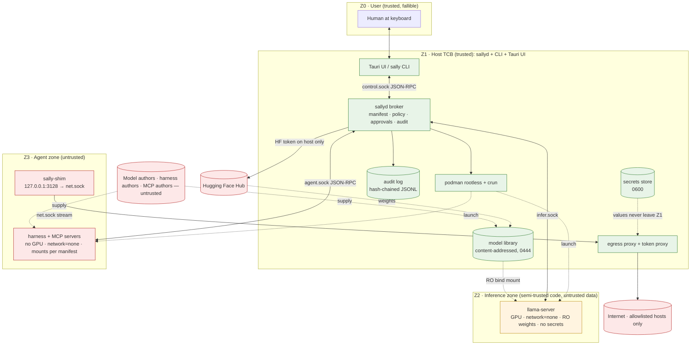

# Sallyport — Threat Model

**Status:** v1 baseline. Every mitigation below maps to a component and to a red-team test ID
(`tests/redteam/REDTEAM_SUITE.md`). A mitigation without a test is a claim, not a control.

## 0. One-paragraph summary

Sallyport runs untrusted model files and untrusted agent code on a trusted single-user machine.
We assume prompt injection **will** succeed and the model **will** eventually try to do the worst
thing it can. Security therefore comes from architecture: two isolated zones (inference, agent)
that have *nothing* except what the manifest grants, connected only through a trusted broker on
the host that enforces the manifest, injects credentials, proxies egress, gates destructive actions
behind human approval, and logs everything to a tamper-evident audit trail. Model behavior is
never a control.

## 1. Assets

| ID | Asset | Why it matters |
|---|---|---|
| A1 | Host filesystem outside granted mounts (code, documents, `~/.ssh`, browser profiles, `/mnt/c`) | Primary theft/destruction target |
| A2 | Credentials in the secrets store (HF token, GitHub token, API keys) | Theft → lateral movement, cost, impersonation |
| A3 | Granted workspace contents | The agent legitimately edits these; integrity matters (approvals) |
| A4 | Model library blobs | Integrity (tampered weights) and the fact that they are *inputs to a C++ parser* |
| A5 | Audit log | Forensics; without integrity the rest is unprovable |
| A6 | Approval decisions | The user must approve what they *think* they are approving |
| A7 | Host OS integrity / persistence | No code execution as the user outside a sandbox, no autostart, no implant |
| A8 | Network identity and bandwidth | No exfiltration, no pivot, no DDoS participation |
| A9 | GPU, CPU, RAM, disk availability | DoS resistance; a stuck 16 GB VRAM allocation is a usability failure |
| A10 | Conversation content | Local-only by default; nothing leaves unless a manifest allows a destination |

## 2. Trust zones and boundaries



### Boundary rules (the invariants)

| ID | Invariant | Enforced by |
|---|---|---|
| SI-1 | Every sandbox is launched with `--network=none`. There is no interface except loopback. The only path to any network is a Unix socket to `sallyd`. | sandbox driver (`sallyd::sandbox`) |
| SI-2 | Three roles that never share a filesystem, namespace or socket directory: inference (GPU, read-only weights, one socket), workspace (manifest mounts and the egress socket; no GPU, no model or tool socket), harness (model socket and tool socket only; no mounts, no egress, no GPU). | sandbox driver profiles |
| SI-3 | Secret *values* live only in `sallyd` memory and the 0600 store — never in env, files, argv, logs, or any socket a sandbox can read. The per-session interception CA key is a secret under this rule. Credentials are injected only inside TLS that the proxy terminates and re-originates to a verified upstream. | secrets module, token proxy, audit redaction |
| SI-4 | Every tool call, egress connection, approval, launch and model import produces an audit entry recording the decision before the action's effect is visible to the caller; `audit.level` controls detail, never coverage. Every command run and every file changed in a mount on the harness's behalf is such an entry. Sandboxes cannot reach the audit log. | broker request pipeline |
| SI-5 | Every action the manifest routes through the broker — `shell` in `approve` mode, destructive-tagged `shell` in `allow` mode, `brokered` writes and deletes matching their approve globs, `fetch` writes in `approve` mode, MCP tools with `approve: always` — executes only after a human approves the exact canonical request. Approval IDs are single-use; timeout = deny. A manifest widens the blast radius only through explicit settings that `summary()` names in plain words, never by omission. | approvals module |
| SI-6 | Model files reach an engine only after: extension allowlist → magic bytes → strict bounded header parse in Rust → SHA-256 recorded (and matched to publisher hash when available) → stored immutable. Pickle-family files are refused, never opened. | `sally-core::model` |
| SI-7 | Manifests are strict (`deny_unknown_fields`); the built-in mount denylist (`/`, `$HOME` root, `~/.ssh`, `~/.config/sallyport`, `~/.local/share/sallyport`, `/mnt/*`, `/etc`, `/proc`, `/sys`, `/dev`, `/run`, `/var/run`) cannot be overridden by any manifest. | manifest validator |
| SI-8 | Brokered file operations are confined by the kernel (`openat2` with `RESOLVE_BENEATH \| RESOLVE_NO_SYMLINKS \| RESOLVE_NO_MAGICLINKS` from a pinned directory fd), not by string comparison. | `sallyd::tools::fs` |
| SI-9 | The egress policy decides on the request authority, resolves on the host, filters loopback/private/link-local/host-own addresses, and connects to the pinned resolved IP. Hostnames only; IP literals denied. TLS is intercepted only for hosts with a secret grant; every other allowed host is spliced untouched. | egress proxy |
| SI-10 | The UI renders model output as sanitized Markdown only (no raw HTML), under a strict CSP, with no Tauri fs/shell capabilities exposed to the webview. | Tauri shell + React renderer |
| SI-11 | Images are referenced by digest in registry form only; transport prefixes (`dir:`, `oci:`, `docker-daemon:` and similar) are refused. Weights are mounted read-only. What a sandbox writes persists in exactly two places: granted `rw` mounts, and the session's staged upper directories inside Sallyport's own state directory. Staged data is inert: never executed, never mounted into another session, applied to the host only through the reviewed apply step, and deleted on discard or after apply. | sandbox driver, library |
| SI-12 | `sallyd` itself makes no outbound connections except Hugging Face downloads the user initiated and proxied sandbox egress. No telemetry. | code review + RT-NET-11 |

## 3. Attacker capabilities

| ID | Attacker | Controls | Does **not** control |
|---|---|---|---|
| AT1 | Malicious model author | Bytes of the model file (GGUF/safetensors/pickle); the model's weights, hence its outputs including tool calls ("sleeper agent") | Our parser, the sandbox config |
| AT2 | Prompt injector | Content the model reads: web pages, repo files, tool outputs, MCP results, filenames. **Assumed to succeed at steering the model.** | The broker, the manifest |
| AT3 | Malicious harness / MCP author | Arbitrary code execution inside Z3 at container start; everything Z3 can do | Anything outside Z3's mounts/sockets |
| AT4 | Network attacker | DNS answers, on-path for plaintext, compromised mirrors | TLS to Hugging Face (verified), publisher hashes |
| AT5 | Supply chain | A compromised crate/npm/pip dependency or base image | Pinned digests, lockfiles, `cargo-deny`, review |
| AT6 | The user, under approval fatigue | Clicks "approve" too fast | The canonical rendering, flood control |

**Out of scope (explicitly):** an attacker who already runs code as your user on the host;
malicious kernel/Podman/WSL/Hyper-V/NVIDIA driver; physical access; microarchitectural side
channels; GPU memory residue between processes; a user who approves a correctly-rendered
destructive action; denial of service against *you* by *you*.

## 4. Attack trees

Notation: goal → OR branches → (AND steps) · `[mitigation → test]`.

### G1. Exfiltrate a secret (A2)
```
G1 Obtain GITHUB_TOKEN value from inside Z3
├─ Read it from environment        [SI-3: never set → RT-SEC-01]
├─ Read it from a file/mount        [SI-3, SI-7: store path denylisted → RT-SEC-02, RT-MAN-02]
├─ Read sallyd memory               [separate host process; Z3 has no ptrace/proc of host → RT-FS-09]
├─ Make the proxy send it to me
│  ├─ Request to attacker.example with injection   [per-host injection map → RT-SEC-03]
│  ├─ Request to allowlisted-but-not-secret host    [no injection there → RT-SEC-03]
│  ├─ Trick Host header / absolute-URI mismatch    [authority from request-target only → RT-NET-05]
│  └─ Redirect from api.github.com to attacker     [proxy never follows redirects → RT-SEC-05]
├─ Get the upstream to echo it back
│  ├─ Plain response body                           [response redaction → RT-SEC-06]
│  ├─ Response header (or header name)              [header redaction; a name refused → RT-SEC-06]
│  ├─ Encoded echo (base64, percent-encoding)      [every documented form → RT-SEC-12 (9b)]
│  ├─ Fetch it in pieces with Range                 [Range and If-Range dropped (decision 4)]
│  └─ Compressed body hides it from the scanner    [Accept-Encoding stripped; any Content-Encoding refused → RT-SEC-06b]
├─ Read it from the audit log                       [values never logged; log unreachable → RT-SEC-07, RT-AUD-02]
└─ Define my own secret in the manifest             [manifests reference names only → RT-SEC-08]
```

### G2. Read or modify host files outside granted mounts (A1)
```
G2 Access ~/.ssh/id_ed25519 from Z3
├─ It's just there                                  [only manifest mounts exist → RT-FS-01]
├─ Mount it via manifest                            [denylist, no $HOME root, no /mnt → RT-MAN-02, RT-FS-05]
├─ Mount a path that is a symlink to it             [realpath before mount, refuse symlinked roots → RT-FS-06]
├─ Create a symlink inside the workspace → /etc/shadow
│                                                   [resolves inside container rootfs → RT-FS-03]
├─ Path traversal via brokered fs tool              [openat2 RESOLVE_BENEATH → RT-FS-04]
├─ Escape the container
│  ├─ Capabilities / setuid binary                  [cap-drop ALL, no-new-privileges, nosuid → RT-FS-08]
│  ├─ Device nodes                                  [nodev, no CAP_MKNOD → RT-FS-07]
│  ├─ /proc tricks (sysrq, kcore, /proc/1/root)     [masked paths, rootless → RT-FS-09]
│  ├─ Kernel exploit via syscall surface            [seccomp tightened; RESIDUAL → v2 gVisor]
│  └─ WSL interop: run cmd.exe / reach /mnt/c       [never mounted; interop socket absent → RT-FS-11]
└─ Write to a RO mount                              [EROFS → RT-FS-02]
```

### G3. Exfiltrate data (A1, A10, A8)
```
G3 Send /workspace/secret.txt to attacker
├─ Direct TCP/UDP                                   [no interfaces → RT-NET-01]
├─ DNS tunnelling                                   [no resolver, no interface; proxy resolves allowed names only → RT-NET-02]
│                                                   [RESIDUAL: labels under a wildcard rule reach that domain's DNS; §6]
├─ ICMP / raw sockets                               [no interface, no CAP_NET_RAW → RT-NET-08]
├─ Via proxy to attacker.example                    [allowlist → RT-NET-03]
├─ Via proxy to allowlisted host, other port        [port allowlist → RT-NET-04]
├─ Via proxy using IP literal / decimal / IPv6 form [IP literals denied → RT-NET-05]
├─ Wildcard confusion (*.github.com ⊃ github.com.evil.com)
│                                                   [suffix match on label boundary → RT-NET-06]
├─ SSRF to host services / 169.254.169.254 / DNS rebinding
│                                                   [IP filter after resolution, pinned connect → RT-NET-07]
├─ Replace or kill the shim                         [still only a Unix socket → RT-NET-10]
├─ Covert channel inside an allowlisted host (e.g. GitHub issue body)
│                                                   [RESIDUAL: logged with byte counts; v2 DLP]
└─ Side channels (timing, GPU)                      [out of scope]
```

### G4. Execute code on the host as the user (A7)
```
G4 Run attacker code outside any sandbox
├─ Pickle payload in model file                     [refused by extension+magic; never deserialized → RT-MDL-01, RT-MDL-02]
├─ GGUF parser exploit in llama.cpp                 [strict Rust pre-parse rejects malformed headers → RT-MDL-03;
│                                                    engine runs in Z2 anyway; RESIDUAL: 0-day + container escape]
├─ safetensors header bomb                          [bounded header, JSON limits → RT-MDL-08]
├─ Zip-slip in model import                         [reject ../, absolute, symlink/hardlink entries → RT-MDL-05]
├─ Convince user to approve `curl … | sh`           [canonical rendering + destructive tags; RESIDUAL: user judgment]
├─ Malicious harness image                          [digest pinned; user-chosen; still inside Z3 → RT-SUP-01]
├─ XSS in UI → Tauri IPC                            [sanitized Markdown, CSP, no fs/shell caps → RT-UI-01, RT-UI-02]
└─ Persistence via workspace (e.g. write .bashrc)   [home root never mountable → RT-MAN-02]
```

### G5. Bypass or spoof approval (A6)
```
G5 Get a denied action executed
├─ Flood 1000 requests hoping for a mis-click       [max pending, auto-deny + banner → RT-AG-03]
├─ Disguise the command (ANSI, bidi, newlines, long padding)
│                                                   [escaped rendering, explicit truncation → RT-AG-04]
├─ TOCTOU: change args after approval               [broker executes its own canonical copy → RT-AG-02]
├─ Replay an approval id                            [single-use → RT-AG-02]
├─ Let it time out                                  [default deny → RT-AG-02]
├─ Call a control-plane method from the session socket
│                                                   [separate sockets, separate method tables → RT-AG-06]
└─ Call a tool the manifest doesn't grant           [tool allowlist → RT-AG-01]
```

### G6. Tamper with evidence (A5)
```
G6 Hide what happened
├─ Edit/delete audit lines from Z3                  [log dir not mounted → RT-AUD-02]
├─ Edit as the user later                           [hash chain detects → RT-AUD-01; RESIDUAL: user can rewrite whole chain]
└─ Put secrets in the log to poison exports         [redaction → RT-SEC-07]
```

### G7. Deny service (A9)
```
G7 Make the machine unusable
├─ Fork bomb / memory bomb in Z3                    [pids-limit, memory limit → RT-AG-09]
├─ Huge model download fills disk                   [size check vs free space before pull → RT-MDL-09]
├─ GGUF with 2^40 tensors makes the parser spin     [bounded counts → RT-MDL-03]
├─ Giant proxy request                              [header/body limits → RT-NET-09]
└─ VRAM never released after crash                  [container exit → sallyd reaps; RESIDUAL: driver bugs]
```

## 5. Mitigation ↔ component ↔ test matrix

| Mitigation | Component | Tests |
|---|---|---|
| `--network=none`, `--no-hosts` on every container (no `--dns=none`: Podman 4.9 rejects it with `none`; `none` already yields no resolver) | `sallyd::sandbox::profile` | RT-NET-01, 02, 08 |
| Shim → Unix socket → policy proxy; CONNECT by hostname; port allowlist | `sally-shim`, `sallyd::egress` | RT-NET-03..07, 10 |
| Resolve-then-filter-then-pin connect; deny loopback/private/link-local/own | `sallyd::egress::policy` | RT-NET-07 |
| Label-boundary wildcard matching | `sallyd::egress::policy` | RT-NET-06 |
| Per-host header injection inside TLS the proxy terminates (grant hosts only; others spliced), set only after the request's audit entry; strip `Accept-Encoding`, `Range`, `If-Range`; refuse any `Content-Encoding`; redact every response header and body with every form of every session secret, at the same length; no redirects | `sallyd::egress::server::intercept`, `sallyd::egress::rewrite` (9a-2); `sallyd::egress::inject`, `sallyd::egress::redact` (9a-3, `{basic}` 9b) | RT-SEC-03..07, 09..13 |
| Secrets module: values never serialized; `Debug` redacted; zeroize | `sally-core::secrets`; values only in `sallyd` (`egress::inject`), the placeholder the only `--env` value | RT-SEC-01, 02, 07 |
| Manifest strict schema + denylist + realpath checks | `sally-core::manifest` | RT-MAN-01..03, RT-FS-05, 06 |
| `--cap-drop=ALL --security-opt=no-new-privileges --read-only --userns=keep-id`, `nosuid,nodev` mounts, custom seccomp | `sallyd::sandbox::profile` | RT-FS-07, 08, 09 |
| `openat2` confinement for brokered fs | `sallyd::tools::fs` | RT-FS-04 |
| Tool allowlist per manifest; shell modes; destructive tags | `sallyd::tools` | RT-AG-01, 02, 07 |
| Approval queue: canonical args, single-use, timeout-deny, flood control, escaped rendering | `sallyd::approvals` | RT-AG-02..05 |
| Separate control vs session sockets; method tables; peer-cred check | `sallyd::rpc` | RT-AG-06, 08 |
| Resource limits (`--pids-limit`, `--memory`, `--cpus`, timeout) | `sallyd::sandbox` | RT-AG-09 |
| Extension allowlist, magic bytes, strict GGUF/safetensors parsers, SHA-256, immutability | `sally-core::model` | RT-MDL-01..04, 06..08 |
| Zip import hardening | `sally-core::model::import` | RT-MDL-05 |
| Disk-space check before pull | `sally-core::hf` | RT-MDL-09 |
| Image digest pinning; refuse unpinned | `sallyd::sandbox::images` | RT-SUP-01 |
| Hash-chained audit, verify command, redaction | `sally-core::audit` | RT-AUD-01, 02, RT-SEC-07 |
| Sanitized Markdown, CSP, minimal Tauri capabilities, https-only opener with confirm | `app/` | RT-UI-01..03 |
| No telemetry; `sallyd` egress limited to HF + proxy | code review | RT-NET-11 |

## 6. Residual risks (accepted for v1, with the planned upgrade)

| Risk | Why accepted | Upgrade |
|---|---|---|
| Kernel exploit from Z2/Z3 escapes the container (WSL2 kernel 6.18; shared kernel) | No GPU-capable stronger isolation exists on WSL2 (`/dev/dxg` is unsupported by gVisor nvproxy; microVM GPU passthrough unavailable) | v2: gVisor for Z3 (systrap on WSL2, KVM on native Linux); native-Linux users get nvproxy for Z2 |
| OCI runtime (crun) breakout, e.g. the `/proc`-write class | The runtime is in the TCB; a breakout lands as the user's UID, which owns the secrets store. Rootless mode probably blunts the known `/proc`-write breakouts, **but that is not a control**. Mitigations: Sallyport never uses the distro `crun` (release build, never security-patched); it passes `--runtime` to a pinned upstream crun ≥ 1.25.1 (`/proc` hardening), checksum- and signature-verified at install, and doctor V14 warns otherwise (AMENDMENTS-02 B5) | gVisor for the workspace and harness roles (M6 spike) |
| Covert exfiltration through an allowlisted host | Any allowed destination can carry data | v2: egress DLP heuristics; per-session byte budgets (v1 logs counts) |
| DNS-lookup exfiltration through a wildcard rule: with `*.example.com` (or `*`) allowed, a sandbox can encode data in the labels of `CONNECT <data>.example.com:443`; the host resolves the name, so the data reaches that domain's nameservers even when the connect fails | A wildcard grants every name under it by design; the lookup happens only after the policy allowed the name, and every attempt is audited (`egress.allow`/`egress.deny` with the name) | Prefer exact hosts; v2 per-session lookup budgets and label-entropy heuristics |
| No LAN and no plain-HTTP access in v1: the address filter refuses every address that is not global unicast (IPv4 private, CGNAT, link-local, loopback, multicast, reserved; IPv6 outside `2000::/3`, and inside it `2001::/23` whole, `2001:db8::/32` and `3fff::/20`; mapped, NAT64 and 6to4 forms judged by their IPv4 address) and every address the host owns; the proxy accepts `CONNECT` only (anything else is 405) | A LAN service or a plain-HTTP mirror is the classic SSRF target; v1 gives up that use rather than carve exceptions. `2001::/23` holds both special-purpose and a few global blocks; it is denied whole on purpose | A per-manifest LAN allowance with its own acknowledgement (post-v1). Plain HTTP stays refused for every host, grant hosts included: interception (Task 9a) serves HTTP inside TLS only |
| **What response redaction protects against (Task 9a-3, maintainer decision 6).** Redaction protects against an *honest* upstream that echoes the credential back: an API that reflects request headers, an error page that quotes the `Authorization` it got, a debug endpoint. It does not protect against an upstream that colludes with the sandbox: that upstream already holds the token and can return it in any disguise (reversed, XORed, split over requests, encrypted) | The grant host is the party the credential was issued for; the sandbox can only talk to it because the manifest grants it | None in v1: choose grant hosts you trust with the credential |
| Encodings inside an unencoded body (Task 9a-2, architect Q30; Task 9a-3 refuses any `Content-Encoding` but exactly one `identity`: decision 1 as relaxed by R1, architect Q10). An upstream can still send compressed, base64 or otherwise transformed bytes as an unencoded body (a `.gz` download, a JSON field holding gzip) | Redaction matches the raw value and its documented forms only (raw, percent-encodings in both hex cases, JSON-escaped, trimmed base64 in both alphabets at all three alignments, each rendered header value, and a `{basic}` grant's blob padded and unpadded); anything the upstream encodes inside the body is not seen. The upstream is the grant host itself, which already holds the credential | Document per grant host; redaction of further forms if a host is found doing this |
| Gaps of the redaction forms (Task 9a-3, architect D3). Not covered: percent-encoding with mixed-case hex digits (`%2f%2F`), base64 forms shorter than 12 characters (a secret under ~9 bytes has none; the store warns under 16 bytes), any other encoding (hex, base32, UTF-16, HTML entities, line-wrapped base64). A `{basic}` blob re-encoded in the URL-safe alphabet is covered only through the secret's own trimmed base64 forms: its `basic_user` part and edge characters pass (architect ruling A1). The other way round, the blob forms skip the 12-character floor: a short value with a short user gives a short unpadded blob, which may redact unrelated body bytes (fails safe: more filler, never less) | Same as above: the colluding case is out of reach, and an honest echo uses the common forms | Add forms as hosts are found using them (Task 9b added the `{basic}` blob, padded and unpadded; the CLI's short-value warning is #98) |
| What the filler reveals (Task 9a-3, decision 2 as ruled R2, architect Q6 and Q9). The filler has the length of what it replaces, so the sandbox learns where an echo was and how long its form was. The filler is the first of `* # ~ ^ \| ! $ @` that no form of the session's secrets holds, so its identity says that every earlier candidate occurs in some form of some session secret and the chosen one in none: a property of all the session's secrets together, never of one. The response no longer names the secret: the name and the bytes go only to the `egress.response` audit entry, which no sandbox can reach (SI-4). A redaction, or a 502 `upstream-echoed-secret` for a form in a header name, also confirms a full-value guess the sandbox planted in a request the upstream echoes. Since no form holds the filler, filler beside the upstream's own bytes can never spell a form again | Lengths of tokens are public per token format; a guess must be the whole value of a store secret (≥ 16 bytes recommended) | None; the order is fixed on purpose: a per-session random order would reveal a different candidate each session, so over sessions all eight facts instead of one |
| Partial echoes (Task 9a-3, security review L3). Redaction matches whole forms: an upstream that echoes part of the credential (a truncated token in an error message), splits it across two header lines, or across two responses, sends the parts unredacted | The upstream is the grant host itself, which already holds the credential (decision 6); a part is not a credential the sandbox can use, and `Range`/`If-Range`/`Request-Range` are dropped so it cannot ask for one | Document per grant host |
| The `egress.response` entry follows the bytes it describes (Task 9a-3, architect Q13). It is appended before the body's end reaches the client, but redacted bytes streamed mid-body reach the client first (at least the last byte always waits for it). A body the client abandons gets its entry from a task, which may land after `egress.close` (#72) | The gated actions, the connection and the exchange, are audited before anything leaves (`egress.allow`, `egress.request`); this entry is a record of what the proxy removed. A failed append withholds the end and the tunnel ends `error`; an abandoned body is still recorded, so a client cannot suppress the entry by going away | TODO(#72) |
| Up to the longest form minus one byte of a streamed response is held back until more arrives or the response ends (Task 9a-3, decision 3, architect D2): a server-sent event stream lags by that much; a response cut by its cap or by the upstream loses the held bytes, which are wiped | Redaction across chunk boundaries needs the overlap | None |
| Secret copies outside `Secret` (Task 9a-3, architect D8). The rendered header value is kept as a `Secret` and wiped at session end, but each request builds a `HeaderValue`, and hyper's and rustls's write buffers hold the plaintext request; on the way back an echoed form sits in hyper's and rustls's read buffers, the upstream's parsed `HeaderMap` and each upstream body frame before redaction: those copies are freed, not wiped (as the leaf keys in Session CA limits (3)). The redaction's held-back bytes are wiped; its forms are built in buffers wiped as they drop and held once per session in `SessionForms`, wiped with its last holder | No safe-Rust way to wipe buffers inside hyper and rustls | TODO(#69) |
| Session CA limits (Task 9a-1). (1) Where one grant host lies beneath another (`api.github.com` beside `github.com`), the outer host's subdomains are not excluded, so the CA could vouch for other names under it. (2) rustls-webpki clients ignore a trust anchor's pathlen 0. (3) The CA key is wiped right after the leaves are minted, and the leaf keys when the session ends; `zeroize` covers Sallyport's copies and rcgen's serialized copy, but the PKCS#8 document ring returns during key generation and ring's (later rustls's) key objects are freed, not wiped. The proxy builds each leaf's signer from the leaf's key in place, so it keeps no plain copy of its own (9a-2 review R7; #69) | (1) and (2) matter only to someone holding the CA key, which never leaves `sallyd` memory and is dropped before the container starts. Name constraints still bind every client tested (OpenSSL, Python, rustls-webpki, GnuTLS, Go; RT-SEC-10), and pathlen 0 binds all but rustls-webpki. (3) A same-UID memory reader is out of scope. All three accepted by the maintainer (Task 9a-2), because the CA key does not outlive minting | (1) one CA per grant host if a client ever needs it; (3) revisit when ring exposes zeroizing keys |
| GPU driver attack surface exposed to a compromised `llama-server` via `/dev/dxg` | Inherent to GPU access | Native Linux + nvproxy; nothing on WSL2 |
| Destructive-pattern matching is bypassable | It is a UX aid; the mount set is the boundary | Documented; `approve` is the recommended mode |
| A process a `shell` call starts can outlive the call's time limit by calling `setsid` and reparenting to the container's init: the kill set is the call's process, its descendants and its session (Task 11, architect ruling Q32). Likewise a process whose main thread has exited while other threads run: `/proc/<pid>/stat` shows it as a zombie, so it is never found or killed by the call | The time limit is hygiene, not a boundary: such a process stays inside the session's sandbox and limits, and the session's teardown removes it | Per-call cgroups or pid namespaces (v2) |
| The file tools reach `rw` and `staged` mounts through `/proc/<init>/root` from the broker, not from a process inside the container: the write runs with `sallyd`'s identity (the same uid under `keep-id`) but without the sandbox's seccomp profile (Task 11, architect ruling Q29) | Only open, read, write, truncate, unlink and rmdir run there, through `openat2` with no symlinks from a root checked against the launch pin or the overlay; mount flags (read-only binds) still apply. The effect lands where the sandbox's own write would (location only). In every mode the broker first refuses what the sandbox's `uid:gid`, without supplementary groups, could not do by mode bits; an object carrying a POSIX ACL (or one whose ACL cannot be read) is owner-only (architect ruling Q39). Not emulated: permission models the mode bits do not show (NFSv4 or server-side ACLs, LSM labels); there the kernel's check with `sallyd`'s credentials is the only one | — |
| User approves a correctly rendered bad action | Human-in-the-loop is the design | Better risk tags, dry-run previews (v2) |
| Resource limits are **silently dropped** by Podman on cgroup v1 (WSL2 default) | Fixed on the dev machine with `cgroup_no_v1=all` in `.wslconfig`; other users may not have it | `sally doctor` fails (not warns) when `podman info` reports cgroups v1; `install.sh` prints the `.wslconfig` fix |
| Secrets plaintext at rest (0600) | Same-UID attacker is out of scope | v2 OS keychain |
| Whole audit chain can be rewritten by the user | Single-user machine | Paid tier: remote anchoring |
| Every argv passes `--security-opt label=disable`, so SELinux hosts lose label confinement | Rootless Podman on WSL2 has no SELinux; labels would block the shared socket and mount binds without relabeling host folders (`:z` rewrites user files) | Per-role SELinux policy on native Linux (v2) |
| Overlays (`staged` mounts, `.git` shields) are not `nosuid,nodev`: Podman 4.9.3 refuses other options next to `O` | `--cap-drop=ALL` and the user namespace make `mknod` fail (probed), and a set-id bit only ever names the user's own uid; kept `staged` upper directories sit under a 0700 session directory (Task 6b) | Revisit when Podman accepts options with `O` |
| Overlay lower layers (`staged` roots, `.git` directories) cannot be compared inside the container after `init`: an overlay reports its own device | Every pin is re-checked on the host without following symlinks just before `podman init`, and the overlap rule (AMENDMENTS-02 B4) keeps every other live sandbox from writing anywhere above, at or below the mount; host processes of the same user are trusted | TODO(#15): the OCI config verifier checks each overlay's `lowerdir` (Task 14) |
| Until Task 14 the launcher checks the argv, the configuration podman reads and the bind mounts, but not the OCI config podman generates | Hermetic podman leaves no input podman reads from outside Sallyport's state directory except root-owned system binaries; the container tests check capabilities, namespaces and mounts end to end | TODO(#15): verify the generated config before `start` (RT-SUP-04) |
| A Unix socket created in a mount after the launch scan (a host daemon starting later, git's fsmonitor socket) is reachable from the sandbox | The scan refuses sockets present at launch (RT-FS-13); a host program that creates a socket in a folder the user shared is the user's own configuration | Re-scan or watch mounts for new sockets (v1.1) |
| The launch scan needs `STATX_MNT_ID` (kernel ≥ 5.8) to stay out of nested mounts | It refuses to launch rather than walk blind on an older kernel | `sally doctor` reports the kernel (Task 12) |
| The overlap rule compares paths and identity chains walked with `..`, so a host bind of a *subdirectory* of a live session's mount (or a btrfs subvolume reached through its own mount) is not recognized as overlapping | Needs a bind mount made by root or the user; the sandboxes cannot create one | TODO(#17): compare `(st_dev, path inside the filesystem)` from mountinfo |
| `runtime.stage_size` (staged and `.git` overlay writes, #14) is a **soft** limit, with two gaps. First, it is triggered by the state filesystem's usage, so space freed elsewhere on that filesystem can let a staged directory grow past it before a walk runs. Second, the walk counts names, so a file kept open after unlinking it (or an `O_TMPFILE`) is not counted | The **free-space floor** is the guarantee. Every 250 ms it reads `fstatfs` of every filesystem a sandbox can write to, and kills the session below `max(4 GiB, 5 %)` free. It counts everything, races nothing, and also covers `rw` mounts, which had no limit before. The walk itself runs on a frozen container, so renames cannot hide data from it. Rootless Podman has no per-directory quota for overlay upper directories. The shell tool holds the exec gate only while an exec starts, so `stage_size` applies during a command too (#24, Task 11; RT-AG-09) | Filesystem project quotas, or a size-limited filesystem for `stage/` (v1.1) |
| The floor is a poll. A writer crosses it by what it writes in one 250 ms poll, plus the audit write, plus starting `podman kill`: at several GB/s, a large part of the 4 GiB minimum. On btrfs, `statfs` is approximate. Two availability effects: growth on the state filesystem from any source wakes every session's stage walk there, so another session (or the host) can cause brief freezes; and a container being torn down at `sallyd` shutdown can be left paused (#14, 6c-1 re-review L1–L3) | The floor's minimum leaves the overshoot room. Freezes are bounded: one walk at a time, at most 10 s each, at least 2 s apart per session. Nothing frozen can write. A session left paused at shutdown is removed by `remove_orphans` at the next start | Freeze before auditing a floor breach (`cgroup.freeze`); per-session growth pre-filter (v1.1) |
| An interpreter the host registers in `binfmt_misc` with the `F` (fix binary) flag runs inside sandboxes, with sandbox privileges, for any file matching its magic. binfmt_misc is not per-container, and `F` opens the interpreter at registration. On WSL, `WSLInterop` (`/init`, magic `MZ`) makes a Windows executable start the host's `/init` inside the container (found in Task 6c) | The interpreter runs with the sandbox's namespaces, seccomp profile and no capabilities. WSL interop cannot reach Windows from a sandbox: there is no interop socket and no `WSL_INTEROP`, and `AF_VSOCK` is refused (RT-NET-12, RT-FS-11) | #21 (M6): evaluate an empty per-user-namespace binfmt_misc instance (kernel ≥ 6.7) so such executables fail with `ENOEXEC` |
