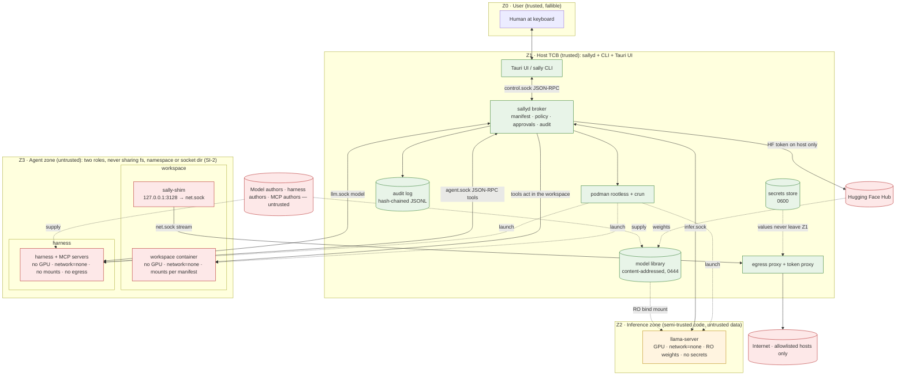

# Sallyport — Threat Model

**Status:** v1 baseline. Every mitigation below maps to a component and to a red-team test ID
(`tests/redteam/REDTEAM_SUITE.md`). A mitigation without a test is a claim, not a control.

## 0. One-paragraph summary

Sallyport runs untrusted model files and untrusted agent code on a trusted single-user machine.
We assume prompt injection **will** succeed and the model **will** eventually try to do the worst
thing it can. Security therefore comes from architecture: two isolated zones (inference, agent)
that have *nothing* except what the manifest grants, connected only through a trusted broker on
the host that enforces the manifest, injects credentials, proxies egress, gates destructive actions
behind human approval, and logs everything to a tamper-evident audit trail. Model behavior is
never a control.

## 1. Assets

| ID | Asset | Why it matters |
|---|---|---|
| A1 | Host filesystem outside granted mounts (code, documents, `~/.ssh`, browser profiles, Windows drives wherever they are mounted, `/mnt/c` among them) | Primary theft/destruction target |
| A2 | Credentials in the secrets store (HF token, GitHub token, API keys) | Theft → lateral movement, cost, impersonation |
| A3 | Granted workspace contents | The agent legitimately edits these; integrity matters (approvals) |
| A4 | Model library blobs | Integrity (tampered weights) and the fact that they are *inputs to a C++ parser* |
| A5 | Audit log | Forensics; without integrity the rest is unprovable |
| A6 | Approval decisions | The user must approve what they *think* they are approving |
| A7 | Host OS integrity / persistence | No code execution as the user outside a sandbox, no autostart, no implant |
| A8 | Network identity and bandwidth | No exfiltration, no pivot, no DDoS participation |
| A9 | GPU, CPU, RAM, disk availability | DoS resistance; a stuck 16 GB VRAM allocation is a usability failure |
| A10 | Conversation content | Local-only by default; nothing leaves unless a manifest allows a destination |

Beside A10, what a sandbox learns about the user and the host is carried out the same way: the
account entry Podman writes into the container's `/etc/passwd` under `keep-id`, and the host
paths of bind sources and overlay layers in the container's mount table (§6).

## 2. Trust zones and boundaries



### Boundary rules (the invariants)

| ID | Invariant | Enforced by |
|---|---|---|
| SI-1 | Every sandbox is launched with `--network=none`. There is no interface except loopback. The only path to any network is a Unix socket to `sallyd`. | sandbox driver (`sallyd::sandbox`) |
| SI-2 | Three roles that never share a filesystem, namespace or socket directory: inference (GPU, read-only weights, one socket), workspace (manifest mounts and the egress socket; no GPU, no model or tool socket), harness (model socket and tool socket only; no mounts, no egress, no GPU). | sandbox driver profiles |
| SI-3 | Secret *values* live only in `sallyd` memory and the 0600 store — never in env, files, argv, logs, or any socket a sandbox can read. The per-session interception CA key is a secret under this rule. Credentials are injected only inside TLS that the proxy terminates and re-originates to a verified upstream. | secrets module, token proxy, audit redaction |
| SI-4 | Every tool call, egress connection, approval, launch and model import produces an audit entry recording the decision before the action's effect is visible to the caller; `audit.level` controls detail, never coverage. Every command run and every file changed in a mount on the harness's behalf is such an entry. Sandboxes cannot reach the audit log. | the broker's request pipeline; model import is not wired yet (#209) |
| SI-5 | Every action the manifest routes through the broker — `shell` in `approve` mode, destructive-tagged `shell` in `allow` mode, `brokered` writes and deletes matching their approve globs, `fetch` writes in `approve` mode, MCP tools with `approve: always` — executes only after a human approves the exact canonical request. Approval IDs are single-use; timeout = deny. A manifest widens the blast radius only through explicit settings that `summary()` names in plain words, never by omission. Every manifest field is classified for the summary, and each classed as named when it differs from its default has a test that it is (RT-MAN-05); the classification is a hand-written table in that test, and the test is a tripwire on the schema and that table, not on summary code; the summary does not show an MCP server's `env` values (its keys are shown) or the `description` (MANIFEST_SPEC §1, the summary paragraphs). | approvals module |
| SI-6 | Model files reach an engine only after: extension allowlist → magic bytes → strict bounded header parse in Rust → SHA-256 recorded (and matched to publisher hash when available) → stored immutable. Pickle-family files are refused, never opened. | the model and library modules at import (`sally-core::model`, `sally-core::library`); the launch-side check is not built (#210) |
| SI-7 | Manifests are strict (`deny_unknown_fields`); the built-in mount denylist (`/`, `$HOME` root, `~/.ssh`, `~/.config/sallyport`, `~/.local/share/sallyport`, the default data and state homes `~/.local/share` and `~/.local/state`, the folder of each binary `config.toml` names, `/mnt/*`, on WSL every root of type `9p` or `virtiofs`, `/etc`, `/proc`, `/sys`, `/dev`, `/run`, `/var/run`; the full list is MANIFEST_SPEC §2) cannot be overridden by any manifest. The denylist is enforced at validation; at launch the launcher compares each root's identity, not the denylist (#231). Not yet true for: Windows drives on a WSL the checks do not detect or over a type not listed (#281); the middle links of a configured binary's link chain (#280); links in more depth-3 folders the host loads from (#283). | manifest validator |
| SI-8 | Brokered file operations are confined by the kernel, not by string comparison: `openat2` with `RESOLVE_BENEATH \| RESOLVE_NO_SYMLINKS \| RESOLVE_NO_MAGICLINKS` from the mount root's directory handle. The broker opens that handle again on every call and checks it before use. For `ro` and `brokered` mounts it opens the host path without following links and compares the device and inode pinned at launch. For `rw` and `staged` mounts the root is a guest path: the broker enters the container's root through `/proc/<init>/root`, a magic link it follows on purpose (section 6), and opens the guest path beneath it with `RESOLVE_IN_ROOT`, no symlinks and no magic links. An `rw` root is then compared with the device and inode pinned at launch. A `staged` root has no pinned identity (an overlay reports its own device, section 6): it must be an overlay mount root in the workspace's own view. | `sallyd::tools::fs` |
| SI-9 | The egress policy decides on the request authority, resolves on the host, filters loopback/private/link-local/host-own addresses and addresses inside a connected network (section 6; the classes in full: ARCHITECTURE §7, address filter classes), and connects to the pinned resolved IP. Hostnames only; IP literals denied. TLS is intercepted only for hosts with a secret grant; every other allowed host is spliced untouched. | egress proxy |
| SI-10 | The UI renders model output as sanitized Markdown only (no raw HTML), under a strict CSP, with no Tauri fs/shell capabilities exposed to the webview. | Tauri shell + React renderer |
| SI-11 | Images are referenced by digest in registry form only; transport prefixes (`dir:`, `oci:`, `docker-daemon:` and similar) are refused. Weights are mounted read-only. What a sandbox writes persists in three places today: granted `rw` mounts, the session's staged upper directories inside Sallyport's own state directory, and the host folder of a `brokered` mount, written by the broker (G4's brokered-write leaf; §6, files a host tool will execute). The inference stage's socket directory is a fourth to come unless that design moves it (§6). Staged data is inert: never executed, never mounted into another session, applied to the host only through the reviewed apply step, and deleted on discard or after apply. M1 has neither step: a stopped session's staged data is kept, and stays until a later milestone adds discard (M4.5, AMENDMENTS-02 B2(b)); §6. | sandbox driver, library |
| SI-12 | `sallyd` itself makes no outbound connections except Hugging Face downloads the user initiated and proxied sandbox egress. No telemetry. | code review + RT-NET-11 |

The peer-UID check `control.sock`, `agent.sock` and `llm.sock` make at accept (`SO_PEERCRED`)
refuses a peer of another UID, but it
does not tell a sandbox from the user: sandboxes run with the user's own UID (`keep-id`). What
keeps Z3 off `control.sock` is that SI-2 never mounts that socket's directory into a sandbox
(RT-FS-10), not the check (§5).

## 3. Attacker capabilities

| ID | Attacker | Controls | Does **not** control |
|---|---|---|---|
| AT1 | Malicious model author | Bytes of the model file (GGUF/safetensors/pickle); the model's weights, hence its outputs including tool calls ("sleeper agent") | Our parser, the sandbox config |
| AT2 | Prompt injector | Content the model reads: web pages, repo files, tool outputs, MCP results, filenames. **Assumed to succeed at steering the model.** | The broker, the manifest (unless its file lies where a session can write: §6) |
| AT3 | Malicious harness / MCP author | Arbitrary code execution inside Z3 at container start; everything Z3 can do | Anything outside Z3's mounts/sockets; the manifest (unless its file lies where a session can write: §6) |
| AT4 | Network attacker | DNS answers, on-path for plaintext (including plaintext a sandbox sends through a spliced tunnel today: §6), compromised mirrors | TLS to Hugging Face (verified), TLS the proxy re-originates to a grant host (verified against the system CA bundle, any anchor in it: §6), publisher hashes |
| AT5 | Supply chain | A compromised crate/npm/pip dependency or base image | Pinned digests, lockfiles, `cargo-deny`, review |
| AT6 | The user, under approval fatigue | Clicks "approve" too fast | The canonical rendering, flood control |
| AT7 | Manifest author (a manifest shipped with a harness, an MCP server or a repository) | The manifest's text, hence what a launch asks for and how its summary reads; the launch summary is the consent surface | The validator, the denylist's rules (what they do not reach is in §6: Windows drives on a WSL the checks do not detect or over a type not listed (#281), the middle links of a configured binary's link chain (#280), more depth-3 folders the host loads from (#283), another spelling of a protected folder), the launch gate's clean-check (G5), the summary's escaping, quoting and naming rules: manifest text escaped, globs, MCP arguments and the injection header and format quoted, settings classed as able to widen the session named when they differ from their defaults (G5, RT-MAN-05) |

**Out of scope (explicitly):** an attacker who already runs code as your user on the host;
malicious kernel/Podman/WSL/Hyper-V/NVIDIA driver; physical access; microarchitectural side
channels; GPU memory residue between processes; a user who approves a correctly-rendered
destructive action; denial of service against *you* by *you*.

## 4. Attack trees

Notation: goal → OR branches → (AND steps) · `[mitigation → test]`.

### G1. Exfiltrate a secret (A2)
```
G1 Obtain GITHUB_TOKEN value from inside Z3
├─ Read it from environment        [SI-3: never set → RT-SEC-01]
├─ Read it from a file/mount        [SI-3, SI-7: store path denylisted → RT-SEC-02, RT-MAN-02]
├─ Read sallyd memory               [separate host process; Z3 has no ptrace/proc of host → RT-FS-09]
├─ Make the proxy send it to me
│  ├─ Request to attacker.example with injection   [per-host injection map → RT-SEC-03]
│  ├─ Request to allowlisted-but-not-secret host    [no injection there → RT-SEC-03]
│  ├─ Request to the grant host on another allowed port
│  │                                                [OPEN, fix planned: a port list per grant, #246; §6]
│  ├─ Trick Host header / absolute-URI mismatch
│  │  ├─ On CONNECT                                 [authority from request-target only → RT-NET-05]
│  │  └─ Inside an intercepted tunnel               [other Host 421 `host-mismatch`, unforwardable target 400 →
│  │                                                 unit tests only: sallyd intercept_tests `a_host_header_naming_another_authority_is_421`,
│  │                                                 `heads_the_proxy_cannot_forward_as_they_are_are_400`, rewrite_tests;
│  │                                                 red-team leg planned (#218)]
│  └─ Redirect from api.github.com to attacker     [proxy never follows redirects → RT-SEC-05]
├─ Get the upstream to echo it back
│  ├─ Plain response body                           [response redaction → RT-SEC-06]
│  ├─ Response header (or header name)              [header redaction; a name refused → RT-SEC-06]
│  ├─ Encoded echo (base64, percent-encoding)      [the forms §6 lists → RT-SEC-12; other JSON and percent
│  │                                                 spellings OPEN, fix planned, #249; §6]
│  ├─ Time the redaction scan                       [RESIDUAL: not constant-time, not measured; §6]
│  ├─ Fetch it in pieces with Range                 [Range and If-Range dropped (decision 4)]
│  ├─ Ask for a delta-encoded reply (`A-IM`)        [OPEN, fix planned, #294: `A-IM` is forwarded and a
│  │                                                 `226 IM Used` reply is not refused; §6]
│  └─ Compressed body hides it from the scanner    [Accept-Encoding stripped; a Content-Encoding other than one `identity` refused → RT-SEC-06b]
├─ Read it from the audit log                       [values never logged; log unreachable → RT-SEC-07, RT-AUD-02]
│                                                   [OPEN, fix planned, #268 (digest part): an approval entry's action
│                                                    digest is taken over the text before masking,
│                                                    for a reader of the log or an export, not Z3; §6]
└─ Define my own secret in the manifest             [manifests reference names only → RT-SEC-08]
```

The Hub token (A2) travels on a connection `sallyd` opens itself. The pull has no production
caller yet (#209), so nothing sends it today.

```
G1 Misuse the Hub token on sallyd's own connection (AT4)
├─ Redirect a request to another host               [redirects only https, port 443, no userinfo, to Hub
│                                                    hosts on a label boundary; the token only on a hop to
│                                                    `huggingface.co` → unit tests only: sally-core hf::plan
│                                                    `redirect_hosts_are_hub_domains_on_a_label_boundary`,
│                                                    `other_redirects_are_refused`; sallyd hf
│                                                    `a_redirect_off_the_hub_is_not_followed`,
│                                                    `a_pull_follows_the_cdn_redirect_without_the_token`;
│                                                    red-team leg planned (#285)]
├─ Redirect a chain back to the API host after it left it
│                                                   [OPEN, fix planned, #266: that hop carries the token; §6]
├─ Serve the file list from a host a redirect named [OPEN, fix planned, #266: the list is read there; §6]
├─ Answer the lookup with an address of the user's network
│                                                   [the egress proxy's address filter, a pinned address
│                                                    dialled → unit tests only: sallyd hf
│                                                    `denied_addresses_are_never_dialled`; red-team leg
│                                                    planned (#285)]
└─ Choose the trust anchors through the environment [roots only from a checked bundle, never chosen by
                                                     the environment → unit tests only: sallyd hf
                                                     `the_client_takes_its_roots_only_from_a_checked_bundle`,
                                                     `the_client_trusts_no_anchor_but_its_bundle`;
                                                     red-team leg planned (#285); the bundle's file
                                                     checks: no test named yet (#286)]
```

### G2. Read or modify host files outside granted mounts (A1)
```
G2 Access ~/.ssh/id_ed25519 from Z3
├─ It's just there                                  [only manifest mounts exist → RT-FS-01]
├─ Mount it via manifest                            [denylist, no $HOME root, no /mnt → RT-MAN-02, RT-FS-05;
│                                                    the default data and state homes, exported or
│                                                    not → RT-FS-05; on WSL a root of type `9p` or
│                                                    `virtiofs`, from the mount table entry for the
│                                                    root's mount id, wherever it is mounted → RT-FS-11]
│                                                   [OPEN (#281): not probed on a virtiofs-serving WSL
│                                                    nor on WSL1 (drives of type `drvfs`, not listed);
│                                                    a WSL neither signal detects keeps only the `/mnt`
│                                                    rule, and a FUSE re-export of a drive is accepted;
│                                                    OPEN (#283): more depth-3 folders the host loads
│                                                    from; §6]
├─ Mount a path that is a symlink to it             [realpath before mount, refuse symlinked roots, also
│                                                    written `x/`, `x/.`, `x//`, `x/./` → RT-FS-06]
├─ Create a symlink inside the workspace → /etc/shadow
│                                                   [resolves inside container rootfs → RT-FS-03]
├─ Path traversal via brokered fs tool              [openat2 RESOLVE_BENEATH → RT-FS-04]
├─ Write through a hard link in a `brokered` mount to a file outside it
│                                                   [refused `hard-link` → unit tests only: sallyd tools::fs::tests
│                                                    `a_brokered_write_refuses_a_hard_link_and_leaves_its_other_name_untouched`,
│                                                    tools::tests `only_a_brokered_write_refuses_a_hard_link`;
│                                                    red-team leg planned (#285)]
├─ Have the broker open a non-regular object (device, FIFO) with host privileges
│                                                   [regular files and empty directories only: a read or
│                                                    write types its target on an `O_PATH` fd before
│                                                    anything is opened; a delete types its target by
│                                                    name and removes it by name (§6, the file tools'
│                                                    row) → unit tests only: sallyd
│                                                    tools::fs::tests `only_regular_files_are_read`,
│                                                    `a_write_creates_or_replaces_a_regular_file_only`,
│                                                    `a_delete_takes_a_file_or_an_empty_directory_only`
│                                                    (tested with a FIFO and a directory); red-team leg
│                                                    planned (#285); that a refused object is never
│                                                    opened is tested for a permission refusal only →
│                                                    RT-FS-18]
├─ Reach a host process through an object in a mount
│  ├─ A Unix socket                                 [launch refused `socket-in-mount` → RT-FS-13;
│  │                                                 one created after the scan: RESIDUAL; §6]
│  └─ A FIFO a host process reads                   [OPEN, fix planned, #253: the scan treats a FIFO like a socket; §6]
├─ Have the broker connect to what the inference role put at `infer.sock` in its own socket
│  directory (Z2 controls that folder; it is not a mount)
│                                                   [RULE for the inference stage (M3), not built: the
│                                                    broker opens `infer.sock` without following links
│                                                    and checks that it is a socket owned by the
│                                                    expected id before it connects, and it connects
│                                                    to the object it checked: the name `infer.sock`
│                                                    is not resolved a second time; §6 (Z2's socket
│                                                    directory) → RT-INF-06 when it lands]
├─ Escape the container
│  ├─ Capabilities / setuid binary                  [cap-drop ALL, no-new-privileges, nosuid → RT-FS-08]
│  ├─ Device nodes                                  [nodev, no CAP_MKNOD → RT-FS-07]
│  ├─ /proc tricks (sysrq, kcore, /proc/1/root)     [masked paths, rootless → RT-FS-09]
│  ├─ Kernel exploit via syscall surface            [seccomp tightened; RESIDUAL → v2 gVisor]
│  └─ WSL interop: run cmd.exe / reach /mnt/c       [never mounted; interop socket absent → RT-FS-11
│                                                    (its Windows-executable leg runs on WSL only)]
├─ Write to a RO mount                              [EROFS → RT-FS-02]
└─ Have the runtime create a directory in a host folder at `init`, on the image's say: an image
   working directory or volume below a mount's guest path, or an image link at or above a mount
   destination
                                                    [working directory fixed at `/` (`--workdir`, the
                                                     verifier requires it), image volumes ignored
                                                     (`--image-volume=ignore`), and the mount-link
                                                     probe refuses a link before the real create →
                                                     RT-FS-02; RESIDUAL: the probe walks only the
                                                     image's tree (a destination nested in a host
                                                     folder resolves there; the launch scan and the
                                                     pin checks hold it) and Sallyport's own
                                                     destinations (OPEN,
                                                     fix planned, #273 (probe-mounts part): a mount podman adds of its
                                                     own), and inference probes are not swept
                                                     (#134); §6]
```

### G3. Exfiltrate data (A1, A10, A8)
```
G3 Send /workspace/secret.txt to attacker
├─ Direct TCP/UDP                                   [no interfaces → RT-NET-01]
├─ DNS tunnelling                                   [no resolver, no interface; proxy resolves allowed names only → RT-NET-02]
│                                                   [RESIDUAL: labels under a wildcard rule reach that domain's DNS; §6]
│                                                   [OPEN, fix planned, #291: the name is looked up before
│                                                    any audit entry, and lookups go on after an append
│                                                    fails; §6]
├─ ICMP / raw sockets                               [no interface, no CAP_NET_RAW → RT-NET-08]
├─ Via proxy to attacker.example                    [allowlist → RT-NET-03]
├─ Via proxy to allowlisted host, other port        [port allowlist → RT-NET-04]
├─ Via proxy using IP literal / decimal / IPv6 form [IP literals denied → RT-NET-05]
├─ Wildcard confusion (*.github.com ⊃ github.com.evil.com)
│                                                   [suffix match on label boundary → RT-NET-06]
├─ SSRF to host services / 169.254.169.254 / DNS rebinding
│                                                   [IP filter after resolution, pinned connect → RT-NET-07;
│                                                    RESIDUAL: what the "No LAN" row lists as not
│                                                    covered; §6]
├─ Replace or kill the shim                         [still only a Unix socket → RT-NET-10]
│  └─ Open `net.sock` itself, past the shim listener's own limits (32 connections by default,
│     a plain byte stream; `--stdio` has no cap)
│                                                   [the proxy's own bounds hold without the shim:
│                                                    its connection cap and admission rate, met
│                                                    host-side straight on `net.sock` → RT-NET-09,
│                                                    RT-AUD-02; not tested: what `net.sock`,
│                                                    `agent.sock` and `llm.sock` do with ancillary
│                                                    descriptors and out-of-band bytes (#270)]
├─ Via a spliced tunnel to an allowed host: any protocol (plain HTTP included), another tenant
│  of a shared edge (HTTP Host inside TLS), or an encrypted client hello
│                                                   [OPEN, fix planned, #247: the proxy does not look at a spliced
│                                                    tunnel's bytes today; planned, the first bytes must be a
│                                                    TLS client hello naming the CONNECT host, so other
│                                                    protocols and an encrypted client hello are refused; §6.
│                                                    RESIDUAL after it: the Host header inside TLS; §6]
├─ Covert channel inside an allowlisted host (e.g. GitHub issue body)
│                                                   [RESIDUAL: logged with byte counts; v2 DLP]
├─ Data in the URL or headers of a fetch the approval policy counts as a read
│                                                   [RESIDUAL: a GET or HEAD with no body runs without a
│                                                    prompt under `fetch_writes: approve`; §6]
├─ Send the conversation (A10) to an allowed host under a manifest with no mount and no secret
│                                                   [RESIDUAL: the `[data-can-leave]` finding and the
│                                                    acknowledgements count mounts and secrets only,
│                                                    and a fetch GET never prompts; the summary's
│                                                    network and fetch lines name the channel; §6]
└─ Side channels (timing, GPU)                      [out of scope]
```

### G4. Execute code on the host as the user (A7)
```
G4 Run attacker code outside any sandbox
├─ Pickle payload in model file                     [refused by extension+magic; never deserialized → RT-MDL-01,
│                                                    RT-MDL-02 when they land]
├─ GGUF parser exploit in llama.cpp                 [strict Rust pre-parse rejects malformed headers → RT-MDL-03
│                                                    when it lands;
│                                                    engine runs in Z2 anyway; RESIDUAL: 0-day + container escape]
├─ A well-formed header the engine reads differently from the pre-parse
│                                                   [known cases refused with tests → sally-core
│                                                    model::gguf `a_nul_suffixed_alignment_key_is_refused_not_applied`,
│                                                    `a_chat_template_holding_a_nul_is_refused`,
│                                                    `split_count_may_only_say_one_file`; OPEN (#182):
│                                                    the type table against the pinned engine;
│                                                    RESIDUAL: no general rule; §6]
├─ Hide bytes where no check reads: after the last tensor, in the padding before and between
│  tensors                                          [hashed and stored, never parsed; OPEN (#183) for
│                                                    bytes after the last tensor; padding: RESIDUAL;
│                                                    §6]
├─ Launch a blob changed after its import, or one stored under looser rules
│                                                   [blobs stored 0444 in Sallyport's state directory;
│                                                    OPEN (#210): a stored blob is never hashed again,
│                                                    and the launch side checks its path, owner and
│                                                    mode only; §6]
├─ safetensors header bomb                          [`.safetensors` refused by name, `format_not_allowed`, before any
│                                                    byte is read (`sally-core::model::detect`); the bounded header
│                                                    check is M2 Task 2, not built → RT-MDL-08 when it lands]
├─ Zip-slip in model import                         [archives refused by name, `format_not_allowed`, before any byte
│                                                    is read; zip import (reject ../, absolute, symlink/hardlink
│                                                    entries) is M2 Task 3, not built → RT-MDL-05 when it lands]
├─ Convince user to approve `curl … | sh`           [canonical rendering + destructive tags; RESIDUAL: user judgment]
├─ Malicious harness image                          [digest pinned; user-chosen; still inside Z3 → RT-SUP-01]
├─ Metadata of any sandbox image (harness, `runtime.image`, inference) that Podman acts on
│  outside the container (a health check, declared volumes)
│                                                   [health check disabled by the argv, required by the check,
│                                                    a recorded one refused by the verifier; image volumes
│                                                    ignored, containers removed with their anonymous volumes
│                                                    → RT-SUP-05. Labels are bounded in the orphan listing;
│                                                    other fields reach `config.json`, where the verifier
│                                                    refuses extra mounts and unknown keys]
├─ XSS in UI → Tauri IPC                            [sanitized Markdown, CSP, no fs/shell caps → RT-UI-01, RT-UI-02]
├─ Persistence via workspace (e.g. write .bashrc)   [home root never mountable → RT-MAN-02]
├─ Persistence via a linked target (~/.local/bin/t -> ~/tools/t/bin/t; ~/.bashrc -> ~/dotfiles/bashrc)
│                                                   [link targets in protected folders (depth 2) and
│                                                    home dotfiles become denylist rules → RT-FS-19;
│                                                    OPEN (#283): more depth-3 folders the host loads
│                                                    from; RESIDUAL for the rest; §6]
├─ Replace a binary `sallyd` runs: mount the folder of the runtime or podman `config.toml` names
│                                                   [that folder, as written and as resolved, is a
│                                                    denylist rule naming the setting → unit tests
│                                                    only: sally-core paths
│                                                    `the_folder_of_a_configured_binary_is_a_rule`
│                                                    (the resolved folder), sallyd sandbox::binaries_tests
│                                                    `the_folder_of_a_configured_binary_is_not_mountable`,
│                                                    sally-cli consent
│                                                    `the_cli_refuses_the_folder_of_a_binary_its_config_names`;
│                                                    red-team leg planned (#285);
│                                                    OPEN, fix planned, #280: the folders of the links
│                                                    in the middle of a chain of two or more are not
│                                                    rules; OPEN (#325): the check before a run reads
│                                                    the type, owner and mode of a user-owned binary
│                                                    (a configured one or the installed default
│                                                    runtime) and its folders, neither its link count
│                                                    nor its content, so a second name of the file in
│                                                    an `rw` mount lets a session rewrite what `sallyd`
│                                                    runs (a `brokered` write through a hard link is
│                                                    refused, G2); root-owned binaries are not
│                                                    affected; §6]
└─ Plant files a host tool will execute, in a granted mount
   ├─ `.git` hooks, config, `commondir`             [shielded; brokered writes `protected-path` → RT-FS-12]
   ├─ Other files in an `rw` mount: working-tree hooks, editor and build files, a `.git` made
   │  after the launch scan, a git directory under another name, a `.git` symlink
   │                                                [RESIDUAL: `[direct-write]`, use `staged`; §6]
   └─ A `brokered` write outside narrowed approve globs (a working-tree hook file)
                                                    [RESIDUAL: runs unasked; the default `["**"]` asks; §6]
```

### G5. Bypass or spoof approval (A6)
```
G5 Get a denied action executed
├─ Flood 1000 requests hoping for a mis-click       [max pending, auto-deny + banner → RT-AG-03]
│  └─ Tell whether an approver is attached, and how fast it answers
│                                                   [RESIDUAL, low alone: the reply says `denied:
│                                                    no-approver`, at once; with an approver the call
│                                                    waits for the human's answer. This
│                                                    lets a session time a flood or the approver drop
│                                                    (G7); §6]
├─ Disguise the command (ANSI, bidi, newlines, long padding)
│                                                   [escaped rendering, explicit truncation → RT-AG-04;
│                                                    OPEN, fix planned, #290: a long run of one
│                                                    character is shown whole, so the command can sit
│                                                    off the last screen before the question; §6]
├─ Disguise the launch summary (AT7): a manifest whose shown lines read narrower than it grants
│                                                   [`summary()` escapes every manifest and host string
│                                                    to printable ASCII, quotes globs, MCP arguments
│                                                    (a backtick as `\x60`) and the injection header
│                                                    and format, marks a cut after the closing
│                                                    backtick with where it fell, and names approvals,
│                                                    runtime sizes and proxy limits that differ from
│                                                    their defaults → RT-MAN-05 (sally-core
│                                                    `rt_manifest.rs`, four `rt_man_05_` tests);
│                                                    the launch gate refuses a shown line that is not
│                                                    printable ASCII (control characters, bidi
│                                                    overrides, any other non-ASCII), summary lines
│                                                    included (`consent.rs` `block`) → unit tests only:
│                                                    sally-cli `consent_tests.rs`
│                                                    `a_line_that_cannot_be_shown_withholds_the_block_and_is_named`
│                                                    (a warning line); red-team leg planned (#285).
│                                                    Summary lines are escaped at their source, so for
│                                                    them the gate's check is a second layer;
│                                                    OPEN (#322): mount realpaths are escaped but not
│                                                    quoted, so a folder name holding ` and ` or
│                                                    ` (at ` can read as two folders or as a guest
│                                                    path;
│                                                    OPEN (#323), latent: the validator refuses a
│                                                    mount whose realpath is not UTF-8 (`path-chars`,
│                                                    `paths.rs` `check_mount_host`; no test, #323), so
│                                                    no summary holds such a byte; were that check
│                                                    removed, the `[data-can-leave]` line would show
│                                                    it as `\u{fffd}` and the gate would not reliably
│                                                    catch it (warnings are cut at 300 characters and
│                                                    token-masked); §6]
├─ Get bytes approved that the human cannot read: a brokered write's content, a fetch body
│                                                   [the prompt shows their size and SHA-256 only; the
│                                                    digest binds the bytes that run → RT-AG-02,
│                                                    sallyd approvals::action::tests
│                                                    `a_write_binds_its_content_and_paths`,
│                                                    `fetch_binds_method_url_header_values_and_body`;
│                                                    RESIDUAL; §6]
├─ Change state at a grant host with a GET, which the approval policy counts as a read
│                                                   [RESIDUAL: it runs without a prompt under
│                                                    `fetch_writes: approve`, with the injected
│                                                    credential; §6]
├─ Crowd other sessions' prompts out of the approval listings with large prompts of one session
│                                                   [fails closed: the hidden prompts deny at their
│                                                    timeout; OPEN (#107); §6]
├─ TOCTOU: change args after approval               [broker executes its own canonical copy → RT-AG-02]
├─ TOCTOU: change what an approved path names before it runs
│                                                   [re-resolved from the mount root, opened and checked
│                                                    again (SI-8), escapes refused →
│                                                    unit tests only: sallyd tools::fs::tests
│                                                    `a_directory_swapped_for_a_symlink_after_prepare_is_refused_at_run`,
│                                                    `a_symlink_target_escapes_and_a_lost_create_race_is_refused`;
│                                                    red-team leg planned (#285); RESIDUAL: whether a write creates or replaces is decided
│                                                    at run]
├─ Stop or cancel a call while its approval is being recorded
│                                                   [OPEN, fix planned, #297: the withdraw cannot reach that
│                                                    prompt, the ticket is issued and no withdraw is
│                                                    recorded; for a cancel or a closed connection the
│                                                    approved call runs, and for a stop only the
│                                                    executor's own stop check stands before it; §6]
├─ Replay an approval id                            [single-use → RT-AG-02]
├─ Let it time out                                  [default deny → RT-AG-02]
├─ Call a control-plane method from the session socket
│                                                   [separate sockets, separate method tables → RT-AG-06]
├─ Run a command in the workspace with no approval (`sessions.attach`)
│                                                   [control socket only, the user's own uid; no attach
│                                                    method on the session socket → RT-AG-06; audited
│                                                    `sandbox.exec` first; RESIDUAL: §6]
├─ Drive the user's terminal with the output of an attached command (`session.output`, line
│  mode): CSI, OSC 52 clipboard, OSC 8 links, C1 controls, bidi overrides, `\r`
│                                                   [`sallyd` escapes each stream to printable ASCII
│                                                    and `\n` before it leaves → RT-CLI-01;
│                                                    `sally sandbox run` checks again: a chunk with
│                                                    anything else is shown wholly escaped, said so
│                                                    on stderr, exit 1 → sally-cli `run_tests.rs`;
│                                                    RESIDUAL: `\n` is kept, so the command can print
│                                                    lines that look like `sally`'s own or a prompt;
│                                                    no decision is asked in that terminal (`sally
│                                                    approve` runs apart). `--tty` (#138) would be
│                                                    raw by design; §6]
├─ Widen the next session by editing its manifest file (AT2, AT3: a manifest kept where a
│  session can write)
│  ├─ Rewrite a manifest kept in a folder the same manifest mounts `rw` or `brokered`
│  │                                                [the CLI refuses the launch: place check on the
│  │                                                 folder of the name as given and of the file it
│  │                                                 resolves to → RT-MAN-03; OPEN (#254): a link hop
│  │                                                 through a writable folder, a hard link, a bind of
│  │                                                 a subdirectory. The check sees only the text
│  │                                                 being launched, so a rewrite that drops the
│  │                                                 writable mount passes it; there the defence is
│  │                                                 that every launch needs consent (below); §6]
│  ├─ Rewrite a manifest kept in a folder another manifest mounts `rw` or `brokered`
│  │                                                [only the manifest's own mounts are read; the
│  │                                                 rewritten text launches only with consent given
│  │                                                 for that text (below) → RT-MAN-03; RESIDUAL: the
│  │                                                 consent is the only defence, so a `yes` given
│  │                                                 without re-reading the summary launches the
│  │                                                 rewrite (#322 for what the summary can still
│  │                                                 show ambiguously); §6]
│  ├─ Change what is launched from what the user reviewed
│  │                                                [every launch shows the summary, warnings and
│  │                                                 acknowledged risks and needs consent for the
│  │                                                 exact text read: a typed `yes` on a terminal, or
│  │                                                 its SHA-256 (`--accept-manifest`, on a terminal
│  │                                                 too); a wrong hash refuses → RT-MAN-03;
│  │                                                 RESIDUAL: a hash shipped with a manifest is
│  │                                                 accepted unread; §6; OPEN (#255): what is shown
│  │                                                 comes from the CLI's own validation, and `sallyd`
│  │                                                 validates and resolves the hosts again, with the
│  │                                                 `config.toml` it read at start; §6]
│  └─ A client other than `sally` launches it       [fact: the gate is the CLI's; `sessions.create`
│                                                    itself shows nothing and asks nothing, and only
│                                                    the user's own uid reaches `control.sock`]
├─ Call a tool the manifest doesn't grant           [tool allowlist → RT-AG-01]
├─ Answer a prompt from a driven session's own connection
│                                                   [a seat connection is refused decide and watch → RT-DRV-04]
└─ Pass a driven call off as the agent's, or run one past the gate
                                                    [one gate, driver actor fixed at the recorder → RT-DRV-02]
```

A **driven session** (`sessions.drive`) has no harness: its model is a script, which is untrusted
data. It can only produce model output, the drive loop turns that into tool calls through the
agent socket's own dispatch, and `sallyd` serves no `agent.sock` or `llm.sock` for it. Which
connection drives is decided by where the call arrives (the control table), never by anything the
caller or the script sends.

### G6. Tamper with evidence (A5)
```
G6 Hide what happened
├─ Edit/delete audit lines from Z3                  [log dir not mounted → RT-AUD-02]
├─ Edit as the user later                           [hash chain detects → RT-AUD-01; RESIDUAL: user can rewrite whole chain]
├─ Empty the log, or append past its head, and let `sally audit verify` say ok
│                                                   [OPEN, fix planned, #268 (verify part): verify exits 0 for a log
│                                                    whose files and head are gone, and for one past
│                                                    its head; §6]
├─ Put secrets in the log to poison exports         [the audit writer masks every live session's
│                                                    secret forms before disk → RT-SEC-15; a grant
│                                                    session's egress entries carry its own
│                                                    redaction → RT-SEC-07 (post-release clause);
│                                                    OPEN (#293, #195, #267): text escaped or cut
│                                                    before the mask, and overlapping occurrences;
│                                                    OPEN, fix planned: the panic hook logs a
│                                                    panic's own message after the release; §6]
├─ Ask a question the trail cannot answer at any level
│                                                   [OPEN: which trust roots a grant session verified
│                                                    against (#56), which host folder a launch granted
│                                                    (#295), which risk tag a prompt showed (#296); §6]
├─ Spell the log's own markers in sandbox text (`[REDACTED:NAME]`, a cut tail)
│                                                   [RESIDUAL: a reader of the log cannot tell them
│                                                    from the writer's; §6]
└─ Push an entry's arguments past the 4 KiB cap, so none of them is kept
                                                    [the entry is still written and chained, with the
                                                     arguments' SHA-256; OPEN, fix planned, #267 (size-cap part); §6]
```

### G7. Deny service (A9)
```
G7 Make the machine unusable
├─ Fork bomb / memory bomb in Z3                    [pids-limit, memory limit → RT-AG-09; §6]
├─ Use up a per-user kernel allowance the host user's own programs share (under `keep-id` the
│  sandbox runs as the host user's kernel uid)      [OPEN, fix planned, #271: no open-descriptor
│                                                    limit of the sandbox's own (descriptors only);
│                                                    RESIDUAL: the other per-user counters (inotify,
│                                                    pipe pages, process count, message queues);
│                                                    not measured; §6]
├─ Memory bomb in Z2: a model file drives the engine's allocation (AT1)
│                                                   [OPEN, fix planned, #252: the argv check requires a memory
│                                                    limit for the inference role; §6]
├─ Stall or take over the engine (Z2) from Z3 through request content: a tool's `parameters` or
│  `response_format.json_schema`, which the engine turns into a grammar and runs with the
│  model's chat template                            [every other body member is allowlisted →
│                                                    RT-INF-03, RT-INF-05; those two must be objects
│                                                    and pass as opaque JSON; OPEN (#55); a takeover
│                                                    reaches another session's conversation (A10) if
│                                                    an instance is ever shared; §6]
├─ Stall or outrun the broker's own file operation
│  ├─ A lease or a non-regular object in a brokered mount
│  │                                                [a leased file fails at once, non-regular objects are
│  │                                                 refused → unit tests only: sallyd tools::fs::tests
│  │                                                 `a_leased_file_fails_at_once_instead_of_stalling_the_broker`,
│  │                                                 `only_regular_files_are_read`; red-team leg planned
│  │                                                 (#285)]
│  └─ A broker file write the session kill does not reach (on an `rw` or `staged` mount, holding
│     the exec gate the walk and the stop need)     [RESIDUAL: bounded in data, not in time; §6]
├─ Push a slow approver off the approval hub, so every prompt of every session is denied
│  `no-approver`, at a moment it chooses, again after each restart of `sally approve`
│                                                   [fails closed; OPEN (#110, #112): the UI bridge watches
│                                                    on its own connection; RESIDUAL after it: a watcher
│                                                    that reads slowly is still dropped; §6]
├─ Huge model download fills disk                   [size check vs free space before pull → RT-MDL-09 when it lands]
│  ├─ Keep stopped pulls' partials on the disk      [OPEN (#211): kept with no limit on count or age;
│  │                                                 a 0444 leftover refuses every later pull of its
│  │                                                 digest; §6]
│  └─ Hold a pull open by sending a little inside each idle window
│                                                   [RESIDUAL: only the 60 s idle wait is bounded; §6]
├─ GGUF with 2^40 tensors makes the parser spin     [bounded counts → RT-MDL-03 when it lands]
├─ Giant proxy request                              [header/body limits → RT-NET-09]
├─ Grow `sallyd`'s own memory through `agent.sock` calls: finished call tasks, replies the
│  peer does not read                               [finished calls reaped while the connection
│                                                    is open; at most `MAX_IN_FLIGHT` calls, their
│                                                    replies included, held per session → RT-AG-17]
├─ Broker writes fill the disk via a brokered mount [floor checked before each file-tool write, refused `disk-floor`; the watchdog watches brokered roots → RT-AG-09]
├─ Use up a filesystem's inodes with empty files    [OPEN, fix planned, #273 (inode part): the floor counts free bytes
│                                                    only, so neither the broker's check nor the watchdog
│                                                    acts; an in-container writer on an `rw` mount has the
│                                                    same gap; §6]
├─ Connection flood grows the audit log             [net.sock admission rate: over-rate connections closed unread, one `egress.shed` a second → RT-AUD-02; RESIDUAL: requests inside an admitted intercepted tunnel, #228]
├─ Fill the audit log's disk through net.sock       [OPEN, fix planned, #248: the free-space floor watches
│                                                    the audit log's filesystem only for a session
│                                                    with staged mounts or `.git` overlays, or an `rw`
│                                                    or `brokered` mount on that filesystem; §6]
├─ Fill the host runtime filesystem from Z2's socket directory
│                                                   [RESIDUAL until the inference stage: no RPC or daemon path
│                                                    reaches the inference launch yet; §6]
├─ A workspace or harness launch or start task panics after its container started
│                                                   [OPEN, fix planned, #113: the container counts as live, so no sweep
│                                                    takes it; no watchdog; it ends at the backstop or the
│                                                    next daemon start; §6]
├─ A launch result is sent but its caller never receives it
│                                                   [OPEN, fix planned, #292: the handle is dropped with no
│                                                    stop, so the container keeps running with its claims
│                                                    and slot until the next daemon start; today's only
│                                                    caller cannot hit the window; §6]
├─ Hold every name-lookup slot of the daemon from four sessions
│                                                   [a session's share is 16 of the daemon's 64; RESIDUAL:
│                                                    four sessions whose lookups resolve slowly (an
│                                                    allowed host whose nameserver does not answer, or
│                                                    any fresh name under a wildcard rule) hold them
│                                                    all, and every other
│                                                    session's `CONNECT` fails `resolve-failed` until
│                                                    those calls return; §6]
├─ Panic a daemon-scoped task (a start task, a supervisor, the sweep, a control connection),
│  which stops every session                        [RESIDUAL by design: fails closed, `sallyd` exits
│                                                    non-zero; no sandbox-reachable panic is known; §6]
├─ Sessions enough to fail the orphan sweep         [64 live at most, refused `session-limit` at reservation → unit tests only: sallyd sandbox::budget, overlap, orphans; red-team leg planned (#285); RESIDUAL §6]
└─ VRAM never released after crash                  [container exit → sallyd reaps; RESIDUAL: driver bugs]
```

## 5. Mitigation ↔ component ↔ test matrix

| Mitigation | Component | Tests |
|---|---|---|
| `--network=none`, `--no-hosts` on every container (no `--dns=none`: Podman 4.9 rejects it with `none`; `none` already yields no resolver) | `sallyd::sandbox::argv`, checked by `sandbox::check` | RT-NET-01, 02, 08 |
| Shim → Unix socket → policy proxy; CONNECT by hostname; port allowlist | `sally-shim`, `sallyd::egress` | RT-NET-03..07, 10 |
| Resolve-then-filter-then-pin connect; deny loopback/private/link-local/own/connected networks | `sallyd::egress::server` (`check`), `egress::addr`, `egress::hostaddrs`, `egress::net` (`ProcHostAddrs`) | RT-NET-07 |
| Label-boundary wildcard matching | sally-core `manifest::host` (`HostPattern::matches`), called from `sallyd::egress::policy` (`decide`) | RT-NET-06 |
| Per-host header injection inside TLS the proxy terminates (grant hosts only; others spliced); no request carrying a grant header is sent unless its `egress.request` entry was written (an entry that cannot be written sends nothing); strip `Accept-Encoding`, `Range`, `If-Range`; refuse a `Content-Encoding` other than one `identity`; redact every response header and body with every form of every session secret, at the same length; no redirects | `sallyd::egress::server::intercept`, `sallyd::egress::rewrite` (9a-2); `sallyd::egress::inject`, `sallyd::egress::redact` (9a-3, `{basic}` 9b) | RT-SEC-03..07, 09..13 |
| Secrets module: values never serialized; `Debug` redacted; zeroize | `sally-core::secrets`; values only in `sallyd` (`egress::inject`), the placeholder the only `--env` value | RT-SEC-01, 02, 07 |
| Manifest strict schema + denylist + realpath checks | `sally-core::manifest` | RT-MAN-01..03, RT-FS-05, 06, 19 |
| `--cap-drop=ALL --security-opt no-new-privileges --read-only --userns=keep-id`, `nosuid,nodev` mounts, custom seccomp | `sallyd::sandbox::argv` (seccomp profiles from `sandbox::profiles`), checked by `sandbox::check` | RT-FS-07, 08, 09, 17, RT-NET-12 |
| `openat2` confinement for brokered fs | `sallyd::tools::fs` | RT-FS-04 |
| Brokered file operations take regular files and empty directories only (a read or write types its target on an `O_PATH` fd before anything is opened; a delete types its target by name and removes it by name), refuse a hard link, fail at once on a lease, and re-resolve an approved path from the mount root, opened and checked again (SI-8) | `sallyd::tools::fs` | unit tests only (red-team legs planned, #285): sallyd `tools::fs::tests` `a_brokered_write_refuses_a_hard_link_and_leaves_its_other_name_untouched`, `only_regular_files_are_read`, `a_write_creates_or_replaces_a_regular_file_only`, `a_delete_takes_a_file_or_an_empty_directory_only`, `a_leased_file_fails_at_once_instead_of_stalling_the_broker`, `a_directory_swapped_for_a_symlink_after_prepare_is_refused_at_run`, `a_symlink_target_escapes_and_a_lost_create_race_is_refused`; `tools::tests` `only_a_brokered_write_refuses_a_hard_link`. For a read or write, typed on the `O_PATH` fd first, a refused object is never opened for I/O by construction; RT-FS-18 proves that for a file refused by mode bits |
| Tool allowlist per manifest; shell modes; destructive tags | `sallyd::tools` | RT-AG-01, 02, 07 |
| Approval queue: canonical args, single-use, timeout-deny, flood control, escaped rendering | `sallyd::approvals` | RT-AG-02..05 |
| Separate control vs session sockets; method tables | `sallyd::rpc` | RT-AG-06, 08 |
| Session socket memory: finished calls reaped while their connection is open; a call holds its slot until its reply is written or dropped, so at most `MAX_IN_FLIGHT` calls, their replies included, per session | `sallyd::rpc::agent` | RT-AG-17 |
| Peer-UID check at accept, before a byte is read (`SO_PEERCRED`): refuses a peer of another UID. It does not tell a sandbox from the user (sandboxes run with the user's own UID under `keep-id`), so only the socket directory not being mounted keeps Z3 off `control.sock` (SI-2; RT-FS-10) | `sallyd::rpc::listen` (`spawn`) | unit tests only (red-team leg planned, #285): sallyd `rpc::listen` `another_uid_is_refused_before_a_byte_is_read`, `rpc::agent`, `rpc::control` and `llm::server` `a_peer_with_another_uid_is_refused_and_recorded`: each gives the listener an expected UID that is not the test's own, so the test's own connection is the refused peer; none connects as another UID |
| Line-mode output neutralization: one escaper per stream of an attached command, to printable ASCII and `\n`, before `session.output` leaves; the CLI's clean-check as a second layer | `sally-core::text` (`StreamEscaper`), applied in `sallyd::tools::pipe`; `sally-cli` (`sally sandbox run`) | RT-CLI-01 (the escaper); the clean-check: sally-cli `run_tests.rs` |
| Resource limits (`--pids-limit`, `--memory`, `--cpus`, timeout) | `sallyd::sandbox` | RT-AG-09 |
| Extension allowlist (`.gguf` only: `.safetensors` and archives are refused by name, `format_not_allowed`, until M2 Tasks 2 and 3), magic bytes, strict GGUF parser, SHA-256, immutability; the safetensors check is M2 Task 2, not built | `sally-core::model` | RT-MDL-01..04, 06, 07 when they land; RT-MDL-08 with the safetensors check |
| Zip import hardening (M2 Task 3, not built: archives are refused by name today) | `sally-core::model::import` (planned; no such module yet) | RT-MDL-05 when it lands |
| Disk-space check before pull | `sally-core::library` (download admission: rest + a twentieth above the reserve, before the partial exists and again before every write) | RT-MDL-09 (test lands with the other model red-team tests; filesystem half: `sallyd::hf` unit test `a_file_that_does_not_fit_sends_no_request`) |
| HF client: first hop only to `huggingface.co`, redirects only https/443/no userinfo to `huggingface.co`, `hf.co` or their subdomains; the token only on a hop to `huggingface.co` itself, inside TLS verified against the anchors of a checked CA bundle (the egress proxy's `BundleFiles` checks; production: the system bundle owned by root, never chosen by the environment); one lookup on the host, answers the egress proxy's address filter refuses (loopback/private/link-local/own/connected networks) never dialled, a pinned address dialled; files at the listed commit; the publisher's SHA-256 checked before anything else reads the bytes. No production caller yet (#209), so SI-12 is unchanged | `sally-core::hf`, `sallyd::hf`, `sally-core::library` | unit tests only (red-team legs planned, #285; the bundle's file checks, #286): `sally-core` `hf::plan` (`redirect_hosts_are_hub_domains_on_a_label_boundary`, `other_redirects_are_refused`), `library::download` (`the_hash_is_checked_before_the_magic`); `sallyd` `hf` (`a_pull_follows_the_cdn_redirect_without_the_token`, `denied_addresses_are_never_dialled`, `a_redirect_off_the_hub_is_not_followed`, `a_certificate_for_another_name_is_refused`, `a_hash_mismatch_stores_nothing`) |
| Image digest pinning; refuse unpinned | `sallyd::sandbox::images`; the validator (sally-core `manifest`) refuses an unpinned image | RT-SUP-01; RT-MAN-02 for the validator's refusal |
| Image fields reach the container only through `config.json` (extra mounts and unknown keys refused); image-declared volumes ignored at `create` (`--image-volume=ignore`); the image's health check disabled (`--no-healthcheck`), both required by the argv check, and a health check Podman recorded anyway refused by the verifier; containers removed with their anonymous volumes (`rm --volumes`) | `sallyd::sandbox::argv`, `sandbox::check`, `sandbox::oci` (`facts`, the verifier), `sandbox::commands` | RT-SUP-04, 05 |
| Hash-chained audit, verify command, redaction (an entry over the 4 KiB cap keeps none of its arguments: open, fix planned, #267, size-cap part) | `sally-core::audit` | RT-AUD-01, 02, RT-SEC-15; RT-SEC-07 (post-release clause: `NewEntry::redacted`) |
| Sanitized Markdown, CSP, minimal Tauri capabilities, https-only opener with confirm | `app/` | RT-UI-01..03 |
| No telemetry; `sallyd` egress limited to HF + proxy | code review | RT-NET-11 |

## 6. Residual risks (accepted for v1, with the planned upgrade)

| Risk | Why accepted | Upgrade |
|---|---|---|
| Kernel exploit from Z2/Z3 escapes the container (WSL2 kernel 6.18; shared kernel) | No GPU-capable stronger isolation exists on WSL2 (`/dev/dxg` is unsupported by gVisor nvproxy; microVM GPU passthrough unavailable) | v2: gVisor for Z3 (systrap on WSL2, KVM on native Linux); native-Linux users get nvproxy for Z2 |
| OCI runtime (crun) breakout, e.g. the `/proc`-write class | The runtime is in the TCB; a breakout lands as the user's UID, which owns the secrets store. Rootless mode probably blunts the known `/proc`-write breakouts, **but that is not a control**. Mitigations: Sallyport never uses the distro `crun` (release build, never security-patched); it passes `--runtime` to a pinned upstream crun ≥ 1.25.1 (`/proc` hardening), checksum- and signature-verified at install, and doctor V14 warns otherwise (AMENDMENTS-02 B5) | gVisor for the workspace and harness roles (M6 spike) |
| What the runtime creates at `init` on the image's say. A runtime creates a missing working directory, an image volume or a missing mount destination while it places the mounts, and the image's root filesystem decides where a guest path resolves, through a link at or above a mount destination, while earlier binds may not yet be read-only: the image could make it create a directory in a host folder | Every container's working directory is `/`, set by the launcher and required by the verifier; image volumes are ignored at create; before the real `podman create` the mount-link probe inits a container of the same image without host-folder binds and walks every destination of the launch, and a link at or above any of them refuses the launch (RT-FS-02, each leg with its control). Left: the walk sees the image's tree only, so a destination nested inside a host folder resolves there at the real `init` and stays with the launch scan, its host re-check and the post-init pin check; an inference instance's probe is not swept (#134); and the probe walks only the destinations Sallyport intends, so on a host where podman adds a mount of its own (#121) an image link at that destination is still followed at the real `init`, before the verifier refuses the launch. That case needs such a host and an attacker-chosen image; not measured | Open, fix planned, #273 (probe-mounts part): the probe's own mounts are compared with the intended ones before the real create; #134 for the inference probe |
| Covert exfiltration through an allowlisted host | Any allowed destination can carry data | v2: egress DLP heuristics; per-session byte budgets (v1 logs counts) |
| DNS-lookup exfiltration through a wildcard rule: with `*.example.com` (or `*`) allowed, a sandbox can encode data in the labels of `CONNECT <data>.example.com:443`; the host resolves the name, so the data reaches that domain's nameservers even when the connect fails | A wildcard grants every name under it by design; the lookup happens only after the policy allowed the name, and every attempt is audited (`egress.allow`/`egress.deny` with the name). Open, fix planned, #291: that last reason does not hold yet. The lookup comes before any entry about the request, a stop that races it leaves none, and lookups go on after an append has failed | Prefer exact hosts; v2 per-session lookup budgets and label-entropy heuristics |
| A wildcard over shared hosting the validator does not know: a wildcard reaching hosts anyone can register needs `acknowledge_unrestricted_egress` only when its base is a listed entry (suffix or tree), a parent of one, or under a listed shared tree (`sally-core::manifest::host`); the lists are curated, so an unlisted service's wildcard is an ordinary rule, registry second levels beyond `co.uk`, `com.au` and `co.jp` are not listed, and an exact host that serves anyone's content by path is never flagged | The lists cover the hosting, tunnel and object-storage services an exfiltrating agent would reach for; every rule is still shown to the user in the summary before launch, and every connection is audited | #235: derive the lists from the Public Suffix List's private section (vendored, no network) |
| No LAN and no proxy-form plain-HTTP access in v1: the address filter refuses every address that is not global unicast, every address the host owns, and every address inside a network the host is directly connected to, read from the kernel's tables on every connection (the classes and the routes that count, in full: ARCHITECTURE §7, address filter classes); an unreadable or unparsed table refuses every connection. With a rule whose names the sandbox can point anywhere, the filter's refusal also shows which networks the host has routes to (the row "What a sandbox learns"); the proxy accepts `CONNECT` only (a proxy-form request, plain HTTP, is 405). **Open:** a `CONNECT` to an allowed port of an allowed host that is not a grant host opens a spliced tunnel that carries whatever bytes the sandbox sends, plain HTTP or any other protocol, in plaintext on the path for AT4 | A LAN service or a plain-HTTP mirror is the classic SSRF target; v1 gives up that use rather than carve exceptions. `2001::/23` holds both special-purpose and a few global blocks; it is denied whole on purpose. IPv4 cannot tell a gateway in that table, so a specific prefix reached through a gateway is refused too; default-like routes (length 0 to 7, such as a full-tunnel VPN's two half-space routes) are ignored. Not covered: on IPv4, whatever is reached only through a default-like route; on IPv6, internal networks with global addresses reached through a router (only directly connected networks are known); NAT64 under a network's own prefix (only `64:ff9b::/96` is known); the router's own public address. An IPv6 device route covering most of the address space (a split default route on a tunnel) refuses nearly every address, accepted. An IPv4 `THROW` line is ignored; an IPv6 throw route carries the reject flag: neither counts | A per-manifest LAN allowance with its own acknowledgement (post-v1). Proxy-form plain HTTP stays refused (405) for every host, grant hosts included: interception (Task 9a) serves HTTP inside TLS only. Open, fix planned before a real model has an egress rule (#247): a spliced tunnel passes nothing until its first bytes are a complete TLS client hello whose server name is the `CONNECT` host; anything else ends it with an audited refusal |
| Tenant choice inside a spliced tunnel. The proxy decides on the `CONNECT` host only; it reads neither the server name of the client hello nor the HTTP `Host` inside the encrypted stream, so on a shared edge the sandbox can reach another tenant behind the allowed name's address. An encrypted client hello hides the inner name | The `CONNECT` host is allowed and its addresses passed the filter; the other tenants share them | Open, fix planned before a real model has an egress rule (#247): the first bytes must be a client hello whose server name is the `CONNECT` host, so an encrypted client hello (its outer name differs) is refused. Residual after it: the HTTP `Host` inside TLS can still name another tenant of the same edge; none planned |
| A grant's credential goes to every allowed port of its host. The proxy intercepts a grant host on each port its network rules allow (a second port on the grant host's rule, or a wildcard rule with other ports that also matches it) and injects the grant's header there, so another service on another port of the same name receives it | Pinned on purpose today (`a_grant_host_on_another_allowed_port_gets_the_credential_and_a_redacted_echo`); the manifest names every allowed port | Open, fix planned before v0.1 (#246): a port list per grant, default 443; on any other allowed port the host is spliced |
| Upstream trust for a credential-carrying connection is the whole system CA bundle. Any anchor in it, roots added locally included (an inspection or development CA), verifies a grant host; there is no revocation check and no per-grant pin. Whoever can issue a certificate for a grant host under any such anchor, and answer its DNS, receives the credential | The bundle is a regular file from a fixed list, owned by root and not group- or other-writable; `sallyd`'s environment never chooses it (`SSL_CERT_FILE` and `SSL_CERT_DIR` are not honoured) | None in v1 |
| Audit-log growth through `net.sock`. Every connection writes audit entries. `net.sock` admits at most 20 connections a second per session (a burst of 40), closes the rest unread and writes one `egress.shed` a second that counts them, so the log still grows at the admitted rate, and requests inside an admitted intercepted tunnel are not counted (#228). The free-space floor watches the filesystem of Sallyport's data directory, which holds the audit log, only for a session with staged mounts or `.git` overlays, or an `rw` or `brokered` mount on that filesystem | Each entry is bounded in size; such a session is killed below the floor | Open, fix planned before a real model has an egress rule (#248): the floor on the audit log's filesystem for every session |
| **What response redaction protects against (Task 9a-3, maintainer decision 6).** Redaction protects against an *honest* upstream that echoes the credential back: an API that reflects request headers, an error page that quotes the `Authorization` it got, a debug endpoint. It does not protect against an upstream that colludes with the sandbox: that upstream already holds the token and can return it in any disguise (reversed, XORed, split over requests, encrypted) | The grant host is the party the credential was issued for; the sandbox can only talk to it because the manifest grants it | None in v1: choose grant hosts you trust with the credential |
| Encodings inside an unencoded body (Task 9a-2, architect Q30; Task 9a-3 refuses any `Content-Encoding` but exactly one `identity`: decision 1 as relaxed by R1, architect Q10). An upstream can still send compressed, base64 or otherwise transformed bytes as an unencoded body (a `.gz` download, a JSON field holding gzip) | Redaction matches the raw value and the spellings of it that ARCHITECTURE §7 (Redaction) lists, the one full list: some percent-encodings, the one JSON-string spelling `serde_json` writes, trimmed base64 of 12 characters or more, each rendered header value, and a `{basic}` grant's blob. Anything the upstream encodes inside the body is not seen. The upstream is the grant host itself, which already holds the credential | Document per grant host; redaction of further forms if a host is found doing this |
| Gaps of the redaction forms (Task 9a-3, architect D3). Not covered, open, fix planned before v0.1 (#249): every percent spelling but the ones ARCHITECTURE §7 lists (hex digits of mixed case within one occurrence, a kept character percent-encoded, another keep-set) and every JSON spelling but `serde_json`'s (other escapes of characters it writes as themselves, upper-case hex in `\u` escapes). Not covered, none planned: base64 forms shorter than 12 characters (a secret under ~9 bytes has none; the store warns under 16 bytes), double encoding, any other encoding (hex, base32, UTF-16, HTML entities, line-wrapped base64). A `{basic}` blob re-encoded in the URL-safe alphabet is covered only through the secret's own trimmed base64 forms: its `basic_user` part and edge characters pass (architect ruling A1). The other way round, the blob forms skip the 12-character floor: a short value with a short user gives a short unpadded blob, which may redact unrelated body bytes (fails safe: more filler, never less) | Same as above: the colluding case is out of reach, and an honest echo uses the common forms | JSON and percent: open, fix planned before v0.1 (#249), every spelling of those two families. Others: add forms as hosts are found using them (Task 9b added the `{basic}` blob, padded and unpadded; the CLI's short-value warning is #98) |
| What the filler reveals (Task 9a-3, decision 2 as ruled R2, architect Q6 and Q9). The filler has the length of what it replaces, so the sandbox learns where an echo was and how long its form was. The filler is the first of `* # ~ ^ \| ! $ @` that no form of the session's secrets holds, so its identity says that every earlier candidate occurs in some form of some session secret and the chosen one in none: a property of all the session's secrets together, never of one. The response no longer names the secret: the name and the bytes go only to the `egress.response` audit entry, which no sandbox can reach (SI-4). A redaction, or a 502 `upstream-echoed-secret` for a form in a header name, also confirms a full-value guess the sandbox planted in a request the upstream echoes. Since no form holds the filler, filler beside the upstream's own bytes can never spell a form again. The scan also compares window by window and is not constant-time: its time may depend on how far echoed text agrees with a form, which a sandbox that gets chosen text echoed, and times the response, might observe. Not measured | Lengths of tokens are public per token format; a guess must be the whole value of a store secret (≥ 16 bytes recommended) | None; the order is fixed on purpose: a per-session random order would reveal a different candidate each session, so over sessions all eight facts instead of one. Scan timing: none planned; not measured |
| Partial echoes (Task 9a-3, security review L3). Redaction matches whole forms: an upstream that echoes part of the credential (a truncated token in an error message), splits it across two header lines, or across two responses, sends the parts unredacted | The upstream is the grant host itself, which already holds the credential (decision 6); a part is not a credential the sandbox can use, and `Range`/`If-Range`/`Request-Range` are dropped so it cannot ask for one. Open, fix planned, #294: `A-IM` is not dropped and a `226 IM Used` reply is not refused, so an upstream that honours it returns a body the redactor reads as opaque bytes; whether any credential host honours it is not known | Document per grant host; #294: drop `A-IM`, refuse a 226 response and any response with an `IM` header |
| The `egress.response` entry follows the bytes it describes (Task 9a-3, architect Q13). It is appended before the body's end reaches the client, but redacted bytes streamed mid-body reach the client first (at least the last byte always waits for it). A body the client abandons gets its entry from a task, which may land after `egress.close` (#72) | The gated actions, the connection and the exchange, are audited before anything leaves (`egress.allow`, `egress.request`); this entry is a record of what the proxy removed. A failed append withholds the end and the tunnel ends `error`; an abandoned body is still recorded, so a client cannot suppress the entry by going away | TODO(#72) |
| Up to the longest form minus one byte of a streamed response is held back until more arrives or the response ends (Task 9a-3, decision 3, architect D2): a server-sent event stream lags by that much; a response cut by its cap or by the upstream loses the held bytes, which are wiped | Redaction across chunk boundaries needs the overlap | None |
| Secret copies outside `Secret` (Task 9a-3, architect D8). The rendered header value is kept as a `Secret` and wiped at session end, but each request builds a `HeaderValue`, and hyper's and rustls's write buffers hold the plaintext request; on the way back an echoed form sits in hyper's and rustls's read buffers, the upstream's parsed `HeaderMap` and each upstream body frame before redaction: those copies are freed, not wiped (as the leaf keys in Session CA limits (3)). The redaction's held-back bytes are wiped; its forms are built in buffers wiped as they drop and held once per session in `SessionForms`, wiped with its last holder | No safe-Rust way to wipe buffers inside hyper and rustls | TODO(#69) |
| Session CA limits (Task 9a-1). (1) Where one grant host lies beneath another (`api.github.com` beside `github.com`), the outer host's subdomains are not excluded, so the CA could vouch for other names under it. (2) rustls-webpki clients ignore a trust anchor's pathlen 0. (3) The CA key is wiped right after the leaves are minted, and the leaf keys when the session ends; `zeroize` covers Sallyport's copies and rcgen's serialized copy, but the PKCS#8 document ring returns during key generation and ring's (later rustls's) key objects are freed, not wiped. The proxy builds each leaf's signer from the leaf's key in place, so it keeps no plain copy of its own (9a-2 review R7; #69) | (1) and (2) matter only to someone holding the CA key, which never leaves `sallyd` memory and is dropped before the container starts. Name constraints still bind every client tested (OpenSSL, Python, rustls-webpki, GnuTLS, Go; RT-SEC-10), and pathlen 0 binds all but rustls-webpki. (3) A same-UID memory reader is out of scope. All three accepted by the maintainer (Task 9a-2), because the CA key does not outlive minting | (1) one CA per grant host if a client ever needs it; (3) revisit when ring exposes zeroizing keys |
| GPU driver attack surface exposed to a compromised `llama-server` via `/dev/dxg` | Inherent to GPU access | Native Linux + nvproxy; nothing on WSL2 |
| The Hub token on `sallyd`'s own connection. The token goes only on a hop to `huggingface.co`, and redirects go only to Hub hosts over https on port 443, but a redirect chain that has left the API host and comes back to it carries the token again, and the file list is read from whatever Hub host a redirect named | The pull has no production caller yet (#209), so nothing sends the token today; every hop is TLS verified against a checked bundle, and the publisher's SHA-256 is checked before anything reads the bytes | Open, fix planned, #266: no request carries the token once a chain has left the API host, and the file list is read from the API host only |
| Download partials are kept. A stopped pull's partial under `downloads/` stays, with no limit on count or age, each up to the size its download was admitted for, so repeated stopped pulls can hold the disk down to the reserve. A crash between the blob link and the row leaves a 0444 partial that every later begin of that digest refuses (`download_not_private`) until it is removed by hand. No API lists or removes partials | Each download is admitted against free space above a reserve (RT-MDL-09 when it lands); the pull has no production caller yet (#209) | Open (#211): a sweep of `downloads/` under the same lock |
| A file body has no total deadline. Only the wait for its next bytes is bounded (60 s), so a mirror that sends a little inside each idle window keeps the pull, its connection and the digest's lock open as long as it likes, and a second pull of that digest is refused busy | The pull has no production caller yet (#209); a pull is the user's own, and stopping it keeps the partial for a resume | None planned |
| Model import is not audited yet (SI-4). No code appends `model.import` or `model.refuse` today. As built, the library stores the blob and the row, and `list` and `stored` answer them, in one call (a pull verifies and promotes in one call, and a file import is one call), so a caller has no point between decision and effect where an entry could go first | No production caller reaches an import or a pull yet; the entry lands with the first one | Open (#209): the first caller writes `model.import` and `model.refuse` before their effect is visible |
| Stored blobs are checked once (SI-6 holds at import). After the store a blob is guarded by its mode bits only: `stored` (which lets a pull skip the download), `inspect`, and an import or promote that finds a blob under its digest accept it on type, owner, mode and size. The launch side's pin checks the path, owner and mode, so a blob stored under looser rules stays launchable after the rules tighten, and one whose row is gone still pins. No production code builds that pin yet | The blobs are the user's own 0444 files in Sallyport's state directory, which no sandbox can write; changing them needs the user's uid (§3) | Open (#210): the caller that hands a blob to an engine checks its SHA-256 then, and the import becomes the pin's only constructor |
| Request content reaches interpreters inside Z2. The engine turns a harness-chosen schema (a tool's `parameters`, `response_format.json_schema`, which pass the body allowlist as opaque objects) into a grammar, and runs the model's chat template (kept whole by the pre-parse: at most 16, each within the string limit) on every request; a schema or template that never finishes, or an engine bug in either, stalls or takes over the engine from Z3. Whether an inference instance is ever shared by two sessions is not decided (inference stage); if it is, this reaches another session's availability (A9) or conversation (A10) | Z2 has no network and no secrets, and holds only its weights (read-only) and its socket directory; no RPC or daemon path reaches the inference launch yet | Open (#55): the body allowlist is reviewed when the M4 reference harness runs; what the opaque members may hold is decided with the inference stage |
| The pre-parse and the engine can read a well-formed header differently. Known cases are handled one at a time, each with a test (a NUL-suffixed key, a template holding a NUL, a split file), and the type table is compared with the pinned engine only in M3 (#182). Not inspected: arrays are kept as type and length only, so arrays the engine reads together are never compared; an ordinary string holding a NUL is summarized, not refused; the value type of a key the engine reads with a typed getter is not checked | The engine runs in Z2, with no network and no secrets | Open (#182) for the type table; none planned for the rest |
| Bytes of a model file no check reads. Bytes after the last tensor, and the padding before the data section and between tensors (never required to be zero), are hashed and stored but never parsed, so a file that is a valid GGUF and also readable as another container format from its end passes SI-6 and sits in the library | Nothing in Sallyport reads those bytes as anything; the engine reads the tensors the header lists | Open (#183): a rule for bytes after the last tensor; none planned for the padding |
| Destructive-pattern matching is bypassable, by obfuscated or untagged commands and also by plain spellings of forms the table lists (open, #302) | It is a UX aid; the mount set is the boundary | Documented; `approve` is the recommended mode; #302: the tagger covers the plain spellings |
| A fetch is a read by its method alone. A GET or HEAD with no body, no method-override header and no body framing runs without a prompt under `fetch_writes: approve`. At a grant host it carries the injected credential, so a GET that changes state there runs unasked; data can leave in the URL or headers of a read nobody was asked about | Shown before launch. Since 264fe1e the summary's fetch line reads "fetch sends GET and HEAD requests without asking you. A GET can still change things at a host.", followed, when the manifest has a credential grant, by "At a host with a credential grant it carries that credential." When the manifest has a mount or a secret and an allow rule, the `data-can-leave` finding marks grant hosts "acting as you" and ends "The fetch tool's GET requests are not prompted and can carry data out in the URL." (MANIFEST_SPEC §1.1); it names the URL only. The proxy's host rules still bound where a read can go; every fetch is audited (`tool.run`) before its `CONNECT` | None planned |
| The conversation (A10) is not private data to the validator. The `[data-can-leave]` finding and the acknowledgements count mounts and secrets only, so a manifest with an allow rule and any unprompted channel (the fetch tool, whose GET and HEAD never prompt whatever `fetch_writes` says, carrying data in the URL; `fetch_writes: allow`; `shell: allow`; an MCP server with `approve: never`), but no mount and no secret, gets no finding and needs no acknowledgement for what it can send, while the model can send the conversation to the allowed host | The summary's network and fetch lines name the channel; every allowed host is a rule the manifest states, and every connection is audited | None planned |
| A process a `shell` call starts can outlive the call's time limit by calling `setsid` and reparenting to the container's init: the kill set is the call's process, its descendants and its session (Task 11, architect ruling Q32). Likewise a process whose main thread has exited while other threads run: `/proc/<pid>/stat` shows it as a zombie, so it is never found or killed by the call | The time limit is hygiene, not a boundary: such a process stays inside the session's sandbox and limits, and the session's teardown removes it | Per-call cgroups or pid namespaces (v2) |
| The file tools reach `rw` and `staged` mounts through `/proc/<init>/root` from the broker, not from a process inside the container: the write runs with `sallyd`'s identity (the same uid under `keep-id`) but without the sandbox's seccomp profile (Task 11, architect ruling Q29) | Each object is reached by `openat2` with no symlinks from a root checked against the launch pin or the overlay, as an `O_PATH` handle that is typed and judged first; a read or write reopens that handle through its `/proc/self/fd` link (a write's reopen truncates). Besides those reads and writes, the calls are directory listings, `stat` of an opened object or of a name without following links, `statfs`, a read of the ACL attribute, and unlink and rmdir; mount flags (read-only binds) still apply. The effect lands where the sandbox's own write would (location only). In every mode the broker first refuses what the sandbox's `uid:gid`, without supplementary groups, could not do by mode bits; an object carrying a POSIX ACL (or one whose ACL cannot be read) is owner-only (architect ruling Q39). Not emulated: permission models the mode bits do not show (NFSv4 or server-side ACLs, LSM labels); there the kernel's check with `sallyd`'s credentials is the only one | — |
| Another spelling of the same object. On a case-folding or normalising file system a narrowed approve glob matches fewer names than the file system resolves to the same file, and `protected-path` goes by component name in ASCII case, so an alias of `.git` (a FAT or NTFS short name) would not be protected; whether such a mount can be granted is not measured. The mount denylist compares paths byte for byte, and its identity check covers a rule's own folder and that folder's ancestors only, so on a case-insensitive directory another casing of a folder inside a rule (a folder under `.config`) matches neither; not measured: it needs no mount and no privilege, but depends on `realpath` keeping the spelling it was given. On a `brokered` mount, a write or delete under another spelling of a gated name does not match the glob and runs without a prompt | MANIFEST_SPEC states both limits; the default approve glob `["**"]` asks for every brokered write. A mount root is judged without a trailing `/`, repeated `/` or `.` components, so a linked root written `x/`, `x/.`, `x//` or `x/./` is still refused `is-symlink` (RT-FS-06) | None planned |
| Windows drives the WSL checks do not reach. On WSL a mount root of type `9p` or `virtiofs`, from the mount table entry for the root's mount id, is refused wherever it is mounted, at validation (and at the library's re-check, which no production code calls, #231), and a root whose type cannot be read is refused (MANIFEST_SPEC §2; RT-FS-11). Not covered: a WSL that serves drives over virtiofs is not probed; WSL1's drives are type `drvfs`, which is not listed; a WSL that neither signal detects (a kernel release without "microsoft" and interop off) keeps only the `/mnt` rule; a FUSE re-export of a drive is accepted | A manifest that mounts such a path names it, the launch shows the host folder in its summary, and every launch needs consent | Open (#281) |
| User approves a correctly rendered bad action | Human-in-the-loop is the design | Better risk tags, dry-run previews (v2) |
| A stop or cancel does not always win. A cancel, a closed connection or a session stop that arrives while an approval's audit entry is still being written cannot reach that prompt: the approval is delivered, a run ticket is issued, and no withdraw is recorded; for a cancel or a closed connection the approved call then runs | For a session stop, the executor checks for the stop before it runs a ticket; in every case the approval was a human's, for the exact canonical request | Open, fix planned, #297: a withdraw that arrives after a decision was taken is recorded, and its stored cause dropped; a row shows that a ticket issued during a stop does not run |
| What the audit trail does not record, at any `audit.level`: which trust-root bundle a credential-carrying session verified its upstreams against and how many certificates in it were skipped; which host folder each mount of a launch granted (the `sandbox.launch` entry has the guest path and mode only); and which risk tag a prompt showed (neither `tool.pending` nor `approval.decide` holds it) | Each is fixed in the launch's configuration or the prompt the human saw, and SI-4's other entries are written before each effect | Open, fix planned: an entry naming the bundle's path and the skipped count (#56, item 1); the launch entry names each mount's host root, resolved, with its device and inode (#295); the two entries carry the risk tags (#296) |
| The human approves bytes they cannot read. A brokered write's content and a fetch body are shown in the prompt only as their size and SHA-256 | The path, the method, the URL and the headers are shown, escaped (an action text past `ACTION_CHARS` is cut, and `sally approve` then shows the full text up to 256 KiB; past that, or when the text is not clean, it offers deny only; open, fix planned, #290: a run of one repeated character is neither bounded nor marked, and the full text is printed whole before the question, so the last screen may hold only the request's tail), and the bytes that run are the bytes hashed: the canonical action carries their length and SHA-256, and the broker runs its own copy (RT-AG-02; sallyd `approvals::action` tests `a_write_binds_its_content_and_paths`, `fetch_binds_method_url_header_values_and_body`) | None planned |
| Resource limits are **silently dropped** by Podman on cgroup v1 (WSL2 default) | Fixed on the dev machine with `cgroup_no_v1=all` in `.wslconfig`; other users may not have it | `sally doctor` fails (not warns) when `/sys/fs/cgroup` is not cgroup2 (a statfs test that agrees with `podman info`, PROBE_NOTES); `install.sh` prints the `.wslconfig` fix |
| A fork bomb can also reach `runtime.memory`. Each forked process takes memory, so under a small memory limit the kernel may kill inside the container (possible, not observed: no OOM kill in any fixture run, PROBE_NOTES) before or while the pids limit holds, the container's init included, which ends the session; the counters from the last second before the end may go unrecorded in `session.resource_limit` | Both limits bound the container, not the host; a session that ends is contained. RT-AG-09's fork-bomb leg runs with memory to spare, so pids is the only limit it reaches | None planned for the kernel's behaviour; a red-team leg where both limits bind is planned (#285) |
| Secrets plaintext at rest (0600) | Same-UID attacker is out of scope | v2 OS keychain |
| The driver seat is not a boundary against the host user (Task 12, architect Q121): the rule that a connection in the drive seat cannot decide an approval stops the driver from answering its own prompts, but any process of the same uid can open a second control connection and decide | `control.sock` trusts the user's own processes (SO_PEERCRED uid check); a driven session exists so that the user can watch a scripted run, and a prompt still names the exact canonical request | A separate approval channel for the UI bridge (M5) |
| `client.pid` in `rpc.request`, `approval.decide` and `sandbox.exec` entries does not prove which process acted: it is read once at connect, and a pid can be reused | Identity on `control.sock` is the uid (SO_PEERCRED); the pid is a hint for the reader of the trail, never a check | None planned |
| One session's large prompts crowd other sessions out of the approval listings. A listing reply holds at most 768 KiB of prompts, ordered by session id then queue order, and only a prefix of them; one prompt at its largest takes more than 512 KiB, and the harness controls the size of its own prompts. Prompts of sessions that sort later are absent from `approvals.list` and from a new watcher's first list until the earlier ones are answered, and meanwhile deny at their timeout | Fails closed: a prompt nobody sees is denied, never approved; a session-wide deny clears the crowding session's prompts | Open (#107): paging, and fair order across sessions |
| A sandbox can get a slow approver dropped from the approval hub. A watcher 64 notes behind is dropped at once and its connection closes; a session causes notes (prompts, withdrawals, a flood notice) as fast as its prompts come, at most one new prompt per 2 s per session with a burst of `max_pending`, and one note can be several hundred KiB. A watcher busy in a long request, or a client that reads slowly (the 10 s write bound), falls behind. `sally approve` is such a client: while it waits for the human's answer to one question it takes no notification and holds at most nine frames unread, so the socket fills and `sallyd` drops it (64 notes behind, or a write past 10 s); one `approval.requested` for a cut prompt carries up to 256 KiB of its full text; `sally approve` then exits. With no watcher left, every prompt of every session is denied `no-approver`. The sandbox chooses the moment, and can do it again after each restart of `sally approve`; whether an approver is attached the reply tells it (`denied: no-approver`, at once), and how fast an attached approver answers it can tell from the time its calls take. Only the drop itself is tested (`a_full_watcher_is_dropped_and_never_waited_for` at the hub, `a_dropped_watcher_closes_its_connection` on the control socket); no test has a second session whose prompt stays shown and decidable | Fails closed: nothing is approved without a watcher | Open (#110, #112): the UI bridge watches on a connection of its own. Residual after it: a watcher that reads slowly is still dropped |
| `sessions.attach` (`sally sandbox run`, Task 12, architect Q49, Q101) runs a command in any live session's workspace with no approval: any process of the user's uid that opens `control.sock` can attach to any session, driven ones included, and the command's output, escaped, comes back to it. The command has everything the workspace has (SI-2): it reads every mount (`ro` and `brokered` ones are bound read-only), writes the `rw` and `staged` ones, and has the egress socket under the manifest's host rules, so a grant host gets the credential injected (the command uses it, never sees it). None of the gates on the harness's `shell` tool apply (approve mode, destructive patterns in allow; SI-5). It has no time limit of its own (Q101): it runs until it exits, the session stops (`runtime.timeout` included) or its connection ends. Its output is escaped, not redacted. Input goes the other way by default: `sally sandbox run` forwards the caller's standard input from attach, whether or not the command reads it, with no way to give the command none, so in a script or a loop the rest of the caller's input, or typed-ahead terminal input, reaches untrusted code (open, fix planned, #272: forward input only with an explicit flag) | `control.sock` trusts the user's own processes (SO_PEERCRED uid check), as it already does for create, stop and decide. Such a process could already run `podman exec` on its own containers or read the 0600 secrets store, so this is no escalation. The command runs only in the workspace container, through `podman exec -i` inside the session's sandbox (its namespaces, seccomp profile, no capabilities, `--network=none`), never on the host or in the harness. Writes and deletes on a `brokered` mount still go only through the broker and its approvals (the bind is read-only, EROFS). The session socket has no attach method (RT-AG-06), so a sandbox cannot reach it. A connection in the drive seat is refused (`driver-seat`). `sandbox.exec` (actor `user`, the argv) is appended before the command starts; if that append fails, no command starts and the connection closes. `sandbox.exec_result` records the byte counts and how the command ended. Output is escaped by `sallyd` before it leaves (RT-CLI-01). Not redacting it is accepted for M1 because secret values never enter the workspace (SI-3; RT-SEC-01, -02); output bytes stay out of the audit and operational logs, counts only | A separate approval channel for the UI bridge (M5); a tripwire that ends a session when a secret form shows up in its output (Stage 2) |
| Line-mode output of an attached command (`sally sandbox run`, `session.output`) keeps `\n`, so the command can print lines that look like `sally`'s own (`sally: …` goes to stderr, where the command's own stderr also goes) or like a shell prompt | The user's own process started the command over `control.sock`. Every other byte is escaped: `sallyd` turns each stream into printable ASCII and `\n` before it leaves (RT-CLI-01), and `sally sandbox run` checks each chunk again (sally-cli `run_tests.rs`). `sally` asks no decision in that terminal (`sally approve` runs apart), and the exit status and the `sandbox.exec` / `sandbox.exec_result` audit entries are not output, so a forged line changes neither | None planned for line mode. Before any prompt is asked in an attached terminal, the command's lines must be marked apart from `sally`'s own. `--tty` (#138) is raw by design and needs its own row |
| A signal from outside the terminal (SIGTERM, SIGHUP, SIGKILL) ends `sally secrets set` at its prompt with terminal echo still off (Task 12, Q112). Ctrl-C does not: at the prompt it is a cancel character, and every return restores the terminal and discards unread input | Restoring it on a signal needs a handler, hence `unsafe` or a new dependency; nothing was read with echo on, and the help names `stty echo` | — |
| A secret value typed as an argument (`sally secrets set NAME VALUE`) is in shell history before `sally` runs | The CLI never takes a value from argv: it refuses the line, repeats no argument, and says to rotate the secret (maintainer ruling, Task 12) | — |
| Whole audit chain can be rewritten by the user. Cheaper still: `sally audit verify` exits 0 for a log whose files and head are gone ("ok: 0 entries in 0 file(s), last seq 0, head absent") and for a log that runs past its head, and scripts read 0 as verified (open, fix planned, #268, verify part: verify fails on a log more than one entry past its head, and on a missing log unless a flag allows it) | Single-user machine | Paid tier: remote anchoring |
| Every argv passes `--security-opt label=disable`, so SELinux hosts lose label confinement | Rootless Podman on WSL2 has no SELinux; labels would block the shared socket and mount binds without relabeling host folders (`:z` rewrites user files) | Per-role SELinux policy on native Linux (v2) |
| Overlays (`staged` mounts, `.git` shields) are not `nosuid,nodev`: Podman 4.9.3 refuses other options next to `O` | `--cap-drop=ALL` and the user namespace make `mknod` fail (probed), and a set-id bit only ever names the user's own uid; kept `staged` upper directories sit under a 0700 session directory (Task 6b) | Revisit when Podman accepts options with `O` |
| Kept staged data has no deletion path in M1 (SI-11). Every stopped session's `stage/` stays in Sallyport's state directory, written by the sandbox (set-id files included), up to `runtime.stage_size` each; no product command deletes it, and removing it by hand needs `podman unshare` (its overlay work directories belong to the container's user namespace). A new session's admission counts only its own `stage_size`, so the leftovers are bounded only by the launch-time floor refusing new sessions | Inert: never executed or mounted into another session, under the 0700 session directory; a reused session id is refused (ARCHITECTURE §3.5); `sally session changes` lists it | Open, fix planned (#216): discard arrives with the apply engine (M4.5, AMENDMENTS-02) |
| Files a host tool will execute, planted in a granted mount. In an `rw` mount the sandbox writes working-tree hooks, editor and build files (`.vscode/tasks.json`, a `Makefile`), a `.git` made after the launch scan, a git directory under another name, or a `.git` symlink, which the scan neither shields nor reports; host git or an editor runs them later. On a `brokered` mount with narrowed approve globs, a write to a working-tree hook file outside them runs unasked and is not `protected-path` | `rw` is direct write by design and `summary()` says so (`[direct-write]`); `.git` directories present at launch are shielded and brokered writes into them are `protected-path` (RT-FS-12, MANIFEST_SPEC); the default approve glob `["**"]` asks for every brokered write | None planned: use `staged`, whose apply list arrives unselected (M4.5, AMENDMENTS-02) |
| A manifest kept where a session can write (§3: AT2 and AT3 do not control the manifest only while its file lies elsewhere). A session with `rw` on the folder that holds a manifest, or `brokered` writes its approve globs leave unasked, can rewrite it: more mounts outside the denylist, a wider shell policy, acknowledged wildcards. The next launch from that file starts the rewritten text if it validates | The CLI's launch gate (`sally session start`, `sally sandbox run`; MANIFEST_SPEC §1.2, RT-MAN-03): a manifest inside a folder its own manifest mounts `rw` or `brokered` is refused, for the folder of the name as given and of the file it resolves to; every launch shows the summary, warnings and acknowledged risks and needs consent bound to the exact text read (a typed `yes` on a terminal, or `--accept-manifest <sha256>`, on a terminal too, with every mount host written as its folder; a wrong hash refuses); `manifest.acknowledged_risk` and `manifest.warn` are audited before `sandbox.launch`. So a text changed after review launches only with consent given for that text. The place check sees only the text being launched and only that manifest's own mounts: a rewrite that drops the writable mount passes it, and a session that can write a folder another manifest mounts can change that manifest; in both cases the defence is the consent, and only the consent: a `yes` given without re-reading the summary launches the rewrite (#322 for what the summary can still show ambiguously). Not covered: a link chain through a writable folder at an intermediate hop, a hard link of the file into a writable folder, and a bind of a subdirectory (#254); what is shown and accepted comes from the CLI's own validation, while `sallyd` validates the text again and resolves the mount hosts again after the CLI's check, with the `config.toml` it read at start, so a `config.toml` changed between the two (its binaries' folders are denylist rules) is not seen by the consent (#255). The gate is the CLI's: `sessions.create` itself shows and asks nothing, and only the user's uid reaches `control.sock` | Open (#254, #255). Until they close, keep a manifest outside every folder any manifest mounts `rw` or `brokered` |
| A manifest's author (AT7) shapes the launch summary, which is the consent surface for a manifest shipped with a harness, an MCP server or a repository. Since 264fe1e the summary escapes manifest text, quotes globs, MCP arguments and the injection header and format, and names approvals, runtime sizes and proxy limits that differ from their defaults; realpaths stay unquoted (#322); no validated manifest can hold a realpath that is not UTF-8, so the lossy rendering of such a byte in the `[data-can-leave]` line is latent (#323). The consent can be `--accept-manifest <sha256>`, on a terminal too, which whoever ships the manifest can also ship (a script, a README line): a hash that ships with a manifest launches it with no question, so the text is accepted unread; the summary is still printed | The summary's escaping, quoting and naming (RT-MAN-05). The launch gate refuses a shown line that is not printable ASCII (control characters, bidi overrides, any other non-ASCII); a mount whose realpath is not UTF-8 is refused by the validator (`path-chars`; no test, #323), so #323 is latent; whatever the summary says, the validator and the denylist's rules hold (RT-MAN-02; what they do not reach: the Windows-drives and another-spelling rows). The hash binds the exact text (another text refuses, never a question instead), the flag's help text says never to use a hash that came with the manifest, and by hash every mount host must be written as its folder; a shipped script the user runs is code running as the user (§3, out of scope), and a command copied from a README is the user's own act | Open (#322): a folder name can read as two folders or as a guest path. Open (#323), latent: reachable only if the validator's UTF-8 check is removed. The hash: none planned |
| Overlay lower layers (`staged` roots, `.git` directories) cannot be compared inside the container after `init`: an overlay reports its own device | Every pin is re-checked on the host without following symlinks just before `podman init`, and the overlap rule (AMENDMENTS-02 B4) keeps every other live sandbox from writing anywhere above, at or below the mount; host processes of the same user are trusted; the OCI config verifier checks each overlay's `lowerdir`, `upperdir` and `workdir` against the grant before `start` (Task 14) | Residual: a swap of the lower layer's contents between the host re-check and `init` by a host process of the same user |
| Podman reads configuration from places the argv cannot name: until Task 14, `$HOME/.config/containers/mounts.conf` of the user's home reached every container as a `/run/secrets` copy, because podman builds the spec at `init` and only `create` had `--default-mounts-file` (#11's test checked the wrong string) | Hermetic podman gives podman a private empty `HOME`, `XDG_CONFIG_HOME` and hooks directory, checked empty before every launch, a generated `containers.conf`, and the empty mounts file on `create`, `init` and `start` (user and system `mounts.conf` both out); its environment is an allowlist, so hostile variables in `sallyd`'s environment never reach it; an image's own health check and declared volumes are turned off by the argv (`--no-healthcheck`, `--image-volume=ignore`, both required by the argv check), a health check Podman recorded anyway is refused, and removals take anonymous volumes (RT-SUP-05); then the OCI config verifier compares the generated config with the argv's intent as an allowlist before `start` and refuses any difference (`sandbox.config_mismatch`, RT-SUP-04) | Residual: a podman upgrade that changes what it generates refuses launches until the verifier is updated (fail closed). A same-UID host action that returns the container to the created state between the verification and `start` makes `start` build a spec nobody verified; it carries the empty mounts file, and `confirm_running` refuses the launch (the init pid changed), but that spec runs for the start grace first (same-UID attacker out of scope) |
| What a sandbox learns about the user and the host (§1, beside A10). Podman binds its own `/etc/passwd` and `/etc/group` into every container (probed, PROBE_NOTES); whether the entry for the user's uid under `keep-id` carries the host account's login name and description is not measured. The container's mount table shows the host paths of bind sources and overlay layers. Any allowed egress host can carry either out. With a rule whose names the sandbox can point anywhere, the filter's refusal shows which networks the host has routes to, one address per connection | The paths name folders the user granted; nothing in them is a secret under SI-3. The route probe is bounded by the admission rate, and every try is an `egress.deny` | Account entry: open, fix planned before v0.1 (#251): a fixed generic entry. Mount-table paths: none planned. The route probe: none planned |
| The inference role's socket directory (Z2) is bound read-write under the host runtime directory (usually memory-backed), with no size bound, no free-space watch, no cgroup-event watch for that role and no backstop: a compromised engine could fill the filesystem that holds `sallyd`'s and Podman's own runtime files. At the inference stage the broker connects to a path inside a directory the engine controls | No RPC or daemon path reaches the inference launch today | The inference stage (M3), before any RPC or daemon path reaches the inference launch: the broker opens `infer.sock` without following links and checks that it is a socket owned by the expected id before it connects, and it connects to the object it checked: the name `infer.sock` is not resolved a second time (RT-INF-06; §4 G2); the socket directory's missing size bound and watch are closed; the orphan sweeps cover inference instances (#134) and their cgroup events are watched (#132); the model pin is tied to the import; instance ids are made unique by the launcher's own check |
| The inference container (Z2) has no required memory bound. Its pids and CPU limits are always passed; `--memory` only when the launch names one (optional because memory-mapped weights count as page cache), and `check_argv` does not require it for that role. A model file drives the engine's allocations (AT1), so host RAM is then the limit | No RPC or daemon path reaches the inference launch today | Open, fix planned (#252): the argv check requires a memory limit for the inference role (RT-INF-04's OOM leg needs it) |
| Per-user kernel allowances shared with the host. Under `--userns=keep-id` a sandbox's processes run as the host user's kernel uid, and the kernel counts some resources per user, among them descriptors in flight over Unix sockets, inotify instances and watches, pipe buffer pages, the user's process count (each container has its own pids limit, RT-AG-09; the per-user count is the sum over up to 64 live sessions) and POSIX message-queue bytes. Containers have no open-descriptor limit of their own: they inherit podman's, up to `sallyd`'s hard limit, usually far above the soft limit of ordinary host programs. So a sandbox could use up or shrink an allowance the user's own programs (desktop and IPC software) share. From the design; not measured, for every counter named | Availability only; it needs no capability and no network | Open, fix planned, #271: an explicit open-descriptor limit for every role, below host programs' soft limit (design note first) (descriptors only). The other per-user counters: none planned; not measured |
| A Unix socket created in a mount after the launch scan (a host daemon starting later, git's fsmonitor socket) is reachable from the sandbox | The scan refuses sockets present at launch (RT-FS-13); a host program that creates a socket in a folder the user shared is the user's own configuration | Re-scan or watch mounts for new sockets (v1.1) |
| A FIFO in a mount is a channel to a host process that reads it, in every mount mode: opening a FIFO for writing passes a read-only bind (probed, PROBE_NOTES), as `connect` on a socket does. The launch scan refuses sockets but ignores FIFOs | A host program that reads a FIFO in a folder the user shared is the user's own configuration, as for a socket made after the scan (row above) | Open, fix planned (#253): the launch scan treats a FIFO like a socket |
| The launch scan needs `STATX_MNT_ID` (kernel ≥ 5.8) to stay out of nested mounts | It refuses to launch rather than walk blind on an older kernel | `sally doctor` reports the kernel (Task 12) |
| The directory underneath a host mount point. The launch scan skips a mount point inside a granted folder as invisible in the sandbox; a non-recursive bind may instead show the directory the mount covers, which the scan cannot see from the host. A socket or `.git` there would be neither scanned nor shielded, and in an `rw` mount the sandbox could write there out of the user's sight. Nested mounts are hidden in the sandbox (probed when the scan was written); whether the covered directory's own entries show is not measured | A mount inside a granted folder is the user's own configuration | None planned until measured |
| An `rw` session can leave launch blockers in its folder: a socket file, a 33rd `.git`, a `.git` under a name holding `,` or `:`, or a tree past the scan's bounds. Every later launch of that folder is then refused until the user cleans it up. Likewise, files that make a folder read as a git directory, in its mount's root or any folder under it, make every later `rw`, `brokered` or `staged` mount at or under it fail validation with `protected-path` | Fails closed: availability only, and the refusal names the cause | None planned |
| The overlap rule compares paths and identity chains walked with `..`, at validation (the mounts of one manifest) and at reservation (against live sessions), so a host bind of a *subdirectory* of another mount, of the same manifest or of a live session (or a btrfs subvolume reached through its own mount), is not recognized as overlapping. Within one manifest that can leave a `rw` view of part or all of a `brokered` folder (either root may be the bind of a subdirectory of the other). Two binds of `/` nested directly in each other also end the walk early, at the inner one. The reservation's own copy of the walk still ends at a folder bound on its own child, which the validation walk climbs past (#242) | Needs a bind mount made by root or the user; the sandboxes cannot create one | TODO(#17): compare `(st_dev, path inside the filesystem)` from mountinfo; TODO(#242): the reservation calls the validation walk, so one walk remains |
| A hard-linked regular file shared by a `rw` mount and a `brokered` mount (of one manifest, or of two sessions) is one inode under two unrelated folders: directory identity does not see it, and a write through the `rw` name changes the brokered file with no approval asked | The user or their tools on the host, or an earlier session with `rw` on that filesystem, can make the link; whether a sandbox can link across two of its own mounts is not measured. The broker refuses its own write to a brokered file with more than one link (`hard-link`) | #241: the launch scan could refuse or report a multiply-linked file in a `rw` mount when a `brokered` mount shares its device (cost: package stores hard-link by design) |
| `runtime.stage_size` (staged and `.git` overlay writes, #14) is a **soft** limit, with three gaps. First, it is triggered by the state filesystem's usage, so space freed elsewhere on that filesystem can let a staged directory grow past it before a walk runs. Second, the walk counts names, so a file kept open after unlinking it (or an `O_TMPFILE`) is not counted. Third, a file-tool write on the sandbox's behalf runs in `sallyd`, not in the container the walk freezes and the kill ends (floor row) | The **free-space floor** is the guarantee. Every 250 ms it reads `fstatfs` of every filesystem a sandbox can write to, and kills the session below `max(4 GiB, 5 %)` free. It counts every byte (free bytes, not free inodes: on a filesystem with a fixed inode table, empty files use up inodes while free bytes barely move; open, fix planned, #273, inode part), races nothing, and also covers `rw` mounts, which had no limit before, and `brokered` mounts, written by the broker's file tools: the broker is a writer outside the container, so each of its writes is also checked against the floor first and refused `disk-floor` below it (a check, not a reservation: the overshoot is at most the writes already past the check, one agent frame each), and a write to an existing `staged` file truncates at the open, so it copies nothing up. The walk itself runs on a frozen container, so renames cannot hide data from it. Rootless Podman has no per-directory quota for overlay upper directories. The shell tool holds the exec gate only while an exec starts, so `stage_size` applies during a command too (#24, Task 11; RT-AG-09) | Filesystem project quotas, or a size-limited filesystem for `stage/` (v1.1) |
| The floor is a poll. A writer crosses it by what it writes in one 250 ms poll, plus the audit write, plus starting `podman kill`: at several GB/s, a large part of the 4 GiB minimum. On btrfs, `statfs` is approximate. Three availability effects: growth on the state filesystem from any source wakes every session's stage walk there, so another session (or the host) can cause brief freezes, and a walk slowed past its 10 s deadline is `unmeasurable` and that session is killed, so one session's I/O, or the host's, can get another session killed; the floor watches `brokered` roots too, so a launch whose brokered folder's filesystem is already below the floor is refused, and growth from any source on that filesystem kills a session with a brokered mount there (for example a brokered folder on a nearly full Windows drive under WSL); and a container being torn down at `sallyd` shutdown can be left paused (#14, 6c-1 re-review L1–L3). A file-tool write on the sandbox's behalf runs in `sallyd`, where the session kill does not reach it; one into an `rw` or `staged` mount holds the exec gate the walk and the stop need, and a `brokered` one does not wait for it | The floor's minimum leaves the overshoot room. Freezes are bounded: one walk at a time, at most 10 s each, at least 2 s apart per session. Nothing frozen can write. A session left paused at shutdown is removed by `remove_orphans` at the next start, or by the periodic sweep within a minute after it (architect Q61), and at the latest by conmon's `--timeout` backstop, `runtime.timeout` + 300 s after its `podman init`, frozen or not (#92, RT-AG-16); both sweeps remove only containers carrying this installation's label, never another daemon's or a test run's (Q64). A session whose file operation outlived the stop drain when `sallyd` shut down leaves its container running with no watchdog until that next start or that backstop, whichever comes first (Q66, #96) | Freeze before auditing a floor breach (`cgroup.freeze`); per-session growth pre-filter (v1.1) |
| A file-tool operation runs in `sallyd`, not in the container, so neither the watchdog's kill nor the session's stop cuts one that is already inside its call. One on an `rw` or `staged` mount holds the exec gate for its whole length, and the stage walk and the stop's container removal take that gate with no timer of their own, so they wait for it; a call stalled in the kernel (a hung filesystem under a mount) is not bounded by the frame | What one such operation can do is bounded in data. An `fs_write` writes its own content and nothing else: at most what one frame of the session socket carries (256 KiB; in a driven session one script line, 64 KiB). It never reads or copies an existing file: the open truncates it, so a `staged` mount's lower file is copied up without its data (RT-AG-09). An `fs_delete` removes one name. At most 16 calls are in flight per session, those on `rw` and `staged` mounts one at a time under the exec gate, and a write or delete that has not begun when the stop is signalled does not begin; so the operations already inside their calls at a stop write at most 16 frames (4 MiB) between them. The stop waits at most 5 s (`STOP_DRAIN`) for them and then answers; if one is still inside its call the answer is stop-failed (RT-AG-15) | The bound is on data, not on time. Replacing or deleting a large existing file makes the filesystem release the old file's blocks inside that one call: no file data is written and space is freed, but the time depends on the old file and the filesystem, as does any call on a slow or hung filesystem. Until the operation returns the session stays stop-failed and its idle container stays (ARCHITECTURE §5.4); conmon's backstop is the last bound |
| A `sallyd` killed outright (SIGKILL, OOM) stops none of its containers, and audits nothing about them | Conmon's `--timeout` backstop (#92, architect Q60, Q191–Q197) kills each workspace and harness container `runtime.timeout` + 300 s after its own `podman init`, running or frozen, and `--rm` removes it; `check_argv` requires the exact value and the config verifier compares podman's `.Config.Timeout` with it (RT-AG-16); the next start's orphan sweep removes the workspace and harness containers and probes still left. Residuals: an inference container, its probe, and its `infer/<id>` directories under the runtime and the data directory have no bound: no sweep covers them and the start's stale-state step does not remove `infer/`, so they stay until removed by hand (#134; no network, read-only weights, one socket whose peer is gone); the bound runs per container from its `init`, not from session start; it depends on conmon surviving (a same-UID kill of conmon is out of scope); a backstop kill leaves no `session.stop` entry, like any work of a killed `sallyd` | An instance lifetime for inference, if one is designed |
| A launch that fails after its mount-link probe or its container was created gets one cleanup (`sandbox/launch/teardown.rs` `clean_failed`): `podman rm --force` by name of whichever of the two is left, up to four attempts 2 s apart with a `podman unpause` before each retry (`sandbox/commands.rs` `remove_container`), then the directories the launch created; it stops at the first step that fails. If that fails, nothing retries it: the refusal's audit entry records the cleanup as incomplete, with its error. A workspace launch keeps its reservation (its mount claims, one of the 64 session slots, its descriptor share) until the daemon exits, so no orphan sweep takes its container or probe while the daemon runs; a harness launch keeps its session's harness claim, and its leftover is taken by the periodic sweep only once its session has stopped. No disk watchdog watches the container (a workspace's starts only after its launch succeeds). A later shutdown reports a clean stop with the container still there: it counts only registered sessions | Conmon's `--timeout` backstop ends a workspace or harness container `runtime.timeout` + 300 s after its own `podman init` (RT-AG-16); one whose launch failed before `init` has no conmon and runs nothing. The next start's orphan sweep removes the containers and probes still left, not the launch's directories. An inference container has neither (#134). No production path launches a harness or an inference container in M1 | Open, fix planned (#239): a failed cleanup is retried with backoff up to a cap; what is left is recorded and taken by the next start's sweep; shutdown never waits on it and does not report a clean stop while it is left. One case the fix must not introduce, not reachable today: a paused orphan thawed and left running unsupervised when its removal keeps failing. Today only the disk watchdog pauses a container, and only a workspace's whose launch succeeded, so the `podman unpause` in a failed launch's cleanup thaws nothing; the sweeps run `podman rm --force` once per orphan and never unpause |
| Name lookups are shared across sessions. The proxy's lookups are capped at 64 in flight across the daemon and 16 per session, a lookup that finds no free daemon slot fails at once (`resolve-failed`), and a slot stays taken until its blocking call returns. Four sessions whose lookups resolve slowly (an allowed host whose nameserver does not answer; under a wildcard rule, any fresh name) hold all 64, and every other session's `CONNECT` then fails until those calls return (`session::lookup` `the_global_bound_holds_across_sessions` shows that state); with 64 live sessions allowed, a quarter share no longer protects the rest | A session's share keeps one session from taking every slot; the effect is availability only, lasts as long as a resolver's timeout, and needs allow rules whose names resolve slowly (a wildcard rule makes that easier) | None planned |
| A panic in a daemon-scoped task (a start task, a supervisor, the sweep, a control connection) stops every session, and `sallyd` exits non-zero (architect Q47); with `overflow-checks = true` in release builds, an arithmetic overflow is such a panic | By design: it fails closed. No sandbox-reachable panic is known | None planned |
| The orphan sweep's `podman ps` listing is refused whole past 64 KiB, which stops every sweep, startup and periodic, until the listing shrinks. The live-session limit (64, `session-limit` at reservation) keeps the worst listing of live sessions at about 46 KiB: at most two 185-byte lines each (a container or its mount-link probe), counted twice as margin (sallyd unit tests in `sandbox::budget`, `overlap`, `orphans`). Lines no live session accounts for are not bounded: inference instances are listed but not counted (#134), and several killed predecessors' leftovers, or containers made outside the daemon under its label, can still push the listing past the cap | The 16 KiB of headroom absorbs some of them. Past the cap the startup sweep refuses the start and names the recovery (`podman ps --all --filter label=sallyport.installation=<id>`). A failed periodic sweep is an oplog line, retried a minute later. Only processes under the user's own UID can make such containers | Count inference instances against their own limit (#134); page the listing if a cap is ever hit in practice |
| A session's secret forms leave the audit and operational logs' redactors right after its last entry, `session.closed` (#85, #94, architect Q219, Q242). Open, fix planned: the daemon's panic hook writes a panic's whole message to the operational log when the panic happens, also after the release, so a panic message holding a form would be logged unmasked (the hook will write a fixed text and the location only). Entries of the egress and watchdog writers still outstanding at teardown may land after `session.closed` and after the release: an append whose task was aborted while it waited for or ran its blocking write, and an `egress.response` started from a body's drop on a detached task (#72; Q244, Q251). A launch or start task that panics after registering a session's forms never releases them; if the session's container had already started, it keeps running: its reservation still counts it as live, so no orphan sweep takes it, it has no watchdog, and it ends only at its backstop or the next daemon start. Likewise a launch whose result is sent but never received drops its handle with no stop: the container keeps running, with its overlap claims and session slot, until the next daemon start (today's only caller cannot hit the window; the harness and inference launch paths would inherit it) | An egress entry holds the sandbox's own request text (host, target), which can hold a value the sandbox learned (rows above); every egress entry of a proxy session with secret grants (interception) is redacted with that session's own forms before the writer sees it, whenever it lands (`SessionRedacted`, Q249, Q278; RT-SEC-07's post-release clause), so the release changes nothing about what is redacted: forms only, as for a live session's entry (Q253). Watchdog entries hold counts and names, no sandbox text. RT-AUD-03 asserts the order on the normal path. For the secret forms the panic case fails safe: the values stay redacted, and in `sallyd`'s memory, until it exits. A container left running by it does not fail safe | A sealable per-session teardown handle for the egress and watchdog writers, with the session Recorder's seal (#156, ordering only); the release for a panicked task, and an owner for every started container (#113, and #292 for a result never received): open, fix planned before the work of #133 or #134 merges |
| An interpreter the host registers in `binfmt_misc` with the `F` (fix binary) flag runs inside sandboxes, with sandbox privileges, for any file matching its magic. binfmt_misc is not per-container, and `F` opens the interpreter at registration. On WSL, `WSLInterop` (`/init`, magic `MZ`) makes a Windows executable start the host's `/init` inside the container (found in Task 6c) | The interpreter runs with the sandbox's namespaces, seccomp profile and no capabilities. WSL interop cannot reach Windows from a sandbox: there is no interop socket and no `WSL_INTEROP`, and `AF_VSOCK` is refused (RT-NET-12, RT-FS-11; RT-FS-11's Windows-executable leg runs on WSL only, so CI holds the claim by its other legs) | #21 (M6): evaluate an empty per-user-namespace binfmt_misc instance (kernel ≥ 6.7) so such executables fail with `ENOEXEC` |
| Audit redaction matches a secret's forms only. A sandbox that transforms a value it holds (reverses it, splits it across requests, spells a hostname label of it in mixed case, which the proxy logs lower-cased) writes text no redactor recognizes. The logs mask the forms of live sessions only (architect Q275): a stored secret no live session holds is not masked, so a mount copy of it is logged like any mount content if sent. Accepted because masking it would keep every stored value resident for the daemon's life and need a second store loader (Q219, Q221); revisit if any new path lets a store value reach a sandbox other than the user's own mount or an upstream echo. Two escapes precede the mask, on text that is not the sandbox's: an OCI config mismatch is escaped where it is found (host- and image-chosen parts, read before the container starts), and a staged-changes listing error escapes a `stage/` directory name, a name only `sallyd` writes (architect Q305). Two more cases are open: several control-socket refusal entries escape and cut their text before the writer masks it (open, fix planned, #293: declared raw, so masked before the cut; no sandbox-chosen text reaches them today), and validation errors repeat some manifest values unmasked into `manifest.refuse` (open, #195: text that failed its own check is never echoed; a manifest a session wrote reaches `sallyd` only after the CLI's own validation and the user's consent). Masking runs in passes, a session's own and then the writer's, each by whole form, so values that contain or overlap one another can leave part of one unmasked, and an occurrence that overlaps an earlier occurrence of the same form is not found (open, fix planned, #267, one-pass masking part: one pass over every form, overlapping occurrences found); the store neither refuses nor warns about such a pair (none planned) | SI-3 keeps the store's values out of every sandbox; a value from the store reaches a sandbox only through an upstream that echoed it, and the proxy's response redaction replaces every form first. A copy in a mount (a project `.env` holding the same token as another session's grant) is the user's own, and that sandbox can already read and send it. Every audit entry declares the text a sandbox chose, or text that can carry it, raw; the writer masks it whole with every live session's forms before it cuts or escapes it, and the operational log masks before it caps (architect Q276, Q288-Q294, RT-SEC-15, RT-SEC-07) | #160 (the lower-cased host); #267, one-pass masking part |
| Sandbox text that spells the log's own markers. The escaped text keeps `[ ] : ( ) + .` and a cut tail is written inside the text, so a sandbox can send `[REDACTED:NAME]` or a cut tail itself, and a reader of the log or an export cannot tell it from the writer's own: an entry can look as if a named secret was sent somewhere, or as if the text ended at a cut | Masking is unaffected: a real value is still replaced. Only the hex style reports its cut apart from the text (`target_cut`) | None planned |
| Digests of unmasked text. An approval entry's action digest is computed over the action's text before masking, so a digest over text that holds a secret value is logged | A digest does not hold the value; it confirms a guess of the whole text | Open, fix planned, #268, digest part: a keyed digest under a key made at session start and held only in memory; the broker still binds the exact bytes |
| An entry whose arguments pass the 4 KiB cap is written with a marker (and the full arguments' SHA-256) in place of all of them. Text a sandbox controls can make an entry that long, and then none of that entry's arguments are kept; some builders pin their largest entry under the cap with a test, the launcher, watchdog and crash builders do not | The entry, its event and decision are still written and chained before the effect; the digest binds what was cut | Open, fix planned, #267, size-cap part: an entry over the cap keeps the arguments the daemon chose, bounded |
| Links out of protected folders that the denylist does not follow (MANIFEST_SPEC §2, §6). The link scan reads the protected folders to depth 2, the default data and state homes among them, four folders one level deeper as roots of their own (`systemd/user`, `dbus-1/services` and `bash-completion/completions` in the data home, `systemd/user` in the config home; unit tests only: sally-core paths `the_scan_only_subfolders_are_read_for_links`; red-team leg planned (#285)), and each home's own entries for dot names only, when the session is validated. Not followed: a link deeper than depth 2 or inside a linked folder (other depth-3 folders the host loads from: #283); the folders of the middle links of a configured binary's chain of two or more (#280); a second name (hard link) of a user-owned binary `sallyd` runs, a configured one or the installed default runtime, in an `rw` mount: the check before a run reads neither its link count nor its content, so a session could rewrite it (open, #325; whether a session can make that second name itself is not measured); a link made after the session's validation (the launch scan compares each mount root's identity, not the denylist); a non-dot entry of a home (a build-tool file found by walking up that links into a project); a link in a `$PATH` folder outside the homes (`/usr/local/bin/x -> ~/code/x`); the middle hops of a chain longer than two; a target that does not exist yet and is spelled with `..` after a linked component (only its textual form is protected). The environment rules come from `sallyd`'s own environment at its start, so a variable set only in the user's shell is not seen; a tool folder moved by a variable that is not on the list is not a rule. Host code loaded by reference, not through a link or a listed variable, is not a rule either: an rc file that sources a file elsewhere, git's hooks path and include path in a regular `~/.gitconfig`, search-path variables (`LD_LIBRARY_PATH`, `PYTHONPATH`, `NODE_PATH`), and an empty or `.` entry in `$PATH`, which makes every mounted folder the user works in a place the host runs code from. The second home is found in `/etc/passwd` only: for an account served by a directory service, a `HOME` set elsewhere leaves the real home with no rules | The listed folders and dotfiles are where tools put the links they make (pipx, uv, stow, cargo, nvm), and each read is bounded (65 536 entries per validation) so validation cannot be made slow; a mount of a deeper or later link's target is still the user's own choice of folder. A variable or link that names `/` or a home is kept as a rule (every mount under it refused), never skipped, so these gaps never widen what a rule covers | Re-read the links at launch when the launcher calls the library's re-check (#231); more tool variables, and whether search-path variables belong (#232); open: more depth-3 scan roots (#283); a configured binary's middle links (#280); open: a second name of a binary `sallyd` runs (#325); none planned for the rest |
| Known low findings, batch (from a security review; each is still true, and each place in these documents that describes the defence beside it should be read with it). Sandbox: the argv check accepts a comma or a control character in a volume argument (#298); the overlap claim does not compare the directory it opened with the validated root (#299); a decimal CPU limit may be refused as a config mismatch (#300); the `oci_dump` example prints home paths it cannot redact (#301); internet sockets are limited by address family only in the seccomp profiles (#224). Tools: the destructive tagger misses plain spellings of forms its table lists (#302); the private-directory check of the store and audit directories follows a link at its path and does not use the directory it checked (open). Library: a failure after the row is committed reports a refusal for a model it lists (#303); a download shorter than its magic is refused as an I/O error (#304). Manifest: credential-shaped values in an MCP server's command are not looked for (#305); no test fails when a duplicate-grant error guard is removed (#306); a git directory whose object store is a link is not recognised (#307); model names `.`, `..` and names starting with a dash are accepted (#308). Model socket: the reply-size cap applies to streamed replies only (#309); a request body is parsed whole before its element limits apply (#310); the scripted backend keeps whole parsed requests, bounded by count only (#311); two fuzz targets check less than the property they name (#312). Shim: the connect to `net.sock` has no time limit and holds a slot (#313); a stderr that stops draining stops the relay (#314); the default connection budget is not well below the process limit (#315). CLI: `sally approve` says a prompt was denied at the end of input without checking the deny (#316); `sally`'s own error line can join the command's unfinished stderr line (#317) | Each is low: hardening, availability inside the session's own sandbox, a test gap, or a path no production caller reaches yet | Open: each issue until it closes |
