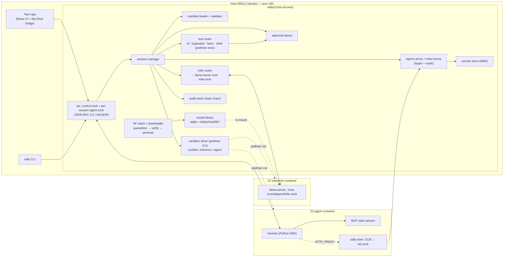

# Sallyport — Architecture (v1)

## 1. Stack, and where it departs from the original design

| Layer | Choice | Notes |
|---|---|---|
| Broker, sandbox orchestration, model validation, proxies, CLI | **Rust** (`tokio`, `hyper` 1.x + `rustls`, `rustix` for `openat2`, `rusqlite`, `serde`, `schemars`, `clap`, `tracing`; `sallyd`'s own log is the in-tree `sallyd::oplog`, §2.1) | Memory safety exactly where untrusted bytes are parsed. `#![forbid(unsafe_code)]` in every crate. |
| Desktop shell + UI | **Tauri v2** + React + TypeScript (Vite) | Kept. The Rust side of Tauri is a *thin client* of `sallyd`; the webview gets no fs/shell plugins. |
| Inference | **llama.cpp `llama-server`** in our own CUDA image | Kept. Pinned commit, built with `-DCMAKE_CUDA_ARCHITECTURES="86;89;120"`, CUDA 12.9. Prebuilt images lack sm_120. |
| Sandboxing | **Podman rootless + crun**, GPU via CDI | See THREAT_MODEL §6 for why not gVisor/microVM on WSL2 in v1. |
| Reference harness + SDK | **Python 3.12** | Runs inside Z3; language has no security weight; maximizes moddability. |
| Training sidecar | **deferred to v2** | Not in v1 at all. |

**Two deliberate deviations from the original requirements:**

1. **The broker is a separate daemon (`sallyd`), not a library inside the Tauri process.** Tauri
   starts it as a sidecar and the CLI talks to the same socket. Reasons: the UI crashing must not
   kill sandboxes; CLI and UI coexist; M1 is CLI-only and must not depend on Tauri; one process
   holds secrets, not two.
2. **"Egress proxy" is not a network proxy the sandbox can route to — the sandbox has no network.**
   Every container runs `--network=none`. A tiny static binary (`sally-shim`) inside the
   workspace sandbox listens on `127.0.0.1:3128` and forwards each TCP connection over a
   bind-mounted Unix socket to `sallyd`, which accepts HTTP-proxy `CONNECT` only (a proxy-form
   request is 405) and applies policy. This
   kills DNS exfiltration, raw-socket exfiltration and any "find the gateway" tricks by
   construction, and it needs zero iptables, which rootless Podman can't give us anyway.

## 2. Components



### 2.1 `sallyd` modules (crate `sallyd`, library crate `sally-core` for pure logic)

| Module | Responsibility | Trust-critical? |
|---|---|---|
| `sally-core::manifest` | Parse (strict), validate (denylist, realpath, wildcard rules, secret refs), summarize (plain English), JSON Schema export | **yes** |
| `sally-core::model::{gguf,safetensors,detect,hash,import}` | Format detection by magic, bounded parsers, SHA-256, zip import hardening, fit estimation | **yes** |
| `sally-core::audit` | Hash-chained NDJSON writer, verifier, redaction of secret values and oversize args | yes |
| `sally-core::secrets` | Load/store 0600 TOML; `Secret` newtype with redacted `Debug`, `zeroize` on drop; name-only references everywhere else | **yes** |
| `sally-core::hf` | The HF Hub client's decisions, with no socket: names validated and encoded, the bounded parse of a repository's file list (path, size, LFS sha256 at one commit), each hop's request (host, path, range, whether it carries the token), the decision on each response head (redirect, bounded wait, body, refusal) and the resume rules. Search and the Range fetch of a GGUF header come later (#214) | no (but handles untrusted bytes → bounded, fuzzed) |
| `sally-core::library` | SQLite index of blobs; content-addressed store; immutability (`chmod 0444`). The SQLite is the bundled one this crate pins; the database is only an index, and the blob directory decides what a model's bytes are. Bytes enter `blobs/` two ways, both ending in one tail (read-only, linked, then the row), and only a file the library created is ever linked: import runs the whole SI-6 chain on its own copy; a download is a partial the library creates and locks, which verify checks against the publisher's SHA-256 before anything else reads it, then magic and parse, without the library's lock; promote takes only a verified download | yes |
| `sallyd::hf` | The HF client's transport: one lookup on the host, answers the egress proxy's address filter refuses (loopback/private/link-local/own/connected networks) refused, a pinned address dialled on 443, TLS verified against the anchors of a checked CA bundle (`egress::roots::BundleFiles`, the client's only constructor argument for them; production: the system bundle owned by root); requests exactly as `sally-core::hf` plans them, the token only on a hop to `huggingface.co` itself, never again once a redirect chain has left it; the file list from `huggingface.co` only; file bytes only into the library's download. No production caller yet (#209) | yes |
| `sallyd::sandbox` | Build `podman run` argv from manifest + profile; mount prep (realpath re-check, socket dirs); launch/exec/kill/wait; image digest check | **yes** |
| `sallyd::rpc` | `control.sock` (trusted methods, §4.1) and per-session `agent.sock` (the MCP subset, §4.2); bounded NDJSON framing, duplicate-key-refusing JSON, per-session rate and connection caps, `SO_PEERCRED` UID check before a byte is read, an audit entry before every reply | **yes** |
| `sallyd::llm` | Per-session `llm.sock` (§4.4): HTTP/1.1 through hyper; the broker reads and decides on the head itself and gates hyper's writes; strict body allowlist; the model backend is a constructor argument (M3 wires the engine) | **yes** |
| `sallyd::session` | Lifecycle: validate → ensure inference loaded → create socket dir → launch agent → wire → monitor → teardown (always, even on panic — `Drop` guard) | yes |
| `sallyd::daemon` | Startup (Task 12, architect Q42): umask 077, no core dumps, non-dumpable, refuse root and set-id, the `$XDG_RUNTIME_DIR/sallyport` fd checked and `flock`ed for life (one `sallyd` per user), `NOFILE` raised; the crash reporter that turns a session task's panic into `session.crash` (Q47) | **yes** |
| `sallyd::oplog` | The operational log on stderr (Q43): in-tree, no `tracing` subscriber. Diagnostics only, after the audit entry; each value redacted, escaped (`sally-core::text`) and capped at 4 KiB, the line at 16 KiB; a bounded queue and a writer thread, so logging never blocks. Never manifests, argv, bodies, model output or environment | yes |
| `sallyd::infer` | Pool of at most one loaded model (v1); start/stop inference container; forward OpenAI-compatible requests over `infer.sock`; validate request JSON (allowed fields, size caps); stream back | yes |
| `sallyd::tools` | The built-in tools as the approvals `Executor` (§4.3, Task 11): `path` (guest path → mount + canonical rel), `args`, `fs` (openat2 beneath a checked root: the host pin for `brokered`/`ro`, the workspace's own view through the container init's `/proc/<pid>/root` for `rw`/`staged`), `tag` (destructive tagger), `shell` + `exec` (`podman exec` runner; finds, limits and kills the call's processes through pidfds), `procs`, and `fetch` (`fetch_url` the URL, `fetch` the checks and the reply, `fetch_client` one exchange through the session proxy's `Connector`, §7) | **yes** |
| `sallyd::approvals` | Queue, canonicalization, rendering sanitization, single-use IDs, timeout, flood control, notifications to UI/CLI | **yes** |
| `sallyd::egress::{server,policy,addr,net,…}` | Accept streams from `net.sock`; parse the request head (bounded, CONNECT only in v1); policy decision; host addresses → resolve → filter → pinned connect; CONNECT splice for every allowed host without a secret grant. A grant host's tunnel is intercepted: the proxy terminates TLS with a session-CA leaf, injects the grant's header and redacts every response (`intercept`, `rewrite`, `inject`, `redact`; Tasks 9a, 9b; §7) | **yes** |
| `sally-shim` (separate crate, musl static, std only) | generic relay (AMENDMENTS-01 §3.3): `--listen LOOPBACK_IP:PORT=/abs/sock` (repeatable; `127.0.0.1:3128` → `net.sock`, `127.0.0.1:8080` → `llm.sock`) with one fresh UDS connection per TCP connection, opaque bidirectional copy with fixed 16 KiB buffers, half-close propagated, a read or write error ending only its own direction (after a failed write toward the server the client's bytes are discarded for at most the linger from that write, whether it then sends on, half-closes or goes silent, so a reply in flight is not cut before the linger, #76; a client read error also ends the server-to-client direction), at most `--max-connections` (default 32, shared by all listeners; each costs two threads against the sandbox's `pids` limit) live connections, and a 30 s linger for a client that never closes, or still sends, after the server finished; a write call toward the client that gets no byte accepted within the linger fails, so a client that stops reading is cut some lingers later, the count being the kernel's, and one that reads again then gets the reply cut short and an EOF (a reset if it had sent bytes the relay never read), left to the relayed protocol's framing (#155); `--stdio /abs/sock` for stdio clients. Parses nothing, holds no policy, listens on IPv4 loopback (127/8) only (`::1` too is refused); `make shim-check` keeps it static and dependency-free | low (dumb, inside the sandbox) |
| `sally-proto` | Shared request/response types; `ts-rs` generates TypeScript for the UI | no |
| `sally` CLI | `doctor`, `manifest validate`, `models …`, `secrets …`, `sandbox run`, `run`, `chat`, `approvals`, `audit tail\|verify`, `sessions …` | no |

## 3. Process and sandbox layout

### 3.1 Host filesystem
```
~/.config/sallyport/
  config.toml                 # paths, podman binary, image digests; [sandbox] runtime, runtime_path
  secrets.toml                # 0600; name = "value"
  manifests/*.yaml            # user manifests
~/.local/share/sallyport/
  library/                    # 0700, as are blobs/, blobs/sha256/, quarantine/ and downloads/
  library/library.db          # sqlite, 0600: the index
  library/blobs/sha256/<hex>  # immutable 0444 model files
  library/quarantine/<pid>-<n>/  # an import's copy before verification (mkdirat makes the
                                 # name unique); removed when the import ends
  library/downloads/<hex>.part   # 0600, a download in progress, named by the publisher's
                                 # SHA-256 and flock-ed while pulled; kept for a resume, deleted
                                 # on a refusal its bytes cannot survive and after promote
  audit/audit-YYYYMM.jsonl    # hash-chained; audit.head = newest {seq, hash}; audit.lock
  sessions/                   # 0700
  sessions/<id>/              # 0700, created fresh per session (#10)
  sessions/<id>/profiles/     # the embedded seccomp profiles, written 0600 at launch
  sessions/<id>/stage/<n>/{upper,work}   # staged mount n: kept for `sally session changes`;
                                         # sandbox::staged_changes lists upper/ (RT-FS-15)
  sessions/<id>/git/<k>/{upper,work}     # .git overlays of rw mounts: discarded at teardown
  podman/                     # 0700: hermetic podman (#11, §3.5)
  podman/containers.conf      #   generated at startup; CONTAINERS_CONF of every podman call
  podman/config/              #   empty; XDG_CONFIG_HOME of every podman call
  podman/home/                #   empty; HOME of every podman call (Task 14, Q118)
  podman/hooks/               #   empty; --hooks-dir of every podman call
  podman/mounts.conf          #   empty; --default-mounts-file of create, init and start
  logs/
  bin/crun -> crun-<version>  # pinned upstream OCI runtime (static, signature-verified); the
                              # default sandbox.runtime_path. Never the distro crun (AMENDMENTS-02 B5)
$XDG_RUNTIME_DIR/sallyport/   # $XDG_RUNTIME_DIR must be ours and 0700 (checked at launch)
  control.sock                # 0600; CLI + UI
  infer/<instance-id>/infer.sock   # created by llama-server inside Z2
  sessions/<session-id>/      # 0700, created fresh per session
  sessions/<session-id>/workspace/net.sock   # created by sallyd, workspace role only (proxy mode)
  sessions/<session-id>/harness/{llm,agent}.sock   # created by sallyd, harness role only
```

### 3.2 `podman create` argv: common prologue (normative)
Built by the pure `sallyd::sandbox::{workspace,harness,inference}_argv` (one container per role,
AMENDMENTS-01 §2). The verb is `create`: the launcher checks the created container before it
starts it (§3.5). Every builder checks its own output with `check_argv` against a per-role
policy (`Allowed`), an **allowlist**:
- the global options exactly `--runtime <the checked runtime> --hooks-dir <Sallyport's empty
  hooks directory> --default-mounts-file <Sallyport's empty mounts file>`, then `create`;
- one spelling per option: `--flag value` for the options written that way below, `--flag=value`
  for the others, bare flags without a value; the other spelling is refused;
- only the options below, each with its exact value or value shape (`--user` is the session's
  ids, the seccomp profile is the role's file under the profiles directory, `--device` only
  `nvidia.com/gpu=all` and only for inference, environment variables only the role's exact
  name/value pairs plus `expose_env` placeholders); `--workdir /` (that value only, as two
  tokens), `--image-volume=ignore` and a bare `--no-healthcheck` are required, and every other
  health-check option is refused;
- every option at most once (mounts, variables and `--security-opt` kinds included), every
  hardening option exactly once;
- every `-v` source a declared source of that role at its declared guest path: `ro` grants only a
  read-only bind, `rw` a read-write bind plus binds and overlays of paths inside it at the
  matching guest path, `staged` only an overlay; overlay upper and work directories only inside
  the session's scratch directory, and no two of them equal or nested; another role's socket
  directory is never a source (SI-2); `/` is never a source, scratch or profile directory;
- the image in the shared digest-pinned grammar (`sally_core::manifest::is_pinned_image_ref`:
  never a Podman transport such as `dir:` or `docker-daemon:`, SI-11);
- the command after the image exactly the role's fixed command.

The snapshots in `crates/sallyd/tests/snapshots/` are the normative examples.
```
podman --runtime <checked runtime_path>          # AMENDMENTS-02 B5: never the distro crun
  --hooks-dir <data>/podman/hooks                # empty, Sallyport-owned (#11)
  --default-mounts-file <data>/podman/mounts.conf  # empty: no system mounts.conf (6b review)
  create --rm --name sp-{ws|h|infer}-<id>
  --label sallyport.installation=<installation id>   # Q64: the orphan sweeps match it
  --pull=never --http-proxy=false --log-driver=none --ulimit core=0   # AMENDMENTS-01 §6.1
  --network=none --no-hosts          # NOT --dns=none: Podman 4.9 rejects it with --network=none (preflight V4)
  --read-only --read-only-tmpfs=false
  --cap-drop=ALL --security-opt no-new-privileges
  --security-opt seccomp=<data>/sessions/<id>/profiles/seccomp-{workspace|harness|inference}.json
  --security-opt label=disable
  --userns=keep-id --user <uid>:<gid>
  --workdir / --image-volume=ignore --no-healthcheck   # the image adds no mount (RT-FS-02) and no health check (RT-SUP-05)
```
`label=disable`: the mounts are the user's own directories, which SELinux would only allow after relabelling (`:z`/`:Z` rewrites host labels); keeping SELinux confinement on SELinux hosts is #29 (M6).
`--user` is the caller's own `getuid`/`getgid` (the snapshots' `1000:1000` is the fixture's): with `keep-id` that is the host user inside, so `rw` writes stay the user's.
Bind mounts are `<host>:<guest>:{ro|rw},nosuid,nodev,bind` (`bind` = non-recursive). Overlays
are `<host>:<guest>:O,upperdir=<scratch>/upper,workdir=<scratch>/work` with nothing else: Podman
4.9.3 refuses other options next to `O` (probed in Task 6a), so overlays are not `nosuid,nodev`;
`no-new-privileges`, `--cap-drop=ALL` and the seccomp profile keep set-id files and device nodes
inert there.

### 3.3 Per role
**Workspace** (mounts, egress socket, toolchain; idles until the broker execs into it):
```
  --tmpfs /tmp:rw,{noexec|exec},nosuid,nodev,size=<tmp_size>
  --pids-limit <pids> --cpus <cpus> --memory <memory>b --memory-swap <memory>b   # no swap
  --init --env-host=false --timeout <runtime.timeout + 300>   # conmon backstop, seconds (#92)
  --hostname sandbox
  [--env {HTTP,HTTPS,ALL}_PROXY=http://127.0.0.1:3128 (and lowercase) --env NO_PROXY= --env no_proxy=]   # proxy mode
  [--env {SSL_CERT_FILE,REQUESTS_CA_BUNDLE,CURL_CA_BUNDLE,GIT_SSL_CAINFO,PIP_CERT,CARGO_HTTP_CAINFO,AWS_CA_BUNDLE}=/run/sallyport/ca-bundle.pem
   --env NODE_EXTRA_CA_CERTS=/run/sallyport/session-ca.pem]                                            # proxy mode + secrets
  [--env <expose_env>=sallyport-placeholder]
  -v <host>:<guest>:ro,…        # ro and brokered
  -v <host>:<guest>:rw,…        # rw; then from the launch scan (required for every rw mount, AMENDMENTS-02 B2(a)):
  -v <host>/<p>:<guest>/<p>:rw,…                               # every directory between the root and a .git entry, bound
                                                               # onto itself so it cannot be renamed away (EBUSY)
  -v <host>/<rel>/.git:<guest>/<rel>/.git:O,upperdir=<data>/sessions/<id>/git/<k>/upper,workdir=…/work
  -v <host>/<rel>/.git:<guest>/<rel>/.git:ro,…                 # .git files (worktree/submodule pointers)
  -v <host>:<guest>:O,upperdir=<data>/sessions/<id>/stage/<n>/upper,workdir=…/work      # staged (B2(b))
  -v $XDG_RUNTIME_DIR/sallyport/sessions/<id>/workspace:/run/sallyport:ro,…               # net.sock + CA bundle (connect only)
  <runtime.image or bundled workspace image>@sha256:<digest> /opt/sallyport/entry --idle
```
**Harness** (no mounts, no egress, no GPU; fixed 1 CPU, 1 GiB, 128 pids):
```
  --tmpfs /tmp:rw,noexec,nosuid,nodev,size=256MiB --pids-limit 128 --cpus 1 --memory 1GiB --memory-swap 1GiB
  --init --env-host=false --timeout <runtime.timeout + 300>   # the session's manifest (#92)
  --hostname sandbox
  --env OPENAI_BASE_URL=http://127.0.0.1:8080/v1 --env OPENAI_API_KEY=sallyport
  -v $XDG_RUNTIME_DIR/sallyport/sessions/<id>/harness:/run/sallyport:ro,…                 # llm.sock, agent.sock (connect only)
  <harness.image or bundled harness image>@sha256:<digest> /opt/sallyport/entry
```
**Inference** (GPU, one read-only model file):
```
  --tmpfs /tmp:rw,noexec,nosuid,nodev,size=256MiB --pids-limit 64 --cpus <n> [--memory <m>b --memory-swap <m>b]
  --init --env-host=false [--device nvidia.com/gpu=all]
  -v <blobs>/sha256/<hex>:/models/model.gguf:ro,…
  -v $XDG_RUNTIME_DIR/sallyport/infer/<id>:/run/sallyport:rw,…   # llama-server creates infer.sock
  <inference image>@sha256:<digest>
  llama-server --host /run/sallyport/infer.sock -m /models/model.gguf
               -ngl <n> -c <ctx> --jinja --no-webui -np 1 --log-disable
```
`-m` is always passed (without it llama-server boots as a multi-model router); `check_argv`
accepts exactly this command with only the `-ngl`/`-c` numbers varying, so `--models-dir`,
`--models-preset`, `--slot-save-path`, `--webui*`, `--path`, `--lora`, `-hf` and every other flag
are refused (AMENDMENTS-01 §6.2). Each role has its own socket directory; no role can see
another's sockets.

`--timeout` (#92, architect Q60, Q191–Q197) is the bound on a session's container whose
`sallyd` was killed outright: conmon kills the container `runtime.timeout` + 300 s after its own
`podman init` (the clock starts at `init`, not `start`; PROBE_NOTES), frozen or not, and the
`--rm` cleanup removes it, with no `sallyd`. The workspace and the harness each carry their
session manifest's value; `check_argv` requires exactly that value, once, as two tokens, and
refuses a policy without one or with one no longer than the grace (podman reads 0 as none). An
inference container carries none: it has no `runtime.timeout`, and an instance is not a
session's. The value is not in the OCI config; the verifier (§3.5) compares podman's
`.Config.Timeout` with it instead (0 for inference).

Podman configuration outside the argv (`containers.conf`, `mounts.conf`, OCI hooks,
`CONTAINER_HOST`) is not covered by `check_argv`; hermetic podman (§3.5) controls it.

### 3.4 Seccomp
Start from `containers-common`'s default profile and **remove**: `mount, umount2, pivot_root,
chroot, ptrace, process_vm_readv, process_vm_writev, keyctl, add_key, request_key, bpf,
perf_event_open, userfaultfd, io_uring_setup, io_uring_enter, io_uring_register, unshare,
setns, kexec_load, kexec_file_load, reboot, swapon, swapoff, init_module, finit_module,
delete_module, acct, settimeofday, clock_settime, mknod, mknodat, personality, uselib,
vhangup, quotactl, lookup_dcookie, nfsservctl, open_by_handle_at, name_to_handle_at`, plus the
same capabilities under other names: the new mount API (`fsopen, fsconfig, fsmount, fspick,
move_mount, open_tree, mount_setattr`), `umount`, `stime, clock_settime64, clock_adjtime,
clock_adjtime64`, `quotactl_fd` and `pidfd_getfd`, and `socketcall` and `syslog` (6b security
review). Every remaining non-errno rule is a plain `SCMP_ACT_ALLOW`, and:
- `clone` is allowed only without namespace flags (`arg0 & 0x7E020000 == 0`, Docker's rule): no
  nested user, network, mount, PID, IPC, UTS or cgroup namespace, so no `CAP_NET_ADMIN` over
  nf_tables in a fresh network namespace. `clone3` is not allowed (its flags are in memory
  seccomp cannot read); it fails with ENOSYS and libc falls back to `clone`.
- `socket` is allowed per address family: `AF_UNIX`, `AF_INET`, `AF_INET6` and `AF_NETLINK`
  (`NETLINK_ROUTE` only, by equality) for workspace and harness, `AF_UNIX` only for inference. Every other
  family fails, in particular `AF_VSOCK`, which network namespaces do not isolate (on WSL2 and
  other VMs it reaches the host).
- `socketpair` is allowed for `AF_UNIX` only, in every role, by one rule with an equality on the
  family argument; every other family (`AF_INET`, `AF_INET6` and `AF_NETLINK` included) fails
  with `ENOSYS`, the profile's answer, which the kernel never gives for an unsupported
  `socketpair` family.
- Only native architectures are listed (x86-64, aarch64, no 32-bit sub-architectures), so the
  32-bit ABI (`int 0x80`, the unfilterable `socketcall`) never reaches an allow rule.

The profiles are `profiles/seccomp-{workspace,harness,inference}.json`, derived by
`scripts/gen_seccomp.py` from containers-common's profile and committed. They are embedded in
`sallyd` and written into the session's 0700 `profiles/` directory at launch (#10), so no file
outside Sallyport's control decides what a sandbox may call. Unit tests check the profile JSON
independently of the generator (`sandbox::profiles`:
`no_rule_of_any_role_allows_a_removed_syscall_under_any_condition`,
`sockets_are_an_allowlist_of_address_families`, `socketpair_is_allowed_for_af_unix_only`,
`clone_is_allowed_only_without_namespace_flags`, `only_native_architectures_are_listed`). The
OCI config verifier compares each container's `linux.seccomp` with the embedded profile by
content before `start` (`sandbox::oci` `the_cgroup_path_seccomp_and_masked_paths_are_checked`;
RT-SUP-04). In a container, three probes meet the filter: RT-FS-07 (`mknod`, `ENOSYS`), RT-FS-17
(`unshare`, `clone` with namespace flags, `clone3`) and RT-NET-12 (`socket` and `socketpair`
families outside the role's list, with `AF_UNIX` pairs made as its analogue control). The other
removals are checked in the JSON only, by no system call in a container. RT-FS-09 tests the
masked and read-only `/proc` and `/sys` paths, not the profile.

### 3.5 Launch (normative, Task 6b)
`sallyd::sandbox::Launcher::launch_workspace`, in this order. The launch runs in its own task:
a caller that goes away cannot interrupt it, and a launch whose caller has gone before the result
is sent is stopped again; a result sent but never received is not (open, fix planned, #292). Any
failure audits `sandbox.refuse` (or `sandbox.mount_mismatch`) with a reason and the cleanup
outcome. It removes the container by its name `sp-ws-<id>`, even when `create` printed no id,
and removes only the directories this launch created: an id whose directories exist is refused
before anything is created, so a stopped session's kept `stage/` is never touched. The claims
are released only once the cleanup has finished, which needs the container confirmed gone. A
cleanup that fails is retried in its own task, backed off and capped (ten tries, pauses 2 s
doubling to 60 s); it ends with `sandbox.cleaned` (then the claims are released) or, when the
probe or container is still not confirmed gone at the tenth try, `sandbox.cleanup_abandoned`,
and the claims are held until `sallyd` exits.

0. **Image** (architect Q58). The workspace image is resolved first: the manifest's
   `runtime.image`, else the bundled default. While no bundled image is installed (#88) the
   default is absent, and a manifest without `runtime.image` is refused `no-default-image`
   before anything is reserved or created.
1. **Overlap rule** (AMENDMENTS-02 B4, RT-AG-08b). Two live sessions may mount overlapping host
   directories (the same directory, or one inside the other) only when neither mount is `rw` or
   `brokered`. Overlap is decided by path and by identity. Each claim carries the
   `st_dev:st_ino` of its root and of every ancestor up to `/`, walked with `..` from an fd. A
   directory reached through a bind alias or a second mount of the same filesystem therefore
   still conflicts. No sandbox ever holds write access to an ancestor, a descendant or the same
   directory as another session's mount, so no live sandbox can swap what another session's
   launch scan pinned. `Launcher::remove_orphans` removes `sp-ws-*`/`sp-h-*` containers (and
   their mount-link probes, `sp-probe-ws-*`/`sp-probe-h-*`) a
   previous `sallyd` of this installation left running (audited `sandbox.orphan_removed` with
   the name, the full ID it removes by, and `sweep: startup`); `sallyd` calls it before it accepts the first launch, then every 60 s
   (`sweep: periodic`, architect Q61): a `podman create` a killed `sallyd` left running can make
   its container after the startup sweep. Each removal is one `podman rm` by full ID and an
   existence check, never `unpause`; a failure is audited `sandbox.orphan_remove_failed` and the
   sweep goes on to the others, then fails. A container is removed only if it carries this
   installation's label (`sallyport.installation`, a UUID v4 kept 0600 as `installation` in
   the state directory, created once under the single-instance lock, crash-safe (written and
   synced as `installation.new`, linked into place, which never replaces anything, directory
   synced), and never regenerated; architect Q64), has a session container's name and no live session owns it. One without the
   label (another daemon's, a test run's, or one made before the label existed) is never
   removed. The label is compared in `sandbox::orphans`, after podman's own label filter. A
   launch reserves its id before it creates anything, so no sweep takes a launch in progress; a
   container a stop removes during the sweep drops out of its second listing; a failed periodic
   sweep is an oplog line, retried at the next. The listing asks podman for one label only,
   `<full ID> <name> <installation label>`, each a JSON string, never the whole label set: a
   container's labels include its image's, so a line would be as long as an image author likes
   (architect Q307). A line is daemon-bounded (ID, name and UUID): at most 185 bytes for a
   session container or its probe, 188 for an inference instance's probe. A listing over 64 KiB
   is refused whole, never cut (#173): a cut on a line boundary would parse as a shorter listing
   that misses the containers past it. That cap bounds the sweep at about 350 containers: past it, the startup
   sweep refuses the start and a periodic one fails. So the live sessions are bounded where
   they are admitted: at most 64 (`MAX_LIVE_SESSIONS`), counted in the same step that reserves
   the overlap claims and descriptors, before either is checked. The 65th is refused
   `session-limit` before anything is created (stop a session to launch another). A live
   session has at most two lines (a container is listed as its probe until the probe is removed,
   before its real `create`); counting four of the longest length per live session (twice, as
   margin), 64 sessions list about 46 KiB, which leaves at least 16 KiB for lines no session
   accounts for: inference instances, which are listed but not counted (#134), and leftovers of
   killed predecessors or containers made outside the daemon under its label. Those can still
   push a listing past the cap (`THREAT_MODEL.md` §6). The relation is unit-tested in
   `sandbox::orphans`. The refusal names the recovery (Q308): `podman ps --all --filter
   label=sallyport.installation=<id>` lists this installation's containers, where `<id>` is the
   `installation` file in the state directory. Containers are listed and removed by that label,
   never by an `sp-*` name, which other installations and test runs share.
2. **Checks.** The runtime binary and the podman binary are re-checked (B5), for every role, by
   the one launch path before the role's preparation. Everything podman
   reads from Sallyport's state is re-checked too: the state directory is private, `hooks/` and
   `config/` are empty, `mounts.conf` is empty, and `containers.conf` is byte-identical to what
   was generated.
3. **Launch scan** (`scan_mounts`). One bounded walk per mount from a pinned directory fd,
   `openat2(RESOLVE_BENEATH | RESOLVE_NO_SYMLINKS | RESOLVE_NO_MAGICLINKS | RESOLVE_NO_XDEV)`
   (SI-8):
   - The mount root is opened without following any symlink, including in its ancestors, and
     must still be the validated `st_dev:st_ino` (RT-FS-06).
   - A Unix socket anywhere refuses the launch (`socket-in-mount`, RT-FS-13), in every mode and
     inside `.git` (git's fsmonitor socket): `connect` works on a read-only mount.
   - The walk never enters another filesystem mount, and never shields a mount point of any
     kind, directory or bind-mounted file. Non-recursive binds and overlays hide nested mounts
     from the sandbox (RT-FS-16). `statx` must report `STATX_MNT_ID` (kernel ≥ 5.8), or the
     scan refuses rather than walk blind.
   - In an `rw` mount, every `.git` directory and `.git` file is recorded, sorted, together with
     the identity of each of them and of every directory between it and the root. A `.git`
     symlink is neither shielded nor followed.
   - More than 32 shielded entries in one `rw` mount, 250 000 entries, a depth of 64, or 16 MiB
     of paths waiting to be listed, refuses the launch. For an `rw` mount the message recommends
     `staged`. Only the scanner can construct a `GitScan` or a `LaunchScan`, and a scan is
     bound to its manifest's mounts (realpath and identity).
4. **Session directories** (#10). `sessions/<id>` is created fresh and 0700 under both roots,
   along with the role socket directories, `profiles/` (with the embedded profiles written
   0600), and the overlay upper and work directories, each 0700. `$XDG_RUNTIME_DIR` must be
   owned by the user and 0700. Then the **image check** (`images.rs`, RT-SUP-01/02): hermetic
   `podman image exists` must find the pinned reference and `image inspect` must list the pinned
   digest among its `RepoDigests` (exactly one JSON list of strings; anything else is refused).
   Otherwise the launch is refused `digest-mismatch`; a podman error is refused as `podman`. The
   check exists for the clear reason only: enforcement is the digest reference plus
   `--pull=never` at `podman create`, so nothing depends on the gap between the two.
5. **Argv** (§3.2), then, with `network.mode: proxy` only, the **egress listener** (Task 8):
   `sessions/<id>/workspace/net.sock` is bound 0600 (through `/proc/self/fd` of the opened
   directory, so no path length can exceed `sun_path`) and served by the session's proxy. A bind
   failure is refused `egress-listener`. The listener lives with the running session: `stop`
   shuts it down after the container is gone (open tunnels audit `egress.close` with `end:
   session-stopped`), a failed launch drops it. Then **audit** `sandbox.launch` (SI-4: before
   anything is visible).
6. The **mount-link probe** (RT-FS-02, `sandbox/mount_probe.rs`): a probe container of the same
   image from the checked argv minus every `-v` bind and overlay and the GPU device flag
   (its name recorded first), `create` and `init`, its pid and image id read, every mount
   destination of the launch walked inside its root filesystem with no link allowed, then
   removed and confirmed gone whatever the walk found. A link at or above a destination, or any
   failure, refuses the launch. The walk sees the image's tree only: a destination nested in a
   host folder (a `.git` shield in an `rw` mount) stays with the launch scan, the host re-check
   and step 7's pin check. Then `podman create`, its image id compared with the probe's; then
   every pin is re-checked on the host (`LaunchScan::recheck_host`), then `podman init`. The
   runtime builds the mounts but starts nothing.
7. **Post-init mount check** (B4). From the host, under `/proc/<init-pid>/root` with
   `RESOLVE_IN_ROOT | RESOLVE_NO_SYMLINKS`, every bind-mounted pin (mount roots, the `.git`
   parent self-binds, `.git` pointer files) must show its pinned `st_dev:st_ino`. On a mismatch
   the container is removed and `sandbox.mount_mismatch` is audited. Overlay lower layers report
   the overlay's own device, so they rely on step 6's host re-check and on the overlap rule.
   Then the **OCI config verifier** (Task 14, RT-SUP-04, `sandbox::oci`): the config podman
   generated (`podman unshare cat` of `OCIConfigPath`, at most 1 MiB, strictly parsed: a
   repeated or unknown key anywhere is a mismatch) must equal what the argv builder recorded as
   it pushed each flag, plus podman's own per-role additions, and nothing else: user and groups,
   no capability in any set, `noNewPrivileges`, read-only root, seven own namespaces, the
   keep-id map shape, the seccomp filter by content (the embedded profile converted for the
   native architecture), exactly the mounts with their options (each overlay's `lowerdir`
   included, parents before children), the args and environment as built plus the image's
   `Env`, the working directory `/` whatever the image declares (`--workdir /`), rlimits,
   cgroup limits with swap equal to memory, `cgroupsPath` in the systemd form only (doctor
   requires systemd), masked and read-only paths, annotations and hostname. Beside the config,
   podman's `.Config.Timeout` (read by the same `podman inspect`) must equal the argv's
   `--timeout`, and 0 when it has none (#92, Q193), and its
   `.Config.Healthcheck` (same inspect) must be exactly the disabled form `{"Test":["NONE"]}`
   that `--no-healthcheck` records, else the field named is `healthcheck`. On a difference the
   container is removed and `sandbox.config_mismatch` is audited
   with the first differing field (never a value of the environment or the command). GPU
   inference is refused until M3 (#116); an image with an entrypoint until #117.
8. `podman start`, then the **running check** (Task 6c): after a 250 ms grace, `podman inspect`
   must report the container running as the pid checked in step 7. `start` succeeds even when
   the entry point exits at once, and a container that exited is already gone (`--rm`). Either
   way the launch is refused (`not-running`), and everything it created is removed.

**One launch path for every role** (#123; architect Q129–Q131, Q139–Q143). The workspace,
harness (`Launcher::launch_harness`) and CPU inference (`Launcher::launch_inference`) launches
share one path (`sandbox/launch/start.rs`): each role's refusals that need nothing made and its
claim, the re-check of step 2, the role's own preparation (its image found in local storage,
then its directories and argv), and steps 5 (audit) to 8, in the order audit, probe, `create`
and the image-id compare, host re-check, `init`, pin compare, verifier, `start`. `podman create`,
`init` and `start`, the empty mounts file (`Podman::spec_args`), the mount-link probe and the
config verifier are called there only, and every podman command runs through hermetic podman, so
no role starts without the private `HOME`, the empty mounts file, the probe or the verifier. A
refusal audits the real role.
- **Harness**: `no-default-image` first (`harness.image`, else the bundled default, #88); then it
  claims its session's harness, refused `no-session` unless the session is live and `overlap` if
  a harness is already claimed (live check and claim under one lock, so a second launch can never
  create, or clean up, a container of the same name); then `sessions/<id>` under both roots, the
  harness socket directory and `profiles/` must exist as private directories (`no-session`;
  never created). It pins its socket directory, re-checks it on the host after `create` and
  compares it at `/run/sallyport` after `init`. `sp-h-<id>`, audited with the session.
  `stop_role` audits `sandbox.stop {role}`, removes the container only and frees the claim; the
  session layer stops the harness before the workspace (#133).
- **CPU inference**: `gpu-unsupported` first (#116). An instance is not a session: its entries
  carry `instance` in their args and no session. The launcher derives and creates
  `$XDG_RUNTIME_DIR/sallyport/infer/<id>` (the socket directory) and `<data>/infer/<id>/profiles`,
  fresh and 0700: an id in use is refused before anything is created. The model blob (its
  import identity) and the socket directory are pinned, re-checked and compared like the
  harness's. `stop_role` audits `sandbox.stop {role, instance}` and removes the container and
  both directories. The orphan sweeps do not cover an inference container (`sp-infer-<id>`) or
  its probe (`sp-probe-infer-<id>`) yet (#134).
- The disk watchdog and the cgroup event observer stay workspace-only (#132).

**Disk watchdog** (#14, Task 6c; maintainer design after the 6c-1 reviews). A sandbox writes to
the host disk through its `rw` mounts and through the upper directories of its `staged` mounts
and of its `.git` overlays; the broker's file tools write to the host folder of its `brokered`
mounts on its behalf. Each session whose sandbox can do any of these gets the floor task; a
session with stage areas (`staged` mounts or `.git` overlays) also gets the stage task
(`watchdog.rs`):

- **Free-space floor** (the hard, race-free guarantee; `disk.rs`).
  - It watches every filesystem the sandbox can write to: the state filesystem, when the session
    has staged mounts or `.git` overlays, and the filesystem of each `rw` and each `brokered`
    mount root. Each is held by an `O_PATH` fd.
  - The broker is a writer outside the container, which the kill does not reach, so each file
    tool write is first held to the same floor on the filesystem its parent directory is on, and
    is refused `disk-floor` below it (`tools::fs::write`). This is the watchdog's own predicate,
    not a reservation: the write that crosses the floor is admitted, and the overshoot is at most
    the writes already past the check, one agent frame each.
  - Every 250 ms it reads `fstatfs`. When the space available to unprivileged users falls below
    the floor, `max(4 GiB, 5 %)` by default, the session is killed. The audit reason is
    `disk-floor`, with the filesystem, the free bytes and the floor.
  - A `statfs` that fails or takes over 5 s fails closed.
  - A launch is refused (`disk-floor`) unless every watched filesystem has the floor free, plus
    `runtime.stage_size` on the state filesystem.
  - It reads the filesystem's own accounting, so renames, open unlinked files and `O_TMPFILE`s
    all count.
  - It never waits for a walk, the walk permit or the exec gate.
- **`stage_size`** (a soft limit).
  - There is no periodic walk. The floor task tracks the state filesystem's used bytes, and wakes
    the stage task only when they have grown past the session's headroom since the last accurate
    measurement. The baseline is lowered whenever usage shrinks, which is conservative.
  - The stage task takes the global one-walk permit, then the session's exec gate. An exec holds
    `Running::exec_gate` only while it starts, because a running exec process freezes with the
    container's cgroup (`tools::exec`, #24); a file tool's write or delete in the workspace's
    view holds it for the whole operation. Then the stage task runs `podman pause` (the cgroup
    v2 freezer), walks the upper directories, and runs `podman unpause`.
  - The walk goes through directory fds, never follows a symlink, holds one fd per level, and is
    bounded at 1 000 000 entries, 64 levels and 10 s. The permit stays with the walk until it
    stops.
  - Because the sandbox is frozen, any error fails closed, including an entry that vanished.
  - Over the limit, unmeasurable, or past the deadline: that session is killed (reasons
    `stage-size`, `unmeasurable`). The audit entry names the area: `filesystem.mounts[n]` or
    `filesystem.mounts[n].git[j]`, never a host path.
  - Walks of one session are at least 2 s apart, or four times the last walk's duration if that
    is longer.

**Freeze hygiene.**
- A guard unpauses on every path except a kill, panics and cancellation included. If the unpause
  fails, the container is removed.
- A failed `unpause` after a walk kills the session (`unpause-failed`).
- A failed `pause` kills it (`pause-failed`), unless the container is gone; then the watchdog
  ends.

**Killing.** Every kill audits `session.resource_limit` first, then kills and removes the
container, retrying every 2 s until it is confirmed gone. It audits `session.kill_failed` once if
the first attempt fails. The kill happens even if an audit write fails.

**Cgroup observer** (#27, architect Q48, every session). Between `podman init` and `podman
start` (step 7), the launcher reads the init's `0::` line of `/proc/<pid>/cgroup` through the
held `/proc/<pid>` fd (bounded, plain components only), checks that `/sys/fs/cgroup` is cgroup2,
and opens `pids.events` and `memory.events` beneath it with `openat2(RESOLVE_BENEATH |
RESOLVE_NO_SYMLINKS | RESOLVE_NO_MAGICLINKS)`. If any step fails, the launch is refused with
`cgroup-events`, and the detail names the step. The watchdog's observer holds only those two fds.
Every 1 s it re-reads them with `pread`, off the runtime, with a 5 s timeout. For each counter
that grew it writes one `session.resource_limit {resource: "pids", reason: "pids-max", count}`
or `{resource: "memory", reason: "oom-kill", count}`, where `count` is the counter's new value.
It only observes: the kernel already refused the fork or killed the process, and the session
runs on. A disk kill reads the counters once more alongside the kill, and `Launcher::stop` reads
them once more before removal. A failed or slow read is logged once to the oplog, and the next
tick reads again. The observer ends when the cgroup is gone (`ENODEV`). Known gap: a rise in the
last second before a container ends on its own, or before a disk kill wins the race to its
cgroup, is not audited. `runtime.tmp_size` has no kernel event (a tmpfs returns ENOSPC), so it
is contained and not audited.

Teardown stays with `Launcher::stop`, which keeps the staged data. Dropping the session's handle
stops every watchdog task and any walk in progress. A launch whose caller had gone before the result
was sent is stopped with retries until its container is gone, and keeps its watchdog meanwhile.
A result sent but never received drops the handle with no stop (open, fix planned, #292).

**Teardown** (`Launcher::stop`) audits `sandbox.stop`, then runs
`podman rm --force --volumes --time 0` (every removal takes the container's anonymous volumes)
and confirms the container is gone (`podman container exists`). If it is not gone, the session
keeps its claims and the caller gets the handle back to retry. Otherwise teardown removes
`git/` and `profiles/` through `podman unshare` (overlay work directories belong to the
container's user namespace), removes the socket directory, keeps `stage/`, and releases the
overlap claims. After a teardown that succeeded, the registry writes the session's last entry,
`session.closed`, through `Launcher::close` (§5.4, #94).

**Hermetic podman** (#11). Every podman process gets a cleared environment plus
`HOME=<data>/podman/home` (empty, never the user's home), the host's `XDG_RUNTIME_DIR`,
`XDG_DATA_HOME` (the host's, else `<home>/.local/share`, so the user's image store is found) and
`PATH=/usr/bin:/bin:/usr/sbin:/sbin`. Podman builds a container's OCI spec, and with it the
`mounts.conf` subscriptions, at `init`, not at `create`. Without `--default-mounts-file` on that
call it reads the first existing file of `$HOME/.config/containers/mounts.conf`,
`/etc/containers/mounts.conf` and `/usr/share/containers/mounts.conf`. Until Task 14 only
`create` had the flag, so the user's file was copied into `/run/secrets` of every container;
the OCI config verifier found it (architect Q118, Q119). It also gets:
- `CONTAINERS_CONF=<data>/podman/containers.conf`, generated at startup. On Podman 4.9.3 it
  replaces the system file, the user file and their drop-ins; probed in Task 6b.
  `CONTAINERS_CONF_OVERRIDE` would still be read, and it is never passed.
- `XDG_CONFIG_HOME=<data>/podman/config` (empty), so the user's `storage.conf` and
  `registries.conf` are not read either.
- `--hooks-dir` naming the empty hooks directory and `--default-mounts-file` naming the empty
  mounts file in the checked `create` argv, and the same mounts file as a global flag before
  the verb on `init` and `start` (`Podman::spec_args`), which keep every `mounts.conf` and the
  hook directories out. The `default_mounts_file` key of `containers.conf` is ignored on 4.9.3
  (probed). FIPS mode (`/etc/system-fips`) is not switched off by the flag; such hosts are
  refused by the verifier (#121).

`home/`, `config/` and `hooks/` are checked private and empty before every launch. Whatever
podman read, the OCI config verifier (§3.5 step 7) refuses a container whose config holds
anything the argv did not ask for.

The generated file has no default volumes, devices, capabilities, environment, sysctls,
ulimits, annotations or mounts. Namespaces are private, there is no keyring, events and logs are
off, and remote is off. The runtime, `conmon` and `catatonit` (`--init`) are explicit paths.

**Binaries** (R1, architect Q123–Q128; `sandbox/binaries.rs`). Each is resolved once, to its
realpath, and every check covers the file and every directory above it (a regular executable
file, no group or other write bit, owned as the rule allows):
- the runtime: `sandbox.runtime_path`, else `<data_home>/sallyport/bin/crun`; root or the user;
- podman: `sandbox.podman_path` when set, root or the user. Otherwise `podman` in
  `/usr/bin`, `/bin`, `/usr/sbin`, `/sbin` (the directories of podman's own `PATH`, in that
  order), root only. `sallyd`'s own `PATH` is never consulted;
- `conmon` and `catatonit`: their fixed candidate lists, root only, even beside a configured
  user-owned podman.

A search never falls through. The first candidate that exists by `lstat` (a dangling link or
a directory included) is checked, and a failure is an error. For podman, that error says
`sandbox.podman_path` can name another. Only an absent candidate moves the search on. Before
every launch the podman binary is re-checked under the rule it was resolved under.

At start, `sallyd` runs `podman --version` (hermetic environment) and `<runtime> --version`
(`PATH` only), each within 5 s with output capped at 4 KiB, and parses `<name> version
<token>` strictly. Any failure stops startup. One oplog line, `podman resolved`, records the
podman path, version and source (`system` or `sandbox.podman_path`), and the runtime path and
version. A configured podman that the system search would not have accepted (not root-owned,
or not one of its candidates) runs, and a warning line says why. The setting comes from
`config.toml` under `$XDG_CONFIG_HOME/sallyport/`, which is `sallyd`'s own configuration and a
trusted input. Whoever sets `sallyd`'s environment can still pick a podman that way; the
warning line is how that shows.
Every podman command is killed after 120 s. A successful command's stdout over its caller's
bound (64 KiB unless the caller sets one) is refused, never cut (#173); a failed command's
stderr is held whole up to 64 KiB or withheld whole (Q295).

**Consequences.**
- A user whose image store is configured through `~/.config/containers/storage.conf` (a
  non-default `graphroot`) must move it to the default location. `sally doctor` will report it.
- On Podman 4.9.3, a `staged` mount over a folder with another filesystem mounted inside it
  cannot launch: the runtime refuses the overlay in the keep-id user namespace (`EINVAL`, probed
  in Task 6b). The launch fails closed after `init`, and nothing runs.

## 4. Broker API

Transport: JSON-RPC 2.0, newline-delimited JSON over Unix stream sockets. Max frame 1 MiB
(control) / 256 KiB (agent); `llm.sock` is HTTP/1.1 instead (§4.4, 4 MiB bodies). Notifications
stream events. Errors use JSON-RPC codes plus `data.reason`. Every socket checks the peer's UID
(`SO_PEERCRED`) before it reads a byte: the expected UID is `sallyd`'s own, which under
`--userns=keep-id` is also the sandbox user's (§7); a mismatch is closed and recorded `rpc.deny` /
`llm.deny` with reason `peer-uid`. Every refusal that sends a reply has its own entry first; a
refusal whose entry could not be written closes the connection unanswered. The one exception
(architect Q93): `approvals.decide` answers `audit-failed` when the desk's entry could not be
written; nothing was approved and a `deny_all_session` latch stays (the maintainer's Task 11
audit rule). The
CLI checks the other way too: before it sends a byte to `control.sock` it requires the socket's
peer to be its own uid (architect Q78), and it reads replies under the same 1 MiB cap
(`sally_proto::MAX_FRAME`; a longer frame is fatal). The peer check has unit tests only
(sally-cli `only_this_users_socket_is_spoken_to`); a red-team leg is planned (no issue yet).

### 4.1 `control.sock` — trusted clients (CLI, Tauri)

| Method | Purpose |
|---|---|
| `doctor.run` | environment checks (returns the V1–V9 table results) |
| `manifests.list` / `manifests.get` / `manifests.validate` / `manifests.save` / `manifests.summary` | manifest CRUD + plain-English summary |
| `models.list` / `models.inspect` / `models.import` (path) / `models.remove` / `models.fit` (model, ctx) | library |
| `hf.search` (query, filters) / `hf.files` (repo, revision) / `hf.pull` (repo, file) → job id | Hugging Face |
| `jobs.list` / `jobs.cancel`; notification `job.progress` | long-running work |
| `infer.load` (model) / `infer.unload` / `infer.status` | inference lifecycle |
| `chat.complete` (session-less chat using the loaded model; same body as `infer.complete`) | Chat screen |
| `sessions.create` (manifest text; `model?: {kind: scripted, script, driven}`; `lifetime?: "connection"`; task: PR C) / `sessions.list` / `sessions.stop` (id) / `sessions.changes` (id) / `sessions.drive` (id) / `sessions.attach` (id, argv, cwd?) / `sessions.input` (id, data, eof?); notification `session.output` | agent sessions |
| `ui.send` (session, text) — user → harness; notification `ui.message` — harness → user | chat with an agent |
| `approvals.list` / `approvals.watch` / `approvals.decide` (id, approve\|deny\|deny_all_session, digest, full_shown?); notification `approval.requested` / `approval.flood` / `approval.closed` | gate |
| `secrets.set` (name, value) / `secrets.list` (names only) / `secrets.remove` | store; values are write-only |
| `audit.tail` (filter, follow) / `audit.verify` | log |

In M1 the CLI runs `doctor` (host facts only; container checks are #119), `manifest
validate|summary` (an advisory verdict: `sallyd` validates again at `sessions.create`; at
launch, `sally session start` and `sally sandbox run` run the same validation as a refusing
gate, check where the manifest file is kept, show what it grants and need consent for every
launch, a typed `yes` or the hash of the exact text read, before they send it, MANIFEST_SPEC
§1.2),
`audit verify|tail` (read-only, no `audit.lock`) and `secrets set|list|rm` itself, without
`sallyd` (architect Q52, Q106–Q110). Paths come from `sally_core::paths`, as `sallyd`'s do.
`secrets set|rm` write the store directly under its writers' lock: an exclusive `flock` on a
separate 0600 `secrets.lock`, given up after 10 s with nothing changed. `save` writes a temp
file in the same directory, fsyncs and renames, so a reader never sees a partial store. A value
comes from a no-echo prompt (at most 4094 bytes; Ctrl-C cancels it) or piped stdin, never argv
or the environment (the argv refusal has binary-level tests, no `rt_` test: sally-cli `tests/secrets_argv.rs`
`set_with_a_value_argument_is_refused_without_echo`,
`set_after_a_double_dash_is_refused_without_echo`,
`set_with_an_unknown_option_is_refused_without_echo`; a red-team leg is planned, no issue yet; no
test names the environment); every secrets command turns core dumps off first. A command line that does
not parse is refused with a fixed message that repeats no argument (architect Q113); a secrets
line adds the shell-history warning. `audit verify` exits 0 verified, 1 failed verification, 2
unreadable (Q115). The `doctor.*`, `manifests.*`, `secrets.*` and `audit.*` methods above stay
for the UI.

Task 12 serves ten of them (`sally_proto::method::ALL`: `sessions.create`, `.list`, `.stop`,
`.changes`, `.drive`, `.attach`, `.input`, `approvals.list`, `.decide`, `.watch`); every other method is `-32601` and
recorded `rpc.deny {socket: control}`, and no control method resolves on the session socket's
table (a unit test holds that). Params are strict (unknown fields, a `model` other than the
scripted one below, `task` before PR C, a `client` in decide, a malformed session id: `-32602`).
A request that is never admitted is recorded `rpc.deny`; an admitted one
`rpc.request {socket, method, client: {uid, pid}}` before its effect (the uid and pid from
`SO_PEERCRED`, audit detail only; a create adds `manifest_bytes` and `manifest_sha256`, with
a model `script_bytes` and `script_sha256`, never the text, and `lifetime` when one is given; a
stop, a listing, a drive and an attach add the parsed `id`; an input adds `{id, bytes, eof}`,
never the data). A refused admitted
request is `-32000` with `data`
`{reason, detail?, errors?}` (`sally_proto::ErrorData`):

- `sessions.create`: the manifest is validated against the host facts `sallyd` read at start; a
  rejection is `manifest-invalid` with every error (`manifest.refuse`). The secret names come
  from the secrets store, read afresh for each create through `sally_core::secrets::StoreNames`
  (the type `sally manifest validate|summary` uses too) and only when the manifest names a
  secret; a store that cannot be read refuses the create as `session.refuse` `secret-store`
  (the store's error, never its text), not as a missing name (architect Q221). A launch refusal is told the launcher's reason and the very detail its
  `sandbox.refuse` holds (e.g. `no-default-image`, `digest-mismatch`); a launch refusal whose
  `sandbox.refuse` could not be written gets no reply. A launch whose task ended without a
  result is `start-failed` with its own `session.refuse` naming the session (architect Q98;
  TODO(#113): what such a task leaves behind). Any other start failure is `shutting-down` or
  `start-failed` with its own `session.refuse`. A start whose `manifest.acknowledged_risk` or
  `manifest.warn` entry could not be written, or whose writing task failed, launches nothing;
  its `session.refuse` (`start-failed`) carries the session's `id` and, in `detail`, the entry
  that failed.
- `sessions.create` with a `model` (architect Q119): only `{kind: "scripted", script, driven:
  true}` starts. `script` is JSON Lines text of at most 256 KiB (`sally_proto::MAX_SCRIPT_BYTES`;
  `sallyd` opens no file), parsed whole before anything launches: each line is exactly one of
  `{"content"}`, `{"tool_calls": [{name, arguments}]}` (at most 8 calls) or `{"fail": true}`;
  at most 1024 turns and 64 KiB a line; a duplicate key at any depth, any other shape or an
  extra key in a call is refused. A bad script is `script-invalid`, `driven: false` is
  `scripted-not-driven` (TODO(#53): `llm.sock` serves no backend until Task 13), another kind is
  `model-invalid`; each is a `session.refuse` and nothing starts. `session.start` carries
  `model: {kind, driven, sha256, turns}` for a scripted session (`{kind: "none"}` otherwise) and
  `sessions.list` shows it.
- **Driven sessions** (`sessions.drive {id}`; architect Q117, Q120–Q122 on the maintainer's R3).
  A session declared driven at start serves no `agent.sock` and no `llm.sock`: the harness has
  no socket to reach it by, and its calls come from the script held by `sallyd`. The method
  exists only in this table, takes the session id and nothing else, and one request runs one
  scripted turn: its `drive.turn` entry first (`{turn, kind, calls}`, a message's size and
  SHA-256, never the text), then the turn's calls one at a time through `Agent::drive_call`,
  the front half of the agent socket's own dispatch: the same classifier, in-flight slot,
  `rpc.request`, policy, approvals and audit entries. A step ends at the first call the
  classifier refuses; a tool's own denial is a result, as to a model. The reply (`Step`:
  `turn`, `kind`, `content`, `calls: [{name, result}]`, `done`) carries texts escaped and cut
  by `sallyd` at named caps; `done` marks the end of the script, a message or a failure (a
  driven script ends at its first message or failure: `sessions.create` refuses a turn after
  one, `script-invalid`), or a call the classifier refused (that ends the step, not the script:
  the next `sessions.drive` runs the next turn, and the refused turn's later calls never run).
  Every
  entry that would be the harness's is written as actor `driver` (the recorder's origin is
  fixed where the registry picks the transport; nothing in a request, a script or a flag can
  choose it), so a driven session's log holds no `harness` entry; entries whose actor is
  `sallyd` or `user` keep it, and `session.start`'s model object marks the session.
  The first `sessions.drive` of a session takes its **seat** for that connection, for the
  session's life: another connection is `driver-busy`, and once the driver's connection has
  closed the seat is `driver-gone` (the session is not stopped). A session that was not
  declared driven is `not-driven`, an unknown one `unknown-session`, a step after the stop
  began `session-stopping` (also when the stop seals the log under a call of the step); a
  seat whose session stopped is let go at its connection's next request, which is then no
  driver; a connection that watches cannot take the seat
  (`driver-watching`). Each refusal is a `session.refuse` in the control log, and nothing is
  written to the session's. A connection in the seat is refused `approvals.decide` (the
  prompt stays pending; `approval.decide` `refuse`, reason `driver-seat`, actor `user`) and
  `approvals.watch`: the driver is never an approver. This is not a boundary against the host
  user: any process of the same uid may open a second connection and decide (THREAT_MODEL).
  While a step runs, the connection's end of stream is watched, a half-close included (bytes
  sent meanwhile are the next request and are kept; a close after them is seen at the next
  read, so such a driver's prompt waits until it is decided or times out, a deny). When the
  driver's connection closes mid-step (or shuts its write side) the step is dropped,
  unanswered, and the seat is gone: the call in flight runs to its end with its entries, a
  prompt it waits on is withdrawn (`Withdraw::Closed`), as on a closed `agent.sock`
  connection, and the turn's later calls do not run. An entry being written when the step is
  dropped is still written whole, so the log may show an `rpc.request` or `drive.turn` with no
  call after it: it can over-report an attempt, never under-report an effect. No other method
  is raced so.
  TODO(#126): re-rule the transport once the Task 13 harness launcher lands.
- **Line mode** (`sessions.attach {id, argv, cwd?}`, `sessions.input {id, data, eof?}`;
  architect Q100–Q102, Q144–Q153). An attach runs one command in the session's workspace
  container, `podman exec -i --detach-keys=` (no detach sequence in the relayed stdin) through
  the shell tool's own runner, and streams its output. Params
  are strict: `argv` is 1 to 256 strings with no NUL (`MAX_ARGV`), `data` at most 64 KiB
  (`MAX_INPUT_BYTES`), both `-32602` at parse; an absent `cwd` is the shell tool's default (the
  first mount's guest path, else `/`), a bad one the shell tool's `bad-arguments`. Input is
  UTF-8 text (TODO(#139): binary stdin); there is no terminal mode (TODO(#138): `--tty`).
  - A connection is **plain, watching, driving or attached**, never two. Attach is refused
    `attach-watching` on a watching connection and `driver-seat` on one holding a drive seat;
    `unknown-session`, `session-stopping`, and `attach-busy` (the session already has an attach,
    on any connection). While attached a connection is served only `sessions.input`: any other
    admitted method, a watch included, is recorded `rpc.request` and refused `attached`, and the
    attach goes on (a frame error or an unknown method stays `rpc.deny`). An input is refused
    `not-attached` (on a connection not attached, or naming another session), `input-pending`
    (one input at a time; its reply is the ack) or `input-closed` (after `eof`, or once a write
    to the command's stdin failed). Every refusal is a `session.refuse` in the control log,
    actor `sallyd`.
  - Order (Q146): the session's attach claim, the session's operation (so a stop drains it),
    `sandbox.exec {exec, argv, cwd, client}` (actor `user`) in the session's log, then the
    command. An entry that cannot be written runs nothing and closes the connection.
  - Output: one `StreamEscaper` per stream (the alphabet above plus `\n`; RT-CLI-01), each read
    at most 16 KiB of source (`MAX_OUTPUT_CHUNK`), sent as `session.output {id, stream, text}`
    through a queue of 8 (`OUTPUT_QUEUE`; the worst escaped frame stays under `MAX_FRAME`, a
    relation test holds it). A full queue pauses the readers, so a client that does not read
    stalls the command, never `sallyd`; a write to the client that fails or blocks 10 s
    (`WRITE_TIMEOUT`) is a disconnect. So a client paused for more than 10 s gets its command
    killed.
  - End: the reply is `{exit_code}` (`podman exec`'s code; 128+N for a signal) or `{killed:
    session-stop | disconnect | start-timeout}`, by precedence stop, then disconnect, then the
    start limit. A kill is never delayed by a blocked client; once killed the pipes are no longer
    read (queued chunks may still be sent). After the command exits its pipes are drained to
    their end, 500 ms of idleness, or a stop or disconnect. That bound is on idleness only: a
    process the command left behind (`setsid`) that keeps writing to the pipes holds the attach,
    and the session's `attach-busy`, until the client disconnects or the session stops. `sandbox.exec_result {exec,
    stdin_bytes, stdout_bytes, stderr_bytes, exit_code | killed | failed}` (actor `sallyd`,
    byte counts, never content) is written when the runner returns, never waiting on the
    client, so within the stop's drain. A run that failed is `failed: true` and the attach is
    refused `exec-failed`. A pending input is answered `input-closed` before the attach's reply.
    A task that ends without a result closes the connection unanswered.
  - A **disconnect** is end of stream (a half-close included), a failed or timed-out write, or
    the connection's task dropped: the command is killed `disconnect`.
  - `lifetime: "connection"` on `sessions.create` (Q150) binds the session to its connection
    from the start's return, before the reply is written. When the connection ends the session
    is stopped, reason `disconnect`, by a task under the daemon's crash reporter; one already
    stopped is left alone; a failed stop writes `session.refuse {id, reason: stop-failed,
    detail, cause: disconnect}` in the control log and an oplog line. A bound session may be
    driven. Absent, a session lives until it is stopped.
  - `sally sandbox run --manifest <file> -- <cmd>…` is the CLI's line mode: a bound create, one
    attach, stdin relayed as inputs, output printed through `clean::text`, then `sessions.stop`.
    It exits with the command's code, 137 for a kill (`EXIT_KILLED`); a refused stop makes it at
    least 1. It refuses (exit 1) when any output failed the clean-check, however the run ended:
    a run that could not go on (a lost connection, a stray frame, a refused attach, stdin that
    is not UTF-8, a code outside 0–255) still prints its own line first, and the not-clean line
    comes last. Dirty output therefore always exits 1, never 0. A clean run that could not go
    on exits 2 (1 for a refusal), its own line printed. A code alone does not say who ended the
    run (a command may exit 1, 2 or 137 itself); for a clean run, the `sally:` line on stderr
    tells them apart.
    Anything prompt-like in that terminal is sandbox output: the exit status and `sally audit
    tail` are authoritative (Q149, Q204).
- `sessions.stop`: an unknown id is `unknown-session` (`session.refuse`); a container not
  confirmed gone is `stop-failed` (`session.refuse` in the control log: the session's own log
  is sealed by then).
- `sessions.changes`: needs no manifest, so it serves a live and a stopped session alike, across
  restarts; it trusts only the directory names `sallyd` writes and fails closed on any other
  (`listing-failed`, `session.refuse`). Paths are escaped by `sallyd`.
- Listings (`sessions.changes`, `approvals.list`, `approvals.watch`) are held to 768 KiB of items
  (`REPLY_BYTES`); a cut one says `complete: false` and the `total`. Prompts cut from a watch
  result are not notified later: the CLI lists again once it has answered the ones it holds
  (TODO(#107): paging).
- `sessions.list`, `sessions.changes` and `approvals.list`, and a repeated `approvals.watch` on
  one connection (it only lists again; architect Q94), share one daemon-wide rate, 20/s with
  bursts of 40; an over-rate request waits before it is recorded. A connection's first watch
  never waits.

**Approvals** (Task 10; `sallyd::approvals`). Only a host client on this socket answers; the
session's tool handler holds the asking half (`Gate`) and never the answering half (`Desk`).
Every session's prompts go to the daemon's one hub; a client is *attached* while a control
connection that called `approvals.watch` is open (the watch attaches first, then lists what is
pending). A watcher that falls 64 notifications behind, or whose write blocks for 10 s, is
dropped with its connection, so a watching connection should not also create or stop sessions
(TODO(#110)). The CLI holds at most nine frames unread (`FRAME_QUEUE` 8, plus one in hand;
architect Q91): an approver that does not
read is dropped that way, and its prompts end `no-approver` or by timeout (TODO(#112)). `approvals.decide`
finds the session holding the id; none is `unknown-id` (`approval.decide refuse`). An approve
must carry the digest of the prompt the client showed (`digest-mismatch`) and, for a cut prompt,
`full_shown` (`full-text-not-shown`); refused, the prompt stays pending. A cut prompt whose full
text is over 256 KiB is sent `full_unavailable` and can only be denied (TODO(#108)).
`approve` runs that one action once. `deny_all_session` needs a pending id (a stale one is
`unknown-id` and sets nothing); it denies that request and every pending one, each with its own
entry, and latches the session: every later prompt is denied `session-denied` unasked, while
actions that need no approval still run. It cannot be undone. There is no "allow for this
session". With no client attached, every prompt is denied `no-approver`.

**Output neutralization** (AMENDMENTS-01 §6.4; architect Q50, Q100). Untrusted text a client
prints (model output, tool output, file names, sandbox output) is shown as printable ASCII:
printable ASCII stays as it is, `\` becomes `\\`, every other ASCII byte (`\t`, `\r`, other controls, DEL) and every byte
that is not valid UTF-8 becomes `\xNN`, and every other character becomes `\u{…}`, so no ESC,
CSI, OSC (OSC 52, OSC 8), C1 control (raw `0x9b` or U+009B) or bidirectional control (U+202E)
reaches a terminal (`sally_core::text::escape`; the CLI's one-line form is `clean::line`). Line
mode output keeps `\n` as well and nothing else (`sally_core::text::StreamEscaper`, one per
stream): a character cut across two chunks is carried, at most 3 bytes, and escaped whole, so
the output does not depend on where chunks end; bytes still carried when the stream ends are
`\xNN`. `sally session drive` prints whole lines, never a stream, through `clean::line`, so a
tool result cannot forge a `turn N: …` line. TODO(#130): readable non-ASCII text passed through
on a terminal known to take it.

### 4.2 `agent.sock` — untrusted client (the harness). **Method table is a strict allowlist.**

The broker is an MCP server for tools only (Task 7; MCP specification 2026-07-28 and its schema,
read 2026-11-11). Framing is MCP's stdio framing: one JSON-RPC message per line. Clients that
spawn a stdio server run `sally-shim --stdio /run/sallyport/agent.sock`. The subset is
hand-written in `sallyd::rpc`; no MCP SDK crate is in the TCB.

| Method | Behavior |
|---|---|
| `server/discover` | 2026 only: supported versions, `serverInfo`, `capabilities: {tools: {}}` |
| `initialize` | legacy only: starts the legacy lifecycle on this connection |
| `notifications/initialized` | legacy only: ignored (recorded `rpc.request`) |
| `ping` | legacy only: empty result |
| `tools/list` | the session's tools with their JSON schemas; never a cursor (one is `-32602`) |
| `tools/call` (`name`, `arguments`) | recorded `rpc.request` (the tool and the arguments' shape, never their values), then dispatched with the broker's call number (unique in the session; the harness's id is only display text) to the gated handler: the executor (Task 11) builds the action that will run, the approvals gate admits it (policy; a prompt bound to the action's digest), and the executor runs only the resulting ticket, writing its effect entry first (#62). Blocks until executed, denied or timed out (`approvals.timeout`); a denial is `isError: true` with text `denied: <code>`; a call whose entry could not be written gets no reply. Approval never round-trips through the sandbox |
| `notifications/cancelled` (`requestId`, `reason?`) | both lifecycles: suppresses the reply of a matching in-flight call (recorded `rpc.cancel` first) and withdraws a prompt it waits on (`approval.withdraw`); a closed connection withdraws its calls' prompts the same way. The handler is never dropped by a cancel or a closed connection, and the call keeps its slot until its reply has been written or dropped (a writer that gives up, and session teardown, drop queued replies); session teardown aborts it (after `STOP_GRACE`, 2 s, or at once when the listener handle is dropped), so a handler is safe to drop at any await (#62) |

Everything else → `-32601` + `rpc.deny`: resources, prompts, sampling, elicitation, roots,
logging, subscriptions, tasks, and every control method. The server never sends a request of its
own. A batch is `-32600` with `id: null`; a client response is dropped; a notification it cannot
classify is dropped; each of these is recorded `rpc.deny`.

**Lifecycles.** Each request is classified on its own:

| | 2026-07-28 (stateless) | Legacy (2025-11-25, 2025-06-18, 2025-03-26) |
|---|---|---|
| Recognised by | `params._meta` carries both `io.modelcontextprotocol/protocolVersion` and `…/clientCapabilities` | a request without those keys, on a connection that completed `initialize` |
| Version | must be `2026-07-28`, else `-32022` (`data.supported` lists every version) | the client's version echoed if listed, else `2025-11-25` offered; a second `initialize` is `-32600` |
| `server/discover` | served | `-32601` (`wrong-lifecycle`) |
| `ping`, `notifications/initialized` | `-32601` / dropped, each recorded `rpc.deny` | served / ignored |
| Results | carry `resultType: "complete"`; `tools/list` adds `ttlMs: 0` and `cacheScope: "private"` (the tool table is per session) | no `resultType`, `ttlMs` or `cacheScope` |

A request with one 2026 key but not the other, or with neither on a connection that did not
`initialize`, is `-32602` — never a fallback to the other lifecycle.

**Bounds** (each a named constant with a boundary test): frames 256 KiB (an oversize frame is
recorded, then the connection closes); nesting depth 64; ids ≤ 128 bytes; method names ≤ 64
bytes; tool names 1–128 bytes; duplicate JSON keys refused. Per session: 8 connections (the
listener stops accepting at the cap), 16 `tools/call` in flight, replies not yet written
included (the 17th is `-32000` `too-many-in-flight`, recorded first), a reused in-flight id
`-32600`, and 20 requests read per second with a burst of 40. Over the rate the broker stops
reading (backpressure): requests are slowed, never dropped unrecorded. A reply the peer does
not take within 10 s closes the connection. Prompts: at most `approvals.max_pending` wait at
once, and new ones come at most one per 2 s with a burst of `max_pending`
(`approvals::queue::REFILL`, tunable); a call over either
bound is denied `approval-flood` with its own `approval.deny` entry, and each flood episode (until
the queue is empty and the rate full again) writes one `approval.flood`. With 16 calls in flight
at most, a `max_pending` above 16 is never reached.

The `net.sock` stream channel is not JSON-RPC; it carries raw proxy connections from the shim.

### 4.3 Built-in tools (brokered)

Names on the wire and in manifests are function-name safe. Tool descriptions are static strings
compiled into the broker; manifest or user text is never interpolated into them.

| Tool | Args | Executes | Policy |
|---|---|---|---|
| `fs_list` | `{path}` (the mount root allowed) | broker, `openat2` beneath the mount's root (see below) | path must resolve inside a mount; every mode; never asked; `tool.read` at every level (count, `truncated`, sha256 of the listing) |
| `fs_read` | `{path, offset?, len?}` | broker, as `fs_list` | same; regular files only; at most 1 MiB per call (`len` cut to it); `tool.read` (path, size, bytes, sha256; never the content) |
| `fs_write` | `{path, content_b64}` (strict base64) | broker: on the host folder for `brokered`; in the workspace's view for `rw`/`staged` | `ro` → denied; `rw`/`staged` → runs, audited (path, bytes, sha256; staged writes land in the session's upper directory); `brokered` → `approve.writes` globs → pending; a `.git` component in any case → `protected-path` |
| `fs_delete` | `{path}` | as `fs_write` | as `fs_write`, with `approve.deletes`; a regular file or an empty directory |
| `fetch` | `{url, method?, headers?: [[name, value]…], body_b64?}` | broker: a client of the session's own proxy (§7, broker-originated connections) | listed only with a `Connector` (a granted call without one is `denied: tool_unavailable`, #75 ruling Q8). `https` only; no userinfo, fragment or dot segment; the host as the proxy normalizes it, IP literals refused; the ticket binds the canonical URL `https://host[:port]/path[?query]`. Method `[A-Z]{1,16}`, never `CONNECT`/`TRACE`; ≤ 64 headers, token names each at most once (sent lower-case), visible-ASCII values; any header the proxy would drop or refuse (framing, `Host`, `Connection` and hop-by-hop, `Expect`, `Accept-Encoding`, `Range`/`If-Range`/`Request-Range`, `Proxy-*`, `HTTP2-Settings`, the host's grant headers) is `bad-arguments`; body ≤ `network.max_request_bytes`; the head must fit the proxy's 7168-byte request-head limit. GET/HEAD without a body run; others per `tools.fetch_writes`; a grant host's prompt names the credential added (`secret:NAME`). Reply: `{status, headers, encoding, body, bytes, truncated}`: headers from an allowlist (≤ 32, a value over 1 KiB left out), body ≤ 1 MiB and ≤ `network.max_response_bytes`, UTF-8 or base64, never decompressed; a redirect is returned, never followed. A refused `CONNECT` answers the proxy's reason code. One call ≤ 60 s (`timeout`). `tool.run` before the `CONNECT`, `tool.result` before the reply, at every level; the proxy's own entries follow as for any tunnel |
| `shell` | `{cmd: [1–256 strings], cwd?}` (default: the first mount's root, else `/`) | `podman exec --workdir=<cwd> <container> <cmd…>` in the **workspace** container: the container's environment, no stdin, no terminal | `tools.shell` deny / approve / allow (+ destructive tags); 300 s, then the call is killed; output read incrementally, 64 KiB kept per stream; one reply per call |
| `<server>__<tool>` | the server's schema | relayed to a declared MCP server (M4) | per-server `approve` |

**Where file tools resolve** (maintainer's Task 11 decisions 1–2; architect rulings Q29, Q30,
Q37). Every path resolves with `openat2(RESOLVE_BENEATH | RESOLVE_NO_SYMLINKS |
RESOLVE_NO_MAGICLINKS)` from a checked root fd, at prepare and again at run: a `..`, any symlink
(the last component too) or a magic link is `path_escapes_mount`. `brokered` and `ro` mounts use
the host folder, opened by its realpath without following a symlink and compared with the launch
pin on every call (`mount-changed`), with `RESOLVE_NO_XDEV` added: a file system mounted inside
the folder on the host is invisible in the sandbox, and to the tools. `rw` and `staged` mounts use
the workspace's own view, `/proc/<init pid>/root` through the init's `/proc/<pid>` directory fd
taken at launch (a dead init refuses the call: `container-gone`); the `rw` guest root must show
the pin, the `staged` one must be an overlay mount root. A write there lands where an in-container
write would (the host folder of an `rw` mount behind its `.git` shields; a `staged` mount's
upper directory), and holds the session's exec gate for the whole operation. A broker-side write
never reaches the host folder of a `staged` or `ro` mount. A file is reached `O_PATH`, must be
regular after `fstat` and is judged (below) before the same inode is opened for I/O through
`/proc/self/fd`, so a FIFO or device is never opened. That open is `O_NONBLOCK`: a file another
process holds a lease on fails at once instead of parking a broker thread (and, for a write,
the exec gate) until the lease breaks (ruling Q40). A write is first held to the session's
free-space floor on the filesystem its parent directory is on, before it has any effect
(`disk-floor`; see the disk watchdog, §3.5). An existing file is then truncated by that open
(`O_TRUNC`), after the checks, so a `staged` mount's lower file is copied up empty, never with
its data; a new one is created `O_EXCL`. On `brokered` mounts a file with more than one link is
refused (`hard-link`).

**Whose permissions** (architect ruling Q39). `sallyd` holds supplementary groups the sandbox
lacks: the workspace runs as `uid:gid` alone (§3). So in every mode, for every operation, the
tools first judge the object's mode bits for that `uid:gid` (the launcher's `UserIds`) and refuse
what the sandbox could not do (`permission`). Class: owner if the uid matches; else, when the
object carries a POSIX ACL (or its presence cannot be read), nothing; else group if the gid
matches; else other. The walk is fd-anchored: each directory, the mount root included, needs x
before the next component opens, so a refusal says nothing about what lies deeper. A read needs r;
a listing r and x; a write to an existing file w on the file; a create w and x on the parent,
with `O_EXCL` so the case judged is the case that ran; a delete w and x on the parent (the sticky
rule is the kernel's). `prepare` runs the same checks, so nobody is asked about a call that cannot
run. Brokered writes the user approves are narrowed too: a folder reachable only through a
supplementary group is not writable through the broker.

**Shell** (decision 3; #24, #62; ruling Q32). The runner holds the exec gate only until it has
found the started process: the new process in the container's pid namespace whose parent is
outside it (the exec's `conmon`), still the same process a poll later. It then holds a pidfd.
On the time limit, after a normal exit, and best-effort on drop, it kills the call: the started
process, its descendants and the members of its session (crun gives each exec its own), never the
init or the init's session. Killing the `podman exec` client alone would leave the command running.

### 4.4 `llm.sock` — OpenAI-compatible HTTP (the harness)

HTTP/1.1 in the broker (hyper on the session's Unix listener), one request per connection. The
harness reaches it through the shim at `OPENAI_BASE_URL=http://127.0.0.1:8080/v1` with
`OPENAI_API_KEY=sallyport` (a dummy).

| Route | Behavior |
|---|---|
| `POST /v1/chat/completions` | body checked, recorded `llm.request`, then answered by the backend; `stream: true` → server-sent events, then `data: [DONE]` |
| `GET /v1/models` | the session's model only |
| anything else | `404` + `llm.deny` (`not-found`) |

**The head.** The broker reads the request head itself (≤ 8 KiB, ≤ 64 headers, within 10 s),
because hyper answers a head it refuses with its own 400/431, which would be a reply with no
entry before it (`docs/dev/PROBE_NOTES.md`). Every allow or deny decision is made on this one
parse: HTTP/1.1 only, one `Content-Length` (digits only; a repeat, even an equal one, is
refused), no `Transfer-Encoding`, the exact route. hyper then serves the replayed bytes, and the
service checks that hyper read the same method, request-target, version and body length; any
difference is closed unanswered and recorded `head-mismatch`. hyper's writes stay gated until
the request has its entry, so anything it answers by itself is dropped and recorded
`http-error`.

**The body** (≤ 4 MiB; a larger `Content-Length` is `413` before a byte is read; within 30 s,
else `408`). Strict nested allowlist, duplicate keys refused:

- Top level: `model` (ignored and dropped: the backend never sees it), `messages`, `tools`,
  `tool_choice`, `parallel_tool_calls`, `temperature`, `top_p`, `max_tokens` /
  `max_completion_tokens` (one at most), `stop`, `seed`, `stream`, `stream_options`,
  `response_format`, `presence_penalty`, `frequency_penalty`, `n` (must be 1).
- Message content: text parts only (an image, audio or file part is `400 non-text-part`).
  `tool_calls` only on assistant messages, `tool_call_id` only on tool messages; tool and
  function names match `[A-Za-z0-9_-]{1,64}`. `parameters` and `json_schema` are opaque JSON
  (#55).
- The token limit: more than `model.context` is `400 token-limit`, `0` is `400 bad-value`;
  absent, the backend is given `model.context` as the bound (always explicit). The M3 fit
  estimator clamps further.

Refusals are answered `{"error": {"message", "type", "param", "code"}}` (OpenAI's shape) after
their `llm.deny` entry. **Bounds per session:** 4 connections; 5 requests read per second with a
burst of 10 (backpressure, as on `agent.sock`); a streamed reply is cut at 16 MiB (no
`[DONE]`; `llm.response` says `cut: true`); a write stalled for 10 s fails the connection.
A client that shuts its write side after its request is still answered (hyper's `half_close`
on; the shim passes half-close on). The cost: a peer that disconnects during a whole
(non-streamed) completion is noticed only at the first write, so the backend runs on with
nobody listening, bounded by the connection cap and the rate; the M3 backend must stop such a
completion (#60). The backend is a constructor argument:
until M3 none is served in production (#53). The scripted model is `sallyd::llm::scripted`
(architect Q46, Q119): one strict parser and a `Backend` over it, used by the llm server's tests
and, as its turn source, by driven sessions (§4.1); only the explicit `model` param of
`sessions.create` enables it, and it answers a driver, never a harness.

## 5. Data flows

### 5.1 Pull a model from Hugging Face
```mermaid
sequenceDiagram
    participant UI
    participant D as sallyd
    participant HF as Hugging Face
    participant LIB as library
    UI->>D: hf.files(repo)
    D->>HF: GET /api/models/{repo}/revision/{rev}?blobs=true (token from store, huggingface.co only; a redirect of it off huggingface.co refused)
    HF-->>D: sha (commit), siblings[] {rfilename, size, lfs.sha256}
    D->>HF: GET resolve/{commit}/{file} Range: 0-4194303 (GGUF header only, #214)
    D-->>UI: quants with sizes, metadata, fit badge (VRAM/RAM estimate)
    UI->>D: hf.pull(repo, file)
    D->>LIB: lfs.sha256 already stored (row + blob passing its checks)? answer it, no request
    D->>LIB: ext allowlist and name check; free disk ≥ rest + ceil(size/20) + reserve
    LIB-->>D: downloads/<sha256>.part (created or resumed; flock-ed, the lock bound to the name)
    D->>HF: GET resolve/{commit}/{file} (Range: bytes=n- when resuming; redirects to *.hf.co carry no token, nor does any later hop)
    D->>LIB: append the body (never past size; room checked again before each write)
    D->>D: verify, without the library lock: length == size → sha256 of every byte == lfs.sha256 → magic → strict header parse → sync
    D->>LIB: promote the verified file (the tail only)
    alt any check fails
        LIB->>LIB: delete the partial (a short one is kept to resume)
        D-->>UI: error with reason; audit model.refuse(reason) (#209)
    else ok
        LIB->>LIB: chmod 0444, link → blobs/sha256/<hex> (the linked inode must be the verified one), insert row, unlink the partial
        D-->>UI: job.done; audit model.import (#209)
    end
```

On the pull path the publisher's SHA-256 is checked before anything else reads the bytes; magic
and the strict parse follow on the matched file. Verification runs on the partial's own
descriptor without the library's lock; only a `Verified` download (made by verify alone) reaches
promote, which runs the tail shared with import under the lock. The tail links by name: a blob
it created that is not the verified inode is removed and refused (`blob_changed`), and the name
is left as found. Disk admission is a check, not a reservation: concurrent pulls can overshoot
it by the batches in flight. An import of a local file keeps its order
(magic during the copy, parse, then the digest). Bounds (constants in `sally-core::hf` and
`sallyd::hf`): file list 8 MiB and 10 000 files; path 1024 bytes, segments 255; file size 1 byte
to 1 TiB; 3 redirects, 3 rate-limit retries waiting at most 60 s each (5 s without a
delta-seconds Retry-After); lookup 5 s, connect 10 s, TLS 10 s, response head 30 s, one list
exchange 60 s, a file body's next bytes 60 s (the partial is kept), no bound on a whole body.

### 5.2 Agent tool call with approval
```mermaid
sequenceDiagram
    participant H as harness (Z3)
    participant D as sallyd
    participant U as user (UI/CLI)
    participant C as podman exec (Z3)
    H->>D: tools/call shell {cmd:["rm","-rf","build/"]} (blocks)
    D->>D: call number n; action = argv as it will run; tools.shell == approve → audit tool.pending
    D-->>U: approval.requested {id, action (escaped), digest, risk_tags}
    U->>D: approvals.decide(id, approve) over control.sock
    D->>D: id taken once ✓ → audit approval.decide {client} → ticket = the broker's own copy
    D->>D: audit tool.run (the ticket's action and digest)
    D->>C: podman exec … rm -rf build/ (from the ticket)
    C-->>D: exit code, stdout/err (capped)
    D->>D: kill what the call left in its session → audit tool.result {exit, sizes, sha256}
    D-->>H: tools/call result {exit, killed, stdout, stderr}
```

### 5.3 Egress to a grant host (interception; Task 9a)
```mermaid
sequenceDiagram
    participant P as git / pip / curl (workspace)
    participant S as sally-shim (workspace)
    participant E as egress proxy (sallyd)
    participant X as api.github.com
    P->>S: CONNECT api.github.com:443  (HTTPS_PROXY=127.0.0.1:3128)
    S->>E: new UDS connection, bytes copied
    E->>E: authority → policy: allowed, grant host → route Intercept
    E->>E: resolve → filter (no loopback/private/link-local/own/connected-network) → pin IPs
    E->>E: audit egress.allow {host, port, addresses, intercept: true}
    E->>X: TCP to a pinned IP, TLS (rustls, SNI api.github.com, session trust roots)
    E-->>P: 200 Connection Established (only after upstream verification)
    P->>E: TLS (session-CA leaf for api.github.com, ALPN http/1.1)
    P->>E: GET /user (HTTP/1.1)
    E->>E: check head (origin-form, one Host = CONNECT authority, no TRACE, no Upgrade, framing)
    E->>E: drop hop-by-hop, Proxy-*, Accept-Encoding, every client Authorization; rebuild Host
    E->>E: audit egress.request {host, port, method, target, injected: ["secret:NAME"]}
    E->>E: set Authorization from the credentials (after the entry, last)
    E->>X: GET /user (same upstream connection for the next request)
    X-->>E: 200 + body (no Content-Encoding or identity, plain or chunked)
    E->>E: check response head (no Content-Encoding but identity, no 101); redact header lines; cap the body; never follow 3xx
    E-->>P: response, body redacted as it streams (same length)
    E->>E: audit egress.response {host, port, target, status, end, redacted_bytes, redacted} before the body's end goes out
    E->>E: audit egress.close {host, port, address, bytes_up, bytes_down, end, intercept, requests, statuses}
```
An allowed host without a grant is spliced: after `egress.allow {…, intercept: false}` and the
`200`, the proxy copies bytes and never sees the plaintext. Plain-HTTP requests are refused 405
`plain-http-unsupported` before policy (Task 8), grant host or not.

### 5.4 Session start and stop
The session registry (`sallyd::session`, Task 12, architect Q57) owns every live session.

**Start**, in this order:
1. The session id is minted, and what the validation accepted is audited
   (`sallyd::session::accepted`): one `manifest.acknowledged_risk` per acknowledgement in
   effect, then `manifest.warn`. A failed append, or one whose task failed, launches nothing:
   the session's log keeps the entries written before it, with no `sandbox.launch` or
   `sandbox.refuse` after them, and the caller's error names the session and the entry (the
   control log's `session.refuse`, `start-failed`).
2. `launch_workspace` (§3.5): the image, the overlap claims and fd budget reserved,
   `sandbox.launch` audited, the workspace container started. A failed launch is the
   launcher's `sandbox.refuse` only, with no `session.start`, `session.stop` or
   `session.closed`.
3. The container's init is watched for exit.
4. Approvals, tools and the agent server are built in memory.
5. Audit `session.start` (`model: {kind: "none"}` until a session can have a model).
6. Bind `agent.sock` (0600) in the session's harness socket directory and serve it.

A failed `session.start` append binds nothing, writes a best-effort `session.stop`
(`start-failed`: the entry may have reached the log) and stops the workspace. Any failure after it
ends the session with reason `start-failed`. Every `session.start` gets exactly one
`session.stop`. Every workspace the registry received gets exactly one `session.closed` once
its stop is confirmed, including one whose session never started (`start-failed`, Q245).

TODO(#28): the harness container and `llm.sock` (Task 13, Task 12 PR C).

**Stop reasons:**
- `request`: a client asked.
- `timeout`: `runtime.timeout`; `session.timeout` is audited first.
- `crash`: a session task panicked, including a panic anywhere in a tool call, its prepare and
  gate half included; the oplog line comes first, then `session.crash`.
- `shutdown`: SIGTERM, SIGINT, SIGHUP or SIGQUIT (handlers installed before startup work, so a
  signal during it is handled once `control.sock` is bound); `control.sock` is closed first,
  then every session stops at once. A second signal meanwhile exits non-zero at once.
  A `sallyd` killed outright stops nothing; conmon's `--timeout` backstop (§3.3, #92) ends each
  session container `runtime.timeout` + 300 s after its `podman init`, and the next start's
  orphan sweep removes the workspace and harness containers and probes still left. An inference
  container (no backstop) and its probe are not swept, and the start's stale-state step removes
  only `sessions/` and `control.sock`, so `infer/<id>` under both the runtime and the data
  directory survives too: all of them stay until removed by hand (#134).
- `start-failed`.
- `exited`: the container ended on its own. The registry checks the init's `/proc/<pid>` fd
  every 250 ms (Q62); a lookup through it fails once that process is gone, even if its pid is
  reused. The backstop's grace outlasts every timed wait `sallyd` adds from `podman init` to the
  end of a timeout stop plus one 120 s podman budget (a relation test, Q194, Q198). Untimed waits
  are outside it: audit appends with no deadline (`session.start`, `session.timeout` or
  `session.crash`, the `approval.withdraw` entries `Desk::stop` awaits before the drain deadline
  starts, `sandbox.stop`, `session.resource_limit`), `wait_out` while operations are in flight,
  and a file-system call blocked in a stage walk or `statvfs`. A session whose launch tail or stop
  meets one of them, or podman hanging past the budget, may instead end `exited`, by the
  backstop (fail closed).
- `disconnect`: the control connection that created a session with `lifetime: "connection"`
  ended (§4.1, architect Q102, Q150).

**Stop order** (Q57, amended by Q59: once a stop returns, nothing from the session has any
further effect):
1. The session's operations close, before anything else: a call that reaches the tools from now
   on is denied `session-stopping`.
2. `session.timeout` or `session.crash`, for those reasons.
3. Every pending prompt is withdrawn (`approval.withdraw`, `session-stop`); no call queues after
   it. A prompt whose decision entry is still being written is not pending any more: its ticket
   is issued, and only the executor's own stop check (step 4) stands before the run; a cancel
   or a closed connection in that window does not stop the approved call (open, fix planned,
   #297).
4. The stop signal: a running `shell` is killed (`killed: session-stop`, the kill finished before
   its `tool.result`), an attached command likewise (its `sandbox.exec_result` `killed:
   session-stop`, and its attach answered so), and a write or delete that has not begun aborts
   (`outcome: aborted`). The agent listener shuts down meanwhile.
5. At most 5 s (`STOP_DRAIN`) for the operations in flight to end, each with its `tool.result`.
   A session task that panics meanwhile is audited `session.crash` (Q67), so `session.crash`
   may precede a `session.stop` of any reason; the reason stays the first one.
6. The seal, then the one `session.stop {reason, in_flight}` (ruling 1, Q63). The session's
   audit handle (one per session, shared by its tools, approvals desk and agent server) stops
   admitting writes; writes already in flight get what is left of the same 5 s deadline; then
   `session.stop` is written, and every later write of that handle fails. A write still in
   flight at the deadline either lands before `session.stop` or fails, and a failed write has
   no effect and no reply. A refused write is an oplog line naming only the session and the
   event. `session.stop` has no other writer (the best-effort `start-failed` one included).
7. `Launcher::stop`, retried up to 3 times.
8. Once it succeeded (the container confirmed gone, its tunnels closed, the session released;
   `Launcher::stop` returns a `Confirmed` token, Q252): `session.closed {reason}`, actor
   `sallyd`, the session's last entry (#94, Q242, Q245), then the session's secrets leave the
   logs' redactors (`Launcher::close`, which takes the token, Q219). Only then does the session
   leave the live set and are the stops answered, so a shutdown asking meanwhile waits for its
   `session.closed` (Q250).

So after `session.stop` nothing agent-originated of the session is written: no `tool.*`,
`approval.*` or `rpc.*` entry, whatever its `in_flight`. `sandbox.exec` and
`sandbox.exec_result` are entries of the session's handle too, so they never follow
`session.stop` either (Q146). Teardown entries follow it: `sandbox.*` (`sandbox.stop` always
does), the watchdog's (`session.resource_limit`, `session.kill_failed`) and egress closes (#95,
`session-stopped` for a tunnel still open). `session.closed` follows them, and nothing of the
session follows it (RT-AUD-03), except entries of the egress and watchdog writers still
outstanding at teardown (Q244, Q251, TODO(#156)): (i) an append whose task was aborted while it
waited for or ran its blocking write (`EgressHandle::shutdown` aborts after its grace without
awaiting; the handle's and the watchdog's drop do the same); (ii) an `egress.response` started
from a body's drop on a detached blocking task, when the abort drops the body or the client
abandons it within the grace (#72). Such an entry holds the sandbox's own request text (host,
target), redacted with the session's own forms whenever it lands (the session's egress sink
redacts each entry with them, Q249; RT-SEC-07), plus counts and secret names; watchdog entries
hold no sandbox text. A panic reported after the seal is an oplog line only.

A session with no `session.closed` is one whose teardown did not complete, or whose
`session.closed` append was refused; the oplog names the latter (an error line naming only the
session and the event), and the stop still answers stopped, since the session is already
removed and released (Q243). A stop-failed session has none until a later stop succeeds, nor
does a shutdown that cannot confirm its container gone. A stop that failed only after the
container was removed (the `sandbox.stop` append, the scratch removal) also has none until a
retry succeeds; it is reported as not confirmed gone (TODO(#157), Q246).

A file operation already inside its blocking call is never cut. What it can still do is bounded
in data, not in time: a write writes its own content (at most one agent frame, 256 KiB) and never
copies an existing file (§4.3); a delete removes one name; how long the call takes is the file
system's. One still running after the drain leaves `in_flight > 0`: the stop answers failed and
the session stays stop-failed until it returns; then the supervisor removes the container by
itself. Its `tool.result` is refused by the seal (an oplog line names it), so `in_flight: n`
counts the `tool.run` entries that have no result. Residual risk: a hung or slow file system
under a mount, or the release of a very large file's blocks, keeps an idle container (listener
closed, shells killed, nothing new can start) until that operation returns; if `sallyd` shuts
down meanwhile, the container outlives it with no watchdog until the next start's sweep
(TODO(#96), Q66). Either way conmon's backstop ends it `runtime.timeout` + 300 s after its
`podman init` (#92): a bound from `init`, not from the stop. A container that cannot be
confirmed gone, whether its session started or not, also leaves the session listed as
stop-failed. It keeps its claims and its disk watchdog until a later stop succeeds. At
shutdown, which stops every session at once, it makes `sallyd` exit non-zero. A launch that
failed was never registered as a session (a harness launch's session was, but not the harness),
so nothing lists it stop-failed and no disk watchdog watches its container. Its cleanup is
retried in its own task, backed off and capped (ten tries): the launch's claims are released when
the cleanup finishes. After `sandbox.cleanup_abandoned` a workspace launch's claims are held until
`sallyd` exits, so no periodic sweep takes its container; a harness launch's claim goes when its
session stops, and the periodic sweep then takes its container. Shutdown does not wait for such
a cleanup; while one has not confirmed its container gone (retrying or abandoned), `sallyd`
exits non-zero naming it. Directories its cleanup could not remove stay: the next start's
stale-state step removes a workspace launch's socket directory, and nothing removes the rest
(THREAT_MODEL.md §6; TODO(#239)). A failed `session.start` append is followed by a best-effort
`session.stop` (`start-failed`), since the entry may have reached the log.

## 6. Repository structure

```
sallyport/
├── CLAUDE.md
├── THREAT_MODEL.md
├── SECURITY.md                      # M6
├── README.md
├── Cargo.toml                       # workspace; [workspace.lints] forbid unsafe, clippy pedantic subset
├── rust-toolchain.toml              # pinned stable
├── deny.toml                        # cargo-deny: licenses, advisories, bans
├── Makefile                         # dev, test, redteam, redteam-gpu, images, lint
├── crates/
│   ├── sally-core/                  # manifest, model parsers, audit, secrets, hf, library (no I/O side effects beyond fs)
│   ├── sallyd/                      # daemon: rpc, session, sandbox, infer, tools, approvals, egress
│   ├── sally-cli/                   # `sally`
│   ├── sally-shim/                  # static musl binary, std only
│   └── sally-proto/                 # shared types + ts-rs export
├── harness/
│   └── python/
│       ├── sallyport_sdk/           # Session, chat(), tools, ui
│       ├── reference_harness/       # ReAct loop
│       └── tests/
├── images/
│   ├── inference/Containerfile      # pinned llama.cpp commit, CUDA 12.9, arch 86;89;120
│   ├── inference-cpu/Containerfile  # CI + non-NVIDIA
│   ├── harness-python/Containerfile # python:3.12-slim@sha256, non-root, SDK, sally-shim
│   └── build.sh                     # builds, records digests into images/digests.lock
├── profiles/                        # embedded in sallyd; derived by scripts/gen_seccomp.py
│   ├── seccomp-workspace.json
│   ├── seccomp-harness.json
│   └── seccomp-inference.json
├── manifests/
│   ├── schema/manifest.v1.schema.json   # generated
│   └── examples/{chat-only,coding-agent,web-research}.yaml
├── app/                             # Tauri v2 + React/TS (M5)
│   ├── src/                         # React
│   └── src-tauri/                   # thin bridge: spawn sallyd sidecar, forward allowlisted RPC
├── tests/
│   ├── redteam/                     # the rt_ tests themselves live in the crates (REDTEAM_SUITE.md, Harness)
│   │   ├── REDTEAM_SUITE.md
│   │   ├── attacks/model_scripts/   # scripted-model turns for the RT-DRV and RT-AG tests
│   │   ├── probe/probe.c            # syscall probe, built into the test image at test time
│   │   └── tls/                     # verify.go, verify.py: clients that check the session CA
│   └── scripts/                     # tests of the shell scripts under scripts/ (make test-scripts)
├── fuzz/fuzz_targets/               # cargo-fuzz targets, one per parser of untrusted bytes (gguf, manifest, egress head, …)
├── scripts/
│   ├── doctor.sh                    # V1–V9 developer preflight (`sally doctor`: host facts, M6: more)
│   └── install.sh                   # M6
├── docs/
│   ├── 00_DECISIONS.md  01_SCOPE.md  ARCHITECTURE.md  MANIFEST_SPEC.md  MILESTONES.md
│   └── reports/M*.md                # written by Claude Code at each milestone end
└── .github/workflows/
    ├── ci.yml                       # every PR: rust, coverage, deny, fuzz, zizmor, doctor-syntax, redteam (rootless podman on ubuntu-24.04)
    └── nightly.yml                  # the mutation runs and a loaded repeat that reports only (§8)
```

## 7. Key implementation notes

- **Verified on the dev machine (preflight 2026-11-09, `docs/reports/M0-preflight.md`)**: Podman
  4.9.3 + crun 1.14.1 rootless; GPU via CDI works rootless (spec auto-generated by
  `nvidia-cdi-refresh.service` into `/var/run/cdi/nvidia.yaml` — never generate a second copy by
  hand); `--network=none` leaves `lo` up and no `resolv.conf`; Unix sockets cross bind mounts in
  both directions under `--userns=keep-id`; `openat2` with `RESOLVE_BENEATH` works on kernel
  6.18 (first verified on 5.15.167); HF exposes the hash at `siblings[].lfs.sha256`. Minimum supported Podman is 4.9.
  Resource limits require cgroup v2, which on WSL2 needs `kernelCommandLine = cgroup_no_v1=all`
  in `.wslconfig` — `sally doctor` must check `podman info` reports `cgroups=v2` and fail loudly
  otherwise, because Podman silently *drops* `--memory`/`--pids-limit` on v1.
- **OCI runtime**: every `podman` call carries `--runtime <sandbox.runtime_path>`, which
  `sally_core::config::check_runtime_binary` has checked (regular executable, owned by the user or
  root, neither it nor its directory writable by group/others). The default is the pinned
  upstream crun (1.30.1 on the dev machine, minimum 1.25.1); doctor V1–V5 and V13 run with it,
  V14 reports its provenance. The distro crun 1.14.1 is never used.
- **Podman invocation**: shell out to the `podman` binary with `tokio::process::Command` and an
  argv built by the pure functions `sallyd::sandbox::{workspace,harness,inference}_argv` (§3.2)
  that are unit-tested by snapshot (RT-SUP-01 also asserts digest pinning on it). No REST API in v1.
- **Unix socket bidirectionality with `--userns=keep-id`**: host UID == container UID, so
  `llama-server` can create `infer.sock` in a bind-mounted dir and `sallyd` can connect, and vice
  versa for `agent.sock`. Verify in M1 (V5).
- **VRAM fit estimate** (GGUF metadata keys `general.architecture`, `<arch>.block_count`,
  `<arch>.embedding_length`, `<arch>.attention.head_count`, `<arch>.attention.head_count_kv`):
  `weights = file_size`; `kv = 2 * n_layer * ctx * n_head_kv * (n_embd / n_head) * 2 bytes` (f16
  cache); `overhead ≈ 600 MiB` (CUDA context + compute buffers); fits if
  `weights + kv + overhead ≤ 0.92 * VRAM`. Partial offload: `gpu_layers = floor((0.92*VRAM - kv -
  overhead) / (weights / n_layer))`. RAM check: `weights + kv ≤ 0.8 * free RAM` for CPU fallback.
  Show three states: **Fits on GPU** / **Partial (N of L layers)** / **CPU only** / **Won't fit**.
  Calibrate against real llama-server VRAM readings in M3 and adjust the constant.
- **GGUF strict parser limits** (`sally-core::model::gguf`; detect first: one path component
  without `/` or NUL, extension exactly `gguf`, from the name alone before any open, then the
  magic): magic `GGUF`, version ∈ {2,3} (one layout; a byte-swapped file is a bad version),
  `1 ≤ tensor_count ≤ 65 536` (no tensors is refused), `kv_count ≤ 4 096`, whole header (magic
  through the last tensor info) ≤ 64 MiB. Keys: 1–256 B of ASCII 0x21–0x7E, unique. String len
  ≤ 65 536 B, array len ≤ 4 194 304, arrays of arrays refused, a scalar bool 0 or 1 (bool array
  elements are skipped uninspected). `general.alignment`: u32, power of two, 8 ≤ a ≤ 65 536
  (default 32). Tensor name 1–63 B, UTF-8, no control characters (NUL included), unique.
  `1 ≤ n_dims ≤ 4`, each dim `1 ≤ d ≤ i64::MAX`, element count ≤ `i64::MAX` via `checked_mul`,
  first dim a whole number of blocks, ggml type in the table copied from llama.cpp (removed ids
  refused). Every tensor's `data_start + offset + nbytes ≤ file_len` (checked first), then the
  tensors lie back to back: the first at offset 0, each next at the previous end rounded up to
  the alignment (llama.cpp's layout; it implies aligned and non-overlapping); bytes after the
  last tensor are open (#183). Each file-stated length is checked against its own limit, then the
  header cap, then the bytes left in the file, before any read or allocation. Parse header +
  tensor infos only, forward from a reader through one 64 KiB buffer (read-ahead never
  interpreted); never read tensor data. Kept: scalars, UTF-8 strings ≤ 1 KiB without NUL, the
  chat templates (`tokenizer.chat_template` and `tokenizer.chat_template.<name>`, at most 16,
  each a string, UTF-8, no NUL, else refused: the engine reads them as C strings, turns a scalar
  into template text and drops an array) whole; longer strings and
  arrays as type and length only. `split.count` must be absent or a u16 of 0 or 1: a multi-file
  model makes the engine open sibling files that never passed SI-6, so it is refused. The reader
  starts at the file's first byte, and `file_len` is the length of the object it yields; a parse
  against an advertised length (the §5.1 header preview, whose 4 MiB range is too small for large
  vocabularies, #184) is a preview, not the SI-6 check.
- **Safetensors strict check**: `header_len ≤ 100 MiB` and `8 + header_len ≤ file_len`; header is
  a JSON object; each entry has known `dtype`, `shape` (`checked_mul`), `data_offsets` ascending,
  contiguous, within `file_len - 8 - header_len`; `__metadata__` values are strings.
- **Proxy request parsing** (Task 8): `httparse` over one fixed 8 KiB buffer, ≤ 100 headers, all
  headers ignored (the decision reads the request-target only). Over 8 KiB or 100 headers: 431
  `head-too-large`; no complete head within 10 s: closed without a reply (`head-timeout`); not
  HTTP/1.x: 400 `malformed`; any method but `CONNECT` (absolute-form included): 405
  `plain-http-unsupported`. The authority is `host:port` with the port required; IP literals
  are refused in every spelling (`ip-literal`), userinfo is malformed, and a host of one label
  is malformed (the manifest validator refuses one too). The head is re-parsed only after the
  first read, a read that brought a line end, or a full buffer, at most 128 times (more is
  `head-too-large`), so a client sending a byte at a time costs no more than one sending a line
  at a time. Then policy, the host's own addresses and connected networks (`/proc/net/fib_trie`,
  `if_inet6` and `ipv6_route`, read together; a file over 1 MiB, unreadable or not understood,
  or only one of the two IPv6 files present, refuses every connection as `ip-range-denied`), one
  lookup (5 s) of the absolute name
  `host.` (no search list), the address filter over every address (any denied address refuses
  the name; an answer of more than 64 addresses is `resolve-failed`, before duplicates are
  dropped), at most 3 pinned addresses tried (10 s each), `200`, and a tunnel with one 16 KiB
  buffer per direction and a 300 s idle limit shared by both directions.
- **Address filter classes** (SI-9; `egress::addr`, `egress::hostaddrs`). This is the one full
  list; other documents point here. A resolved address is refused under the first of three
  rules that matches, the `rule` its `egress.deny` records:
  - `reserved-range`: not global unicast. IPv4: `0/8`, `10/8`, `100.64/10` (carrier-grade
    NAT), `127/8`, `169.254/16`, `172.16/12`, `192.0.0/24`, `192.0.2/24`, `192.88.99/24`,
    `192.168/16`, `198.18/15`, `198.51.100/24`, `203.0.113/24`, `224/4`, `240/4` (the limited
    broadcast address included). IPv6: everything outside `2000::/3`, and inside it `2001::/23`
    (denied whole on purpose), `2001:db8::/32` and `3fff::/20`. A v4-mapped (`::ffff:0:0/96`),
    NAT64 (`64:ff9b::/96`) or 6to4 (`2002::/16`) address is judged by the IPv4 address it
    carries.
  - `own-address`: an address the host owns.
  - `connected-network`: inside a network the host is directly connected to. IPv4: each
    `fib_trie` route of length 8 to 32, whatever its scope and whether or not it has a gateway,
    except routes that only drop traffic and `THROW` lines (lengths 0 to 7 are default-like and
    ignored). IPv6: each `ipv6_route` route of length 1 or more without the gateway or reject
    flag, and each own address's prefix.

  The host's addresses and networks are also compared with the IPv4 address an IPv6 form
  carries. The tables are read on every connection; an unreadable or unparsed table refuses
  every connection.
- **Proxy resource bounds** (Task 8). At most 64 `getaddrinfo` calls run at once across every
  session; a lookup that finds no free slot is `resolve-failed` at once (never queued), and a
  slot stays taken until its call returns, even after the 5 s timeout. Lookups and audit appends
  share tokio's blocking pool, so stuck lookups take at most 64 of its threads and never delay
  the audit log: the daemon's runtime (`sallyd::daemon::runtime`) has 512 blocking threads, a
  relation its test pins (#47, architect Q44). Each session also has a share of its own, 16 =
  64 / 4 lookups at once (`sallyd::session::lookup`), so one session naming slow-resolving hosts
  cannot take every slot; both bounds hold, and a slot is held only while a lookup is in flight.
  A lookup over either bound is `resolve-failed` at once. Making both numbers configurable: #86.
  Each session's accept loop holds at most `max_connections + 64` accepted connections (the
  extra ones are answered 429); past that it stops accepting until one ends. Admission rate:
  each session's `net.sock` admits at most 20 connections a second on average, 40 back to back
  (`ADMISSION_RATE`, `ADMISSION_BURST`: the same figures as `agent.sock`, by choice; 40 is at
  least the default `max_connections`). The rate is taken after the in-flight slot and before
  anything else, the 429 included: an accepted connection over it is closed at once, unread, with
  no reply and no entry of its own, and its slot is freed. An over-rate connection is closed
  unread and has no effect; it is counted, not entered one by one: one `egress.shed` per second
  (`SHED_INTERVAL`) while any were closed, and one at the stop for an unfinished second. A count
  whose entry fails to append is kept and goes into the next one; at the stop there is no next
  one, so a failed final entry loses its count, and an abort of the accept task before that
  entry is written (past the stop grace, or a dropped handle) loses it unwritten, as either
  loses a connection's `egress.close` (RT-AUD-03's residual). Broker-originated connections
  (the fetch connector) never cross `net.sock` and draw nothing from the rate. Descriptors are
  bounded across sessions (#48, architect Q45): `sallyd` raises its soft `NOFILE` to the hard
  limit (at most 2^20), and sessions together may reserve half of it. A session costs
  `2 * (network.max_connections + 64) + 64` (the proxy's two descriptors per connection, plus
  `agent.sock`/`llm.sock` connections and exec pipes); it is reserved with the overlap claims, in
  one step, and a session over the budget is refused `fd-budget` before anything is created.
  The same step first checks the live-session limit (64, `session-limit`; see the orphan sweep
  in §3), which binds long before the descriptor budget does.
  After a refusal reply (every pre-tunnel refusal, the 429 included, and the 502s written
  before a `200`) the proxy closes its sending half and discards client input until its end,
  256 KiB or 1 s in total (`DRAIN_BYTES`, `DRAIN_TIMEOUT`), then closes (#71). The bytes are
  never parsed, stored or audited, and the entry is already written. The connection keeps its
  slot or admission extra meanwhile, so a refused connection ends at most 3 s after its
  decision. `head-timeout` gets no reply and no drain. Past the drain the shim relays the reply
  and discards what the client still sends (#76). Residual: a client still sending more than the
  shim's linger (30 s) after the proxy stopped reading is cut by the shim; its reply was relayed
  before that, and its entry is not lost.
- **Egress audit events** (Task 8). Written at every `audit.level`, each before its effect;
  `egress.response` and `egress.close` are records of what happened, written as below:
  - `egress.allow` (decision `allow`), before the first dial and the `200`: `{host, port,
    addresses, intercept}` — the addresses that passed the filter, at most 16, in the order they
    are tried; `intercept` is true for a grant host (Task 9a-2).
  - `egress.request` (decision `allow`, intercepted tunnels only), before the head goes
    upstream: `{host, port, method, target, target_bytes, target_cut, injected}`; method and
    target masked with the session's own forms first, then cut and escaped as below (§7
    Redaction); `injected` lists `secret:NAME` for each grant set on the request (Task 9a-3;
    never a value). The grant headers are built before this entry and set only after it is
    written (architect D13, ruling Q4); a failed append drops them unsent.
  - `egress.response` (no decision; intercepted tunnels only), one per response whose head is
    forwarded (refusals have their own entry instead): `{host, port, target, target_bytes,
    target_cut, status, end, redacted_bytes, redacted}`; `redacted` lists, in grant order,
    `{secret: "secret:NAME", bytes}` for each secret whose forms covered emitted bytes of the
    header values and body together (a byte two secrets cover counts for both), `[]` when none;
    `redacted_bytes` is the filler bytes in all; `end` is `complete`, the tunnel's end for a cut
    (`limit`, `upstream-closed`, `error`) or `dropped`. It is appended before the body's end
    reaches the client (before the head, for a body known empty: HEAD, 204, 304); a failed append
    withholds that end and the tunnel ends `error`. A body dropped before its end (client gone,
    idle, session stop) still gets its entry, from a task, with the counts so far; it may land
    after `egress.close` (#72). Residual: redacted bytes streamed mid-body precede the entry
    (Task 9a-3, architect Q13, superseding D13's "no redaction count").
  - `egress.deny` (decision `deny`), before the reply: `{reason, target, target_bytes,
    target_cut}` (the request-target masked with the session's own forms first, then cut at 256
    bytes and escaped, never a header; §7 Redaction), or `{reason, head_bytes}` when no target
    was parsed; `filter: "host-addresses-unavailable"` when the host's own addresses could not
    be read, with `cause` from a closed set: a table could not be read (which, and the I/O
    error kind), was over the bound, or has a malformed line (which, and its number); the
    `fib_trie` has no loopback address; only one of the two IPv6 tables exists; or the reader
    task failed. Never a line's content or a path. When
    the address filter refused, `address` (the first refused address of the
    answer, as resolved) and `rule` (`reserved-range`, `own-address` or `connected-network`).
    The reply to the sandbox carries the reason only.
  - `egress.limit` (decision `deny`): as `egress.deny`, for `too-many-connections` (decided at
    accept: `{reason}` only), `head-too-large`, `head-timeout`, `request-too-large` and
    `response-too-large`.
  - `egress.shed` (decision `deny`): `{reason: "rate", closed, window_ms}`, after the closes it
    counts: `closed` connections over the admission rate were closed unread in the `window_ms`
    milliseconds since the first of them. Written when that window is 1 s old, or at the stop;
    never while none was closed.
  - Inside an intercepted tunnel a refusal carries `{reason, host, port, target, target_bytes,
    target_cut}` (`response-too-large` adds `part: "head" | "body"`) and is written before the
    reply or the cut. Where hyper answers by itself before the proxy sees the head (a head over
    its bound, or garbled), the entry is `{reason, host, port}` (`head-too-large` as
    `egress.limit`, anything else `malformed` as `egress.deny`) and is written after hyper's own
    400/431, whose body is not the reason code (architect Q45).
  - `egress.close` (no decision): `{host, port, connected, address (the one used, only when
    connected), bytes_up, bytes_down, end, intercept}`, plus `requests` and `statuses` (`{"2xx":
    n, …}`, non-zero classes only) when `intercept` is true; `end` is `closed`, `idle-timeout`,
    `error`, `session-stopped` or `connect-failed` (with `connected: false`, written before the
    502); `closed` also when the client aborts a request head or body (no refusal entry, no
    reply); `error` also when a refusal's entry could not be written (no reply; 9a-2 RQ2). On
    a session stop, an entry whose append was already running (`egress.request`, a body-cap
    `egress.limit`) may land after `egress.close`; no effect precedes its entry (9a-2 RQ4,
    TODO(#72)). And for intercepted tunnels also `upstream-tls-failed` (written before the 502, no
    `200`), `client-tls-failed`, `refused`, `limit` or `upstream-closed` (written before the 502
    when no response head had arrived; the request is never replayed). For an intercepted tunnel
    `bytes_up`/`bytes_down` count the client's wire bytes, TLS framing included, so they are not
    comparable with `max_request_bytes`/`max_response_bytes` (architect Q44).
  - Reasons (reply body and `reason`): 403 `host-not-allowed`, `port-not-allowed`,
    `ip-literal`, `ip-range-denied`, `grant-host-unavailable` (a grant host the proxy holds no
    session-CA leaf for: never spliced), `upgrade-refused`; 502 `resolve-failed`,
    `connect-failed`, `upstream-tls-failed`, `upstream-encoded`, `upstream-malformed`,
    `upstream-closed`, `response-too-large`, `upstream-echoed-secret` (a form of a session secret
    in a response header's name or across its `: `; `egress.deny`, nothing forwarded; Task 9a-3,
    architect D5); 405 `plain-http-unsupported`; 413
    `request-too-large`; 405 `method-refused` (`TRACE` inside a tunnel); 421 `host-mismatch`;
    429 `too-many-connections`; 431 `head-too-large`;
    `head-timeout` (no reply); 400 `malformed`. Replies never echo the target; in-tunnel replies
    carry `Connection: close` and end the tunnel.
- **Broker-originated connections** (#75, `egress::local`; architect rulings Q1, Q2, Q7). The
  `fetch` tool reaches the network only as a client of its session's proxy: a `Connector`
  (from `EgressHandle::connector`) opens an in-memory stream that the session's accept loop
  serves like an accepted one (an in-flight slot, the same connection set, the same stop
  grace), so admission, policy, resolution, the address filter, pinning, the request rewrite,
  injection, redaction, the caps and every `egress.*` entry are the proxy's own code. Each
  entry of such a connection carries `origin` (`{"tool": "fetch", "call": N}`); entries of
  workspace connections carry none. Inside the tunnel the client trusts the session CA only
  for a host that has a leaf, and the session's upstream trust roots only for any other host,
  never both. A session that grants `fetch` loads its upstream trust roots even without secret
  grants (no CA and no file then); without them its launch is refused. The proxy's
  `egress.close` of a fetch may land after the call's `tool.result`. Production wires it in
  `session::Registry::agent` through `Running::fetch_connector` (#103), with the proxy's own
  `network.max_*_bytes` caps; the launcher keeps the handle and its shutdown.
- **Interception** (Task 9a-2, `egress::server::intercept`, `egress::rewrite`; lane decisions
  2–6, architect Q27–Q53). Only grant hosts are intercepted, on every allowed port: a grant host
  reached on 8443, say, gets its credential injected and its responses redacted exactly as on
  443, and an upstream there that does not speak TLS fails `upstream-tls-failed` (CP4 note 4,
  #75 ruling Q10; pinned by `intercept_inject_tests.rs`). Order:
  `egress.allow`, dial, upstream TLS within `limits.connect` (rustls with the session's trust
  roots, SNI = host, ALPN `http/1.1`, TLS 1.2 and 1.3; failure is `upstream-tls-failed` with
  no retry on another address), `200`, the client's TLS within `limits.head` (the host's
  session-CA leaf, ALPN `http/1.1` only), then HTTP/1.1 through hyper: one upstream connection
  per tunnel, used for one request at a time, never pooled or replayed; an upstream close between
  requests ends the tunnel (`closed`). When the upstream connection ends, a response in flight is
  still delivered whole, then the tunnel closes (`closed`) without waiting for the client; a
  request that arrives after the upstream closed is not forwarded and not counted: `egress.close
  upstream-closed`, then 502 (9a-2 review R1). A head that hyper refuses after the upstream ended
  (too large, garbled, or stalled once started) is still audited and ends the tunnel `limit` or
  `refused`, as it would with the upstream up (R1 amended, 9a-2 RQ1).
  - Request head rules, in order: (1) check as received — not `CONNECT`, HTTP/1.1, origin-form
    target only (absolute, authority and `*` forms are 400 `malformed`), exactly one `Host`,
    normalized like a CONNECT target and naming the CONNECT host (port omitted only when the
    CONNECT port is 443), else 421 `host-mismatch` (400 if unparsable); `TRACE` is 405
    `method-refused` (`egress.deny`: it would echo the request, and its credential, back into
    the sandbox); methods match ASCII case-insensitively; any `Upgrade`, `HTTP2-Settings` or
    `Connection: upgrade` is 403 `upgrade-refused`; `Transfer-Encoding` absent or one field that
    is case-insensitively `chunked`, never beside `Content-Length`, which is at most one decimal
    value; `Expect` absent or `100-continue`; (2) drop `Connection` and every header it names,
    `Keep-Alive`, every `Proxy-*`, `TE`, `Trailer`, `Expect`, `Accept-Encoding`, `Range`,
    `If-Range`, `Request-Range` (so an echoed secret cannot be fetched in pieces: decision 4),
    the client's framing headers and every client copy of each grant header of the host; (3)
    rebuild `Host` from the CONNECT authority; (4) once `egress.request` is written, set each of
    the host's grant headers (built before the entry), last (Task 9a-3, D13, Q4). hyper's client sets
    the upstream framing itself; the proxy adds no `Via`, `Forwarded` or `X-Forwarded-*`. hyper's
    server resolves two framings before the proxy sees a head: with `Transfer-Encoding` and
    `Content-Length` it discards `Content-Length` and reads chunked; equal duplicate
    `Content-Length` values merge; unequal or malformed ones it answers 400 itself (architect
    Q51; such a request counts as chunked for the cap).
  - Response rules: `101`, any `Upgrade`, a `Content-Encoding` other than exactly one
    `identity` in any case (a body the redaction cannot read is never forwarded; decision 1 as
    relaxed by R1, architect Q10; an `identity` header is forwarded unchanged), or a
    `Transfer-Encoding` other than absent or one `chunked` is 502
    `upstream-encoded` and the body is never forwarded (Q30); an unparsable head, a
    `Transfer-Encoding` beside a `Content-Length`, or a `Content-Length` other than one decimal
    value (two lines, or a list such as `6, 6`, which hyper's client accepts when the values agree)
    is 502 `upstream-malformed`, body never forwarded (9a-2 review R4). `Connection` and what it names, `Keep-Alive`, `Proxy-*`, `TE`,
    `Trailer`, `Transfer-Encoding` and `Upgrade` are dropped. Redirects are returned, never
    followed. Trailers are never forwarded in either direction. The client gets hyper's canonical
    reason phrase, never the upstream's.
  - Credentials and redaction (Tasks 9a-3 and 9b, `egress::inject`, `egress::redact`;
    maintainer decisions 1–7, architect D1–D13, A1–A3). At launch, a session with grants reads
    the grants' values through the starter's `SecretSource` (production: `StoreFile`, the 0600
    store file `sally secrets` writes, read when each session starts, without the writers'
    lock; `secret-missing` stays the launcher's check behind validation; every other value is
    dropped, wiped, before `prepare` returns): a missing one refuses the
    launch (`secret-missing`), an unreadable store too (`secret-store`), a grant that cannot be
    injected or redacted as well (`secret-grant`), and a session whose forms hold every filler
    candidate (`secret-filler`). A format holds exactly one placeholder: `{value}` takes the
    secret, `{basic}` takes RFC 7617's padded standard base64 of `basic_user:secret`
    (`sally-core::audit::basic_credential`); the pairing of placeholder and `basic_user` is
    checked again here, behind the validator. `Credentials` holds each grant's rendered header
    value as a `Secret` and the redaction of every form of every session secret (sally-core's
    `secret_forms`, as the audit redactor, plus each rendered value and, for `{basic}`, the blob
    padded and unpadded); it has one constructor and
    `Interception::new` refuses leaves and credentials naming different hosts. Each request builds
    a sensitive `HeaderValue`; everything drops with the session's proxy. Every response on every
    grant host is redacted with every secret of the session (D4): each header is scanned as the
    line hyper writes (`name: value`); a covered byte in the name or the `: ` refuses it
    (`upstream-echoed-secret`), otherwise the value is redacted in place. The body passes through
    the redactor outside the cap: every byte any occurrence covers (found in the original bytes)
    becomes the session's filler, the first of `* # ~ ^ | ! $ @` no form holds (a session where
    every one occurs is refused `secret-filler`), so lengths and framing never change and no form
    survives (decisions 2 and 7 as ruled R2; architect Q6, Q7). The forms are sally-core's
    `SessionForms`, built once and read in place (Q11). A form in a header name or its `: ` is
    also looked for in any ASCII case. The redactor holds back the last `longest form − 1` bytes
    until more arrive or the response completes (decision 3): a streamed response lags by that
    much; a cut or failed response drops them, wiped. Spliced hosts are never scanned (they never
    get a secret).
  - Limits: 100 headers either way. Head size, exact: a request head (request line and blank
    line included) passes iff it is at most 7168 bytes (7 KiB) and is refused from 7169 (431,
    `egress.limit head-too-large`); a response head passes iff at most 61440 bytes (60 KiB) and
    is refused from 61441 (502, `response-too-large`, `part: "head"`). The cut is hyper's
    `max_header_size`, which hyper 1.12 checks on a partial head and on a complete one, so it
    holds wherever reads end. Its `max_buf_size` of 8 KiB / 64 KiB is the backstop: with the
    proxy handing hyper at most 1 KiB (client side) / 4 KiB (upstream side) per read, no head
    over 8 KiB / 64 KiB could pass even a hyper that checked only partial heads. So the in-tunnel
    request head limit is 1 KiB below the CONNECT head limit (8192, Task 8). (Architect, Task
    9a-2 part 2; `request_heads_pass_up_to_7168_bytes_and_are_refused_from_7169` and
    `response_heads_pass_up_to_61440_bytes_and_are_refused_from_61441`, whole and split
    deliveries.)
    Body caps are `network.max_request_bytes`/`max_response_bytes`, payload bytes per message
    after chunk decoding (at the cap passes): a declared request length over the cap is 413 with
    nothing sent upstream, a chunked one crossing it is audited (`egress.limit
    request-too-large`, once), then aborted (413 if no response head was forwarded); a declared response length (as hyper decoded it; none for HEAD, 204, 304) over
    the cap is 502, a streamed one crossing it is
    audited, then cut without a final chunk. The response cap counts upstream bytes before
    redaction. hyper's head timer is `limits.head` (10 s) for every wait for a head, so an
    intercepted tunnel's keep-alive idle is 10 s (accepted for v1; revisit in #64): it ends `idle-timeout` with no entry when no
    plaintext byte arrived since the handshake or the last response, and `egress.limit
    head-timeout` (end `limit`) when a head had started (Q53). The 300 s idle limit applies only
    within an exchange (request body, response wait, response body).
- **Session CA** (Task 9a-1, `egress::ca`; architect Q38). Made at launch for a session in proxy
  mode with at least one secret grant (`ca::wanted`, the same condition that sets the CA
  variables in the workspace argv). ECDSA P-256; `basicConstraints` CA:true, pathlen 0;
  `keyUsage` keyCertSign only; EKU serverAuth; critical `nameConstraints` permitting `dNSName` =
  each grant host and excluding `dNSName` `.<host>` (its subdomains; left out where another grant
  host lies beneath it, e.g. `github.com` beside `api.github.com`), `0.0.0.0/0` and `::/0`.
  Validity: launch time, rounded down to the second, to that + `runtime.timeout` + 5 min. One leaf
  per grant host is minted at launch (one SAN, EKU serverAuth, digitalSignature, not a CA, its
  own P-256 key, the CA's validity); then the CA key is dropped, so no later leaf can be signed.
  Leaf keys stay in `sallyd` memory as `Secret` for the life of the session's proxy. Before the
  container is created, `session-ca.pem` (the CA) and `ca-bundle.pem` (the session's trust roots
  re-encoded, then the CA) are written into the workspace socket directory, mounted read-only at
  `/run/sallyport`: new files only (`O_EXCL`, `O_NOFOLLOW`, close-on-exec), mode 0444. The
  harness directory never gets them. Pathlen 0 binds OpenSSL, GnuTLS and Go clients;
  rustls-webpki ignores a trust anchor's path length (name constraints still bind it;
  `docs/dev/PROBE_NOTES.md`, RT-SEC-10).
- **Upstream trust roots** (Task 9a-1, `egress::roots`; architect Q31). Read per session at launch
  from the first file that exists of `/etc/ssl/certs/ca-certificates.crt`,
  `/etc/pki/tls/certs/ca-bundle.crt`, `/etc/ssl/cert.pem`,
  `/etc/pki/ca-trust/extracted/pem/tls-ca-bundle.pem`; `SSL_CERT_FILE`/`SSL_CERT_DIR` are not
  honoured. The file is opened non-blocking and must be a regular file (after symlinks), owned by
  root, not group- or other-writable, and at most 4 MiB; a file that exists but fails a check is
  an error, never skipped. Certificates the verifier cannot use are skipped and counted; none
  usable is an error. Any error refuses the launch (`sandbox.refuse` reason `trust-roots`; a CA or
  file failure is `session-ca`; the credentials, read first, refuse with `secret-missing`,
  `secret-store`, `secret-grant` or `secret-filler`: Task 9a-3). One load feeds the upstream verifier and `ca-bundle.pem`. The
  file list and owner are constructor arguments of the egress starter (Task 8 decision 10);
  production passes these. Doctor V17 applies the same checks. No test is named for the file
  checks yet (#286).
- **RPC and LLM audit events** (Task 7). All are written at every `audit.level` except
  `llm.response`, which is detail (`Detail::Full`, dropped at `actions`). Each is appended off the
  runtime before the reply it covers; a failed append means no dispatch, no reply, and the
  connection closes. Bodies and model output are never logged, only counts and SHA-256; strings
  the peer chose (method, path, field, id) are escaped and cut at 64 bytes (`…(+N)`).
  - `rpc.request` (actor `harness`, decision `allow`): `{method, id, lifecycle}` (`2026` or
    `legacy`); `tools/call` adds `{tool, argument_count, argument_keys, arguments_bytes}` (at
    most 8 keys, each escaped and cut). Argument values are never recorded by the rpc layer: the
    tool handler's own entry carries each tool's fields of §4.3 before the effect (#62). The
    entry is bounded so the writer never truncates it, with 512 bytes to spare because
    redaction can lengthen a string (`[REDACTED:NAME]`). Residual: a peer that already knew a
    stored secret value could repeat it in the id, tool name and keys until redaction pushes
    the entry past the cap and the writer truncates it; SI-3 never gives a sandbox a secret
    value, `args_sha256` still covers the whole entry, and the handler's entry names the tool
    (#62). A tool's entry with no completion
    entry before the session's stop entry means the call was interrupted by teardown.
  - `rpc.deny` (decision `deny`): `{reason, method?, id?}`; on `control.sock` also `{socket:
    "control"}`; a failed peer check is `{reason: "peer-uid", uid}`. Reasons: `parse-error`,
    `too-deep`, `batch`, `not-object`, `bad-version`, `bad-id`, `bad-method`, `bad-params`,
    `bad-shape`, `frame-too-large`, `unexpected-response`, `method-not-found`,
    `wrong-lifecycle`, `missing-protocol-version`, `bad-meta`, `unsupported-protocol-version`,
    `second-initialize`, `duplicate-id`, `too-many-in-flight`, `peer-uid`; on `control.sock`
    also `invalid-params`.
  - `rpc.request` on `control.sock` (actor `user`, no decision): `{socket: "control", method,
    client: {uid, pid}}`, before the request's effect; `sessions.create` adds `manifest_bytes`
    and `manifest_sha256` (never the text), and with a model `script_bytes` and
    `script_sha256`; `sessions.stop`, `sessions.changes` and `sessions.drive` add `id`.
  - `drive.turn` (actor `driver`, decision `allow`, in the session's log): `{turn, kind, calls}`
    and for a message `content_bytes`, `content_sha256`; written before the turn's first call.
  - `manifest.refuse` (actor `sallyd`, decision `refuse`): `{error}`, the validator's errors,
    escaped, at most 1024 characters; nothing is launched.
  - `manifest.acknowledged_risk` (actor `sallyd`, decision `allow`, in the session's log):
    `{risk}`, one per acknowledgement in effect, in the validator's order; then `manifest.warn`
    (actor `sallyd`, no decision): `{count, warnings: [{code, path}]}`, at most 32 listed and
    never a message, only when the validation gave a warning. Both are written before
    `sandbox.launch`.
  - `session.refuse` (actor `sallyd`, decision `refuse`): `{method, id?, reason, detail?,
    error?, client}`; reasons `unknown-session`, `listing-failed`, `shutting-down`,
    `start-failed`, `stop-failed`. A `start-failed` carries `id` when an audit append of the
    start (a manifest entry or `session.start`), or that append's task, failed, and after a
    launch task that was lost (Q98); not yet for a failed `agent.sock` bind or a container
    that exited early (#259).
  - `rpc.cancel` (actor `harness`): `{id}`, only for a cancel that matches an in-flight call,
    before its reply is suppressed.
  - `llm.request` (actor `harness`, decision `allow`): `{path}` for `/v1/models`; for a chat
    `{path, stream, messages, bytes, sha256, max_tokens}` (the bound the backend was given).
  - `llm.deny` (decision `deny`): `{reason, status, method?, path?, field?}` (`status` null when
    the connection closes unanswered). Reasons: 400 `malformed`, `http-version`,
    `transfer-encoding`, `content-length`, `unexpected-body`, `unknown-field`, `bad-value`,
    `missing-field`, `too-many`, `too-deep`, `non-text-part`, `n-must-be-1`, `token-limit`,
    `body-error`; 404 `not-found`; 408 `body-timeout`; 411 `length-required`; 413
    `body-too-large`; 431 `head-too-large`; no reply: `head-timeout`, `incomplete-head`,
    `http-error`, `head-mismatch`, `audit-failed` (an earlier entry of the request could not be
    written), `peer-uid` (`{reason, uid}`).
  - `llm.response` (detail): `{status, bytes, sha256}` before a whole reply; `{status, stream:
    true, events, bytes, sha256, cut, peer_gone}` after a stream ends (a peer that is gone ends
    it at once); `{status: 502, reason:
    "backend-error"}` before a backend failure is answered.
- **Approval rendering** (`approvals::render`; architect ruling Q21, Task 10): the broker builds
  the text from the action itself. Printable ASCII is shown as is except `\` (`\\`); every other
  ASCII byte is `\xNN` and every other character `\u{…}`, so controls, ESC/CSI/OSC, bidi and
  zero-width marks, combining marks and homoglyphs are all visible. Nothing is stripped or
  normalized: what is shown is what runs (readable non-ASCII is M5, #67). argv elements and paths
  are quoted (`"` escaped). The action is cut at 2 000 chars, never inside an escape, with an
  explicit `… (+N bytes, sha256 …)` tail, and travels whole (`full`) for a reveal; a client must
  not take "approve" on a cut prompt before showing the whole text. Paths are shown as *host
  realpath* **and** guest path; payloads (write content, fetch body, MCP arguments) also by
  size and sha256. Model text (a reason) is a separate one-line field: quoted, escaped only up to
  its 500-char cut (the tail names the raw bytes left and their hash), shown last and labelled
  untrusted; it is never part of the action.
- **Approval events** (Task 10; each before the effect, the prompt or the reply it covers; a
  failed append runs nothing and answers nothing). Action fields are `{call, tool, action
  (≤ 1 024 chars), action_sha256}`, where `action_sha256` is the digest the approval binds
  (session, call number and every byte that runs):
  - `tool.pending` (harness, `pending`): action fields, `id`, `note_bytes`/`note_sha256` (never
    the note).
  - `approval.decide` (user, `approve|deny|deny_all_session`): action fields, `id`, `client
    {uid, pid}`, `via` (the id whose `deny_all_session` took it); `refuse` with `reason:
    unknown-id` for an id that is not waiting (written by `control.sock` itself, with no session,
    when no live session holds it), `digest-mismatch` or `full-text-not-shown` for an approve
    that does not match the prompt shown (the prompt stays pending).
  - `approval.expire` (sallyd, `deny`): `{id, call, reason: timeout}`.
  - `approval.withdraw` (harness for a cancel, sallyd for a closed connection or the session's
    stop; `deny`): `{id, call, reason}` with `reason` `cancel`, `closed` or `session-stop`; `id`
    is null when the cancel or close came before the call reached the queue (it is kept until
    the call ends, so that call is never shown). The session's stop withdraws every pending
    prompt before its `session.stop` (Q59), and from then on no call queues (`approval.deny
    session-stopping`). A wait dropped by teardown leaves the queue at once with no entry; since
    the stop withdraws first, that is only a crash's path. Only live calls (begun, not yet ended)
    keep a withdraw, so the harness cannot grow that state. Decisions of a session run one at
    a time; one that has taken its prompt finishes in its own task, so a dropped caller loses no
    entry. A `deny_all_session` latches first, then writes its entry and denies every other
    shown prompt (maintainer's Task 11 audit): if that write fails, the latch stays and the
    client is told `audit-failed`. A panic under the queue's
    lock latches the session. A panic anywhere in a call, its prepare and gate half included,
    is reported as a session crash (`session.crash`) and the session is taken down, as for any
    session task.
  - `approval.deny` (sallyd): action fields and `reason` (`approval-flood`, `session-denied`,
    `no-approver`, `id-unavailable`, `session-stopping`).
  - `approval.flood` (sallyd): `{max_pending}`, once per episode.
  - `tool.deny` (sallyd): action fields (or `{call, tool}` when no action could be built) and
    `code`; `session-stopping` for a call that reaches the tools once the session's stop has
    begun (Q59).
- **Tool events** (Task 11, #62; architect ruling Q34), at every `audit.level`; a failed append
  runs nothing more and answers nothing:
  - `tool.run` (harness, `allow`), before the effect and before any blocking section: action
    fields, `approval` (the id, or null when the policy needed none); for files `mode`, and for a
    write `bytes` and `sha256`. The command and paths are in `action`, escaped and bounded.
  - `tool.result` (sallyd), after it: `{call, tool, action_sha256}` and `outcome` (`ok`,
    `failed` with `code`, or `aborted` with `reason: session-stop` for a write or delete the
    session's stop kept from beginning) for files; for `shell` `exit` or `killed` (`timeout`,
    `start-timeout`, `session-stop`), `stdout`/`stderr` `{bytes, kept, sha256 (of the kept
    bytes), cut}`, and `error` (escaped, cut) when podman could not run. Never output or content.
    Each call's section from `tool.run`/`tool.read` to `tool.result` is a task of its own
    counted by the session's stop (Q59): a caller that goes away loses neither the effect nor
    the entry. A `tool.run` with no `tool.result` before the session's `session.stop` happens
    only when that entry carries `in_flight > 0` (the result is not written: the seal refuses
    it, and an oplog line names it; Q63) or a `session.crash` precedes it (Q67).
  - `tool.read` (harness, `allow`), after the bytes are in the broker and before the reply:
    action fields, `mode`, and `offset`, `len`, `size`, `bytes`, `sha256` (`fs_read`) or
    `entries`, `truncated`, `sha256` of the listing (`fs_list`), or `code`. Stricter than §4.3's
    old "audited at `audit.level: full`": `rpc.request` never carries the path.
- **Audit entry**: `{seq, ts, session, actor: user|harness|sallyd|driver, event, decision, args
  (redacted, ≤ 4 KiB), args_sha256, prev_hash, hash}` with `hash = sha256(prev_hash ||
  canonical_json(entry_without_hash))`; canonical JSON is compact with the fields in that order
  and object keys sorted, and a reader rejects any line that is not byte-for-byte what the
  writer would produce. `args` longer than 4 KiB is stored as `{"truncated":true,"bytes":N}`.
  `args_sha256` hashes the **redacted** full args, never the raw ones (a hash of the raw value
  would let a short secret be brute-forced). Monthly files (UTC); the chain continues across
  files via the first entry's `prev_hash`, and files only rotate forward. `audit.head`
  (`{seq, hash}`, rewritten after every entry) makes deleting the newest entries detectable,
  because a prefix of a valid chain is itself valid; the log may be one entry ahead of it after
  a crash, which is accepted and repaired. A torn final line is dropped on open (the entry is
  written before the action, so the action never happened) and recorded as `audit.recovered`.
  `append` fsyncs before returning (entry, then head and its directory); on any error the caller
  must not perform the action, and a failed head update stops the writer. `sally audit verify`
  reads the head first and accepts a log that runs past it, so it is safe beside a live writer.
- **Redaction** (`sally-core::audit::Redactor`). This is the one full list of the forms; other
  documents point here. The forms of a secret (`sally-core::audit::secret_forms`):
  - the raw value;
  - its percent-encodings: all-upper or all-lower hex digits within one occurrence, the
    unreserved characters kept plus one of three keep-sets (none, `/`, `!'()*`), a space as
    `%20` or `+` (twelve spellings, each kept once);
  - the one JSON-string spelling `serde_json` writes: short escapes for `"`, `\` and the
    control characters that have one, other control characters as lower-case `\u00XX`, every
    other character as itself;
  - its base64 in both alphabets at all three alignments, trimmed to the characters that do not
    depend on neighbouring bytes, so the base64 of any string containing the secret is caught;
    a base64 form under 12 characters is left out.

  Matches become `[REDACTED:NAME]`. The token proxy's response redaction uses the same forms
  (held per session in `SessionForms`) plus, per grant, each rendered header value and, for a
  `{basic}` grant, its blob padded and unpadded (which skip the 12-character floor), with a
  same-length filler and no name (Tasks 9a-3, 9b). What the forms do not cover is THREAT_MODEL
  §6 (encodings, gaps of the redaction forms, #249).
  Text the sandbox chose, and any text that can carry it (podman's and the kernel's messages,
  a panic payload), is never cut or escaped by the code that builds an entry (open, fix planned:
  several control-socket refusal entries still escape and cut their text first, #293, and
  validation errors still repeat some manifest values, #195; the refusal texts carry no
  sandbox-chosen text today, and a manifest a session wrote reaches `sallyd` only after the
  CLI's own validation and the user's consent). The entry
  declares it beside its args (`NewEntry::text`, `texts` and `pieces`; sally-core
  `audit::declared`, architect Q276, Q288, Q290, Q291), raw, with a style from sally-core
  `text::Style`: `Hex` and `HexCounted` (a byte cap, `\xNN` for everything outside printable
  ASCII and for `\` and `"`), `Text` (the shared escape, the cap on its escaped length) or
  `Plain` (a character-boundary cut, unescaped). One text, a list of texts (`argument_keys`,
  each element masked and styled on its own, never joined), or a composite: the approval
  action text, whose broker words are literals and whose request-chosen values are raw
  pieces; the prompt shows the pieces assembled, unmasked (SI-5), and the entry masks each raw
  piece whole, then escapes, assembles and cuts the text at `AUDIT_ACTION_CHARS`. The writer
  resolves an entry under its lock (`NewEntry::resolved`): it masks each declared text whole
  with every live session's forms, then cuts and escapes it, inserts it into the args, and
  then redacts the whole args as before; the writer and every test sink obtain args from
  `resolved` and nothing else. So no cut or escape can split or rewrite a form of any live
  session's secret, whichever session's entry holds it (RT-SEC-15). An egress builder also
  declares its text masked with its own session's forms (`authority::own_masked`, Q253), the
  pass that keeps a late entry masked after the release (below): the passes run in sequence,
  the session's own first. `target_bytes` is the raw length and `target_cut` says whether the
  masked text was cut; the method is masked, then cut to 256 bytes, and the entry does not say
  it was cut (Q256). Text a builder puts in plain args uncut and unescaped (an `egress.allow`
  host, lower-cased only, Q289) needs no declaration: the writer's whole-args pass masks it.
  A panic payload, and a failed podman command's stderr, is held whole up to 64 KiB or
  withheld whole, never cut before the logs mask it (Q293, Q295). A path the launch scan names
  in a refusal is shown raw, never Debug-escaped (Q303); a detail in the plain style escapes
  nothing itself, so it can hold DEL, C1 controls and bidi overrides that the audit line's
  JSON encoding leaves as they are: a viewer of the audit escapes them for display. A failed
  task join is a
  daemon-chosen constant (`crash::join_text`, Q297): tokio's own text escapes the panic
  message, so the payload is only in the oplog's panic line. The operational log masks a value
  before it escapes and caps it; its callers pass values raw. The work under the writer's lock
  for one entry is bounded by the largest declared text (Q298, Q306): an `llm.deny` field, a
  refused key's path, under `llm::body::MAX_BODY` (4 MiB raw), masked whole and then cut at 64
  bytes; it costs one mask per refused request, at most the LLM server's rate per session
  (`llm::server::RATE`, 5 per second, burst 10, taken before any refusal), measured at 0.05 s
  for the body check and the resolve together in a debug build. The lock is the daemon's one
  writer, so several sessions each at that rate add up. A tool call's texts are under
  the tool-call frame cap (256 KiB raw) and are escaped and hashed whole; #174 streams the
  escape and the digest.
  Redaction covers forms only: text that is not a form of a secret (a value the sandbox
  transformed, a CONNECT host it logs lower-cased, #160) is not redacted anywhere. A store
  value under 16 bytes is stored and reported short (`SHORT_SECRET_BYTES`: its base64 forms are
  few or none); `sally secrets set` warns about it (Task 12).
  The audit log and the operational log redact every live session's forms (#85,
  `sallyd::session::secrets`, Q219, Q220). A session's forms enter both redactors when its
  egress has loaded them, before `net.sock` is bound or a container exists. They leave after
  the session's last entry: `sandbox.refuse` for a refused launch, `session.closed` (§5.4) for
  a session. A value two live sessions share stays redacted until both have left. A stored
  value no live session is granted is in neither redactor (Q275): keeping every stored value
  resident would need a second store loader. Revisit this if any new path lets a store value
  reach a sandbox other than the user's own mount or an upstream echo. The egress
  sink of a proxy session with secret grants (interception) also redacts each of its entries
  with that session's own forms, read from its `Redaction` (the patterns `own_masked` masks
  with), masking its declared texts uncut, before the writer sees it (`SessionRedacted`, Q249, Q278). So an egress entry that
  lands after the release (§5.4: an aborted or detached append, #156, #72) is redacted exactly
  as a live session's entry is: forms only (Q253). Residual: a launch or start task that
  panics after registering never releases its forms, so they stay redacted, and in memory,
  until `sallyd` exits (TODO(#113)).
- **Tauri bridge**: Rust side exposes one command `rpc(method: String, params: Value)` that
  forwards to `control.sock` **only** for methods in a compile-time allowlist (no
  `secrets.list` of values exists anyway). Capabilities file grants `core:default` only.
  `WEBKIT_DISABLE_DMABUF_RENDERER=1` set at the top of `main()` on Linux. Markdown via
  `react-markdown` + `rehype-sanitize` (default schema minus `img`), no `rehype-raw`.

## 8. CI and tooling

Required on every PR (`.github/workflows/ci.yml`; every action pinned by commit SHA, default
`permissions: contents: read`, **no caches**: no build output or tool binary restored from a
cache decides a gate, because a poisoned cache entry would print whatever version it is asked for.
Tools are built with `cargo install --locked --version <pinned>`; a later speed-up may switch to
upstream release binaries checked against committed SHA-256 sums):

| Job | Gate |
|---|---|
| `rust` | `make fmt clippy forbid-unsafe mutants-paths nextest` (cargo-nextest, plus doctests) |
| `deny` | `cargo deny check` for the workspace and `fuzz/` |
| `coverage` | `make coverage`: cargo-llvm-cov, `sally-core` ≥ 90 % lines; each of `sallyd/src/{egress,rpc,llm,approvals,tools}/` ≥ 85 % over its files together (lib tests, `scripts/coverage-gate.sh`) |
| `fuzz` | 60 s per cargo-fuzz target on a pinned nightly |
| `zizmor` | GitHub Actions static analysis, offline, no findings at `low` or above |
| `doctor-syntax` | `bash -n scripts/doctor.sh` |

Nightly (`nightly.yml`): `make mutants`, cargo-mutants over the deny paths
(`manifest::validate`, `paths`, `links`, `location`, `host`, `config` today; the egress, rpc, llm,
approvals and tools modules run in the wide job, `make mutants-wide-sallyd`, `tools::exec`
excepted: its decisions need a container and its `rt_` tests hold it) with a **zero-survivor
gate**: a surviving mutant in a deny path is an untested control. cargo-mutants runs with
`TMPDIR` under `target/` because `/tmp` is denylisted. Both jobs run in round-robin shards
(`MUTANTS_SHARD=k/n`), each sized to finish within about two-thirds of its job's time limit; a
set that outgrows that gets more shards, and no mutant is dropped. `scripts/nightly-shards.sh`
(in `make test-scripts`) fails when a set's matrix rows do not list every shard once.
Each mutant builds with the `mutants` cargo profile (the test profile without debug info) and
runs its tests under nextest's `mutants` profile (`.config/nextest.toml`, 4 test threads): a
test past the 30 s per-test limit is terminated and its mutant counts as caught, and the gate
lists it in the job summary. A test that runs past the 7.5 s slow period in the unmutated
baseline fails the gate, which keeps the limit at least 4x the slowest test. Every test process
runs under `prlimit --data` (2 GiB, so at most 8 GiB across the 4 threads), so a mutant that
allocates without end fails its own test instead of exhausting the runner; the gate lists those
too (#82). A run in which no mutant was caught, missed or timed out fails the gate (an unviable
mutant counts for nothing), and `make mutants-paths` (in `make lint` and the `rust` job) fails
when an entry of a mutation list matches no Rust file or a list is empty.

The nightly also runs `loaded-repeat` (#141): RT-AG-09's bombs binary, 10 repeats beside one
`make test` pass (`make loaded-repeat`, `scripts/loaded-repeat.sh`). It reports and does not gate:
the job fails on a red repeat, on a load pass that fails the fork-bomb test, or on fewer than 10
loaded repeats, and its job-level
`continue-on-error: true` keeps that out of the run's conclusion, which stays the mutation verdict.
`scripts/nightly-shards.sh` allows `continue-on-error` on that job alone, in that one form, and
fails when any job lists `loaded-repeat` under `needs`; on a mutation job the key would remove
the gate.

Dev-dependencies: `insta` (summary and diagnostic snapshots; review changes with
`cargo insta review`) and `proptest` (wildcard matcher, host-pattern round trip; the token
proxy's streaming redaction under any split, Task 9a-3). Dependabot opens weekly PRs for cargo (workspace and `fuzz/`) and GitHub
Actions; nothing auto-merges. Release provenance (build attestations, cosign) is M6.

