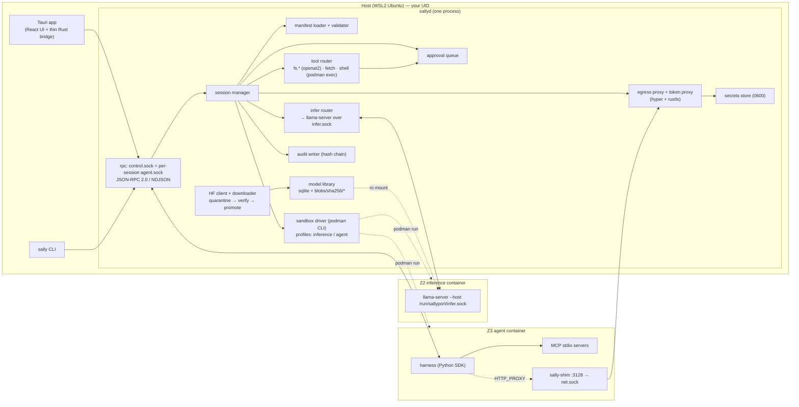

# Sallyport — Architecture (v1)

## 1. Stack, and where it departs from the original design

| Layer | Choice | Notes |
|---|---|---|
| Broker, sandbox orchestration, model validation, proxies, CLI | **Rust** (`tokio`, `hyper` 1.x + `rustls`, `rustix` for `openat2`, `rusqlite`, `serde`, `schemars`, `clap`, `tracing`) | Memory safety exactly where untrusted bytes are parsed. `#![forbid(unsafe_code)]` in every crate. |
| Desktop shell + UI | **Tauri v2** + React + TypeScript (Vite) | Kept. The Rust side of Tauri is a *thin client* of `sallyd`; the webview gets no fs/shell plugins. |
| Inference | **llama.cpp `llama-server`** in our own CUDA image | Kept. Pinned commit, built with `-DCMAKE_CUDA_ARCHITECTURES="86;89;120"`, CUDA 12.9. Prebuilt images lack sm_120. |
| Sandboxing | **Podman rootless + crun**, GPU via CDI | See THREAT_MODEL §6 for why not gVisor/microVM on WSL2 in v1. |
| Reference harness + SDK | **Python 3.12** | Runs inside Z3; language has no security weight; maximizes moddability. |
| Training sidecar | **deferred to v2** | Not in v1 at all. |

**Two deliberate deviations from the original requirements:**

1. **The broker is a separate daemon (`sallyd`), not a library inside the Tauri process.** Tauri
   starts it as a sidecar and the CLI talks to the same socket. Reasons: the UI crashing must not
   kill sandboxes; CLI and UI coexist; M1 is CLI-only and must not depend on Tauri; one process
   holds secrets, not two.
2. **"Egress proxy" is not a network proxy the sandbox can route to — the sandbox has no network.**
   Every container runs `--network=none`. A tiny static binary (`sally-shim`) inside the agent
   sandbox listens on `127.0.0.1:3128` and forwards each TCP connection over a bind-mounted Unix
   socket to `sallyd`, which speaks HTTP-proxy (CONNECT / absolute-form) and applies policy. This
   kills DNS exfiltration, raw-socket exfiltration and any "find the gateway" tricks by
   construction, and it needs zero iptables, which rootless Podman can't give us anyway.

## 2. Components



### 2.1 `sallyd` modules (crate `sallyd`, library crate `sally-core` for pure logic)

| Module | Responsibility | Trust-critical? |
|---|---|---|
| `sally-core::manifest` | Parse (strict), validate (denylist, realpath, wildcard rules, secret refs), summarize (plain English), JSON Schema export | **yes** |
| `sally-core::model::{gguf,safetensors,detect,hash,import}` | Format detection by magic, bounded parsers, SHA-256, zip import hardening, fit estimation | **yes** |
| `sally-core::audit` | Hash-chained NDJSON writer, verifier, redaction of secret values and oversize args | yes |
| `sally-core::secrets` | Load/store 0600 TOML; `Secret` newtype with redacted `Debug`, `zeroize` on drop; name-only references everywhere else | **yes** |
| `sally-core::hf` | HF Hub API client (search, repo files with LFS sha256, Range fetch of GGUF header), resumable downloader to quarantine | no (but handles untrusted bytes → bounded) |
| `sally-core::library` | SQLite index of blobs; content-addressed store; immutability (`chmod 0444`) | yes |
| `sallyd::sandbox` | Build `podman run` argv from manifest + profile; mount prep (realpath re-check, socket dirs); launch/exec/kill/wait; image digest check | **yes** |
| `sallyd::rpc` | `control.sock` (trusted methods, §4.1) and per-session `agent.sock` (the MCP subset, §4.2); bounded NDJSON framing, duplicate-key-refusing JSON, per-session rate and connection caps, `SO_PEERCRED` UID check before a byte is read, an audit entry before every reply | **yes** |
| `sallyd::llm` | Per-session `llm.sock` (§4.4): HTTP/1.1 through hyper; the broker reads and decides on the head itself and gates hyper's writes; strict body allowlist; the model backend is a constructor argument (M3 wires the engine) | **yes** |
| `sallyd::session` | Lifecycle: validate → ensure inference loaded → create socket dir → launch agent → wire → monitor → teardown (always, even on panic — `Drop` guard) | yes |
| `sallyd::infer` | Pool of at most one loaded model (v1); start/stop inference container; forward OpenAI-compatible requests over `infer.sock`; validate request JSON (allowed fields, size caps); stream back | yes |
| `sallyd::tools` | The built-in tools as the approvals `Executor` (§4.3, Task 11): `path` (guest path → mount + canonical rel), `args`, `fs` (openat2 beneath a checked root: the host pin for `brokered`/`ro`, the workspace's own view through the container init's `/proc/<pid>/root` for `rw`/`staged`), `tag` (destructive tagger), `shell` + `exec` (`podman exec` runner; finds, limits and kills the call's processes through pidfds), `procs`. `fetch` follows (#75) | **yes** |
| `sallyd::approvals` | Queue, canonicalization, rendering sanitization, single-use IDs, timeout, flood control, notifications to UI/CLI | **yes** |
| `sallyd::egress::{server,policy,addr,net,…}` | Accept streams from `net.sock`; parse the request head (bounded, CONNECT only in v1); policy decision; host addresses → resolve → filter → pinned connect; CONNECT splice. Grant hosts are refused until the token proxy (`inject`, Task 9a) terminates TLS for them | **yes** |
| `sally-shim` (separate crate, musl static, std only) | generic relay (AMENDMENTS-01 §3.3): `--listen LOOPBACK_IP:PORT=/abs/sock` (repeatable; `127.0.0.1:3128` → `net.sock`, `127.0.0.1:8080` → `llm.sock`) with one fresh UDS connection per TCP connection, opaque bidirectional copy with fixed 16 KiB buffers, half-close propagated, at most `--max-connections` (default 32, shared by all listeners; each costs two threads against the sandbox's `pids` limit) live connections, and a 30 s linger for a client that never closes after the server finished; `--stdio /abs/sock` for stdio clients. Parses nothing, holds no policy, listens on IPv4 loopback (127/8) only (`::1` too is refused); `make shim-check` keeps it static and dependency-free | low (dumb, inside the sandbox) |
| `sally-proto` | Shared request/response types; `ts-rs` generates TypeScript for the UI | no |
| `sally` CLI | `doctor`, `manifest validate`, `models …`, `secrets …`, `sandbox run`, `run`, `chat`, `approvals`, `audit tail\|verify`, `sessions …` | no |

## 3. Process and sandbox layout

### 3.1 Host filesystem
```
~/.config/sallyport/
  config.toml                 # paths, podman binary, image digests; [sandbox] runtime, runtime_path
  secrets.toml                # 0600; name = "value"
  manifests/*.yaml            # user manifests
~/.local/share/sallyport/
  library/library.db          # sqlite
  library/blobs/sha256/<hex>  # immutable 0444 model files
  library/quarantine/<uuid>/  # downloads before verification
  audit/audit-YYYYMM.jsonl    # hash-chained; audit.head = newest {seq, hash}; audit.lock
  sessions/                   # 0700
  sessions/<id>/              # 0700, created fresh per session (#10)
  sessions/<id>/profiles/     # the embedded seccomp profiles, written 0600 at launch
  sessions/<id>/stage/<n>/{upper,work}   # staged mount n: kept for `sally session changes`;
                                         # sandbox::staged_changes lists upper/ (RT-FS-15)
  sessions/<id>/git/<k>/{upper,work}     # .git overlays of rw mounts: discarded at teardown
  podman/                     # 0700: hermetic podman (#11, §3.5)
  podman/containers.conf      #   generated at startup; CONTAINERS_CONF of every podman call
  podman/config/              #   empty; XDG_CONFIG_HOME of every podman call
  podman/hooks/               #   empty; --hooks-dir of every podman call
  podman/mounts.conf          #   empty; --default-mounts-file of every podman call
  logs/
  bin/crun -> crun-<version>  # pinned upstream OCI runtime (static, signature-verified); the
                              # default sandbox.runtime_path. Never the distro crun (AMENDMENTS-02 B5)
$XDG_RUNTIME_DIR/sallyport/   # $XDG_RUNTIME_DIR must be ours and 0700 (checked at launch)
  control.sock                # 0600; CLI + UI
  infer/<instance-id>/infer.sock   # created by llama-server inside Z2
  sessions/<session-id>/      # 0700, created fresh per session
  sessions/<session-id>/workspace/net.sock   # created by sallyd, workspace role only (proxy mode)
  sessions/<session-id>/harness/{llm,agent}.sock   # created by sallyd, harness role only
```

### 3.2 `podman create` argv: common prologue (normative)
Built by the pure `sallyd::sandbox::{workspace,harness,inference}_argv` (one container per role,
AMENDMENTS-01 §2). The verb is `create`: the launcher checks the created container before it
starts it (§3.5). Every builder checks its own output with `check_argv` against a per-role
policy (`Allowed`), an **allowlist**:
- the global options exactly `--runtime <the checked runtime> --hooks-dir <Sallyport's empty
  hooks directory> --default-mounts-file <Sallyport's empty mounts file>`, then `create`;
- one spelling per option: `--flag value` for the options written that way below, `--flag=value`
  for the others, bare flags without a value; the other spelling is refused;
- only the options below, each with its exact value or value shape (`--user` is the session's
  ids, the seccomp profile is the role's file under the profiles directory, `--device` only
  `nvidia.com/gpu=all` and only for inference, environment variables only the role's exact
  name/value pairs plus `expose_env` placeholders);
- every option at most once (mounts, variables and `--security-opt` kinds included), every
  hardening option exactly once;
- every `-v` source a declared source of that role at its declared guest path: `ro` grants only a
  read-only bind, `rw` a read-write bind plus binds and overlays of paths inside it at the
  matching guest path, `staged` only an overlay; overlay upper and work directories only inside
  the session's scratch directory, and no two of them equal or nested; another role's socket
  directory is never a source (SI-2); `/` is never a source, scratch or profile directory;
- the image in the shared digest-pinned grammar (`sally_core::manifest::is_pinned_image_ref`:
  never a Podman transport such as `dir:` or `docker-daemon:`, SI-11);
- the command after the image exactly the role's fixed command.

The snapshots in `crates/sallyd/tests/snapshots/` are the normative examples.
```
podman --runtime <checked runtime_path>          # AMENDMENTS-02 B5: never the distro crun
  --hooks-dir <data>/podman/hooks                # empty, Sallyport-owned (#11)
  --default-mounts-file <data>/podman/mounts.conf  # empty: no system mounts.conf (6b review)
  create --rm --name sp-{ws|h|infer}-<id>
  --pull=never --http-proxy=false --log-driver=none --ulimit core=0   # AMENDMENTS-01 §6.1
  --network=none --no-hosts          # NOT --dns=none: Podman 4.9 rejects it with --network=none (preflight V4)
  --read-only --read-only-tmpfs=false
  --cap-drop=ALL --security-opt no-new-privileges
  --security-opt seccomp=<data>/sessions/<id>/profiles/seccomp-{workspace|harness|inference}.json
  --security-opt label=disable
  --userns=keep-id --user <uid>:<gid>
```
`label=disable`: the mounts are the user's own directories, which SELinux would only allow after relabelling (`:z`/`:Z` rewrites host labels); keeping SELinux confinement on SELinux hosts is #29 (M6).
`--user` is the caller's own `getuid`/`getgid` (the snapshots' `1000:1000` is the fixture's): with `keep-id` that is the host user inside, so `rw` writes stay the user's.
Bind mounts are `<host>:<guest>:{ro|rw},nosuid,nodev,bind` (`bind` = non-recursive). Overlays
are `<host>:<guest>:O,upperdir=<scratch>/upper,workdir=<scratch>/work` with nothing else: Podman
4.9.3 refuses other options next to `O` (probed in Task 6a), so overlays are not `nosuid,nodev`;
`no-new-privileges`, `--cap-drop=ALL` and the seccomp profile keep set-id files and device nodes
inert there.

### 3.3 Per role
**Workspace** (mounts, egress socket, toolchain; idles until the broker execs into it):
```
  --tmpfs /tmp:rw,{noexec|exec},nosuid,nodev,size=<tmp_size>
  --pids-limit <pids> --cpus <cpus> --memory <memory>b --memory-swap <memory>b   # no swap
  --init --env-host=false --hostname sandbox
  [--env {HTTP,HTTPS,ALL}_PROXY=http://127.0.0.1:3128 (and lowercase) --env NO_PROXY= --env no_proxy=]   # proxy mode
  [--env {SSL_CERT_FILE,REQUESTS_CA_BUNDLE,CURL_CA_BUNDLE,GIT_SSL_CAINFO,PIP_CERT,CARGO_HTTP_CAINFO,AWS_CA_BUNDLE}=/run/sallyport/ca-bundle.pem
   --env NODE_EXTRA_CA_CERTS=/run/sallyport/session-ca.pem]                                            # proxy mode + secrets
  [--env <expose_env>=sallyport-placeholder]
  -v <host>:<guest>:ro,…        # ro and brokered
  -v <host>:<guest>:rw,…        # rw; then from the launch scan (required for every rw mount, AMENDMENTS-02 B2(a)):
  -v <host>/<p>:<guest>/<p>:rw,…                               # every directory between the root and a .git entry, bound
                                                               # onto itself so it cannot be renamed away (EBUSY)
  -v <host>/<rel>/.git:<guest>/<rel>/.git:O,upperdir=<data>/sessions/<id>/git/<k>/upper,workdir=…/work
  -v <host>/<rel>/.git:<guest>/<rel>/.git:ro,…                 # .git files (worktree/submodule pointers)
  -v <host>:<guest>:O,upperdir=<data>/sessions/<id>/stage/<n>/upper,workdir=…/work      # staged (B2(b))
  -v $XDG_RUNTIME_DIR/sallyport/sessions/<id>/workspace:/run/sallyport:ro,…               # net.sock + CA bundle (connect only)
  <runtime.image or bundled workspace image>@sha256:<digest> /opt/sallyport/entry --idle
```
**Harness** (no mounts, no egress, no GPU; fixed 1 CPU, 1 GiB, 128 pids):
```
  --tmpfs /tmp:rw,noexec,nosuid,nodev,size=256MiB --pids-limit 128 --cpus 1 --memory 1GiB --memory-swap 1GiB
  --init --env-host=false --hostname sandbox
  --env OPENAI_BASE_URL=http://127.0.0.1:8080/v1 --env OPENAI_API_KEY=sallyport
  -v $XDG_RUNTIME_DIR/sallyport/sessions/<id>/harness:/run/sallyport:ro,…                 # llm.sock, agent.sock (connect only)
  <harness.image or bundled harness image>@sha256:<digest> /opt/sallyport/entry
```
**Inference** (GPU, one read-only model file):
```
  --tmpfs /tmp:rw,noexec,nosuid,nodev,size=256MiB --pids-limit 64 --cpus <n> [--memory <m>b --memory-swap <m>b]
  --init --env-host=false [--device nvidia.com/gpu=all]
  -v <blobs>/sha256/<hex>:/models/model.gguf:ro,…
  -v $XDG_RUNTIME_DIR/sallyport/infer/<id>:/run/sallyport:rw,…   # llama-server creates infer.sock
  <inference image>@sha256:<digest>
  llama-server --host /run/sallyport/infer.sock -m /models/model.gguf
               -ngl <n> -c <ctx> --jinja --no-webui -np 1 --log-disable
```
`-m` is always passed (without it llama-server boots as a multi-model router); `check_argv`
accepts exactly this command with only the `-ngl`/`-c` numbers varying, so `--models-dir`,
`--models-preset`, `--slot-save-path`, `--webui*`, `--path`, `--lora`, `-hf` and every other flag
are refused (AMENDMENTS-01 §6.2). Each role has its own socket directory; no role can see
another's sockets. Podman configuration outside the argv (`containers.conf`, `mounts.conf`, OCI
hooks, `CONTAINER_HOST`) is not covered by `check_argv`; hermetic podman (§3.5) controls it.

### 3.4 Seccomp
Start from `containers-common`'s default profile and **remove**: `mount, umount2, pivot_root,
chroot, ptrace, process_vm_readv, process_vm_writev, keyctl, add_key, request_key, bpf,
perf_event_open, userfaultfd, io_uring_setup, io_uring_enter, io_uring_register, unshare,
setns, kexec_load, kexec_file_load, reboot, swapon, swapoff, init_module, finit_module,
delete_module, acct, settimeofday, clock_settime, mknod, mknodat, personality, uselib,
vhangup, quotactl, lookup_dcookie, nfsservctl, open_by_handle_at, name_to_handle_at`, plus the
same capabilities under other names: the new mount API (`fsopen, fsconfig, fsmount, fspick,
move_mount, open_tree, mount_setattr`), `umount`, `stime, clock_settime64, clock_adjtime,
clock_adjtime64`, `quotactl_fd` and `pidfd_getfd`, and `socketcall` and `syslog` (6b security
review). Every remaining non-errno rule is a plain `SCMP_ACT_ALLOW`, and:
- `clone` is allowed only without namespace flags (`arg0 & 0x7E020000 == 0`, Docker's rule): no
  nested user, network, mount, PID, IPC, UTS or cgroup namespace, so no `CAP_NET_ADMIN` over
  nf_tables in a fresh network namespace. `clone3` is not allowed (its flags are in memory
  seccomp cannot read); it fails with ENOSYS and libc falls back to `clone`.
- `socket` is allowed per address family: `AF_UNIX`, `AF_INET`, `AF_INET6` and `AF_NETLINK`
  (`NETLINK_ROUTE` only, by equality) for workspace and harness, `AF_UNIX` only for inference. Every other
  family fails, in particular `AF_VSOCK`, which network namespaces do not isolate (on WSL2 and
  other VMs it reaches the host).
- Only native architectures are listed (x86-64, aarch64, no 32-bit sub-architectures), so the
  32-bit ABI (`int 0x80`, the unfilterable `socketcall`) never reaches an allow rule.

The profiles are `profiles/seccomp-{workspace,harness,inference}.json`, derived by
`scripts/gen_seccomp.py` from containers-common's profile and committed. They are embedded in
`sallyd` and written into the session's 0700 `profiles/` directory at launch (#10), so no file
outside Sallyport's control decides what a sandbox may call. Unit tests check the removals and
the inference socket filter independently of the generator; RT-FS-07 and RT-FS-09 test them in
a container.

### 3.5 Launch (normative, Task 6b)
`sallyd::sandbox::Launcher::launch_workspace`, in this order. The launch runs in its own task:
a caller that goes away cannot interrupt it, and a launch nobody receives is stopped again. Any
failure audits `sandbox.refuse` (or `sandbox.mount_mismatch`) with a reason and the cleanup
outcome. It removes the container by its name `sp-ws-<id>`, even when `create` printed no id,
and removes only the directories this launch created: an id whose directories exist is refused
before anything is created, so a stopped session's kept `stage/` is never touched. The claims
are released only once the container is confirmed gone.

1. **Overlap rule** (AMENDMENTS-02 B4, RT-AG-08b). Two live sessions may mount overlapping host
   directories (the same directory, or one inside the other) only when neither mount is `rw` or
   `brokered`. Overlap is decided by path and by identity. Each claim carries the
   `st_dev:st_ino` of its root and of every ancestor up to `/`, walked with `..` from an fd. A
   directory reached through a bind alias or a second mount of the same filesystem therefore
   still conflicts. No sandbox ever holds write access to an ancestor, a descendant or the same
   directory as another session's mount, so no live sandbox can swap what another session's
   launch scan pinned. `Launcher::remove_orphans` removes `sp-ws-*`/`sp-h-*` containers a
   previous `sallyd` left running (audited `sandbox.orphan_removed`); `sallyd` calls it before
   it accepts the first launch.
2. **Checks.** The runtime binary and the podman binary are re-checked (B5). Everything podman
   reads from Sallyport's state is re-checked too: the state directory is private, `hooks/` and
   `config/` are empty, `mounts.conf` is empty, and `containers.conf` is byte-identical to what
   was generated.
3. **Launch scan** (`scan_mounts`). One bounded walk per mount from a pinned directory fd,
   `openat2(RESOLVE_BENEATH | RESOLVE_NO_SYMLINKS | RESOLVE_NO_MAGICLINKS | RESOLVE_NO_XDEV)`
   (SI-8):
   - The mount root is opened without following any symlink, including in its ancestors, and
     must still be the validated `st_dev:st_ino` (RT-FS-06).
   - A Unix socket anywhere refuses the launch (`socket-in-mount`, RT-FS-13), in every mode and
     inside `.git` (git's fsmonitor socket): `connect` works on a read-only mount.
   - The walk never enters another filesystem mount, and never shields a mount point of any
     kind, directory or bind-mounted file. Non-recursive binds and overlays hide nested mounts
     from the sandbox (RT-FS-16). `statx` must report `STATX_MNT_ID` (kernel ≥ 5.8), or the
     scan refuses rather than walk blind.
   - In an `rw` mount, every `.git` directory and `.git` file is recorded, sorted, together with
     the identity of each of them and of every directory between it and the root. A `.git`
     symlink is neither shielded nor followed.
   - More than 32 shielded entries in one `rw` mount, 250 000 entries, a depth of 64, or 16 MiB
     of paths waiting to be listed, refuses the launch. For an `rw` mount the message recommends
     `staged`. Only the scanner can construct a `GitScan` or a `LaunchScan`, and a scan is
     bound to its manifest's mounts (realpath and identity).
4. **Session directories** (#10). `sessions/<id>` is created fresh and 0700 under both roots,
   along with the role socket directories, `profiles/` (with the embedded profiles written
   0600), and the overlay upper and work directories, each 0700. `$XDG_RUNTIME_DIR` must be
   owned by the user and 0700. Then the **image check** (`images.rs`, RT-SUP-01/02): hermetic
   `podman image exists` must find the pinned reference and `image inspect` must list the pinned
   digest among its `RepoDigests` (exactly one JSON list of strings; anything else is refused).
   Otherwise the launch is refused `digest-mismatch`; a podman error is refused as `podman`. The
   check exists for the clear reason only: enforcement is the digest reference plus
   `--pull=never` at `podman create`, so nothing depends on the gap between the two.
5. **Argv** (§3.2), then, with `network.mode: proxy` only, the **egress listener** (Task 8):
   `sessions/<id>/workspace/net.sock` is bound 0600 (through `/proc/self/fd` of the opened
   directory, so no path length can exceed `sun_path`) and served by the session's proxy. A bind
   failure is refused `egress-listener`. The listener lives with the running session: `stop`
   shuts it down after the container is gone (open tunnels audit `egress.close` with `end:
   session-stopped`), a failed launch drops it. Then **audit** `sandbox.launch` (SI-4: before
   anything is visible).
6. `podman create`; then every pin is re-checked on the host (`LaunchScan::recheck_host`), then
   `podman init`. The runtime builds the mounts but starts nothing.
7. **Post-init mount check** (B4). From the host, under `/proc/<init-pid>/root` with
   `RESOLVE_IN_ROOT | RESOLVE_NO_SYMLINKS`, every bind-mounted pin (mount roots, the `.git`
   parent self-binds, `.git` pointer files) must show its pinned `st_dev:st_ino`. On a mismatch
   the container is removed and `sandbox.mount_mismatch` is audited. Overlay lower layers report
   the overlay's own device, so they rely on step 6's host re-check and on the overlap rule.
   TODO(#15): the OCI config verifier runs here (Task 14).
8. `podman start`, then the **running check** (Task 6c): after a 250 ms grace, `podman inspect`
   must report the container running as the pid checked in step 7. `start` succeeds even when
   the entry point exits at once, and a container that exited is already gone (`--rm`). Either
   way the launch is refused (`not-running`), and everything it created is removed.

**Disk watchdog** (#14, Task 6c; maintainer design after the 6c-1 reviews). A sandbox writes to
the host disk through its `rw` mounts and through the upper directories of its `staged` mounts
and of its `.git` overlays. Each session whose sandbox can do either gets two tasks:

- **Free-space floor** (the hard, race-free guarantee; `disk.rs`).
  - It watches every filesystem the sandbox can write to: the state filesystem, when the session
    has staged mounts or `.git` overlays, and the filesystem of each `rw` mount root. Each is held
    by an `O_PATH` fd.
  - Every 250 ms it reads `fstatfs`. When the space available to unprivileged users falls below
    the floor, `max(4 GiB, 5 %)` by default, the session is killed. The audit reason is
    `disk_floor`, with the filesystem, the free bytes and the floor.
  - A `statfs` that fails or takes over 5 s fails closed.
  - A launch is refused (`disk-floor`) unless every watched filesystem has the floor free, plus
    `runtime.stage_size` on the state filesystem.
  - It reads the filesystem's own accounting, so renames, open unlinked files and `O_TMPFILE`s
    all count.
  - It never waits for a walk, the walk permit or the exec gate.
- **`stage_size`** (a soft limit).
  - There is no periodic walk. The floor task tracks the state filesystem's used bytes, and wakes
    the stage task only when they have grown past the session's headroom since the last accurate
    measurement. The baseline is lowered whenever usage shrinks, which is conservative.
  - The stage task takes the global one-walk permit, then the session's exec gate. An exec holds
    `Running::exec_gate` only while it starts, because a running exec process freezes with the
    container's cgroup (`tools::exec`, #24); a file tool's write or delete in the workspace's
    view holds it for the whole operation. Then the stage task runs `podman pause` (the cgroup
    v2 freezer), walks the upper directories, and runs `podman unpause`.
  - The walk goes through directory fds, never follows a symlink, holds one fd per level, and is
    bounded at 1 000 000 entries, 64 levels and 10 s. The permit stays with the walk until it
    stops.
  - Because the sandbox is frozen, any error fails closed, including an entry that vanished.
  - Over the limit, unmeasurable, or past the deadline: that session is killed (reasons
    `stage_size`, `unmeasurable`). The audit entry names the area: `filesystem.mounts[n]` or
    `filesystem.mounts[n].git[j]`, never a host path.
  - Walks of one session are at least 2 s apart, or four times the last walk's duration if that
    is longer.

**Freeze hygiene.**
- A guard unpauses on every path except a kill, panics and cancellation included. If the unpause
  fails, the container is removed.
- A failed `unpause` after a walk kills the session (`unpause_failed`).
- A failed `pause` kills it (`pause_failed`), unless the container is gone; then the watchdog
  ends.

**Killing.** Every kill audits `session.resource_limit` first, then kills and removes the
container, retrying every 2 s until it is confirmed gone. It audits `session.kill_failed` once if
the first attempt fails. The kill happens even if an audit write fails.

Teardown stays with `Launcher::stop`, which keeps the staged data. Dropping the session's handle
stops both tasks and any walk in progress. A launch nobody received is stopped with retries
until its container is gone, and keeps its watchdog meanwhile.

**Teardown** (`Launcher::stop`) audits `sandbox.stop`, then runs `podman rm --force --time 0`
and confirms the container is gone (`podman container exists`). If it is not gone, the session
keeps its claims and the caller gets the handle back to retry. Otherwise teardown removes
`git/` and `profiles/` through `podman unshare` (overlay work directories belong to the
container's user namespace), removes the socket directory, keeps `stage/`, and releases the
overlap claims.

**Hermetic podman** (#11). Every podman process gets a cleared environment plus `HOME`,
`XDG_RUNTIME_DIR`, `XDG_DATA_HOME` (when set) and `PATH=/usr/bin:/bin:/usr/sbin:/sbin`. It also
gets:
- `CONTAINERS_CONF=<data>/podman/containers.conf`, generated at startup. On Podman 4.9.3 it
  replaces the system file, the user file and their drop-ins; probed in Task 6b.
  `CONTAINERS_CONF_OVERRIDE` would still be read, and it is never passed.
- `XDG_CONFIG_HOME=<data>/podman/config` (empty), so the user's `storage.conf`, `mounts.conf` and
  `registries.conf` are not read either.
- `--hooks-dir` naming the empty hooks directory and `--default-mounts-file` naming the empty
  mounts file. Rootless podman reads `mounts.conf` through that flag; the `containers.conf` key
  had no effect when probed in Task 6b.

The generated file has no default volumes, devices, capabilities, environment, sysctls,
ulimits, annotations or mounts. Namespaces are private, there is no keyring, events and logs are
off, and remote is off. The runtime, `conmon` and `catatonit` (`--init`) are explicit paths that
passed the runtime's ownership checks. The podman binary is resolved once
(`sandbox.podman_path`, else the first `podman` on `sallyd`'s `PATH`) and gets the same checks.
Every podman command has its output capped at 64 KiB per stream and is killed after 120 s.

**Consequences.**
- A user whose image store is configured through `~/.config/containers/storage.conf` (a
  non-default `graphroot`) must move it to the default location. `sally doctor` will report it.
- On Podman 4.9.3, a `staged` mount over a folder with another filesystem mounted inside it
  cannot launch: the runtime refuses the overlay in the keep-id user namespace (`EINVAL`, probed
  in Task 6b). The launch fails closed after `init`, and nothing runs.

## 4. Broker API

Transport: JSON-RPC 2.0, newline-delimited JSON over Unix stream sockets. Max frame 1 MiB
(control) / 256 KiB (agent); `llm.sock` is HTTP/1.1 instead (§4.4, 4 MiB bodies). Notifications
stream events. Errors use JSON-RPC codes plus `data.reason`. Every socket checks the peer's UID
(`SO_PEERCRED`) before it reads a byte: the expected UID is `sallyd`'s own, which under
`--userns=keep-id` is also the sandbox user's (§7); a mismatch is closed and recorded `rpc.deny` /
`llm.deny` with reason `peer-uid`. Every refusal that sends a reply has its own entry first.

### 4.1 `control.sock` — trusted clients (CLI, Tauri)

| Method | Purpose |
|---|---|
| `doctor.run` | environment checks (returns the V1–V9 table results) |
| `manifests.list` / `manifests.get` / `manifests.validate` / `manifests.save` / `manifests.summary` | manifest CRUD + plain-English summary |
| `models.list` / `models.inspect` / `models.import` (path) / `models.remove` / `models.fit` (model, ctx) | library |
| `hf.search` (query, filters) / `hf.files` (repo, revision) / `hf.pull` (repo, file) → job id | Hugging Face |
| `jobs.list` / `jobs.cancel`; notification `job.progress` | long-running work |
| `infer.load` (model) / `infer.unload` / `infer.status` | inference lifecycle |
| `chat.complete` (session-less chat using the loaded model; same body as `infer.complete`) | Chat screen |
| `sessions.create` (manifest, task, model?) / `sessions.list` / `sessions.stop` / `sessions.attach` | agent sessions |
| `ui.send` (session, text) — user → harness; notification `ui.message` — harness → user | chat with an agent |
| `approvals.list` / `approvals.decide` (id, approve\|deny\|deny_all_session); notification `approval.requested` / `approval.flood` | gate |
| `secrets.set` (name, value) / `secrets.list` (names only) / `secrets.remove` | store; values are write-only |
| `audit.tail` (filter, follow) / `audit.verify` | log |

Until Task 12 fills the table, every method is `-32601` and recorded `rpc.deny {socket:
control}`; no control method resolves on the session socket's table (a unit test holds that).

**Approvals** (Task 10; `sallyd::approvals`). Only a host client on this socket answers; the
session's tool handler holds the asking half (`Gate`) and never the answering half (`Desk`), and
Task 12 serves `approvals.*` from the `Desk` with the client taken from `SO_PEERCRED` (#65).
`approve` runs that one action once. `deny_all_session` needs a pending id (a stale one is
`unknown-id` and sets nothing); it denies that request and every pending one, each with its own
entry, and latches the session: every later prompt is denied `session-denied` unasked, while
actions that need no approval still run. It cannot be undone. There is no "allow for this
session". With no client attached, every prompt is denied `no-approver`.

### 4.2 `agent.sock` — untrusted client (the harness). **Method table is a strict allowlist.**

The broker is an MCP server for tools only (Task 7; MCP specification 2026-07-28 and its schema,
read 2026-11-11). Framing is MCP's stdio framing: one JSON-RPC message per line. Clients that
spawn a stdio server run `sally-shim --stdio /run/sallyport/agent.sock`. The subset is
hand-written in `sallyd::rpc`; no MCP SDK crate is in the TCB.

| Method | Behavior |
|---|---|
| `server/discover` | 2026 only: supported versions, `serverInfo`, `capabilities: {tools: {}}` |
| `initialize` | legacy only: starts the legacy lifecycle on this connection |
| `notifications/initialized` | legacy only: ignored (recorded `rpc.request`) |
| `ping` | legacy only: empty result |
| `tools/list` | the session's tools with their JSON schemas; never a cursor (one is `-32602`) |
| `tools/call` (`name`, `arguments`) | recorded `rpc.request` (the tool and the arguments' shape, never their values), then dispatched with the broker's call number (unique in the session; the harness's id is only display text) to the gated handler: the executor (Task 11) builds the action that will run, the approvals gate admits it (policy; a prompt bound to the action's digest), and the executor runs only the resulting ticket, writing its effect entry first (#62). Blocks until executed, denied or timed out (`approvals.timeout`); a denial is `isError: true` with text `denied: <code>`; a call whose entry could not be written gets no reply. Approval never round-trips through the sandbox |
| `notifications/cancelled` (`requestId`, `reason?`) | both lifecycles: suppresses the reply of a matching in-flight call (recorded `rpc.cancel` first) and withdraws a prompt it waits on (`approval.withdraw`); a closed connection withdraws its calls' prompts the same way. The handler is never dropped by a cancel or a closed connection and keeps its slot until it returns; session teardown aborts it (after `STOP_GRACE`, 2 s, or at once when the listener handle is dropped), so a handler is safe to drop at any await (#62) |

Everything else → `-32601` + `rpc.deny`: resources, prompts, sampling, elicitation, roots,
logging, subscriptions, tasks, and every control method. The server never sends a request of its
own. A batch is `-32600` with `id: null`; a client response is dropped; a notification it cannot
classify is dropped; each of these is recorded `rpc.deny`.

**Lifecycles.** Each request is classified on its own:

| | 2026-07-28 (stateless) | Legacy (2025-11-25, 2025-06-18, 2025-03-26) |
|---|---|---|
| Recognised by | `params._meta` carries both `io.modelcontextprotocol/protocolVersion` and `…/clientCapabilities` | a request without those keys, on a connection that completed `initialize` |
| Version | must be `2026-07-28`, else `-32022` (`data.supported` lists every version) | the client's version echoed if listed, else `2025-11-25` offered; a second `initialize` is `-32600` |
| `server/discover` | served | `-32601` (`wrong-lifecycle`) |
| `ping`, `notifications/initialized` | `-32601` / dropped, each recorded `rpc.deny` | served / ignored |
| Results | carry `resultType: "complete"`; `tools/list` adds `ttlMs: 0` and `cacheScope: "private"` (the tool table is per session) | no `resultType`, `ttlMs` or `cacheScope` |

A request with one 2026 key but not the other, or with neither on a connection that did not
`initialize`, is `-32602` — never a fallback to the other lifecycle.

**Bounds** (each a named constant with a boundary test): frames 256 KiB (an oversize frame is
recorded, then the connection closes); nesting depth 64; ids ≤ 128 bytes; method names ≤ 64
bytes; tool names 1–128 bytes; duplicate JSON keys refused. Per session: 8 connections (the
listener stops accepting at the cap), 16 `tools/call` in flight (the 17th is `-32000`
`too-many-in-flight`, recorded first), a reused in-flight id `-32600`, and 20 requests read per
second with a burst of 40. Over the rate the broker stops reading (backpressure): requests are
slowed, never dropped unrecorded. A reply the peer does not take within 10 s closes the
connection. Prompts: at most `approvals.max_pending` wait at once, and new ones come at most one
per 2 s with a burst of `max_pending` (`approvals::queue::REFILL`, tunable); a call over either
bound is denied `approval-flood` with its own `approval.deny` entry, and each flood episode (until
the queue is empty and the rate full again) writes one `approval.flood`. With 16 calls in flight
at most, a `max_pending` above 16 is never reached.

The `net.sock` stream channel is not JSON-RPC; it carries raw proxy connections from the shim.

### 4.3 Built-in tools (brokered)

Names on the wire and in manifests are function-name safe. Tool descriptions are static strings
compiled into the broker; manifest or user text is never interpolated into them.

| Tool | Args | Executes | Policy |
|---|---|---|---|
| `fs_list` | `{path}` (the mount root allowed) | broker, `openat2` beneath the mount's root (see below) | path must resolve inside a mount; every mode; never asked; `tool.read` at every level (count, `truncated`, sha256 of the listing) |
| `fs_read` | `{path, offset?, len?}` | broker, as `fs_list` | same; regular files only; at most 1 MiB per call (`len` cut to it); `tool.read` (path, size, bytes, sha256; never the content) |
| `fs_write` | `{path, content_b64}` (strict base64) | broker: on the host folder for `brokered`; in the workspace's view for `rw`/`staged` | `ro` → denied; `rw`/`staged` → runs, audited (path, bytes, sha256; staged writes land in the session's upper directory); `brokered` → `approve.writes` globs → pending; a `.git` component in any case → `protected-path` |
| `fs_delete` | `{path}` | as `fs_write` | as `fs_write`, with `approve.deletes`; a regular file or an empty directory |
| `fetch` | `{url, method?, headers?, body?}` | broker egress path | not offered until #75 (a granted call is `denied: tool_unavailable`): same egress policy and injection as the proxy; non-GET/HEAD per `tools.fetch_writes`; response capped and redacted |
| `shell` | `{cmd: [1–256 strings], cwd?}` (default: the first mount's root, else `/`) | `podman exec --workdir=<cwd> <container> <cmd…>` in the **workspace** container: the container's environment, no stdin, no terminal | `tools.shell` deny / approve / allow (+ destructive tags); 300 s, then the call is killed; output read incrementally, 64 KiB kept per stream; one reply per call |
| `<server>__<tool>` | the server's schema | relayed to a declared MCP server (M4) | per-server `approve` |

**Where file tools resolve** (maintainer's Task 11 decisions 1–2; architect rulings Q29, Q30,
Q37). Every path resolves with `openat2(RESOLVE_BENEATH | RESOLVE_NO_SYMLINKS |
RESOLVE_NO_MAGICLINKS)` from a checked root fd, at prepare and again at run: a `..`, any symlink
(the last component too) or a magic link is `path_escapes_mount`. `brokered` and `ro` mounts use
the host folder, opened by its realpath without following a symlink and compared with the launch
pin on every call (`mount-changed`), with `RESOLVE_NO_XDEV` added: a file system mounted inside
the folder on the host is invisible in the sandbox, and to the tools. `rw` and `staged` mounts use
the workspace's own view, `/proc/<init pid>/root` through the init's `/proc/<pid>` directory fd
taken at launch (a dead init refuses the call: `container-gone`); the `rw` guest root must show
the pin, the `staged` one must be an overlay mount root. A write there lands where an in-container
write would (the host folder of an `rw` mount behind its `.git` shields; a `staged` mount's
upper directory), and holds the session's exec gate for the whole operation. A broker-side write
never reaches the host folder of a `staged` or `ro` mount. A file is reached `O_PATH`, must be
regular after `fstat` and is judged (below) before the same inode is opened for I/O through
`/proc/self/fd`, so a FIFO or device is never opened. That open is `O_NONBLOCK`: a file another
process holds a lease on fails at once instead of parking a broker thread (and, for a write,
the exec gate) until the lease breaks (ruling Q40). A write opens without `O_TRUNC` and
truncates after those checks; on `brokered` mounts a file with more than one link is refused
(`hard-link`).

**Whose permissions** (architect ruling Q39). `sallyd` holds supplementary groups the sandbox
lacks: the workspace runs as `uid:gid` alone (§3). So in every mode, for every operation, the
tools first judge the object's mode bits for that `uid:gid` (the launcher's `UserIds`) and refuse
what the sandbox could not do (`permission`). Class: owner if the uid matches; else, when the
object carries a POSIX ACL (or its presence cannot be read), nothing; else group if the gid
matches; else other. The walk is fd-anchored: each directory, the mount root included, needs x
before the next component opens, so a refusal says nothing about what lies deeper. A read needs r;
a listing r and x; a write to an existing file w on the file; a create w and x on the parent,
with `O_EXCL` so the case judged is the case that ran; a delete w and x on the parent (the sticky
rule is the kernel's). `prepare` runs the same checks, so nobody is asked about a call that cannot
run. Brokered writes the user approves are narrowed too: a folder reachable only through a
supplementary group is not writable through the broker.

**Shell** (decision 3; #24, #62; ruling Q32). The runner holds the exec gate only until it has
found the started process: the new process in the container's pid namespace whose parent is
outside it (the exec's `conmon`), still the same process a poll later. It then holds a pidfd.
On the time limit, after a normal exit, and best-effort on drop, it kills the call: the started
process, its descendants and the members of its session (crun gives each exec its own), never the
init or the init's session. Killing the `podman exec` client alone would leave the command running.

### 4.4 `llm.sock` — OpenAI-compatible HTTP (the harness)

HTTP/1.1 in the broker (hyper on the session's Unix listener), one request per connection. The
harness reaches it through the shim at `OPENAI_BASE_URL=http://127.0.0.1:8080/v1` with
`OPENAI_API_KEY=sallyport` (a dummy).

| Route | Behavior |
|---|---|
| `POST /v1/chat/completions` | body checked, recorded `llm.request`, then answered by the backend; `stream: true` → server-sent events, then `data: [DONE]` |
| `GET /v1/models` | the session's model only |
| anything else | `404` + `llm.deny` (`not-found`) |

**The head.** The broker reads the request head itself (≤ 8 KiB, ≤ 64 headers, within 10 s),
because hyper answers a head it refuses with its own 400/431, which would be a reply with no
entry before it (`docs/dev/PROBE_NOTES.md`). Every allow or deny decision is made on this one
parse: HTTP/1.1 only, one `Content-Length` (digits only; a repeat, even an equal one, is
refused), no `Transfer-Encoding`, the exact route. hyper then serves the replayed bytes, and the
service checks that hyper read the same method, request-target, version and body length; any
difference is closed unanswered and recorded `head-mismatch`. hyper's writes stay gated until
the request has its entry, so anything it answers by itself is dropped and recorded
`http-error`.

**The body** (≤ 4 MiB; a larger `Content-Length` is `413` before a byte is read; within 30 s,
else `408`). Strict nested allowlist, duplicate keys refused:

- Top level: `model` (ignored and dropped: the backend never sees it), `messages`, `tools`,
  `tool_choice`, `parallel_tool_calls`, `temperature`, `top_p`, `max_tokens` /
  `max_completion_tokens` (one at most), `stop`, `seed`, `stream`, `stream_options`,
  `response_format`, `presence_penalty`, `frequency_penalty`, `n` (must be 1).
- Message content: text parts only (an image, audio or file part is `400 non-text-part`).
  `tool_calls` only on assistant messages, `tool_call_id` only on tool messages; tool and
  function names match `[A-Za-z0-9_-]{1,64}`. `parameters` and `json_schema` are opaque JSON
  (#55).
- The token limit: more than `model.context` is `400 token-limit`, `0` is `400 bad-value`;
  absent, the backend is given `model.context` as the bound (always explicit). The M3 fit
  estimator clamps further.

Refusals are answered `{"error": {"message", "type", "param", "code"}}` (OpenAI's shape) after
their `llm.deny` entry. **Bounds per session:** 4 connections; 5 requests read per second with a
burst of 10 (backpressure, as on `agent.sock`); a streamed reply is cut at 16 MiB (no
`[DONE]`; `llm.response` says `cut: true`); a write stalled for 10 s fails the connection.
A client that shuts its write side after its request is still answered (hyper's `half_close`
on; the shim passes half-close on). The cost: a peer that disconnects during a whole
(non-streamed) completion is noticed only at the first write, so the backend runs on with
nobody listening, bounded by the connection cap and the rate; the M3 backend must stop such a
completion (#60). The backend is a constructor argument:
until M3 none is wired in production (#53), and the scripted mock model exists only in the test
tree.

## 5. Data flows

### 5.1 Pull a model from Hugging Face
```mermaid
sequenceDiagram
    participant UI
    participant D as sallyd
    participant HF as Hugging Face
    participant LIB as library
    UI->>D: hf.files(repo)
    D->>HF: GET /api/models/{repo}?blobs=true (HF token from store, host only)
    HF-->>D: siblings[] {rfilename, size, lfs.sha256}
    D->>HF: GET resolve/{file} Range: 0-4194303 (GGUF header only)
    D-->>UI: quants with sizes, metadata, fit badge (VRAM/RAM estimate)
    UI->>D: hf.pull(repo, file)
    D->>D: check free disk ≥ size + 5%
    D->>HF: GET resolve/{file} (resumable) → quarantine/<uuid>/
    D->>D: ext allowlist → magic → strict header parse → sha256 == lfs.sha256?
    alt any check fails
        D->>D: delete quarantine, audit model.refuse(reason)
        D-->>UI: error with reason
    else ok
        D->>LIB: mv → blobs/sha256/<hex>, chmod 0444, insert row
        D-->>UI: job.done; audit model.import
    end
```

### 5.2 Agent tool call with approval
```mermaid
sequenceDiagram
    participant H as harness (Z3)
    participant D as sallyd
    participant U as user (UI/CLI)
    participant C as podman exec (Z3)
    H->>D: tools/call shell {cmd:["rm","-rf","build/"]} (blocks)
    D->>D: call number n; action = argv as it will run; tools.shell == approve → audit tool.pending
    D-->>U: approval.requested {id, action (escaped), digest, risk_tags}
    U->>D: approvals.decide(id, approve) over control.sock
    D->>D: id taken once ✓ → audit approval.decide {client} → ticket = the broker's own copy
    D->>D: audit tool.run (the ticket's action and digest)
    D->>C: podman exec … rm -rf build/ (from the ticket)
    C-->>D: exit code, stdout/err (capped)
    D->>D: kill what the call left in its session → audit tool.result {exit, sizes, sha256}
    D-->>H: tools/call result {exit, killed, stdout, stderr}
```

### 5.3 Egress to a grant host (interception; Task 9a)
```mermaid
sequenceDiagram
    participant P as git / pip / curl (workspace)
    participant S as sally-shim (workspace)
    participant E as egress proxy (sallyd)
    participant X as api.github.com
    P->>S: CONNECT api.github.com:443  (HTTPS_PROXY=127.0.0.1:3128)
    S->>E: new UDS connection, bytes copied
    E->>E: authority → policy: allowed, grant host → route Intercept
    E->>E: resolve → filter (no loopback/private/own) → pin IPs
    E->>E: audit egress.allow {host, port, addresses, intercept: true}
    E->>X: TCP to a pinned IP, TLS (rustls, SNI api.github.com, session trust roots)
    E-->>P: 200 Connection Established (only after upstream verification)
    P->>E: TLS (session-CA leaf for api.github.com, ALPN http/1.1)
    P->>E: GET /user (HTTP/1.1)
    E->>E: check head (origin-form, one Host = CONNECT authority, no TRACE, no Upgrade, framing)
    E->>E: drop hop-by-hop, Proxy-*, Accept-Encoding, every client Authorization; rebuild Host
    E->>E: audit egress.request {host, port, method, target, injected: ["secret:NAME"]}
    E->>E: set Authorization from the credentials (after the entry, last)
    E->>X: GET /user (same upstream connection for the next request)
    X-->>E: 200 + body (no Content-Encoding, plain or chunked)
    E->>E: check response head (no Content-Encoding, no 101); redact header lines; cap the body; never follow 3xx
    E-->>P: response, body redacted as it streams (same length)
    E->>E: audit egress.close {host, port, address, bytes_up, bytes_down, end, intercept, requests, statuses}
```
An allowed host without a grant is spliced: after `egress.allow {…, intercept: false}` and the
`200`, the proxy copies bytes and never sees the plaintext. Plain-HTTP requests are refused 405
`plain-http-unsupported` before policy (Task 8), grant host or not.

### 5.4 Session start
`sessions.create` → validate manifest (again) → resolve model → `infer.load` if needed (Z2 up,
health check over `infer.sock`) → create session dir + `agent.sock` (+ `net.sock`) → re-check
mounts (TOCTOU) → `podman run` Z3 → wait for harness `session.info` within 30 s → `running`.
Teardown on stop/timeout/crash: `podman kill`, remove session dir, audit `session.stop`.

## 6. Repository structure

```
sallyport/
├── CLAUDE.md
├── THREAT_MODEL.md
├── SECURITY.md                      # M6
├── README.md
├── Cargo.toml                       # workspace; [workspace.lints] forbid unsafe, clippy pedantic subset
├── rust-toolchain.toml              # pinned stable
├── deny.toml                        # cargo-deny: licenses, advisories, bans
├── Makefile                         # dev, test, redteam, redteam-gpu, images, lint
├── crates/
│   ├── sally-core/                  # manifest, model parsers, audit, secrets, hf, library (no I/O side effects beyond fs)
│   ├── sallyd/                      # daemon: rpc, session, sandbox, infer, tools, approvals, egress
│   ├── sally-cli/                   # `sally`
│   ├── sally-shim/                  # static musl binary, std only
│   └── sally-proto/                 # shared types + ts-rs export
├── harness/
│   └── python/
│       ├── sallyport_sdk/           # Session, chat(), tools, ui
│       ├── reference_harness/       # ReAct loop
│       └── tests/
├── images/
│   ├── inference/Containerfile      # pinned llama.cpp commit, CUDA 12.9, arch 86;89;120
│   ├── inference-cpu/Containerfile  # CI + non-NVIDIA
│   ├── harness-python/Containerfile # python:3.12-slim@sha256, non-root, SDK, sally-shim
│   └── build.sh                     # builds, records digests into images/digests.lock
├── profiles/                        # embedded in sallyd; derived by scripts/gen_seccomp.py
│   ├── seccomp-workspace.json
│   ├── seccomp-harness.json
│   └── seccomp-inference.json
├── manifests/
│   ├── schema/manifest.v1.schema.json   # generated
│   └── examples/{chat-only,coding-agent,web-research}.yaml
├── app/                             # Tauri v2 + React/TS (M5)
│   ├── src/                         # React
│   └── src-tauri/                   # thin bridge: spawn sallyd sidecar, forward allowlisted RPC
├── tests/
│   ├── redteam/
│   │   ├── REDTEAM_SUITE.md
│   │   ├── harness/                 # Rust integration test runner: launch sandbox from fixture manifest, run attack, assert
│   │   ├── attacks/                 # shell/python attack scripts executed inside Z3
│   │   ├── fixtures/manifests/      # manifests per test
│   │   ├── corpus/                  # malicious GGUF/safetensors/zip generators (python, run on host)
│   │   └── mock_upstream/           # TLS mock server (echo, gzip echo, redirect) for SEC tests
│   └── e2e/                         # GPU-local end-to-end (tiny model)
├── fuzz/                            # cargo-fuzz targets: gguf, safetensors, manifest, proxy request parser
├── scripts/
│   ├── doctor.sh                    # V1–V9 checks (also surfaced via `sally doctor`)
│   └── install.sh                   # M6
├── docs/
│   ├── 00_DECISIONS.md  01_SCOPE.md  ARCHITECTURE.md  MANIFEST_SPEC.md  MILESTONES.md
│   └── reports/M*.md                # written by Claude Code at each milestone end
└── .github/workflows/
    ├── ci.yml                       # fmt, clippy -D warnings, test, cargo-deny, python lint/tests, ts lint/tests
    └── redteam.yml                  # rootless podman on ubuntu-24.04; make redteam; fails on any attack success
```

## 7. Key implementation notes

- **Verified on the dev machine (preflight 2026-11-09, `docs/reports/M0-preflight.md`)**: Podman
  4.9.3 + crun 1.14.1 rootless; GPU via CDI works rootless (spec auto-generated by
  `nvidia-cdi-refresh.service` into `/var/run/cdi/nvidia.yaml` — never generate a second copy by
  hand); `--network=none` leaves `lo` up and no `resolv.conf`; Unix sockets cross bind mounts in
  both directions under `--userns=keep-id`; `openat2` with `RESOLVE_BENEATH` works on kernel
  6.18 (first verified on 5.15.167); HF exposes the hash at `siblings[].lfs.sha256`. Minimum supported Podman is 4.9.
  Resource limits require cgroup v2, which on WSL2 needs `kernelCommandLine = cgroup_no_v1=all`
  in `.wslconfig` — `sally doctor` must check `podman info` reports `cgroups=v2` and fail loudly
  otherwise, because Podman silently *drops* `--memory`/`--pids-limit` on v1.
- **OCI runtime**: every `podman` call carries `--runtime <sandbox.runtime_path>`, which
  `sally_core::config::check_runtime_binary` has checked (regular executable, owned by the user or
  root, neither it nor its directory writable by group/others). The default is the pinned
  upstream crun (1.30.1 on the dev machine, minimum 1.25.1); doctor V1–V5 and V13 run with it,
  V14 reports its provenance. The distro crun 1.14.1 is never used.
- **Podman invocation**: shell out to the `podman` binary with `tokio::process::Command` and an
  argv built by a pure function `profile::argv(&Manifest, &SessionPaths) -> Vec<OsString>` that is
  unit-tested by snapshot (RT-SUP-01 also asserts digest pinning on it). No REST API in v1.
- **Unix socket bidirectionality with `--userns=keep-id`**: host UID == container UID, so
  `llama-server` can create `infer.sock` in a bind-mounted dir and `sallyd` can connect, and vice
  versa for `agent.sock`. Verify in M1 (V5).
- **VRAM fit estimate** (GGUF metadata keys `general.architecture`, `<arch>.block_count`,
  `<arch>.embedding_length`, `<arch>.attention.head_count`, `<arch>.attention.head_count_kv`):
  `weights = file_size`; `kv = 2 * n_layer * ctx * n_head_kv * (n_embd / n_head) * 2 bytes` (f16
  cache); `overhead ≈ 600 MiB` (CUDA context + compute buffers); fits if
  `weights + kv + overhead ≤ 0.92 * VRAM`. Partial offload: `gpu_layers = floor((0.92*VRAM - kv -
  overhead) / (weights / n_layer))`. RAM check: `weights + kv ≤ 0.8 * free RAM` for CPU fallback.
  Show three states: **Fits on GPU** / **Partial (N of L layers)** / **CPU only** / **Won't fit**.
  Calibrate against real llama-server VRAM readings in M3 and adjust the constant.
- **GGUF strict parser limits**: magic `GGUF`, version ∈ {2,3}, `tensor_count ≤ 65 536`,
  `kv_count ≤ 4 096`, string len ≤ 65 536 B, array len ≤ 4 194 304, nested arrays depth ≤ 2,
  tensor name ≤ 64 B and unique, `n_dims ≤ 4`, dims product via `checked_mul`, valid ggml type,
  offset aligned to `general.alignment` (default 32, must be power of two ≤ 65 536),
  `data_start + offset + nbytes ≤ file_len`. Parse header + tensor infos only; never read tensor
  data; never allocate proportional to an untrusted count before bounds are checked.
- **Safetensors strict check**: `header_len ≤ 100 MiB` and `8 + header_len ≤ file_len`; header is
  a JSON object; each entry has known `dtype`, `shape` (`checked_mul`), `data_offsets` ascending,
  contiguous, within `file_len - 8 - header_len`; `__metadata__` values are strings.
- **Proxy request parsing** (Task 8): `httparse` over one fixed 8 KiB buffer, ≤ 100 headers, all
  headers ignored (the decision reads the request-target only). Over 8 KiB or 100 headers: 431
  `head-too-large`; no complete head within 10 s: closed without a reply (`head-timeout`); not
  HTTP/1.x: 400 `malformed`; any method but `CONNECT` (absolute-form included): 405
  `plain-http-unsupported`. The authority is `host:port` with the port required; IP literals
  are refused in every spelling (`ip-literal`), userinfo is malformed, and a host of one label
  is malformed (the manifest validator refuses one too). The head is re-parsed only after the
  first read, a read that brought a line end, or a full buffer, at most 128 times (more is
  `head-too-large`), so a client sending a byte at a time costs no more than one sending a line
  at a time. Then policy, the host's own addresses (a `/proc` file over 1 MiB, or unreadable,
  refuses every connection as `ip-range-denied`), one lookup (5 s) of the absolute name
  `host.` (no search list), the address filter over every address (any denied address refuses
  the name; an answer of more than 64 addresses is `resolve-failed`, before duplicates are
  dropped), at most 3 pinned addresses tried (10 s each), `200`, and a tunnel with one 16 KiB
  buffer per direction and a 300 s idle limit shared by both directions.
- **Proxy resource bounds** (Task 8). At most 64 `getaddrinfo` calls run at once across every
  session; a lookup that finds no free slot is `resolve-failed` at once (never queued), and a
  slot stays taken until its call returns, even after the 5 s timeout. Lookups and audit appends
  share tokio's blocking pool, so stuck lookups take at most 64 of its threads and never delay
  the audit log while the pool is larger (the daemon's runtime must keep it so: #47). One
  resolver serves every session. Residual: one session
  can hold every slot for about a resolver timeout (#47). Each session's accept loop holds at
  most `max_connections + 64` accepted connections (the extra ones are answered 429); past that
  it stops accepting until one ends. Residual: descriptors are not yet bounded across sessions
  (#48). After a refusal reply (every pre-tunnel refusal, the 429 included, and the 502s written
  before a `200`) the proxy closes its sending half and discards client input until its end,
  256 KiB or 1 s in total (`DRAIN_BYTES`, `DRAIN_TIMEOUT`), then closes (#71). The bytes are
  never parsed, stored or audited, and the entry is already written. The connection keeps its
  slot or admission extra meanwhile, so a refused connection ends at most 3 s after its
  decision. `head-timeout` gets no reply and no drain. Residual: a client still sending past the
  drain bound may lose the reply through the shim (#76); its entry is not lost.
- **Egress audit events** (Task 8). Written at every `audit.level`, each before its effect:
  - `egress.allow` (decision `allow`), before the first dial and the `200`: `{host, port,
    addresses, intercept}` — the addresses that passed the filter, at most 16, in the order they
    are tried; `intercept` is true for a grant host (Task 9a-2).
  - `egress.request` (decision `allow`, intercepted tunnels only), before the head goes
    upstream: `{host, port, method, target, target_bytes, target_cut, injected}`; method and
    target escaped and cut as below; `injected` lists `secret:NAME` for each grant set on the
    request (Task 9a-3; never a value). The grant headers are set only after this entry is
    written (architect D13).
  - `egress.deny` (decision `deny`), before the reply: `{reason, target, target_bytes,
    target_cut}` (the request-target escaped and cut at 256 bytes, never a header), or `{reason,
    head_bytes}` when no target was parsed; `filter: "host-addresses-unavailable"` when the
    host's own addresses could not be read.
  - `egress.limit` (decision `deny`): as `egress.deny`, for `too-many-connections` (decided at
    accept: `{reason}` only), `head-too-large`, `head-timeout`, `request-too-large` and
    `response-too-large`.
  - Inside an intercepted tunnel a refusal carries `{reason, host, port, target, target_bytes,
    target_cut}` (`response-too-large` adds `part: "head" | "body"`) and is written before the
    reply or the cut. Where hyper answers by itself before the proxy sees the head (a head over
    its bound, or garbled), the entry is `{reason, host, port}` (`head-too-large` as
    `egress.limit`, anything else `malformed` as `egress.deny`) and is written after hyper's own
    400/431, whose body is not the reason code (architect Q45).
  - `egress.close` (no decision): `{host, port, connected, address (the one used, only when
    connected), bytes_up, bytes_down, end, intercept}`, plus `requests` and `statuses` (`{"2xx":
    n, …}`, non-zero classes only) when `intercept` is true; `end` is `closed`, `idle-timeout`,
    `error`, `session-stopped` or `connect-failed` (with `connected: false`, written before the
    502); `closed` also when the client aborts a request head or body (no refusal entry, no
    reply); `error` also when a refusal's entry could not be written (no reply; 9a-2 RQ2). On
    a session stop, an entry whose append was already running (`egress.request`, a body-cap
    `egress.limit`) may land after `egress.close`; no effect precedes its entry (9a-2 RQ4,
    TODO(#72)). And for intercepted tunnels also `upstream-tls-failed` (written before the 502, no
    `200`), `client-tls-failed`, `refused`, `limit` or `upstream-closed` (written before the 502
    when no response head had arrived; the request is never replayed). For an intercepted tunnel
    `bytes_up`/`bytes_down` count the client's wire bytes, TLS framing included, so they are not
    comparable with `max_request_bytes`/`max_response_bytes` (architect Q44).
  - Reasons (reply body and `reason`): 403 `host-not-allowed`, `port-not-allowed`,
    `ip-literal`, `ip-range-denied`, `grant-host-unavailable` (a grant host the proxy holds no
    session-CA leaf for: never spliced), `upgrade-refused`; 502 `resolve-failed`,
    `connect-failed`, `upstream-tls-failed`, `upstream-encoded`, `upstream-malformed`,
    `upstream-closed`, `response-too-large`, `upstream-echoed-secret` (a form of a session secret
    in a response header's name or across its `: `; `egress.deny`, nothing forwarded; Task 9a-3,
    architect D5); 405 `plain-http-unsupported`; 413
    `request-too-large`; 405 `method-refused` (`TRACE` inside a tunnel); 421 `host-mismatch`;
    429 `too-many-connections`; 431 `head-too-large`;
    `head-timeout` (no reply); 400 `malformed`. Replies never echo the target; in-tunnel replies
    carry `Connection: close` and end the tunnel.
- **Interception** (Task 9a-2, `egress::server::intercept`, `egress::rewrite`; lane decisions
  2–6, architect Q27–Q53). Only grant hosts are intercepted, on every allowed port. Order:
  `egress.allow`, dial, upstream TLS within `limits.connect` (rustls with the session's trust
  roots, SNI = host, ALPN `http/1.1`, TLS 1.2 and 1.3; failure is `upstream-tls-failed` with
  no retry on another address), `200`, the client's TLS within `limits.head` (the host's
  session-CA leaf, ALPN `http/1.1` only), then HTTP/1.1 through hyper: one upstream connection
  per tunnel, used for one request at a time, never pooled or replayed; an upstream close between
  requests ends the tunnel (`closed`). When the upstream connection ends, a response in flight is
  still delivered whole, then the tunnel closes (`closed`) without waiting for the client; a
  request that arrives after the upstream closed is not forwarded and not counted: `egress.close
  upstream-closed`, then 502 (9a-2 review R1). A head that hyper refuses after the upstream ended
  (too large, garbled, or stalled once started) is still audited and ends the tunnel `limit` or
  `refused`, as it would with the upstream up (R1 amended, 9a-2 RQ1).
  - Request head rules, in order: (1) check as received — not `CONNECT`, HTTP/1.1, origin-form
    target only (absolute, authority and `*` forms are 400 `malformed`), exactly one `Host`,
    normalized like a CONNECT target and naming the CONNECT host (port omitted only when the
    CONNECT port is 443), else 421 `host-mismatch` (400 if unparsable); `TRACE` is 405
    `method-refused` (`egress.deny`: it would echo the request, and its credential, back into
    the sandbox); methods match ASCII case-insensitively; any `Upgrade`, `HTTP2-Settings` or
    `Connection: upgrade` is 403 `upgrade-refused`; `Transfer-Encoding` absent or one field that
    is case-insensitively `chunked`, never beside `Content-Length`, which is at most one decimal
    value; `Expect` absent or `100-continue`; (2) drop `Connection` and every header it names,
    `Keep-Alive`, every `Proxy-*`, `TE`, `Trailer`, `Expect`, `Accept-Encoding`, `Range`,
    `If-Range` (so an echoed secret cannot be fetched in pieces: decision 4), the client's
    framing headers and every client copy of each grant header of the host; (3) rebuild `Host`
    from the CONNECT authority; (4) once `egress.request` is written, set each of the host's
    grant headers from the credentials, last (Task 9a-3, D13). hyper's client sets
    the upstream framing itself; the proxy adds no `Via`, `Forwarded` or `X-Forwarded-*`. hyper's
    server resolves two framings before the proxy sees a head: with `Transfer-Encoding` and
    `Content-Length` it discards `Content-Length` and reads chunked; equal duplicate
    `Content-Length` values merge; unequal or malformed ones it answers 400 itself (architect
    Q51; such a request counts as chunked for the cap).
  - Response rules: `101`, any `Upgrade`, any `Content-Encoding` (even `identity`: a body the
    redaction cannot read is never forwarded; decision 1, architect D6 tightening Q30), or a
    `Transfer-Encoding` other than absent or one `chunked` is 502
    `upstream-encoded` and the body is never forwarded (Q30); an unparsable head, a
    `Transfer-Encoding` beside a `Content-Length`, or a `Content-Length` other than one decimal
    value (two lines, or a list such as `6, 6`, which hyper's client accepts when the values agree)
    is 502 `upstream-malformed`, body never forwarded (9a-2 review R4). `Connection` and what it names, `Keep-Alive`, `Proxy-*`, `TE`,
    `Trailer`, `Transfer-Encoding` and `Upgrade` are dropped. Redirects are returned, never
    followed. Trailers are never forwarded in either direction. The client gets hyper's canonical
    reason phrase, never the upstream's.
  - Credentials and redaction (Task 9a-3, `egress::inject`, `egress::redact`; maintainer
    decisions 1–7, architect D1–D13). At launch, a session with grants refuses a `{basic}`
    grant (`basic-unsupported`, until 9b: #80) before the secrets store is opened, then reads
    the grants' values through the starter's `SecretSource` (production: the 0600 store file;
    every other value is dropped, wiped, before `prepare` returns): a missing one refuses the
    launch (`secret-missing`), an unreadable store too (`secret-store`), a grant that cannot be
    injected as well (`secret-grant`). `Credentials` holds each grant's rendered header value as
    a `Secret` and the redaction of every form of every session secret (sally-core's
    `secret_forms`, as the audit redactor, plus each rendered value); it has one constructor and
    `Interception::new` refuses leaves and credentials naming different hosts. Each request builds
    a sensitive `HeaderValue`; everything drops with the session's proxy. Every response on every
    grant host is redacted with every secret of the session (D4): each header is scanned as the
    line hyper writes (`name: value`); a covered byte in the name or the `: ` refuses it
    (`upstream-echoed-secret`), otherwise the value is redacted in place. The body passes through
    the redactor outside the cap: every byte any occurrence covers (found in the original bytes)
    becomes the label `[REDACTED:NAME]` cut to the run, then `*`, so lengths and framing never
    change (decision 2). The redactor holds back the last `longest form − 1` bytes until more
    arrive or the response completes (decision 3): a streamed response lags by that much; a cut
    or failed response drops them, wiped. Spliced hosts are never scanned (they never get a
    secret).
  - Limits: 100 headers either way. Head size, exact: a request head (request line and blank
    line included) passes iff it is at most 7168 bytes (7 KiB) and is refused from 7169 (431,
    `egress.limit head-too-large`); a response head passes iff at most 61440 bytes (60 KiB) and
    is refused from 61441 (502, `response-too-large`, `part: "head"`). The cut is hyper's
    `max_header_size`, which hyper 1.12 checks on a partial head and on a complete one, so it
    holds wherever reads end. Its `max_buf_size` of 8 KiB / 64 KiB is the backstop: with the
    proxy handing hyper at most 1 KiB (client side) / 4 KiB (upstream side) per read, no head
    over 8 KiB / 64 KiB could pass even a hyper that checked only partial heads. So the in-tunnel
    request head limit is 1 KiB below the CONNECT head limit (8192, Task 8). (Architect, Task
    9a-2 part 2; `request_heads_pass_up_to_7168_bytes_and_are_refused_from_7169` and
    `response_heads_pass_up_to_61440_bytes_and_are_refused_from_61441`, whole and split
    deliveries.)
    Body caps are `network.max_request_bytes`/`max_response_bytes`, payload bytes per message
    after chunk decoding (at the cap passes): a declared request length over the cap is 413 with
    nothing sent upstream, a chunked one crossing it is audited (`egress.limit
    request-too-large`, once), then aborted (413 if no response head was forwarded); a declared response length (as hyper decoded it; none for HEAD, 204, 304) over
    the cap is 502, a streamed one crossing it is
    audited, then cut without a final chunk. The response cap counts upstream bytes before
    redaction. hyper's head timer is `limits.head` (10 s) for every wait for a head, so an
    intercepted tunnel's keep-alive idle is 10 s (accepted for v1; revisit in #64): it ends `idle-timeout` with no entry when no
    plaintext byte arrived since the handshake or the last response, and `egress.limit
    head-timeout` (end `limit`) when a head had started (Q53). The 300 s idle limit applies only
    within an exchange (request body, response wait, response body).
- **Session CA** (Task 9a-1, `egress::ca`; architect Q38). Made at launch for a session in proxy
  mode with at least one secret grant (`ca::wanted`, the same condition that sets the CA
  variables in the workspace argv). ECDSA P-256; `basicConstraints` CA:true, pathlen 0;
  `keyUsage` keyCertSign only; EKU serverAuth; critical `nameConstraints` permitting `dNSName` =
  each grant host and excluding `dNSName` `.<host>` (its subdomains; left out where another grant
  host lies beneath it, e.g. `github.com` beside `api.github.com`), `0.0.0.0/0` and `::/0`.
  Validity: launch time, rounded down to the second, to that + `runtime.timeout` + 5 min. One leaf
  per grant host is minted at launch (one SAN, EKU serverAuth, digitalSignature, not a CA, its
  own P-256 key, the CA's validity); then the CA key is dropped, so no later leaf can be signed.
  Leaf keys stay in `sallyd` memory as `Secret` for the life of the session's proxy. Before the
  container is created, `session-ca.pem` (the CA) and `ca-bundle.pem` (the session's trust roots
  re-encoded, then the CA) are written into the workspace socket directory, mounted read-only at
  `/run/sallyport`: new files only (`O_EXCL`, `O_NOFOLLOW`, close-on-exec), mode 0444. The
  harness directory never gets them. Pathlen 0 binds OpenSSL, GnuTLS and Go clients;
  rustls-webpki ignores a trust anchor's path length (name constraints still bind it;
  `docs/dev/PROBE_NOTES.md`, RT-SEC-10).
- **Upstream trust roots** (Task 9a-1, `egress::roots`; architect Q31). Read per session at launch
  from the first file that exists of `/etc/ssl/certs/ca-certificates.crt`,
  `/etc/pki/tls/certs/ca-bundle.crt`, `/etc/ssl/cert.pem`,
  `/etc/pki/ca-trust/extracted/pem/tls-ca-bundle.pem`; `SSL_CERT_FILE`/`SSL_CERT_DIR` are not
  honoured. The file is opened non-blocking and must be a regular file (after symlinks), owned by
  root, not group- or other-writable, and at most 4 MiB; a file that exists but fails a check is
  an error, never skipped. Certificates the verifier cannot use are skipped and counted; none
  usable is an error. Any error refuses the launch (`sandbox.refuse` reason `trust-roots`; a CA or
  file failure is `session-ca`; the credentials, read first, refuse with `secret-missing`,
  `secret-store`, `basic-unsupported` or `secret-grant`: Task 9a-3). One load feeds the upstream verifier and `ca-bundle.pem`. The
  file list and owner are constructor arguments of the egress starter (Task 8 decision 10);
  production passes these. Doctor V17 applies the same checks.
- **RPC and LLM audit events** (Task 7). All are written at every `audit.level` except
  `llm.response`, which is detail (`Detail::Full`, dropped at `actions`). Each is appended off the
  runtime before the reply it covers; a failed append means no dispatch, no reply, and the
  connection closes. Bodies and model output are never logged, only counts and SHA-256; strings
  the peer chose (method, path, field, id) are escaped and cut at 64 bytes (`…(+N)`).
  - `rpc.request` (actor `harness`, decision `allow`): `{method, id, lifecycle}` (`2026` or
    `legacy`); `tools/call` adds `{tool, argument_count, argument_keys, arguments_bytes}` (at
    most 8 keys, each escaped and cut). Argument values are never recorded by the rpc layer: the
    tool handler's own entry carries each tool's fields of §4.3 before the effect (#62). The
    entry is bounded so the writer never truncates it, with 512 bytes to spare because
    redaction can lengthen a string (`[REDACTED:NAME]`). Residual: a peer that already knew a
    stored secret value could repeat it in the id, tool name and keys until redaction pushes
    the entry past the cap and the writer truncates it; SI-3 never gives a sandbox a secret
    value, `args_sha256` still covers the whole entry, and the handler's entry names the tool
    (#62). A tool's entry with no completion
    entry before the session's stop entry means the call was interrupted by teardown.
  - `rpc.deny` (decision `deny`): `{reason, method?, id?}`; on `control.sock` also `{socket:
    "control"}`; a failed peer check is `{reason: "peer-uid", uid}`. Reasons: `parse-error`,
    `too-deep`, `batch`, `not-object`, `bad-version`, `bad-id`, `bad-method`, `bad-params`,
    `bad-shape`, `frame-too-large`, `unexpected-response`, `method-not-found`,
    `wrong-lifecycle`, `missing-protocol-version`, `bad-meta`, `unsupported-protocol-version`,
    `second-initialize`, `duplicate-id`, `too-many-in-flight`, `peer-uid`.
  - `rpc.cancel` (actor `harness`): `{id}`, only for a cancel that matches an in-flight call,
    before its reply is suppressed.
  - `llm.request` (actor `harness`, decision `allow`): `{path}` for `/v1/models`; for a chat
    `{path, stream, messages, bytes, sha256, max_tokens}` (the bound the backend was given).
  - `llm.deny` (decision `deny`): `{reason, status, method?, path?, field?}` (`status` null when
    the connection closes unanswered). Reasons: 400 `malformed`, `http-version`,
    `transfer-encoding`, `content-length`, `unexpected-body`, `unknown-field`, `bad-value`,
    `missing-field`, `too-many`, `too-deep`, `non-text-part`, `n-must-be-1`, `token-limit`,
    `body-error`; 404 `not-found`; 408 `body-timeout`; 411 `length-required`; 413
    `body-too-large`; 431 `head-too-large`; no reply: `head-timeout`, `incomplete-head`,
    `http-error`, `head-mismatch`, `audit-failed` (an earlier entry of the request could not be
    written), `peer-uid` (`{reason, uid}`).
  - `llm.response` (detail): `{status, bytes, sha256}` before a whole reply; `{status, stream:
    true, events, bytes, sha256, cut, peer_gone}` after a stream ends (a peer that is gone ends
    it at once); `{status: 502, reason:
    "backend-error"}` before a backend failure is answered.
- **Approval rendering** (`approvals::render`; architect ruling Q21, Task 10): the broker builds
  the text from the action itself. Printable ASCII is shown as is except `\` (`\\`); every other
  ASCII byte is `\xNN` and every other character `\u{…}`, so controls, ESC/CSI/OSC, bidi and
  zero-width marks, combining marks and homoglyphs are all visible. Nothing is stripped or
  normalized: what is shown is what runs (readable non-ASCII is M5, #67). argv elements and paths
  are quoted (`"` escaped). The action is cut at 2 000 chars, never inside an escape, with an
  explicit `… (+N bytes, sha256 …)` tail, and travels whole (`full`) for a reveal; a client must
  not take "approve" on a cut prompt before showing the whole text. Paths are shown as *host
  realpath* **and** guest path; payloads (write content, fetch body, MCP arguments) also by
  size and sha256. Model text (a reason) is a separate one-line field: quoted, escaped only up to
  its 500-char cut (the tail names the raw bytes left and their hash), shown last and labelled
  untrusted; it is never part of the action.
- **Approval events** (Task 10; each before the effect, the prompt or the reply it covers; a
  failed append runs nothing and answers nothing). Action fields are `{call, tool, action
  (≤ 1 024 chars), action_sha256}`, where `action_sha256` is the digest the approval binds
  (session, call number and every byte that runs):
  - `tool.pending` (harness, `pending`): action fields, `id`, `note_bytes`/`note_sha256` (never
    the note).
  - `approval.decide` (user, `approve|deny|deny_all_session`): action fields, `id`, `client
    {uid, pid}`, `via` (the id whose `deny_all_session` took it); `refuse` with `reason:
    unknown-id` for an id that is not waiting.
  - `approval.expire` (sallyd, `deny`): `{id, call, reason: timeout}`.
  - `approval.withdraw` (harness for a cancel, sallyd for a closed connection; `deny`): `{id,
    call, reason}`; `id` is null when the cancel or close came before the call reached the
    queue (it is kept until the call ends, so that call is never shown). A wait dropped by
    teardown leaves the queue at once with no entry. Only live calls (begun, not yet ended)
    keep a withdraw, so the harness cannot grow that state. Decisions of a session run one at
    a time; one that has taken its prompt finishes in its own task, so a dropped caller loses no
    entry. A `deny_all_session` latches first, then writes its entry and denies every other
    shown prompt (maintainer's Task 11 audit): if that write fails, the latch stays and the
    client is told `audit-failed`. A panic under the queue's
    lock latches the session.
  - `approval.deny` (sallyd): action fields and `reason` (`approval-flood`, `session-denied`,
    `no-approver`, `id-unavailable`).
  - `approval.flood` (sallyd): `{max_pending}`, once per episode.
  - `tool.deny` (sallyd): action fields (or `{call, tool}` when no action could be built) and
    `code`.
- **Tool events** (Task 11, #62; architect ruling Q34), at every `audit.level`; a failed append
  runs nothing more and answers nothing:
  - `tool.run` (harness, `allow`), before the effect and before any blocking section: action
    fields, `approval` (the id, or null when the policy needed none); for files `mode`, and for a
    write `bytes` and `sha256`. The command and paths are in `action`, escaped and bounded.
  - `tool.result` (sallyd), after it: `{call, tool, action_sha256}` and `outcome` (`ok`,
    `failed` with `code`) for files; for `shell` `exit` or `killed` (`timeout`,
    `start-timeout`), `stdout`/`stderr` `{bytes, kept, sha256 (of the kept bytes), cut}`, and
    `error` (escaped, cut) when podman could not run. Never output or content. A `tool.run` with
    no `tool.result` before the session's stop entry means teardown interrupted the call.
  - `tool.read` (harness, `allow`), after the bytes are in the broker and before the reply:
    action fields, `mode`, and `offset`, `len`, `size`, `bytes`, `sha256` (`fs_read`) or
    `entries`, `truncated`, `sha256` of the listing (`fs_list`), or `code`. Stricter than §4.3's
    old "audited at `audit.level: full`": `rpc.request` never carries the path.
- **Audit entry**: `{seq, ts, session, actor: user|harness|sallyd, event, decision, args
  (redacted, ≤ 4 KiB), args_sha256, prev_hash, hash}` with `hash = sha256(prev_hash ||
  canonical_json(entry_without_hash))`; canonical JSON is compact with the fields in that order
  and object keys sorted, and a reader rejects any line that is not byte-for-byte what the
  writer would produce. `args` longer than 4 KiB is stored as `{"truncated":true,"bytes":N}`.
  `args_sha256` hashes the **redacted** full args, never the raw ones (a hash of the raw value
  would let a short secret be brute-forced). Monthly files (UTC); the chain continues across
  files via the first entry's `prev_hash`, and files only rotate forward. `audit.head`
  (`{seq, hash}`, rewritten after every entry) makes deleting the newest entries detectable,
  because a prefix of a valid chain is itself valid; the log may be one entry ahead of it after
  a crash, which is accepted and repaired. A torn final line is dropped on open (the entry is
  written before the action, so the action never happened) and recorded as `audit.recovered`.
  `append` fsyncs before returning (entry, then head and its directory); on any error the caller
  must not perform the action, and a failed head update stops the writer. `sally audit verify`
  reads the head first and accepts a log that runs past it, so it is safe beside a live writer.
- **Redaction** (`sally-core::audit::Redactor`): the raw secret, its percent-encoding (both hex
  cases, and `+` for space), and its base64 in three alignments and both alphabets trimmed to the
  characters that do not depend on neighbouring bytes (patterns under 12 characters skipped), so
  the base64 of any string containing the secret is caught (AMENDMENTS-02 B1). Matches become
  `[REDACTED:NAME]`. The token proxy's response redaction uses the same forms
  (`sally-core::audit::secret_forms`) with a same-length filler (Task 9a-3).
- **Tauri bridge**: Rust side exposes one command `rpc(method: String, params: Value)` that
  forwards to `control.sock` **only** for methods in a compile-time allowlist (no
  `secrets.list` of values exists anyway). Capabilities file grants `core:default` only.
  `WEBKIT_DISABLE_DMABUF_RENDERER=1` set at the top of `main()` on Linux. Markdown via
  `react-markdown` + `rehype-sanitize` (default schema minus `img`), no `rehype-raw`.

## 8. CI and tooling

Required on every PR (`.github/workflows/ci.yml`; every action pinned by commit SHA, default
`permissions: contents: read`, **no caches**: no build output or tool binary restored from a
cache decides a gate, because a poisoned cache entry would print whatever version it is asked for.
Tools are built with `cargo install --locked --version <pinned>`; a later speed-up may switch to
upstream release binaries checked against committed SHA-256 sums):

| Job | Gate |
|---|---|
| `rust` | `make fmt clippy forbid-unsafe nextest` (cargo-nextest, plus doctests) |
| `deny` | `cargo deny check` for the workspace and `fuzz/` |
| `coverage` | `make coverage`: cargo-llvm-cov, `sally-core` ≥ 90 % lines; each of `sallyd/src/{egress,rpc,llm,approvals,tools}/` ≥ 85 % over its files together (lib tests, `scripts/coverage-gate.sh`) |
| `fuzz` | 60 s per cargo-fuzz target on a pinned nightly |
| `zizmor` | GitHub Actions static analysis, offline, no findings at `low` or above |
| `doctor-syntax` | `bash -n scripts/doctor.sh` |

Nightly (`nightly.yml`): `make mutants`, cargo-mutants over the deny paths
(`manifest::validate`, `paths`, `host`, `config` today; the egress, rpc, llm, approvals and
tools modules run in the wide job, `make mutants-wide-sallyd`, `tools::exec` excepted: its
decisions need a container and its `rt_` tests hold it) with a **zero-survivor gate**: a surviving mutant in a deny path is an untested
control. cargo-mutants runs with `TMPDIR` under `target/` because `/tmp` is denylisted.

Dev-dependencies: `insta` (summary and diagnostic snapshots; review changes with
`cargo insta review`) and `proptest` (wildcard matcher, host-pattern round trip; the token
proxy's streaming redaction under any split, Task 9a-3). Dependabot opens weekly PRs for cargo (workspace and `fuzz/`) and GitHub
Actions; nothing auto-merges. Release provenance (build attestations, cosign) is M6.

