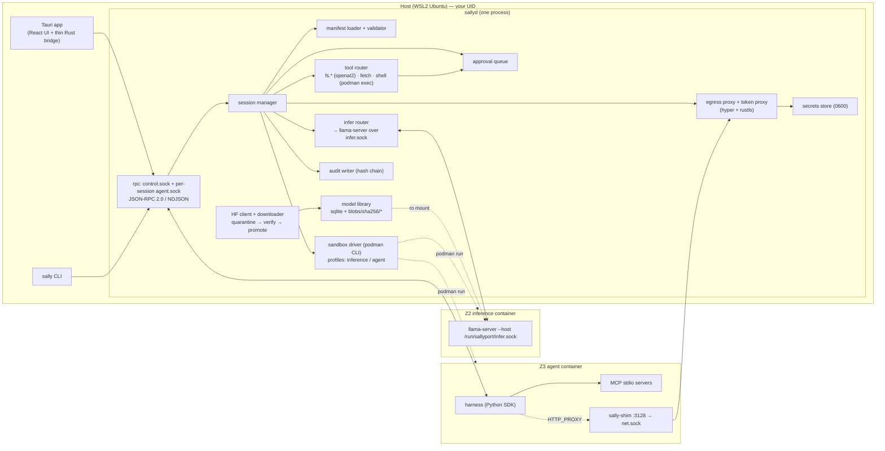
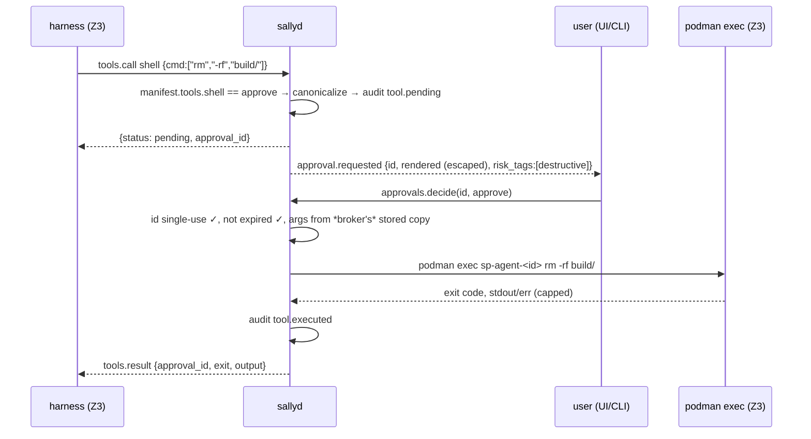

# Sallyport — Architecture (v1)

## 1. Stack, and where it departs from the original design

| Layer | Choice | Notes |
|---|---|---|
| Broker, sandbox orchestration, model validation, proxies, CLI | **Rust** (`tokio`, `hyper` 1.x + `rustls`, `rustix` for `openat2`, `rusqlite`, `serde`, `schemars`, `clap`, `tracing`) | Memory safety exactly where untrusted bytes are parsed. `#![forbid(unsafe_code)]` in every crate. |
| Desktop shell + UI | **Tauri v2** + React + TypeScript (Vite) | Kept. The Rust side of Tauri is a *thin client* of `sallyd`; the webview gets no fs/shell plugins. |
| Inference | **llama.cpp `llama-server`** in our own CUDA image | Kept. Pinned commit, built with `-DCMAKE_CUDA_ARCHITECTURES="86;89;120"`, CUDA 12.9. Prebuilt images lack sm_120. |
| Sandboxing | **Podman rootless + crun**, GPU via CDI | See THREAT_MODEL §6 for why not gVisor/microVM on WSL2 in v1. |
| Reference harness + SDK | **Python 3.12** | Runs inside Z3; language has no security weight; maximizes moddability. |
| Training sidecar | **deferred to v2** | Not in v1 at all. |

**Two deliberate deviations from the original requirements:**

1. **The broker is a separate daemon (`sallyd`), not a library inside the Tauri process.** Tauri
   starts it as a sidecar and the CLI talks to the same socket. Reasons: the UI crashing must not
   kill sandboxes; CLI and UI coexist; M1 is CLI-only and must not depend on Tauri; one process
   holds secrets, not two.
2. **"Egress proxy" is not a network proxy the sandbox can route to — the sandbox has no network.**
   Every container runs `--network=none`. A tiny static binary (`sally-shim`) inside the agent
   sandbox listens on `127.0.0.1:3128` and forwards each TCP connection over a bind-mounted Unix
   socket to `sallyd`, which speaks HTTP-proxy (CONNECT / absolute-form) and applies policy. This
   kills DNS exfiltration, raw-socket exfiltration and any "find the gateway" tricks by
   construction, and it needs zero iptables, which rootless Podman can't give us anyway.

## 2. Components



### 2.1 `sallyd` modules (crate `sallyd`, library crate `sally-core` for pure logic)

| Module | Responsibility | Trust-critical? |
|---|---|---|
| `sally-core::manifest` | Parse (strict), validate (denylist, realpath, wildcard rules, secret refs), summarize (plain English), JSON Schema export | **yes** |
| `sally-core::model::{gguf,safetensors,detect,hash,import}` | Format detection by magic, bounded parsers, SHA-256, zip import hardening, fit estimation | **yes** |
| `sally-core::audit` | Hash-chained NDJSON writer, verifier, redaction of secret values and oversize args | yes |
| `sally-core::secrets` | Load/store 0600 TOML; `Secret` newtype with redacted `Debug`, `zeroize` on drop; name-only references everywhere else | **yes** |
| `sally-core::hf` | HF Hub API client (search, repo files with LFS sha256, Range fetch of GGUF header), resumable downloader to quarantine | no (but handles untrusted bytes → bounded) |
| `sally-core::library` | SQLite index of blobs; content-addressed store; immutability (`chmod 0444`) | yes |
| `sallyd::sandbox` | Build `podman run` argv from manifest + profile; mount prep (realpath re-check, socket dirs); launch/exec/kill/wait; image digest check | **yes** |
| `sallyd::rpc` | Two listeners: `control.sock` (trusted methods) and per-session `agent.sock` (restricted methods); NDJSON framing; `SO_PEERCRED` UID check; request size limits | **yes** |
| `sallyd::session` | Lifecycle: validate → ensure inference loaded → create socket dir → launch agent → wire → monitor → teardown (always, even on panic — `Drop` guard) | yes |
| `sallyd::infer` | Pool of at most one loaded model (v1); start/stop inference container; forward OpenAI-compatible requests over `infer.sock`; validate request JSON (allowed fields, size caps); stream back | yes |
| `sallyd::tools::{fs,fetch,shell}` | Brokered tools with policy + approvals | **yes** |
| `sallyd::approvals` | Queue, canonicalization, rendering sanitization, single-use IDs, timeout, flood control, notifications to UI/CLI | **yes** |
| `sallyd::egress::{server,policy,addr,net,…}` | Accept streams from `net.sock`; parse the request head (bounded, CONNECT only in v1); policy decision; host addresses → resolve → filter → pinned connect; CONNECT splice. Grant hosts are refused until the token proxy (`inject`, Task 9a) terminates TLS for them | **yes** |
| `sally-shim` (separate crate, musl static, std only) | generic relay (AMENDMENTS-01 §3.3): `--listen LOOPBACK_IP:PORT=/abs/sock` (repeatable; `127.0.0.1:3128` → `net.sock`, `127.0.0.1:8080` → `llm.sock`) with one fresh UDS connection per TCP connection, opaque bidirectional copy with fixed 16 KiB buffers, half-close propagated, at most `--max-connections` (default 32, shared by all listeners; each costs two threads against the sandbox's `pids` limit) live connections, and a 30 s linger for a client that never closes after the server finished; `--stdio /abs/sock` for stdio clients. Parses nothing, holds no policy, listens on IPv4 loopback (127/8) only (`::1` too is refused); `make shim-check` keeps it static and dependency-free | low (dumb, inside the sandbox) |
| `sally-proto` | Shared request/response types; `ts-rs` generates TypeScript for the UI | no |
| `sally` CLI | `doctor`, `manifest validate`, `models …`, `secrets …`, `sandbox run`, `run`, `chat`, `approvals`, `audit tail\|verify`, `sessions …` | no |

## 3. Process and sandbox layout

### 3.1 Host filesystem
```
~/.config/sallyport/
  config.toml                 # paths, podman binary, image digests; [sandbox] runtime, runtime_path
  secrets.toml                # 0600; name = "value"
  manifests/*.yaml            # user manifests
~/.local/share/sallyport/
  library/library.db          # sqlite
  library/blobs/sha256/<hex>  # immutable 0444 model files
  library/quarantine/<uuid>/  # downloads before verification
  audit/audit-YYYYMM.jsonl    # hash-chained; audit.head = newest {seq, hash}; audit.lock
  sessions/                   # 0700
  sessions/<id>/              # 0700, created fresh per session (#10)
  sessions/<id>/profiles/     # the embedded seccomp profiles, written 0600 at launch
  sessions/<id>/stage/<n>/{upper,work}   # staged mount n: kept for `sally session changes`;
                                         # sandbox::staged_changes lists upper/ (RT-FS-15)
  sessions/<id>/git/<k>/{upper,work}     # .git overlays of rw mounts: discarded at teardown
  podman/                     # 0700: hermetic podman (#11, §3.5)
  podman/containers.conf      #   generated at startup; CONTAINERS_CONF of every podman call
  podman/config/              #   empty; XDG_CONFIG_HOME of every podman call
  podman/hooks/               #   empty; --hooks-dir of every podman call
  podman/mounts.conf          #   empty; --default-mounts-file of every podman call
  logs/
  bin/crun -> crun-<version>  # pinned upstream OCI runtime (static, signature-verified); the
                              # default sandbox.runtime_path. Never the distro crun (AMENDMENTS-02 B5)
$XDG_RUNTIME_DIR/sallyport/   # $XDG_RUNTIME_DIR must be ours and 0700 (checked at launch)
  control.sock                # 0600; CLI + UI
  infer/<instance-id>/infer.sock   # created by llama-server inside Z2
  sessions/<session-id>/      # 0700, created fresh per session
  sessions/<session-id>/workspace/net.sock   # created by sallyd, workspace role only (proxy mode)
  sessions/<session-id>/harness/{llm,agent}.sock   # created by sallyd, harness role only
```

### 3.2 `podman create` argv: common prologue (normative)
Built by the pure `sallyd::sandbox::{workspace,harness,inference}_argv` (one container per role,
AMENDMENTS-01 §2). The verb is `create`: the launcher checks the created container before it
starts it (§3.5). Every builder checks its own output with `check_argv` against a per-role
policy (`Allowed`), an **allowlist**:
- the global options exactly `--runtime <the checked runtime> --hooks-dir <Sallyport's empty
  hooks directory> --default-mounts-file <Sallyport's empty mounts file>`, then `create`;
- one spelling per option: `--flag value` for the options written that way below, `--flag=value`
  for the others, bare flags without a value; the other spelling is refused;
- only the options below, each with its exact value or value shape (`--user` is the session's
  ids, the seccomp profile is the role's file under the profiles directory, `--device` only
  `nvidia.com/gpu=all` and only for inference, environment variables only the role's exact
  name/value pairs plus `expose_env` placeholders);
- every option at most once (mounts, variables and `--security-opt` kinds included), every
  hardening option exactly once;
- every `-v` source a declared source of that role at its declared guest path: `ro` grants only a
  read-only bind, `rw` a read-write bind plus binds and overlays of paths inside it at the
  matching guest path, `staged` only an overlay; overlay upper and work directories only inside
  the session's scratch directory, and no two of them equal or nested; another role's socket
  directory is never a source (SI-2); `/` is never a source, scratch or profile directory;
- the image in the shared digest-pinned grammar (`sally_core::manifest::is_pinned_image_ref`:
  never a Podman transport such as `dir:` or `docker-daemon:`, SI-11);
- the command after the image exactly the role's fixed command.

The snapshots in `crates/sallyd/tests/snapshots/` are the normative examples.
```
podman --runtime <checked runtime_path>          # AMENDMENTS-02 B5: never the distro crun
  --hooks-dir <data>/podman/hooks                # empty, Sallyport-owned (#11)
  --default-mounts-file <data>/podman/mounts.conf  # empty: no system mounts.conf (6b review)
  create --rm --name sp-{ws|h|infer}-<id>
  --pull=never --http-proxy=false --log-driver=none --ulimit core=0   # AMENDMENTS-01 §6.1
  --network=none --no-hosts          # NOT --dns=none: Podman 4.9 rejects it with --network=none (preflight V4)
  --read-only --read-only-tmpfs=false
  --cap-drop=ALL --security-opt no-new-privileges
  --security-opt seccomp=<data>/sessions/<id>/profiles/seccomp-{workspace|harness|inference}.json
  --security-opt label=disable
  --userns=keep-id --user <uid>:<gid>
```
`label=disable`: the mounts are the user's own directories, which SELinux would only allow after relabelling (`:z`/`:Z` rewrites host labels); keeping SELinux confinement on SELinux hosts is #29 (M6).
`--user` is the caller's own `getuid`/`getgid` (the snapshots' `1000:1000` is the fixture's): with `keep-id` that is the host user inside, so `rw` writes stay the user's.
Bind mounts are `<host>:<guest>:{ro|rw},nosuid,nodev,bind` (`bind` = non-recursive). Overlays
are `<host>:<guest>:O,upperdir=<scratch>/upper,workdir=<scratch>/work` with nothing else: Podman
4.9.3 refuses other options next to `O` (probed in Task 6a), so overlays are not `nosuid,nodev`;
`no-new-privileges`, `--cap-drop=ALL` and the seccomp profile keep set-id files and device nodes
inert there.

### 3.3 Per role
**Workspace** (mounts, egress socket, toolchain; idles until the broker execs into it):
```
  --tmpfs /tmp:rw,{noexec|exec},nosuid,nodev,size=<tmp_size>
  --pids-limit <pids> --cpus <cpus> --memory <memory>b --memory-swap <memory>b   # no swap
  --init --env-host=false --hostname sandbox
  [--env {HTTP,HTTPS,ALL}_PROXY=http://127.0.0.1:3128 (and lowercase) --env NO_PROXY= --env no_proxy=]   # proxy mode
  [--env {SSL_CERT_FILE,REQUESTS_CA_BUNDLE,CURL_CA_BUNDLE,GIT_SSL_CAINFO,PIP_CERT,CARGO_HTTP_CAINFO,AWS_CA_BUNDLE}=/run/sallyport/ca-bundle.pem
   --env NODE_EXTRA_CA_CERTS=/run/sallyport/session-ca.pem]                                            # proxy mode + secrets
  [--env <expose_env>=sallyport-placeholder]
  -v <host>:<guest>:ro,…        # ro and brokered
  -v <host>:<guest>:rw,…        # rw; then from the launch scan (required for every rw mount, AMENDMENTS-02 B2(a)):
  -v <host>/<p>:<guest>/<p>:rw,…                               # every directory between the root and a .git entry, bound
                                                               # onto itself so it cannot be renamed away (EBUSY)
  -v <host>/<rel>/.git:<guest>/<rel>/.git:O,upperdir=<data>/sessions/<id>/git/<k>/upper,workdir=…/work
  -v <host>/<rel>/.git:<guest>/<rel>/.git:ro,…                 # .git files (worktree/submodule pointers)
  -v <host>:<guest>:O,upperdir=<data>/sessions/<id>/stage/<n>/upper,workdir=…/work      # staged (B2(b))
  -v $XDG_RUNTIME_DIR/sallyport/sessions/<id>/workspace:/run/sallyport:ro,…               # net.sock + CA bundle (connect only)
  <runtime.image or bundled workspace image>@sha256:<digest> /opt/sallyport/entry --idle
```
**Harness** (no mounts, no egress, no GPU; fixed 1 CPU, 1 GiB, 128 pids):
```
  --tmpfs /tmp:rw,noexec,nosuid,nodev,size=256MiB --pids-limit 128 --cpus 1 --memory 1GiB --memory-swap 1GiB
  --init --env-host=false --hostname sandbox
  --env OPENAI_BASE_URL=http://127.0.0.1:8080/v1 --env OPENAI_API_KEY=sallyport
  -v $XDG_RUNTIME_DIR/sallyport/sessions/<id>/harness:/run/sallyport:ro,…                 # llm.sock, agent.sock (connect only)
  <harness.image or bundled harness image>@sha256:<digest> /opt/sallyport/entry
```
**Inference** (GPU, one read-only model file):
```
  --tmpfs /tmp:rw,noexec,nosuid,nodev,size=256MiB --pids-limit 64 --cpus <n> [--memory <m>b --memory-swap <m>b]
  --init --env-host=false [--device nvidia.com/gpu=all]
  -v <blobs>/sha256/<hex>:/models/model.gguf:ro,…
  -v $XDG_RUNTIME_DIR/sallyport/infer/<id>:/run/sallyport:rw,…   # llama-server creates infer.sock
  <inference image>@sha256:<digest>
  llama-server --host /run/sallyport/infer.sock -m /models/model.gguf
               -ngl <n> -c <ctx> --jinja --no-webui -np 1 --log-disable
```
`-m` is always passed (without it llama-server boots as a multi-model router); `check_argv`
accepts exactly this command with only the `-ngl`/`-c` numbers varying, so `--models-dir`,
`--models-preset`, `--slot-save-path`, `--webui*`, `--path`, `--lora`, `-hf` and every other flag
are refused (AMENDMENTS-01 §6.2). Each role has its own socket directory; no role can see
another's sockets. Podman configuration outside the argv (`containers.conf`, `mounts.conf`, OCI
hooks, `CONTAINER_HOST`) is not covered by `check_argv`; hermetic podman (§3.5) controls it.

### 3.4 Seccomp
Start from `containers-common`'s default profile and **remove**: `mount, umount2, pivot_root,
chroot, ptrace, process_vm_readv, process_vm_writev, keyctl, add_key, request_key, bpf,
perf_event_open, userfaultfd, io_uring_setup, io_uring_enter, io_uring_register, unshare,
setns, kexec_load, kexec_file_load, reboot, swapon, swapoff, init_module, finit_module,
delete_module, acct, settimeofday, clock_settime, mknod, mknodat, personality, uselib,
vhangup, quotactl, lookup_dcookie, nfsservctl, open_by_handle_at, name_to_handle_at`, plus the
same capabilities under other names: the new mount API (`fsopen, fsconfig, fsmount, fspick,
move_mount, open_tree, mount_setattr`), `umount`, `stime, clock_settime64, clock_adjtime,
clock_adjtime64`, `quotactl_fd` and `pidfd_getfd`, and `socketcall` and `syslog` (6b security
review). Every remaining non-errno rule is a plain `SCMP_ACT_ALLOW`, and:
- `clone` is allowed only without namespace flags (`arg0 & 0x7E020000 == 0`, Docker's rule): no
  nested user, network, mount, PID, IPC, UTS or cgroup namespace, so no `CAP_NET_ADMIN` over
  nf_tables in a fresh network namespace. `clone3` is not allowed (its flags are in memory
  seccomp cannot read); it fails with ENOSYS and libc falls back to `clone`.
- `socket` is allowed per address family: `AF_UNIX`, `AF_INET`, `AF_INET6` and `AF_NETLINK`
  (`NETLINK_ROUTE` only, by equality) for workspace and harness, `AF_UNIX` only for inference. Every other
  family fails, in particular `AF_VSOCK`, which network namespaces do not isolate (on WSL2 and
  other VMs it reaches the host).
- Only native architectures are listed (x86-64, aarch64, no 32-bit sub-architectures), so the
  32-bit ABI (`int 0x80`, the unfilterable `socketcall`) never reaches an allow rule.

The profiles are `profiles/seccomp-{workspace,harness,inference}.json`, derived by
`scripts/gen_seccomp.py` from containers-common's profile and committed. They are embedded in
`sallyd` and written into the session's 0700 `profiles/` directory at launch (#10), so no file
outside Sallyport's control decides what a sandbox may call. Unit tests check the removals and
the inference socket filter independently of the generator; RT-FS-07 and RT-FS-09 test them in
a container.

### 3.5 Launch (normative, Task 6b)
`sallyd::sandbox::Launcher::launch_workspace`, in this order. The launch runs in its own task:
a caller that goes away cannot interrupt it, and a launch nobody receives is stopped again. Any
failure audits `sandbox.refuse` (or `sandbox.mount_mismatch`) with a reason and the cleanup
outcome. It removes the container by its name `sp-ws-<id>`, even when `create` printed no id,
and removes only the directories this launch created: an id whose directories exist is refused
before anything is created, so a stopped session's kept `stage/` is never touched. The claims
are released only once the container is confirmed gone.

1. **Overlap rule** (AMENDMENTS-02 B4, RT-AG-08b). Two live sessions may mount overlapping host
   directories (the same directory, or one inside the other) only when neither mount is `rw` or
   `brokered`. Overlap is decided by path and by identity. Each claim carries the
   `st_dev:st_ino` of its root and of every ancestor up to `/`, walked with `..` from an fd. A
   directory reached through a bind alias or a second mount of the same filesystem therefore
   still conflicts. No sandbox ever holds write access to an ancestor, a descendant or the same
   directory as another session's mount, so no live sandbox can swap what another session's
   launch scan pinned. `Launcher::remove_orphans` removes `sp-ws-*`/`sp-h-*` containers a
   previous `sallyd` left running (audited `sandbox.orphan_removed`); `sallyd` calls it before
   it accepts the first launch.
2. **Checks.** The runtime binary and the podman binary are re-checked (B5). Everything podman
   reads from Sallyport's state is re-checked too: the state directory is private, `hooks/` and
   `config/` are empty, `mounts.conf` is empty, and `containers.conf` is byte-identical to what
   was generated.
3. **Launch scan** (`scan_mounts`). One bounded walk per mount from a pinned directory fd,
   `openat2(RESOLVE_BENEATH | RESOLVE_NO_SYMLINKS | RESOLVE_NO_MAGICLINKS | RESOLVE_NO_XDEV)`
   (SI-8):
   - The mount root is opened without following any symlink, including in its ancestors, and
     must still be the validated `st_dev:st_ino` (RT-FS-06).
   - A Unix socket anywhere refuses the launch (`socket-in-mount`, RT-FS-13), in every mode and
     inside `.git` (git's fsmonitor socket): `connect` works on a read-only mount.
   - The walk never enters another filesystem mount, and never shields a mount point of any
     kind, directory or bind-mounted file. Non-recursive binds and overlays hide nested mounts
     from the sandbox (RT-FS-16). `statx` must report `STATX_MNT_ID` (kernel ≥ 5.8), or the
     scan refuses rather than walk blind.
   - In an `rw` mount, every `.git` directory and `.git` file is recorded, sorted, together with
     the identity of each of them and of every directory between it and the root. A `.git`
     symlink is neither shielded nor followed.
   - More than 32 shielded entries in one `rw` mount, 250 000 entries, a depth of 64, or 16 MiB
     of paths waiting to be listed, refuses the launch. For an `rw` mount the message recommends
     `staged`. Only the scanner can construct a `GitScan` or a `LaunchScan`, and a scan is
     bound to its manifest's mounts (realpath and identity).
4. **Session directories** (#10). `sessions/<id>` is created fresh and 0700 under both roots,
   along with the role socket directories, `profiles/` (with the embedded profiles written
   0600), and the overlay upper and work directories, each 0700. `$XDG_RUNTIME_DIR` must be
   owned by the user and 0700. Then the **image check** (`images.rs`, RT-SUP-01/02): hermetic
   `podman image exists` must find the pinned reference and `image inspect` must list the pinned
   digest among its `RepoDigests` (exactly one JSON list of strings; anything else is refused).
   Otherwise the launch is refused `digest-mismatch`; a podman error is refused as `podman`. The
   check exists for the clear reason only: enforcement is the digest reference plus
   `--pull=never` at `podman create`, so nothing depends on the gap between the two.
5. **Argv** (§3.2), then, with `network.mode: proxy` only, the **egress listener** (Task 8):
   `sessions/<id>/workspace/net.sock` is bound 0600 (through `/proc/self/fd` of the opened
   directory, so no path length can exceed `sun_path`) and served by the session's proxy. A bind
   failure is refused `egress-listener`. The listener lives with the running session: `stop`
   shuts it down after the container is gone (open tunnels audit `egress.close` with `end:
   session-stopped`), a failed launch drops it. Then **audit** `sandbox.launch` (SI-4: before
   anything is visible).
6. `podman create`; then every pin is re-checked on the host (`LaunchScan::recheck_host`), then
   `podman init`. The runtime builds the mounts but starts nothing.
7. **Post-init mount check** (B4). From the host, under `/proc/<init-pid>/root` with
   `RESOLVE_IN_ROOT | RESOLVE_NO_SYMLINKS`, every bind-mounted pin (mount roots, the `.git`
   parent self-binds, `.git` pointer files) must show its pinned `st_dev:st_ino`. On a mismatch
   the container is removed and `sandbox.mount_mismatch` is audited. Overlay lower layers report
   the overlay's own device, so they rely on step 6's host re-check and on the overlap rule.
   TODO(#15): the OCI config verifier runs here (Task 14).
8. `podman start`, then the **running check** (Task 6c): after a 250 ms grace, `podman inspect`
   must report the container running as the pid checked in step 7. `start` succeeds even when
   the entry point exits at once, and a container that exited is already gone (`--rm`). Either
   way the launch is refused (`not-running`), and everything it created is removed.

**Disk watchdog** (#14, Task 6c; maintainer design after the 6c-1 reviews). A sandbox writes to
the host disk through its `rw` mounts and through the upper directories of its `staged` mounts
and of its `.git` overlays. Each session whose sandbox can do either gets two tasks:

- **Free-space floor** (the hard, race-free guarantee; `disk.rs`).
  - It watches every filesystem the sandbox can write to: the state filesystem, when the session
    has staged mounts or `.git` overlays, and the filesystem of each `rw` mount root. Each is held
    by an `O_PATH` fd.
  - Every 250 ms it reads `fstatfs`. When the space available to unprivileged users falls below
    the floor, `max(4 GiB, 5 %)` by default, the session is killed. The audit reason is
    `disk_floor`, with the filesystem, the free bytes and the floor.
  - A `statfs` that fails or takes over 5 s fails closed.
  - A launch is refused (`disk-floor`) unless every watched filesystem has the floor free, plus
    `runtime.stage_size` on the state filesystem.
  - It reads the filesystem's own accounting, so renames, open unlinked files and `O_TMPFILE`s
    all count.
  - It never waits for a walk, the walk permit or the exec gate.
- **`stage_size`** (a soft limit).
  - There is no periodic walk. The floor task tracks the state filesystem's used bytes, and wakes
    the stage task only when they have grown past the session's headroom since the last accurate
    measurement. The baseline is lowered whenever usage shrinks, which is conservative.
  - The stage task takes the global one-walk permit, then the session's exec gate. An exec holds
    `Running::exec_gate` only while it starts, because a running exec process freezes with the
    container's cgroup (TODO(#24), Task 11). Then the stage task runs `podman pause` (the cgroup
    v2 freezer), walks the upper directories, and runs `podman unpause`.
  - The walk goes through directory fds, never follows a symlink, holds one fd per level, and is
    bounded at 1 000 000 entries, 64 levels and 10 s. The permit stays with the walk until it
    stops.
  - Because the sandbox is frozen, any error fails closed, including an entry that vanished.
  - Over the limit, unmeasurable, or past the deadline: that session is killed (reasons
    `stage_size`, `unmeasurable`). The audit entry names the area: `filesystem.mounts[n]` or
    `filesystem.mounts[n].git[j]`, never a host path.
  - Walks of one session are at least 2 s apart, or four times the last walk's duration if that
    is longer.

**Freeze hygiene.**
- A guard unpauses on every path except a kill, panics and cancellation included. If the unpause
  fails, the container is removed.
- A failed `unpause` after a walk kills the session (`unpause_failed`).
- A failed `pause` kills it (`pause_failed`), unless the container is gone; then the watchdog
  ends.

**Killing.** Every kill audits `session.resource_limit` first, then kills and removes the
container, retrying every 2 s until it is confirmed gone. It audits `session.kill_failed` once if
the first attempt fails. The kill happens even if an audit write fails.

Teardown stays with `Launcher::stop`, which keeps the staged data. Dropping the session's handle
stops both tasks and any walk in progress. A launch nobody received is stopped with retries
until its container is gone, and keeps its watchdog meanwhile.

**Teardown** (`Launcher::stop`) audits `sandbox.stop`, then runs `podman rm --force --time 0`
and confirms the container is gone (`podman container exists`). If it is not gone, the session
keeps its claims and the caller gets the handle back to retry. Otherwise teardown removes
`git/` and `profiles/` through `podman unshare` (overlay work directories belong to the
container's user namespace), removes the socket directory, keeps `stage/`, and releases the
overlap claims.

**Hermetic podman** (#11). Every podman process gets a cleared environment plus `HOME`,
`XDG_RUNTIME_DIR`, `XDG_DATA_HOME` (when set) and `PATH=/usr/bin:/bin:/usr/sbin:/sbin`. It also
gets:
- `CONTAINERS_CONF=<data>/podman/containers.conf`, generated at startup. On Podman 4.9.3 it
  replaces the system file, the user file and their drop-ins; probed in Task 6b.
  `CONTAINERS_CONF_OVERRIDE` would still be read, and it is never passed.
- `XDG_CONFIG_HOME=<data>/podman/config` (empty), so the user's `storage.conf`, `mounts.conf` and
  `registries.conf` are not read either.
- `--hooks-dir` naming the empty hooks directory and `--default-mounts-file` naming the empty
  mounts file. Rootless podman reads `mounts.conf` through that flag; the `containers.conf` key
  had no effect when probed in Task 6b.

The generated file has no default volumes, devices, capabilities, environment, sysctls,
ulimits, annotations or mounts. Namespaces are private, there is no keyring, events and logs are
off, and remote is off. The runtime, `conmon` and `catatonit` (`--init`) are explicit paths that
passed the runtime's ownership checks. The podman binary is resolved once
(`sandbox.podman_path`, else the first `podman` on `sallyd`'s `PATH`) and gets the same checks.
Every podman command has its output capped at 64 KiB per stream and is killed after 120 s.

**Consequences.**
- A user whose image store is configured through `~/.config/containers/storage.conf` (a
  non-default `graphroot`) must move it to the default location. `sally doctor` will report it.
- On Podman 4.9.3, a `staged` mount over a folder with another filesystem mounted inside it
  cannot launch: the runtime refuses the overlay in the keep-id user namespace (`EINVAL`, probed
  in Task 6b). The launch fails closed after `init`, and nothing runs.

## 4. Broker API

Transport: JSON-RPC 2.0, newline-delimited JSON over Unix stream sockets. Max frame 1 MiB
(control) / 256 KiB (agent) except `infer.complete` bodies (4 MiB). Notifications stream events.
Errors use JSON-RPC codes plus `data.reason`.

### 4.1 `control.sock` — trusted clients (CLI, Tauri)

| Method | Purpose |
|---|---|
| `doctor.run` | environment checks (returns the V1–V9 table results) |
| `manifests.list` / `manifests.get` / `manifests.validate` / `manifests.save` / `manifests.summary` | manifest CRUD + plain-English summary |
| `models.list` / `models.inspect` / `models.import` (path) / `models.remove` / `models.fit` (model, ctx) | library |
| `hf.search` (query, filters) / `hf.files` (repo, revision) / `hf.pull` (repo, file) → job id | Hugging Face |
| `jobs.list` / `jobs.cancel`; notification `job.progress` | long-running work |
| `infer.load` (model) / `infer.unload` / `infer.status` | inference lifecycle |
| `chat.complete` (session-less chat using the loaded model; same body as `infer.complete`) | Chat screen |
| `sessions.create` (manifest, task, model?) / `sessions.list` / `sessions.stop` / `sessions.attach` | agent sessions |
| `ui.send` (session, text) — user → harness; notification `ui.message` — harness → user | chat with an agent |
| `approvals.list` / `approvals.decide` (id, approve\|deny\|deny_all_session); notification `approval.requested` / `approval.flood` | gate |
| `secrets.set` (name, value) / `secrets.list` (names only) / `secrets.remove` | store; values are write-only |
| `audit.tail` (filter, follow) / `audit.verify` | log |

### 4.2 `agent.sock` — untrusted client (the harness). **Method table is a strict allowlist.**

| Method | Behavior |
|---|---|
| `session.info` | task text, manifest summary, tool list, model name |
| `infer.complete` (OpenAI chat-completion body) | validated (allowed fields, max tokens ≤ manifest, size cap) and forwarded to Z2; streamed back as `infer.delta` notifications then `infer.done` |
| `tools.list` | tools granted by manifest, with JSON schemas |
| `tools.call` (name, args) | dispatch → policy → (approval) → execute → result. Returns `{status: "ok"\|"denied"\|"pending", approval_id?}`; on pending, a later notification `tools.result` carries the outcome |
| `ui.post` (text) / `ui.next_input` (blocking, timeout) | converse with the user through the UI/CLI |
| `audit.note` (text ≤ 4 KiB) | harness may annotate its own trail (rate-limited) |

Everything else → `-32601`. The `net.sock` stream channel is not JSON-RPC; it carries raw proxy
connections from the shim.

### 4.3 Built-in tools (brokered)

| Tool | Args | Policy |
|---|---|---|
| `fs.list` | `{path}` | path must resolve inside a mount; `ro\|rw\|brokered` all allowed |
| `fs.read` | `{path, offset?, len?}` | same; size cap |
| `fs.write` | `{path, content_b64}` | `brokered` mounts only (rw mounts: write directly in the sandbox); `approve.writes` globs → pending |
| `fs.delete` | `{path}` | `brokered` only; `approve.deletes` globs → pending |
| `fetch` | `{url, method?, headers?, body?}` | goes through the same egress policy + injection as the proxy; response capped and redacted |
| `shell` | `{cmd: [..], cwd?}` | `deny` → denied; `approve` → pending; `allow` → run unless destructive-tagged; executes via `podman exec` **inside the same Z3 container**, output streamed, capped |

All `fs.*` paths are resolved relative to the mount's pinned `O_PATH` fd with
`openat2(RESOLVE_BENEATH | RESOLVE_NO_SYMLINKS | RESOLVE_NO_MAGICLINKS)`.

## 5. Data flows

### 5.1 Pull a model from Hugging Face
```mermaid
sequenceDiagram
    participant UI
    participant D as sallyd
    participant HF as Hugging Face
    participant LIB as library
    UI->>D: hf.files(repo)
    D->>HF: GET /api/models/{repo}?blobs=true (HF token from store, host only)
    HF-->>D: siblings[] {rfilename, size, lfs.sha256}
    D->>HF: GET resolve/{file} Range: 0-4194303 (GGUF header only)
    D-->>UI: quants with sizes, metadata, fit badge (VRAM/RAM estimate)
    UI->>D: hf.pull(repo, file)
    D->>D: check free disk ≥ size + 5%
    D->>HF: GET resolve/{file} (resumable) → quarantine/<uuid>/
    D->>D: ext allowlist → magic → strict header parse → sha256 == lfs.sha256?
    alt any check fails
        D->>D: delete quarantine, audit model.refuse(reason)
        D-->>UI: error with reason
    else ok
        D->>LIB: mv → blobs/sha256/<hex>, chmod 0444, insert row
        D-->>UI: job.done; audit model.import
    end
```

### 5.2 Agent tool call with approval


### 5.3 Egress with credential injection
```mermaid
sequenceDiagram
    participant P as pip / fetch tool / curl (Z3)
    participant S as sally-shim (Z3)
    participant E as egress proxy (sallyd)
    participant X as api.github.com
    P->>S: GET http://api.github.com/user  (HTTP_PROXY=127.0.0.1:3128)
    S->>E: new UDS connection, bytes copied
    E->>E: parse request-target → authority api.github.com:80→443 rule? allowed ✓
    E->>E: secrets map has api.github.com → inject "Authorization: Bearer ****"; strip client Authorization; strip Accept-Encoding
    E->>E: resolve → filter (no loopback/private) → pin IP
    E->>X: TLS (rustls, SNI api.github.com) GET /user
    X-->>E: 200 body
    E->>E: redact any occurrence of the secret value; do not follow 3xx
    E-->>S: response
    S-->>P: response
    E->>E: audit egress.close {host, port, address, bytes_up, bytes_down, end} (egress.allow {host, port, addresses, injected: GITHUB_TOKEN} was written before the connect; §7)
```
For `CONNECT host:443` (TLS from the client) the proxy applies policy and splices bytes; no
injection is possible or attempted.

### 5.4 Session start
`sessions.create` → validate manifest (again) → resolve model → `infer.load` if needed (Z2 up,
health check over `infer.sock`) → create session dir + `agent.sock` (+ `net.sock`) → re-check
mounts (TOCTOU) → `podman run` Z3 → wait for harness `session.info` within 30 s → `running`.
Teardown on stop/timeout/crash: `podman kill`, remove session dir, audit `session.stop`.

## 6. Repository structure

```
sallyport/
├── CLAUDE.md
├── THREAT_MODEL.md
├── SECURITY.md                      # M6
├── README.md
├── Cargo.toml                       # workspace; [workspace.lints] forbid unsafe, clippy pedantic subset
├── rust-toolchain.toml              # pinned stable
├── deny.toml                        # cargo-deny: licenses, advisories, bans
├── Makefile                         # dev, test, redteam, redteam-gpu, images, lint
├── crates/
│   ├── sally-core/                  # manifest, model parsers, audit, secrets, hf, library (no I/O side effects beyond fs)
│   ├── sallyd/                      # daemon: rpc, session, sandbox, infer, tools, approvals, egress
│   ├── sally-cli/                   # `sally`
│   ├── sally-shim/                  # static musl binary, std only
│   └── sally-proto/                 # shared types + ts-rs export
├── harness/
│   └── python/
│       ├── sallyport_sdk/           # Session, chat(), tools, ui
│       ├── reference_harness/       # ReAct loop
│       └── tests/
├── images/
│   ├── inference/Containerfile      # pinned llama.cpp commit, CUDA 12.9, arch 86;89;120
│   ├── inference-cpu/Containerfile  # CI + non-NVIDIA
│   ├── harness-python/Containerfile # python:3.12-slim@sha256, non-root, SDK, sally-shim
│   └── build.sh                     # builds, records digests into images/digests.lock
├── profiles/                        # embedded in sallyd; derived by scripts/gen_seccomp.py
│   ├── seccomp-workspace.json
│   ├── seccomp-harness.json
│   └── seccomp-inference.json
├── manifests/
│   ├── schema/manifest.v1.schema.json   # generated
│   └── examples/{chat-only,coding-agent,web-research}.yaml
├── app/                             # Tauri v2 + React/TS (M5)
│   ├── src/                         # React
│   └── src-tauri/                   # thin bridge: spawn sallyd sidecar, forward allowlisted RPC
├── tests/
│   ├── redteam/
│   │   ├── REDTEAM_SUITE.md
│   │   ├── harness/                 # Rust integration test runner: launch sandbox from fixture manifest, run attack, assert
│   │   ├── attacks/                 # shell/python attack scripts executed inside Z3
│   │   ├── fixtures/manifests/      # manifests per test
│   │   ├── corpus/                  # malicious GGUF/safetensors/zip generators (python, run on host)
│   │   └── mock_upstream/           # TLS mock server (echo, gzip echo, redirect) for SEC tests
│   └── e2e/                         # GPU-local end-to-end (tiny model)
├── fuzz/                            # cargo-fuzz targets: gguf, safetensors, manifest, proxy request parser
├── scripts/
│   ├── doctor.sh                    # V1–V9 checks (also surfaced via `sally doctor`)
│   └── install.sh                   # M6
├── docs/
│   ├── 00_DECISIONS.md  01_SCOPE.md  ARCHITECTURE.md  MANIFEST_SPEC.md  MILESTONES.md
│   └── reports/M*.md                # written by Claude Code at each milestone end
└── .github/workflows/
    ├── ci.yml                       # fmt, clippy -D warnings, test, cargo-deny, python lint/tests, ts lint/tests
    └── redteam.yml                  # rootless podman on ubuntu-24.04; make redteam; fails on any attack success
```

## 7. Key implementation notes

- **Verified on the dev machine (preflight 2026-11-09, `docs/reports/M0-preflight.md`)**: Podman
  4.9.3 + crun 1.14.1 rootless; GPU via CDI works rootless (spec auto-generated by
  `nvidia-cdi-refresh.service` into `/var/run/cdi/nvidia.yaml` — never generate a second copy by
  hand); `--network=none` leaves `lo` up and no `resolv.conf`; Unix sockets cross bind mounts in
  both directions under `--userns=keep-id`; `openat2` with `RESOLVE_BENEATH` works on kernel
  6.18 (first verified on 5.15.167); HF exposes the hash at `siblings[].lfs.sha256`. Minimum supported Podman is 4.9.
  Resource limits require cgroup v2, which on WSL2 needs `kernelCommandLine = cgroup_no_v1=all`
  in `.wslconfig` — `sally doctor` must check `podman info` reports `cgroups=v2` and fail loudly
  otherwise, because Podman silently *drops* `--memory`/`--pids-limit` on v1.
- **OCI runtime**: every `podman` call carries `--runtime <sandbox.runtime_path>`, which
  `sally_core::config::check_runtime_binary` has checked (regular executable, owned by the user or
  root, neither it nor its directory writable by group/others). The default is the pinned
  upstream crun (1.30.1 on the dev machine, minimum 1.25.1); doctor V1–V5 and V13 run with it,
  V14 reports its provenance. The distro crun 1.14.1 is never used.
- **Podman invocation**: shell out to the `podman` binary with `tokio::process::Command` and an
  argv built by a pure function `profile::argv(&Manifest, &SessionPaths) -> Vec<OsString>` that is
  unit-tested by snapshot (RT-SUP-01 also asserts digest pinning on it). No REST API in v1.
- **Unix socket bidirectionality with `--userns=keep-id`**: host UID == container UID, so
  `llama-server` can create `infer.sock` in a bind-mounted dir and `sallyd` can connect, and vice
  versa for `agent.sock`. Verify in M1 (V5).
- **VRAM fit estimate** (GGUF metadata keys `general.architecture`, `<arch>.block_count`,
  `<arch>.embedding_length`, `<arch>.attention.head_count`, `<arch>.attention.head_count_kv`):
  `weights = file_size`; `kv = 2 * n_layer * ctx * n_head_kv * (n_embd / n_head) * 2 bytes` (f16
  cache); `overhead ≈ 600 MiB` (CUDA context + compute buffers); fits if
  `weights + kv + overhead ≤ 0.92 * VRAM`. Partial offload: `gpu_layers = floor((0.92*VRAM - kv -
  overhead) / (weights / n_layer))`. RAM check: `weights + kv ≤ 0.8 * free RAM` for CPU fallback.
  Show three states: **Fits on GPU** / **Partial (N of L layers)** / **CPU only** / **Won't fit**.
  Calibrate against real llama-server VRAM readings in M3 and adjust the constant.
- **GGUF strict parser limits**: magic `GGUF`, version ∈ {2,3}, `tensor_count ≤ 65 536`,
  `kv_count ≤ 4 096`, string len ≤ 65 536 B, array len ≤ 4 194 304, nested arrays depth ≤ 2,
  tensor name ≤ 64 B and unique, `n_dims ≤ 4`, dims product via `checked_mul`, valid ggml type,
  offset aligned to `general.alignment` (default 32, must be power of two ≤ 65 536),
  `data_start + offset + nbytes ≤ file_len`. Parse header + tensor infos only; never read tensor
  data; never allocate proportional to an untrusted count before bounds are checked.
- **Safetensors strict check**: `header_len ≤ 100 MiB` and `8 + header_len ≤ file_len`; header is
  a JSON object; each entry has known `dtype`, `shape` (`checked_mul`), `data_offsets` ascending,
  contiguous, within `file_len - 8 - header_len`; `__metadata__` values are strings.
- **Proxy request parsing** (Task 8): `httparse` over one fixed 8 KiB buffer, ≤ 100 headers, all
  headers ignored (the decision reads the request-target only). Over 8 KiB or 100 headers: 431
  `head-too-large`; no complete head within 10 s: closed without a reply (`head-timeout`); not
  HTTP/1.x: 400 `malformed`; any method but `CONNECT` (absolute-form included): 405
  `plain-http-unsupported`. The authority is `host:port` with the port required; IP literals
  are refused in every spelling (`ip-literal`), userinfo is malformed. Then policy, the host's
  own addresses, one lookup (5 s), the address filter over every address (any denied address
  refuses the name), at most 3 pinned addresses tried (10 s each), `200`, and a tunnel with one
  16 KiB buffer per direction and a 300 s idle limit shared by both directions.
- **Egress audit events** (Task 8). Written at every `audit.level`, each before its effect:
  - `egress.allow` (decision `allow`), before the first dial and the `200`: `{host, port,
    addresses}` — the addresses that passed the filter, at most 16, in the order they are tried.
  - `egress.deny` (decision `deny`), before the reply: `{reason, target, target_bytes,
    target_cut}` (the request-target escaped and cut at 256 bytes, never a header), or `{reason,
    head_bytes}` when no target was parsed; `filter: "host-addresses-unavailable"` when the
    host's own addresses could not be read.
  - `egress.limit` (decision `deny`): as `egress.deny`, for `too-many-connections` (decided at
    accept: `{reason}` only), `head-too-large` and `head-timeout`.
  - `egress.close` (no decision): `{host, port, connected, address (the one used, only when
    connected), bytes_up, bytes_down, end}`; `end` is `closed`, `idle-timeout`, `error`,
    `session-stopped` or `connect-failed` (with `connected: false`, written before the 502).
  - Reasons (reply body and `reason`): 403 `host-not-allowed`, `port-not-allowed`,
    `ip-literal`, `ip-range-denied`, `grant-host-unavailable`; 502 `resolve-failed`,
    `connect-failed`; 405 `plain-http-unsupported`; 429 `too-many-connections`; 431
    `head-too-large`; `head-timeout` (no reply); 400 `malformed`. Replies never echo the target.
- **Approval rendering**: escape all C0/C1 controls and `\x1b`, strip Unicode bidi overrides
  (U+202A–U+202E, U+2066–U+2069), NFC-normalize, cap at 2 000 chars with an explicit
  `… (+N bytes, sha256 …)` tail. Paths shown as *host realpath* **and** guest path.
- **Audit entry**: `{seq, ts, session, actor: user|harness|sallyd, event, decision, args
  (redacted, ≤ 4 KiB), args_sha256, prev_hash, hash}` with `hash = sha256(prev_hash ||
  canonical_json(entry_without_hash))`; canonical JSON is compact with the fields in that order
  and object keys sorted, and a reader rejects any line that is not byte-for-byte what the
  writer would produce. `args` longer than 4 KiB is stored as `{"truncated":true,"bytes":N}`.
  `args_sha256` hashes the **redacted** full args, never the raw ones (a hash of the raw value
  would let a short secret be brute-forced). Monthly files (UTC); the chain continues across
  files via the first entry's `prev_hash`, and files only rotate forward. `audit.head`
  (`{seq, hash}`, rewritten after every entry) makes deleting the newest entries detectable,
  because a prefix of a valid chain is itself valid; the log may be one entry ahead of it after
  a crash, which is accepted and repaired. A torn final line is dropped on open (the entry is
  written before the action, so the action never happened) and recorded as `audit.recovered`.
  `append` fsyncs before returning (entry, then head and its directory); on any error the caller
  must not perform the action, and a failed head update stops the writer. `sally audit verify`
  reads the head first and accepts a log that runs past it, so it is safe beside a live writer.
- **Redaction** (`sally-core::audit::Redactor`): the raw secret, its percent-encoding (both hex
  cases, and `+` for space), and its base64 in three alignments and both alphabets trimmed to the
  characters that do not depend on neighbouring bytes (patterns under 12 characters skipped), so
  the base64 of any string containing the secret is caught (AMENDMENTS-02 B1). Matches become
  `[REDACTED:NAME]`.
- **Tauri bridge**: Rust side exposes one command `rpc(method: String, params: Value)` that
  forwards to `control.sock` **only** for methods in a compile-time allowlist (no
  `secrets.list` of values exists anyway). Capabilities file grants `core:default` only.
  `WEBKIT_DISABLE_DMABUF_RENDERER=1` set at the top of `main()` on Linux. Markdown via
  `react-markdown` + `rehype-sanitize` (default schema minus `img`), no `rehype-raw`.

## 8. CI and tooling

Required on every PR (`.github/workflows/ci.yml`; every action pinned by commit SHA, default
`permissions: contents: read`, **no caches**: no build output or tool binary restored from a
cache decides a gate, because a poisoned cache entry would print whatever version it is asked for.
Tools are built with `cargo install --locked --version <pinned>`; a later speed-up may switch to
upstream release binaries checked against committed SHA-256 sums):

| Job | Gate |
|---|---|
| `rust` | `make fmt clippy forbid-unsafe nextest` (cargo-nextest, plus doctests) |
| `deny` | `cargo deny check` for the workspace and `fuzz/` |
| `coverage` | `make coverage`: cargo-llvm-cov, `sally-core` ≥ 90 % lines; every file under `sallyd/src/egress/` ≥ 85 % together (lib tests, `scripts/coverage-gate.sh`); approvals join when they exist |
| `fuzz` | 60 s per cargo-fuzz target on a pinned nightly |
| `zizmor` | GitHub Actions static analysis, offline, no findings at `low` or above |
| `doctor-syntax` | `bash -n scripts/doctor.sh` |

Nightly (`nightly.yml`): `make mutants`, cargo-mutants over the deny paths
(`manifest::validate`, `paths`, `host`, `config` today; `approvals`, `tools::fs` as they land;
the egress modules run in the wide job, `make mutants-wide-sallyd`) with a **zero-survivor gate**: a surviving mutant in a deny path is an untested
control. cargo-mutants runs with `TMPDIR` under `target/` because `/tmp` is denylisted.

Dev-dependencies: `insta` (summary and diagnostic snapshots; review changes with
`cargo insta review`) and `proptest` (wildcard matcher, host-pattern round trip; redaction
windows in task 9b). Dependabot opens weekly PRs for cargo (workspace and `fuzz/`) and GitHub
Actions; nothing auto-merges. Release provenance (build attestations, cosign) is M6.

